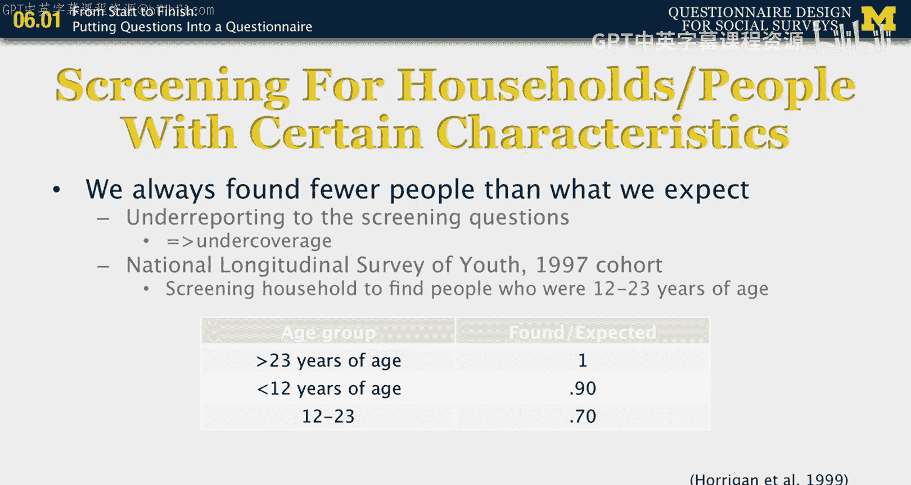

#  073：从设计到实施：问卷编排全流程 📋

在本节课中，我们将学习如何将设计好的单个问题整合成一份完整的问卷。我们将探讨问卷的编排流程，包括如何安排各个部分、如何设计友好的布局，以及如何根据不同的数据收集模式进行调整。

---

上一节我们介绍了问卷中单个问题的设计。本节中，我们来看看如何将所有问题系统地组织起来，形成一份有效的调查工具。

## 第一步：引言设计

一份问卷的开头至关重要，它决定了受访者是否愿意并能够正确地参与调查。引言应清晰、简洁，并包含必要信息。

以下是引言中应包含的核心要素：

*   **调查主体**：说明是谁在进行这项研究。
*   **研究目的**：简要说明调查是关于什么的。
*   **时间预估**：告知受访者完成问卷大致需要多长时间。
*   **保密性与自愿性**：明确告知参与是自愿的，并且他们的回答将被保密。通常伦理审查委员会会要求包含此项。
*   **联系方式**：如果适用，提供当地或机构伦理审查委员会代表的联系方式。

引言的内容会根据数据收集模式而变化：

*   **访谈员主导的调查**：信息通常包含在“上门介绍”中，访谈员经过培训，可以根据受访者的反应灵活介绍。
*   **自填式调查**：所有信息都需要在“预先通知信”或网络调查的“帮助链接”中明确写出。

此外，调查的性质也会影响引言：

*   **固定样本调查**：在后续轮次中，只需提供部分新信息，因为许多内容已在首轮招募时告知。
*   **横断面调查**：通常需要提供更全面的介绍信息。

## 第二步：筛选模块

在引言之后，许多调查会包含筛选问题。这些问题的目的是确定受访者或家庭是否符合调查的目标人群标准。

以下是使用筛选问题的几种常见情况：

*   **目标人群调查**：例如，只调查家中有孩子的家庭，或特定年龄段的成年人（如35-55岁）。
*   **一般人群调查中的户内抽样**：即使面向一般人群，也可能需要从家庭中随机选择一人接受访问，而非访问所有成员。这个过程需要脚本化，并成为问卷的一部分。

户内随机抽样的方法主要有以下几种：

1.  **完全概率方法**：需要完整的家庭成员名单。最著名的是**基什表法**。首先请受访者列出所有家庭成员的姓名和年龄，然后使用一个类似随机数表的“基什表”随机选择一人。这种方法科学但耗时，可能让受访者感到侵扰。
2.  **准随机概率方法**：无需完整名单。最流行的是“**下次/上次生日法**”。访谈员会问：“为了确定访问谁，请问您家中所有18岁及以上的成年人中，谁最近刚过生日？”这种方法假设生日是随机的，从而进行准概率抽样。它负担较轻，但“生日非完全随机”是其潜在弱点。
3.  **非概率方法**：无需家庭名单，通常旨在根据人口特征（如确保年轻男性的受访比例）获取样本，但牺牲了随机性。
4.  **混合方法**：基于家庭规模的混合选择方法，如“R法”。

## 第三步：核心问卷与人口统计问题

通过筛选模块后，便进入问卷的核心部分。核心问卷应逻辑清晰，问题顺序由易到难，由一般到具体。

一个重要的编排原则是：**人口统计问题（如年龄、收入、教育程度）通常放在问卷末尾**。这是因为：
*   这些问题可能涉及隐私，放在开头容易导致拒访。
*   在受访者完成主要部分后，建立了初步信任，更可能回答这些敏感问题。

## 第四步：问卷结尾

问卷的结尾应与开头一样经过精心设计。它通常包括：
*   **感谢语**：真诚感谢受访者的时间和参与。
*   **再次保证**：重申数据的保密性。
*   **后续步骤**（如适用）：例如，告知他们如何查询结果，或如果参与的是固定样本调查，下一轮访问的大致时间。
*   **联系方式**：再次提供研究团队的联系方式，以备受访者有疑问或需要更多信息。

## 第五步：模式考量与选择

在设计问卷编排时，必须考虑数据收集的模式，因为不同模式对问卷设计和流程有直接影响。

以下是不同模式下的关键考量：

*   **面对面访谈**：可以利用视觉辅助工具，流程可由访谈员灵活控制。需要训练访谈员处理复杂的跳转逻辑。
*   **电话访谈**：完全依赖听觉，问题必须极其清晰。跳转逻辑需要预先编程到计算机辅助电话访问系统中。
*   **网络自填**：可以包含丰富的视觉元素和互动功能。跳转逻辑自动执行，但需要确保界面在不同设备上都能友好显示。
*   **纸质自填**：设计必须一目了然，跳转指令（如“如果选‘是’，请跳至第5题”）必须非常明确，因为无法自动执行。

选择模式时，需权衡成本、覆盖率、数据质量以及调查主题的敏感性。

---

本节课中，我们一起学习了问卷从设计到实施的全流程编排。我们从**撰写清晰的引言**开始，讨论了如何通过**筛选模块**确定目标受访者，然后规划了**核心问题与人口统计问题的顺序**，并设计了得体的**结尾部分**。最后，我们强调了**数据收集模式**对问卷设计的具体影响。记住，良好的问卷编排不仅能提升受访者的体验和合作意愿，也能显著提高最终收集数据的质量。