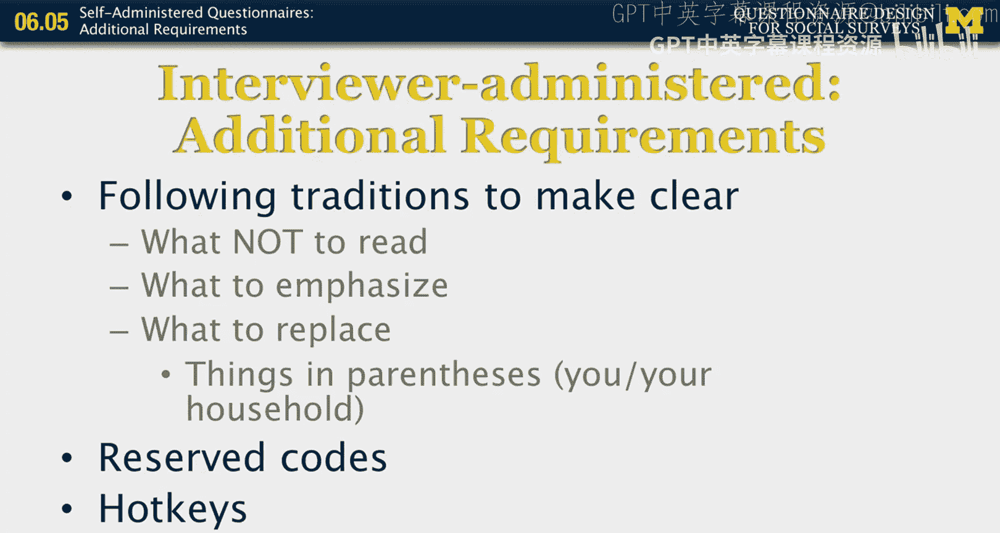

#  077：自填问卷的额外要求 📝

在本节课中，我们将探讨自填式问卷（如邮寄问卷）在设计时需要满足的额外要求。这些要求旨在提升问卷的可用性、数据质量与回复率。

---

## 核心要求：用户友好性

上一节我们介绍了问卷设计的一般原则，本节中我们来看看自填问卷的独特之处。其核心要求是**整体用户友好性**。

*   如果问卷看起来用户友好，将有助于**降低单位无回复率**。许多由唐·迪尔曼及其同事进行的研究都证实了这一点。
*   用户友好的设计也能**减少项目无回复**并**提升数据质量**。
*   如果受访者能清晰地知道他们需要做什么，整个问卷应能**激励受访者认真作答**。
*   如果问卷看起来**重要且专业**，受访者会认为值得花时间填写。
*   反之，如果问卷看起来连研究者自己都不在乎，受访者为何要回复？

**注意平衡**：设计不应过度。例如，一份问卷若设计得像精美的杂志，受访者可能更愿意将其留在候诊室翻阅，而非填写。因此，需要在保持科研问卷的专业性与吸引受访者作答之间找到平衡。

---

## 封面页与说明

以下是自填问卷封面页通常包含的要素：

*   **调查名称**。
*   **样本ID**或其他识别受访者的方式。这有助于追踪回复情况，识别无回复偏差，并决定向谁发送提醒。
*   **数据收集日期**。这在计算机辅助访问调查中通常由程序自动记录，但对于分析很有帮助（例如，可分析访问员随着时间推移可能产生的影响）。
*   **填写说明**。这些说明可放在封面页或附信中，但需确保受访者能方便地看到。
*   **常见问题解答**。例如，数据用途、如何填写及寄回问卷。
*   **相关图片**。研究表明，与受访者或其所在领域相关的图片可能产生积极效果，但同样不宜过度。

---

## 内部设计要素

在问卷内部，应包含一些便于填写和机器读取的设计特征：

*   **边缘编码**：帮助自动阅读设备对齐问卷。
*   **颜色编码**：区分不同部分。
*   **显著的答案填写处**：例如，清晰标记的方框，并注明期望的数字位数。
*   **清晰的问题顺序**。
*   **突出的答案类别提示**。

所有这些特征都有助于提升问卷质量。

---

## 格式建议：宜用与忌用

唐·迪尔曼提出了一些设计自填问卷的格式指南。

**应避免的格式：**

*   **避免在单张纸的正反面都印刷**，因为受访者容易忽略背面。
*   **避免仅左上角装订**，这样末页容易丢失，可能导致人口统计信息缺失。

**应考虑的格式：**

*   **采用横向印刷并折叠成小册子**，然后沿书脊装订。这能防止丢页，并使受访者在翻阅时注意到每一页。
*   对于不希望被注意的内容（如供录入员使用的答案编码），应通过视觉设计明确区分或尽量缩小，以免干扰受访者。
*   **利用视觉线索**（如相近的间距或阴影）表明内容属于同一主题，帮助受访者理解。
*   **所有问题垂直对齐**，避免混合水平与垂直布局，以免造成填写顺序混乱。
*   **使用窄列排版**，鼓励完整阅读，并让受访者有持续进展的感觉。
*   **确保问卷易于填写**，目标应是让填写过程简单、顺畅，甚至有趣，避免给人税务表格般的压迫感。
*   **避免将同一问题拆分到不同页面**，这会导致不必要的数据缺失。
*   **一次只问一个问题**。

---

## 问题结构示例

以下是一些具体的问题结构示例：

*   **低效结构**：将多个具有相同答案选项的问题机械地重复排列。例如：
    > 缺乏租赁住房的重要性如何？【选项】
    > 道路和街道维修差的重要性如何？【选项】
*   **高效结构**：将问题项分组列出，并共用一套答案选项。例如：
    > 以下各项对您的重要性如何？
    > A. 缺乏租赁住房 【选项】
    > B. 道路和街道维修差 【选项】

**注意**：不要强行共用答案选项，除非它们确实适用于所有问题。如果不确定，请回顾关于答案选项设计的章节。

---

## 访问员协助调查的额外要求

对于访问员协助的调查（如电话或面访），问卷设计需额外注意：

*   **明确标注**：清楚告诉访问员哪些内容**不应读出**，哪些需要**强调**，以及哪些需要**替换**（例如，括号内填入受访者姓名或当前日期）。
*   **提供快捷键**：在计算机辅助问卷中，为访问员设置快捷键，以便快速获取帮助功能。
*   **明确代码**：让访问员清楚知道代表“不知道”或需要记录特殊行为（如对某个问题讨论较多）的代码。

---

## 总结

本节课中我们一起学习了自填问卷设计的额外要求。核心在于通过**用户友好的整体设计**来提升回复率和数据质量。具体包括设计专业的**封面页与说明**、采用清晰的**内部布局与视觉线索**、遵循有益的**格式建议**以优化填写体验，以及避免低效的**问题结构**。最后，对于访问员协助的调查，需提供明确的操作指引。记住，在问卷的结尾，别忘了向受访者致以诚挚的**感谢**。