#  079：课程导论 🎯

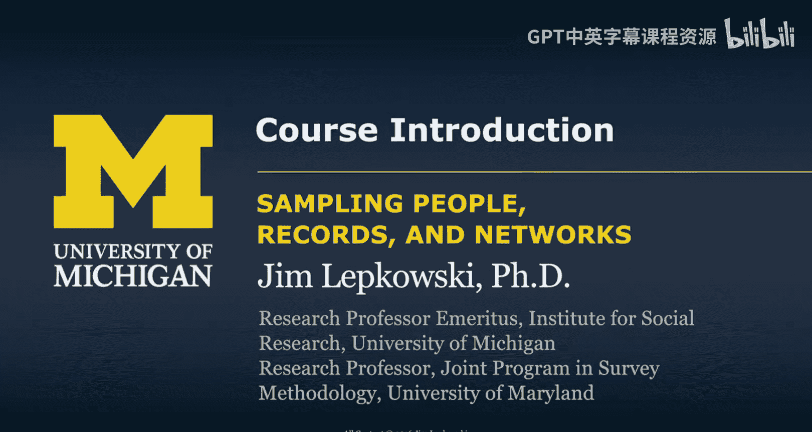

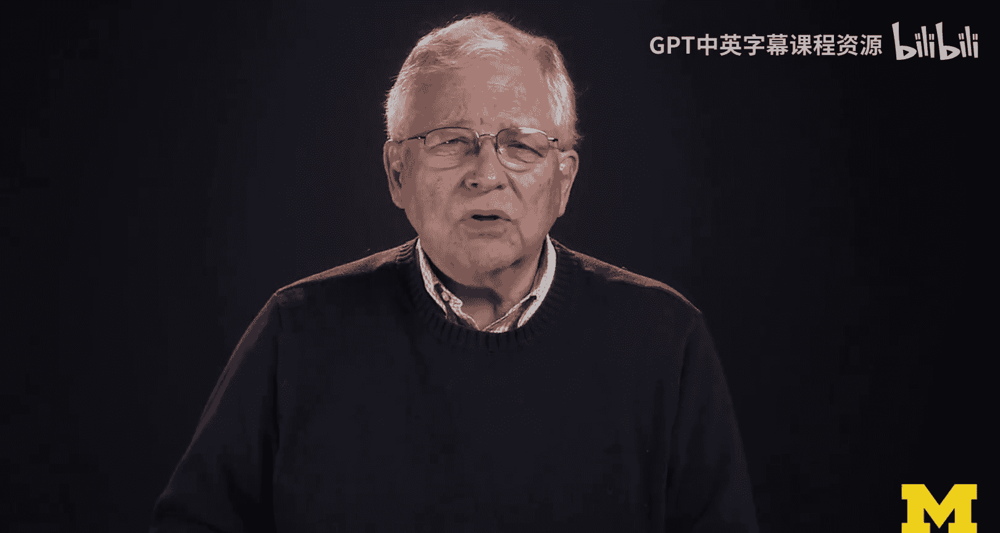

在本节课中，我们将学习抽样方法的基本概念及其在社会科学研究中的应用。我们将探讨抽样如何作为一种研究工具，并概述本课程将涵盖的核心主题。

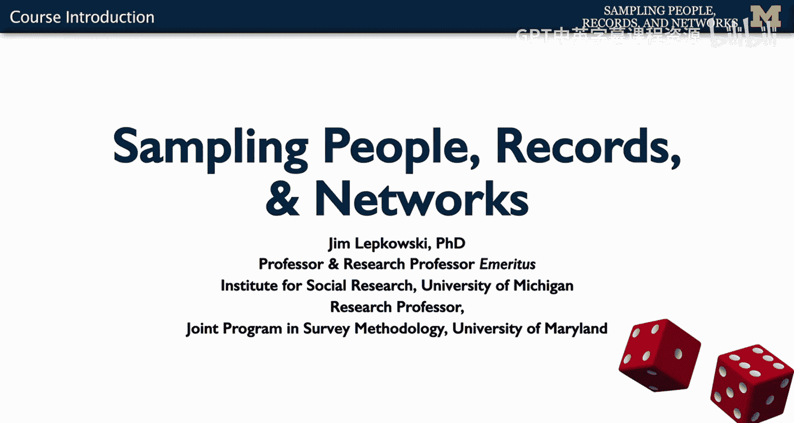

---

抽样是我们以多种方式进行的活动。我们在这里讨论的抽样活动范围是有限的，但需要承认抽样可以有许多不同的应用。

我们在日常生活中也会进行抽样，甚至没有意识到自己在这样做。例如，我们都会抽样品尝食物，或者体验娱乐活动。我们的身体也是抽样机器，例如视觉，我们不断对周围环境进行快速抽样。

在科学中，抽样同样普遍。例如，医生使用患者样本来推断所有人的疾病风险因素。物理学家使用环境样本来推断整个宇宙的规律。化学家在实验室中使用化学样品。在社会科学中，心理学家使用样本（有时是本科生）来推断不同年龄段人群的行为模式。

我们之所以这样做，是因为我们无法观察全部，只能观察一部分，这构成了基于抽样的操作。

然而，在科学甚至日常生活中，我们思考这些问题时，通常假设我们用来研究特定现象的环境是**均匀**的。例如，我们愿意假设疾病风险因素以相同方式影响每个人，即使我们只在特定时间、特定地点、特定环境中观察到了这些因素。我们常常愿意据此推断在其他时间、其他地点会发生什么。

很多时候，这种结论是完全合理的。但在本课程中，我们将更仔细地审视样本告诉我们的信息，而不是依赖关于“均匀混合”的假设。对于物理学家来说，假设环境混合均匀可能是安全的。但在社会和健康科学等领域，假设均匀性或随机混合可能会产生误导，认为一个样本与另一个样本在推断总体时同样有效。

在本课程中，我们将研究如何处理我们所处的非均匀、非混合世界。我们不会依赖关于人群、环境等分布情况的假设。相反，我们将研究**抽样方法**，这些方法通过**随机过程**进行选择，从而在样本中“强制”实现混合，而不是在总体中。这样，我们就能避免对总体做出或强或弱的假设，并避免因假设错误而产生的偏差。

因此，本幻灯片上出现了骰子图案。我们将与样本“玩骰子”——不是像爱因斯坦曾推测的那样与宇宙玩骰子，而是与样本以及我们如何构建样本玩骰子。

---

我们将通过几个步骤来探讨这个问题。本课程包含六个单元。

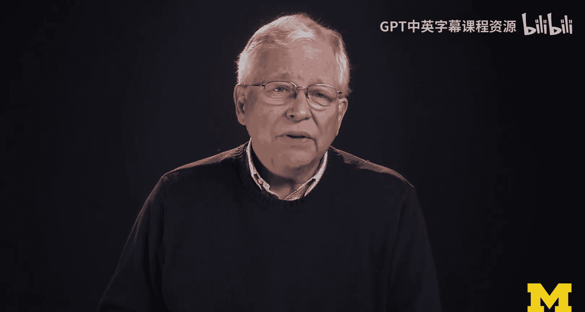

在**第一单元**，我们将讨论**研究设计**，以及抽样如何与调查一起作为研究工具协同工作。我们不会涵盖所有研究设计类型，而是重点关注**调查**、**调查抽样**以及与之相关的数据收集操作。

在本课程中，我们主要讨论在调查背景下的抽样思想。虽然课程名称涉及对人员、记录和网络的抽样，但记录通常是关于人员的记录，网络也是人群组，因此我们讨论的核心主要是**对人类进行抽样**。

接下来，在**第二单元**，我们将讨论**抽样技术**，即研究人员用于选择样本的过程。

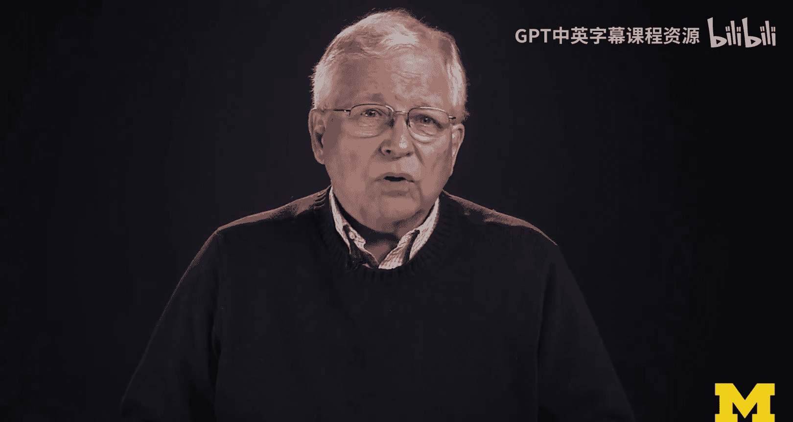

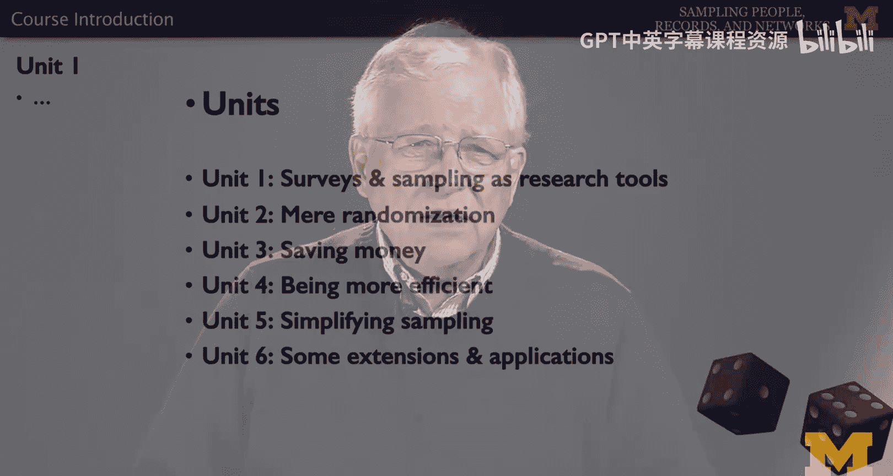

本课程将考虑三种基本工具（并非全部）。**第二单元**介绍第一种：**随机选择**。通常仅使用随机选择的抽样被称为**简单随机抽样**。本单元将探讨如果我们在选择过程中只使用随机化会发生什么。

**第三和第四单元**介绍另外两个因素，并引出一系列与每个因素相关的样本选择技术。

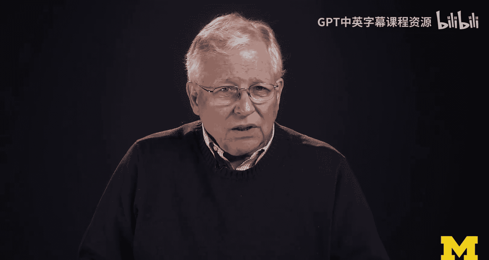

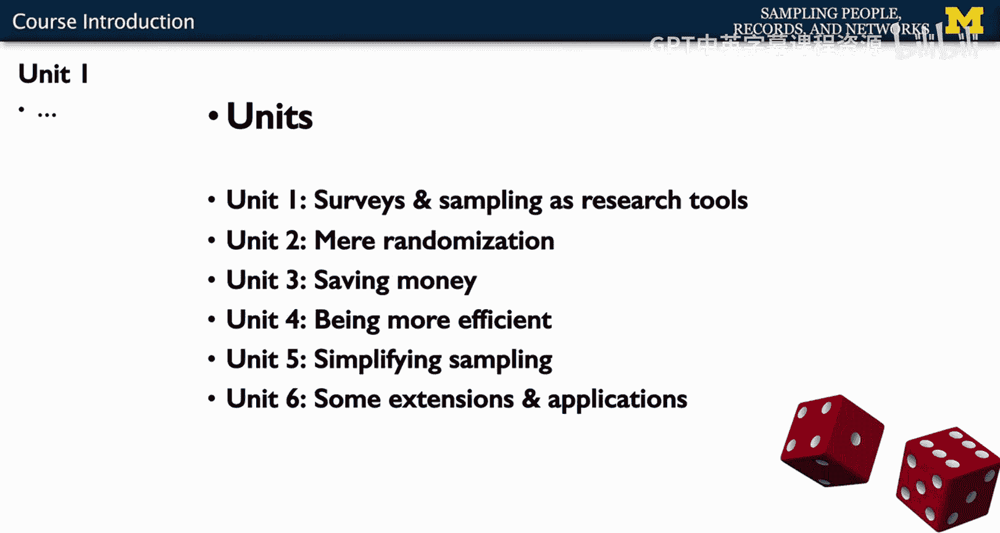

其中一种技术或方法涉及将总体元素**分组**，然后选择**组**而不是单个单位。这样做是为了**降低成本**，这被称为**整群抽样**。

我们处理的第二种技术也涉及分组，但这里是将总体样本分成不同的组或**层**。这种所谓的**分层**用于控制我们工作的**效率**和**有效性**。分层实际上可以让我们以几乎与简单随机抽样相同的成本获得更好的质量，因此它成为一种几乎会自动使用的技术。

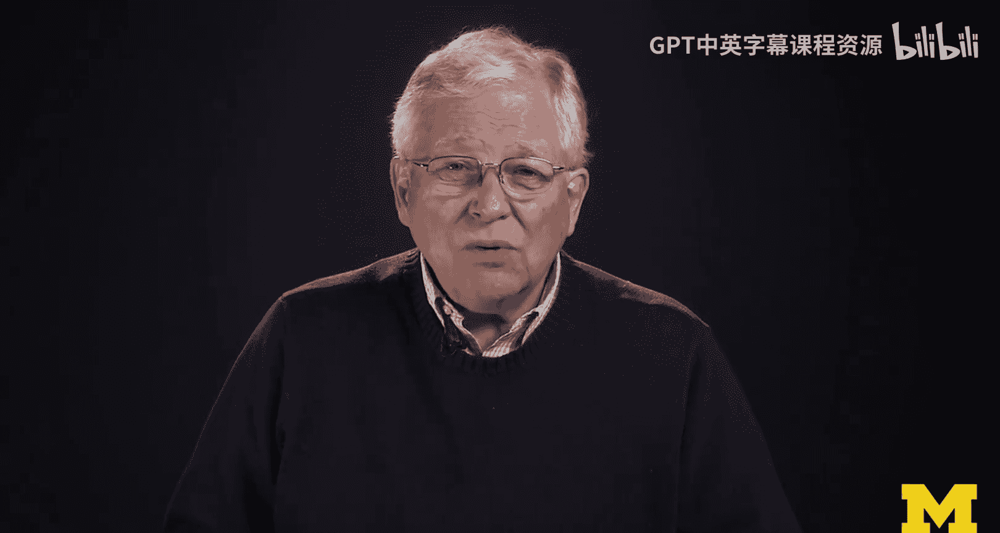

无论我们是先分组再选择（如分层抽样），还是选择组（如整群抽样），我们都将讨论在**使用随机化**时如何操作。

在**第五单元**，我们将讨论一种有时被人们首先介绍的技术，它是一种非常简单的抽样方法，即**系统选择**或**计数法**（例如，每隔K个选择一个）。这种方法存在一些需要注意的陷阱，我们将详细讲解，以便您能更熟练地应用该技术。我们将强调这些陷阱何时重要、如何补救，以及何时可能不适合使用该技术。

然后，我们将在**第六单元**总结本课程，处理一些扩展内容，使对记录和网络的抽样更容易进行。我们将简要讨论如何处理设计的复杂性（相对于简单随机抽样的简单性），以及在使用整群和分层时，设计复杂性对我们得出的结论和数据质量的影响。

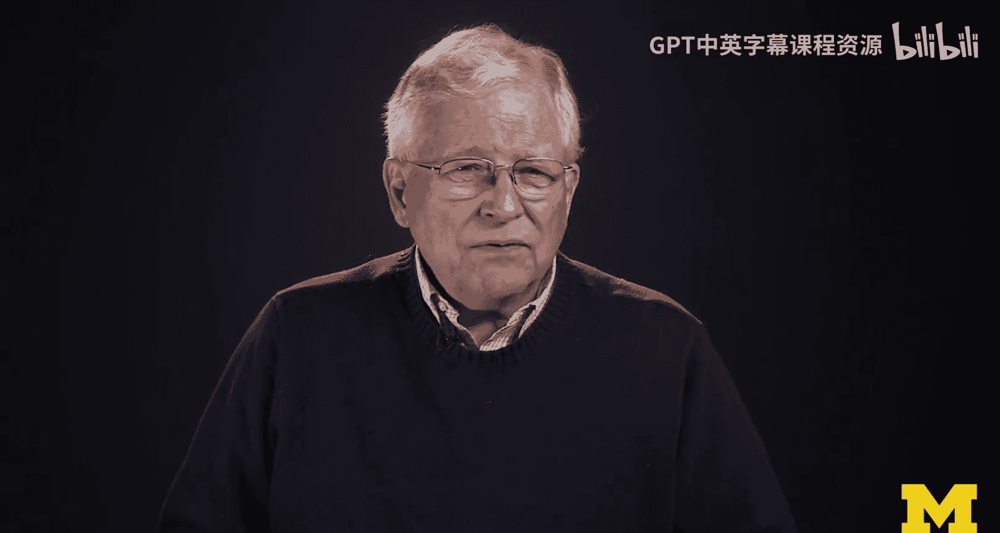

---

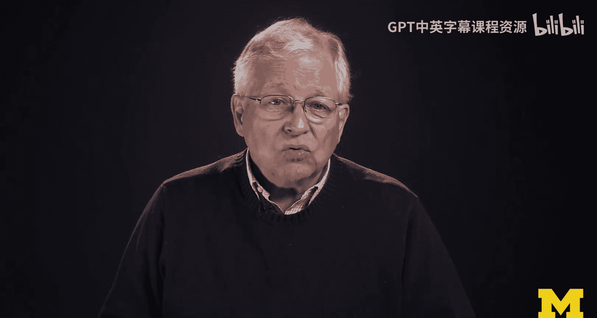

在讲解过程中，我会在幻灯片显示中使用一些额外的侧边栏来组织内容。例如，我会在幻灯片左上角使用一个方框来提示我们正在讨论的是单元还是讲座。每个单元包含多个讲座，在开始讲座前，我会提醒我们当前所处的单元和讲座背景，并高亮显示当前讲座和主题，以帮助跟踪进度。

关于格式的介绍就到这里。在开始研究设计的讨论之前，我想再说几点。

我们将开启**第一单元**，讨论“抽样作为一种研究工具”，并在**第一讲**中深入探讨研究设计与抽样的背景和情境。

我希望通过本课程的学习，您能体会到我们所讨论的这些针对人员、记录和网络的调查抽样技术，如何应用于其他领域，特别是当我们理解了它们如何应用于这些特定的研究对象时。

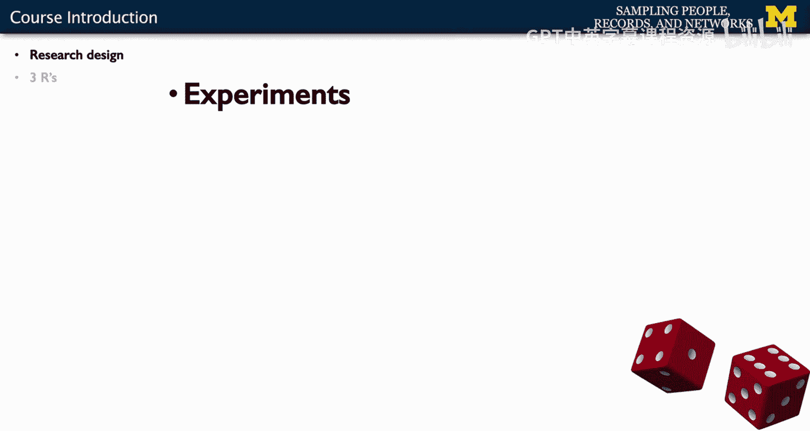

在开始之前，最后还有两点说明。您可能会发现，在讲座中我表现出一些热情。作为一名统计学家和数学家，我很难做到这一点，但我对这些内容充满热情，因为我喜欢它。我从事这个领域很长时间，发现这是一个非常强大的研究工具，并且看到我的同事们用这些研究设计方法做出了惊人的成果。

我发现这是一套非常强大的方法，尽管它们在结构上并非完美无缺，在哲学层面也存在一些根本性的缺陷。但在表面上，在理论上，我们拥有的是一套**不需要我们事先对所做之事做出假设**的方法。这为我们开始思考如何进行抽样提供了一个非常好的起点。

因此，当考虑为一个特定的研究问题设计样本时，我会回归到将要讨论的基本原则。我将把这些基本原则当作可以在实践中存在一样来讨论。在实际操作中，我们经常不得不偏离这些方法。但如果你要偏离，你最好知道你偏离的是什么。这就是本课程的重点：我们提供一个**基线**和**基础**。一旦我们理解了这个基础，我们就可以做出一些偏离，并做出实际的决策，这可能意味着我们能否开展一项研究。

我认为这些是基础性问题，对于**随机化**尤其如此。出于教学目的，我的一些陈述可能会被夸大。例如，我会说随机化使我们能够**在不做假设的情况下得出结论**。从技术上讲，这是正确的，但在实践中并非如此，因为我们最终不得不偏离真正的随机选择。

当我们处理样本中的缺陷时，例如样本单位未能回应，我们无法获得其数据。在这些情况下，我们实际上开始做出一些假设，以帮助我们在数据收集后、选择后处理这些缺陷。这有时被称为**频率学派方法**。我不会深入讨论这一点。其他人可能更喜欢基于模型的方法，但在这里我将坚持频率学派方法，因为这是该领域的标准做法。这并不是说其他方法是错误的或低劣的，只是说这是我们在这里强调的重点。让我们先理解这种方法，然后再尝试处理更有原则性的方法。

好的，我准备好了。如果您也准备好了，让我们进入第一讲，看看研究设计中发生了什么，以及调查样本如何融入研究设计的背景中。

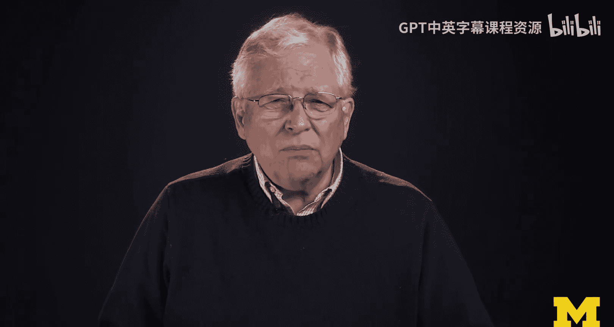

谢谢。

---

**本节课总结**：在本节课中，我们一起学习了抽样方法的基本概念及其广泛的应用场景。我们明确了本课程将专注于社会科学背景下，使用随机化方法来应对非均匀总体进行抽样的核心原则。课程将分为六个单元，系统介绍研究设计、随机选择、整群抽样、分层抽样、系统抽样以及对记录和网络抽样的扩展。我们强调了理解这些基础方法的重要性，为后续在实际研究中进行合理偏离和决策打下坚实的基础。