#  080：研究设计与抽样（上）📊

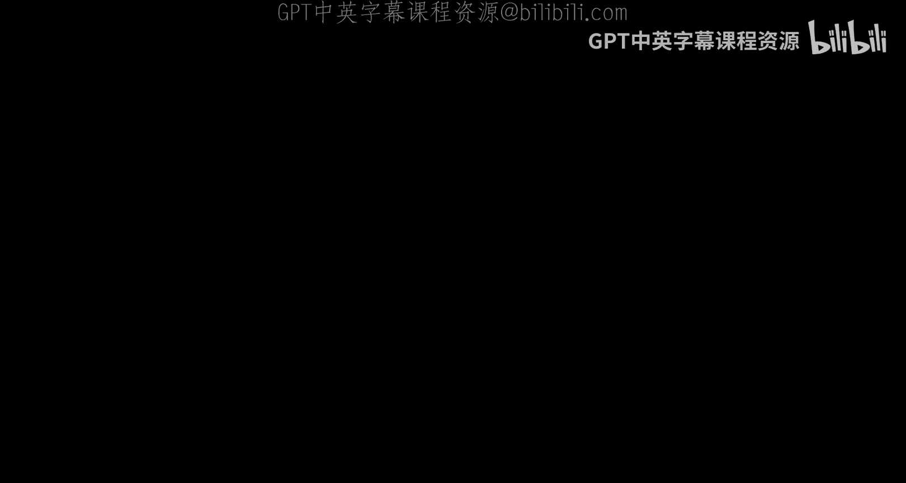

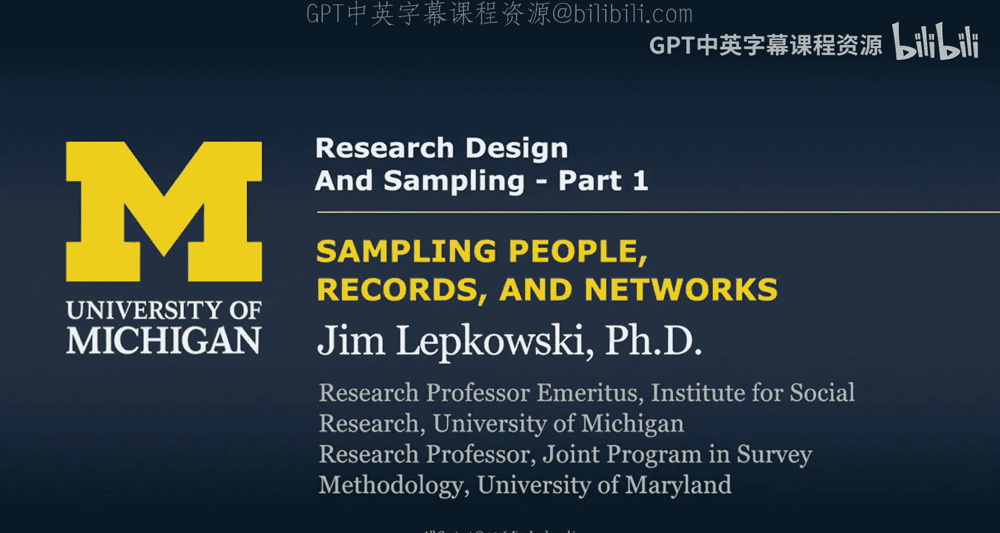

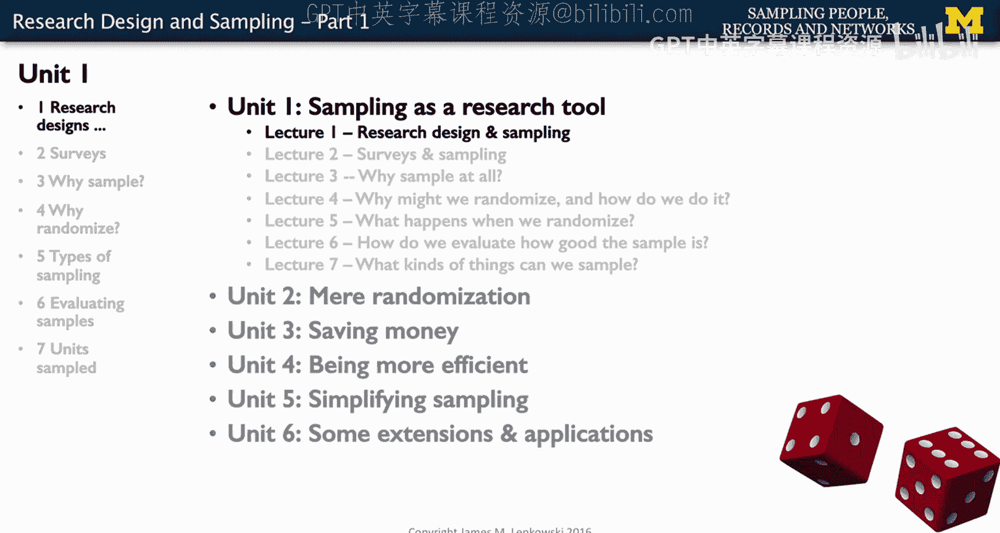

## 概述

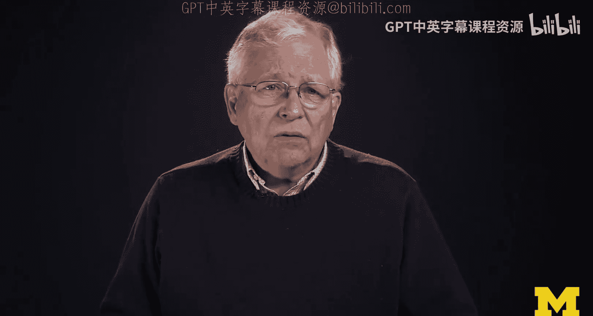

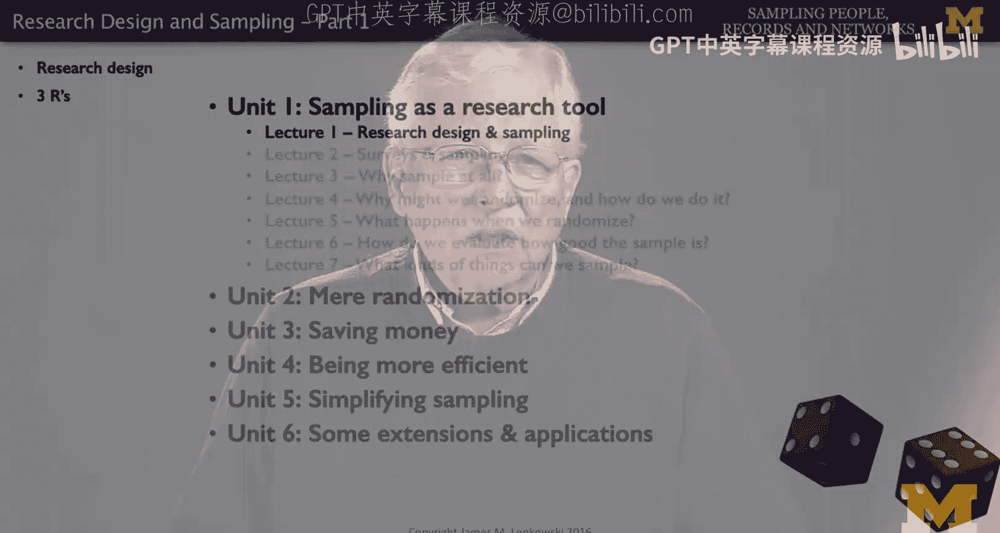

在本节课中，我们将学习研究设计的基本概念，特别是实验和准实验，并探讨抽样作为一种研究工具如何融入其中。我们将通过两个经典案例——脊髓灰质炎疫苗试验和吸烟与健康关系研究——来理解随机化在研究设计中的核心作用及其对结论可靠性的影响。

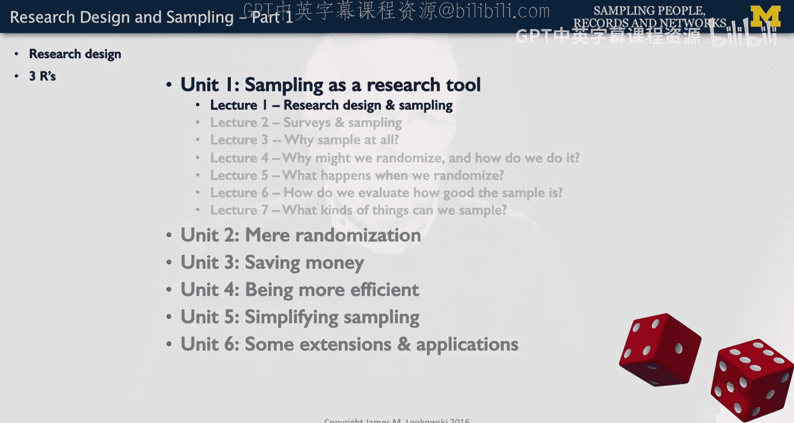

---

## 研究设计与实验

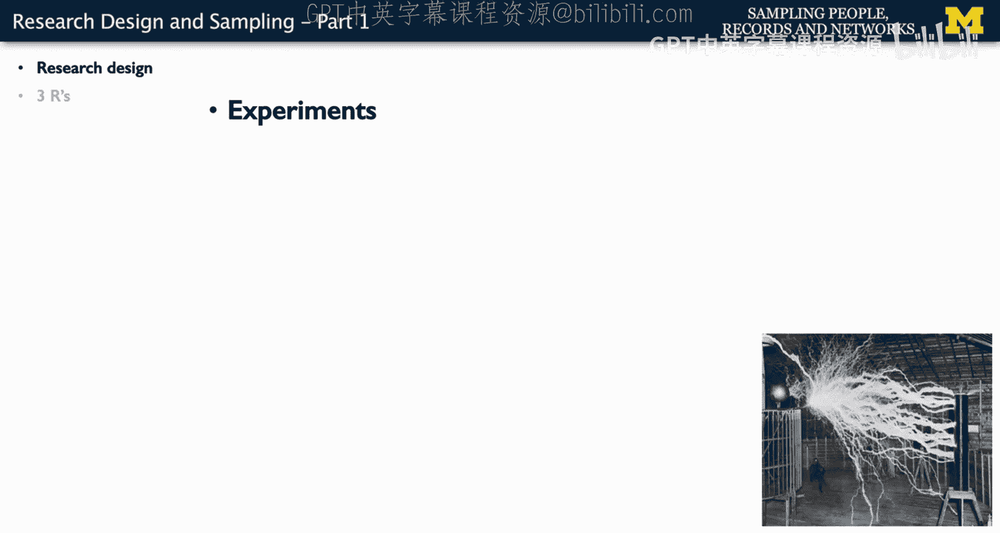

上一节我们介绍了课程的整体框架，本节中我们来看看研究设计的一般概念。当人们谈论研究时，通常会想到**实验**。实验涉及对某种新现象进行科学探索，并将其与现有或未有的情况进行比较。

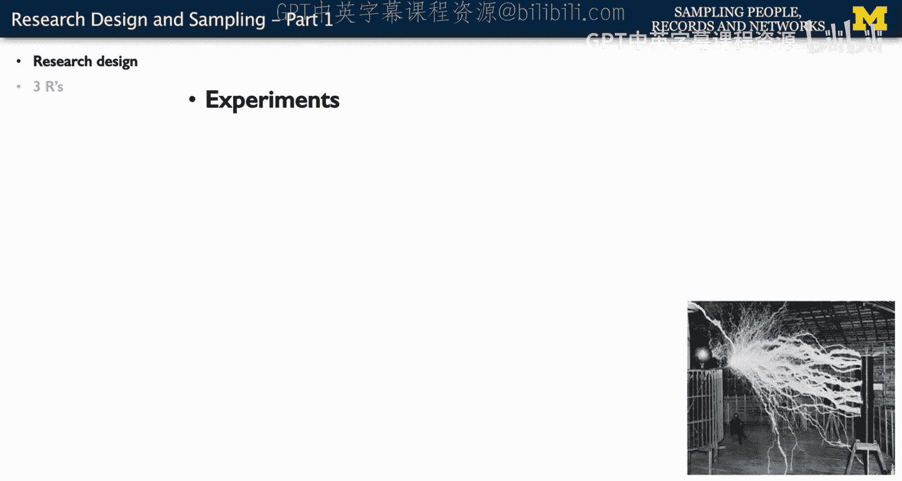

我们倾向于将实验想象在实验室中进行，科学家安静地进行观察研究，仔细记录发现，并在向公众公布前与其他科学家分享。然而，这种模式适用于研究自然现象，但涉及人的现象时，我们需要更精细的考量。

实验是**对主要现象的理想化操控**。我们试图检验某个现象，并将其与其他事物进行对比。因此，这里存在一个比较过程。我们关注一个主要变量，并使用另一个事物作为背景进行比较。

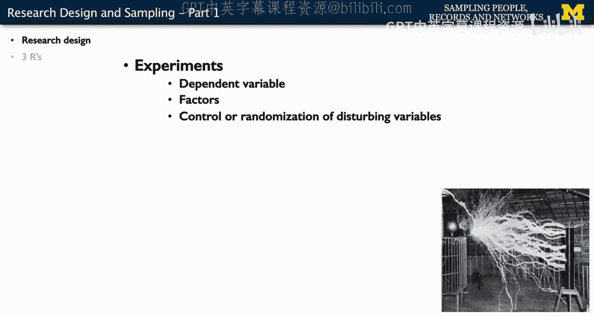

但在背景中，存在一些**干扰变量**，它们可能影响我们比较处理A与标准处理B（或处理B）的能力。这些干扰变量可能导致我们错误地认为存在效应，或者掩盖实际存在的效应。

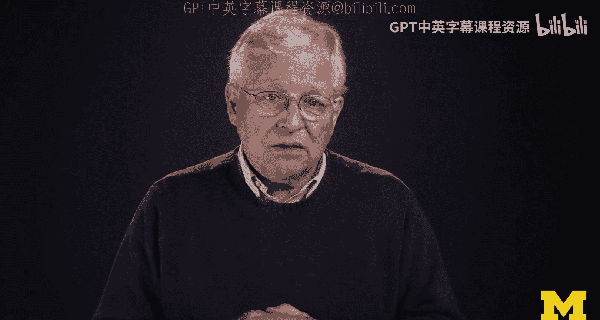

为了处理这些干扰变量，实验设计中会使用**随机化**。受试者被随机分配接受处理A或处理B，这种分配由随机机制决定，而非研究者的主观选择，从而保证了客观性。

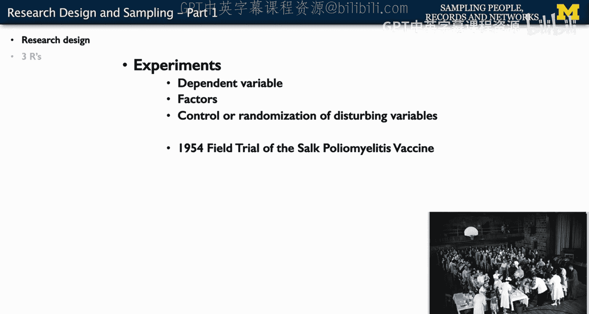

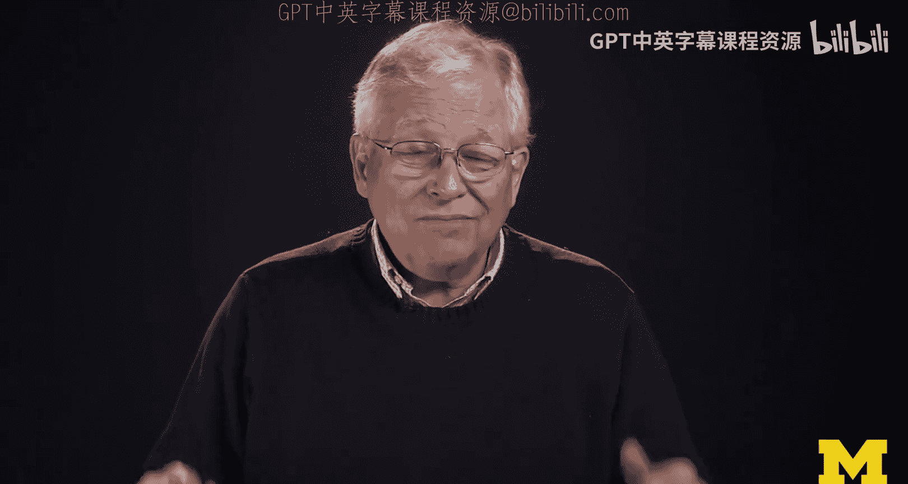

---

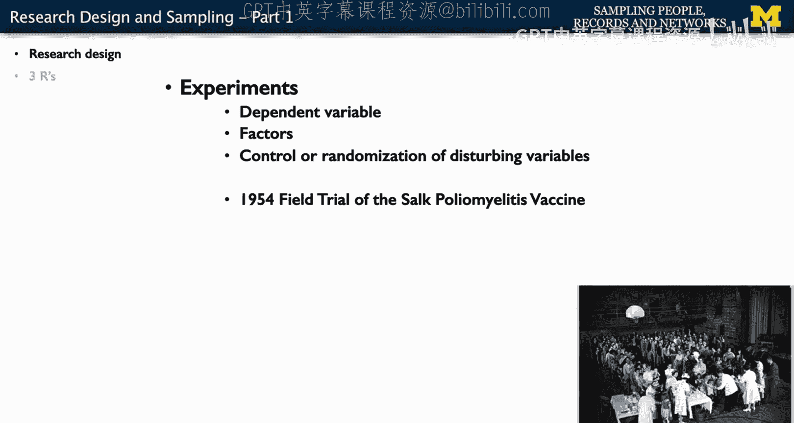

## 案例一：脊髓灰质炎疫苗试验

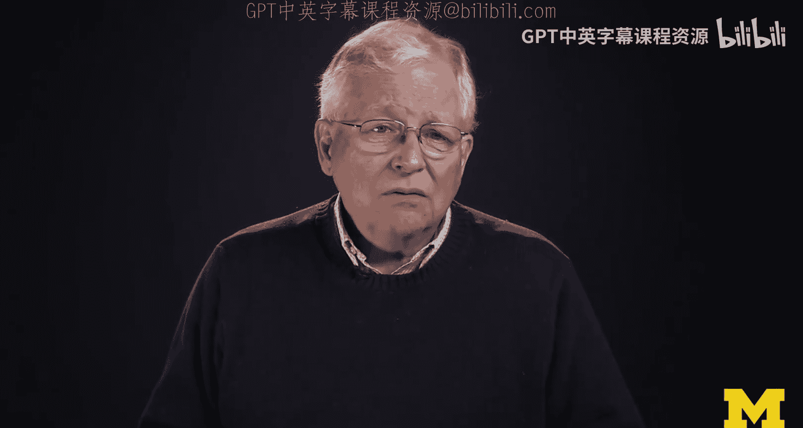

现在，让我们考虑一个经典案例，事实上，这是第一个大规模的人体随机对照试验——1954年的索尔克脊髓灰质炎疫苗现场试验。

脊髓灰质炎是一种病毒性传染病，通过粪口途径传播。在二战后，公众对此病非常关注。乔纳斯·索尔克博士开发了首批被认为有效的疫苗，但无人确定疫苗在普通人群中是否安全有效。临床研究规模很小，因此他们认为需要进行大规模现场试验。

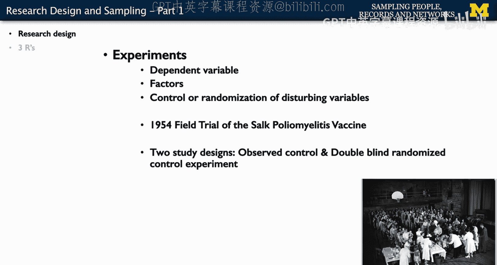

由于该疾病发病率很低，研究必须规模巨大。提出的研究方案是：一组儿童接种疫苗，另一组不接种，然后比较两组儿童的脊髓灰质炎发病率。

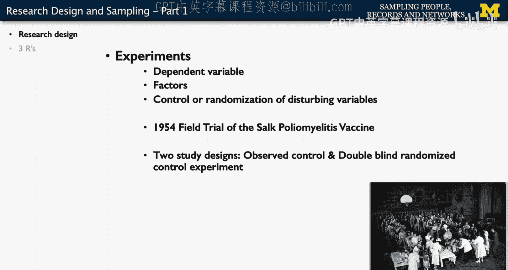

最初提出的设计是：**一、三年级儿童接种疫苗，二、四年级儿童不接种**。但这个设计受到广泛批评，因为所有人（包括家长和医生）都知道谁接种了疫苗。未接种疫苗的儿童可能会受到更多关注，他们观察到的发病率可能与背景率不同，从而可能缩小疫苗组与非疫苗组的差距，无法充分证明疫苗的有效性。

此外，即使一、二、三年级学生来自同一学校，也不能保证接种和未接种儿童的平均背景（如免疫史、病毒暴露史）相同。可能存在其他因素干扰比较。

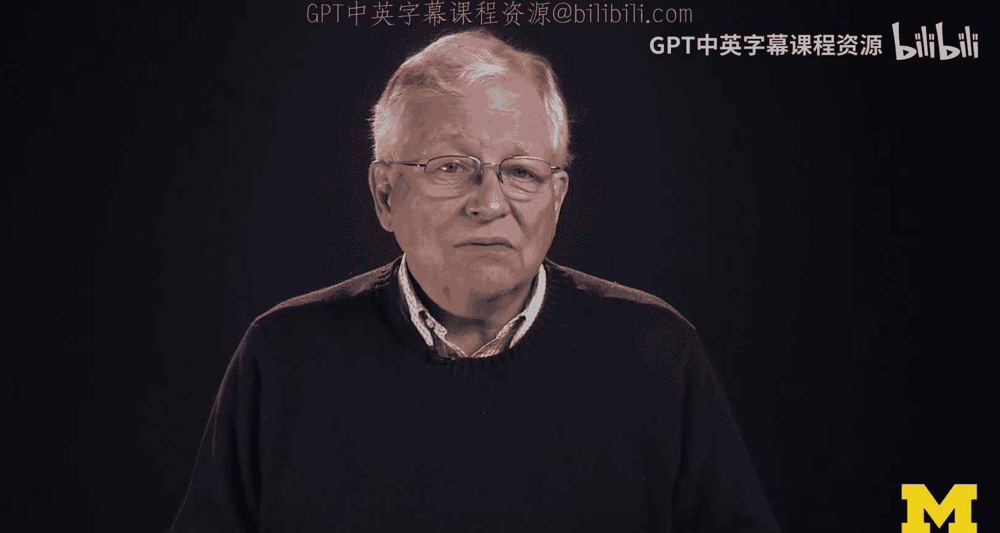

因此，提出了第二个同时进行的研究方案。除了上述非随机研究外，再招募另一批一、二、三年级儿童（通过学校和社区自愿参与）。所有儿童都接受注射，但**随机选择一半儿童接种疫苗，另一半接种安慰剂（盐水溶液）**。除了研究调查者，无人知晓谁接种了疫苗。所有儿童都被跟踪观察。

这项研究规模巨大，涉及超过180万儿童。其中，随机化研究部分涉及近50万儿童。这为随机化的价值提供了绝佳证据，因为我们现在可以比较随机化与非随机化两种研究设计，看看结论有何不同。

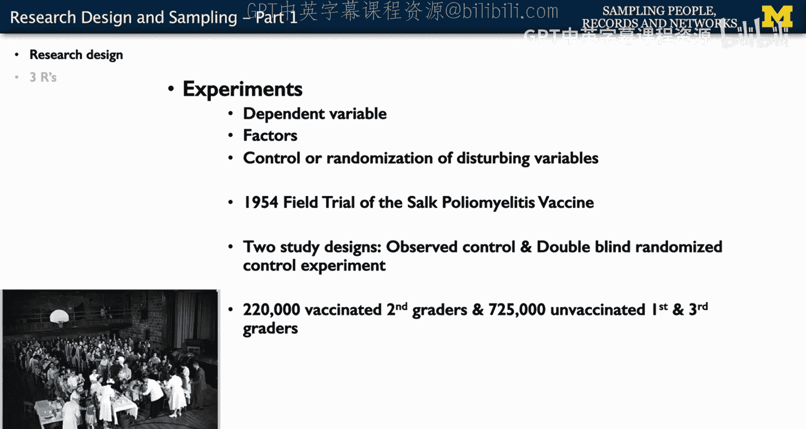

这是一个**双盲随机实验**。家长和医生知道孩子接受了注射，但不知道是疫苗还是安慰剂。他们对疾病迹象保持警惕，这对接种和未接种组是相同的。这使得可以评估两组之间发病率的差异，即疫苗的有效性。

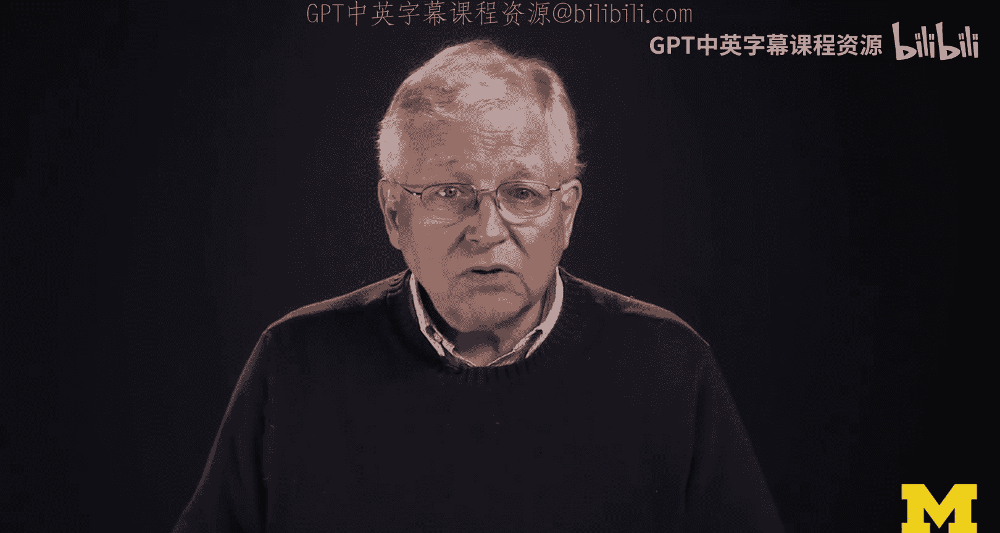

研究跟踪一年后，随机化试验的结果是决定性的：**疫苗安全有效，接种儿童中的脊髓灰质炎发病率不到未接种儿童的一半**。公共卫生行动几乎立即展开。次年，美国各地儿童开始大规模接种。

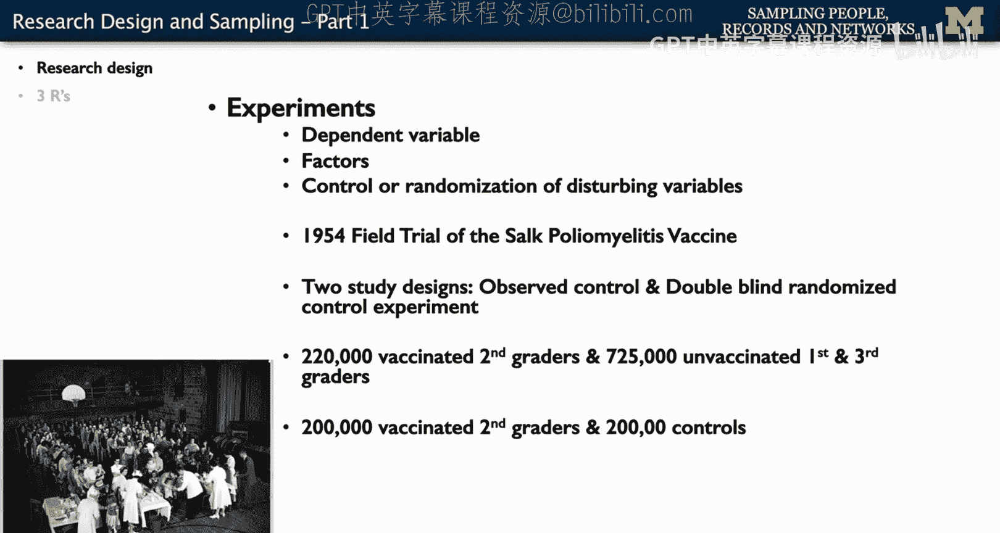

而非随机化研究虽然也显示了差异，但差异要小得多，研究者更不愿意据此得出疫苗有效的结论。因此，**随机化使得能够更快地对突发的公共卫生状况采取行动**。

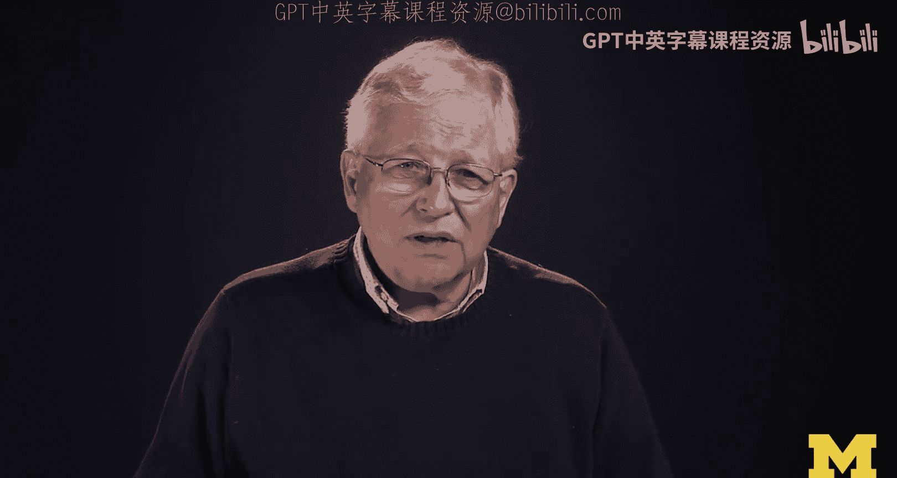

---

## 案例二：吸烟与健康关系研究

在许多情况下，对人体受试者进行随机化已经足够困难。我选择了一个涉及可能导致瘫痪或死亡的疾病的 poignant 案例，对比非常鲜明。但在其他情况下，由于实际困难，我们甚至不会考虑随机化。

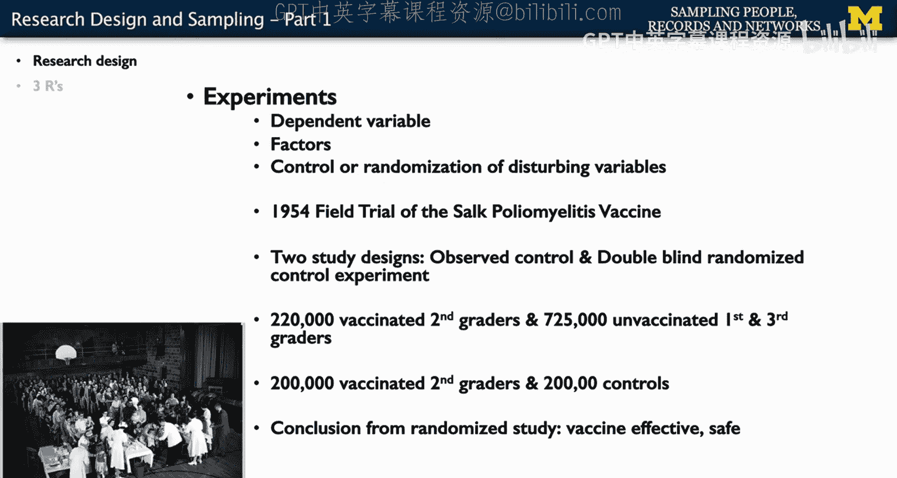

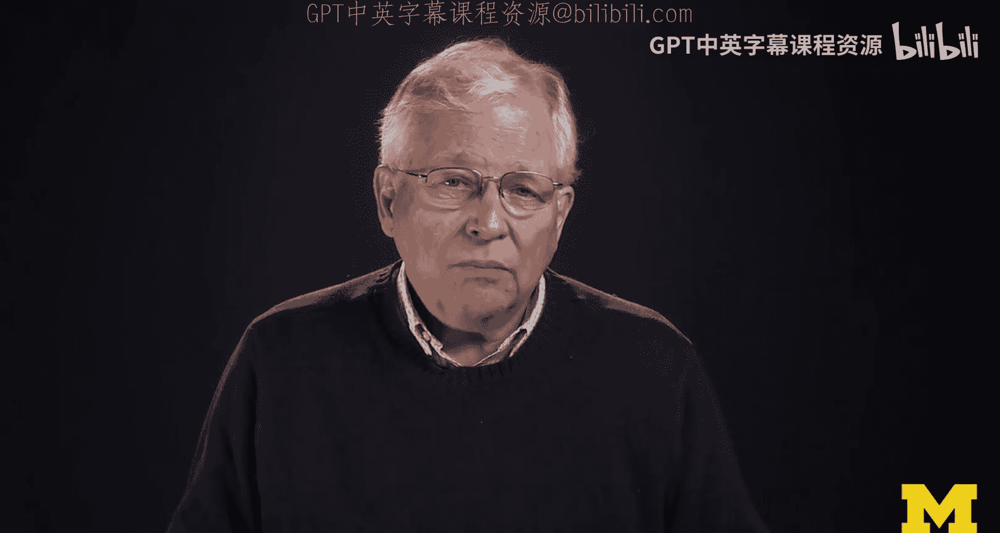

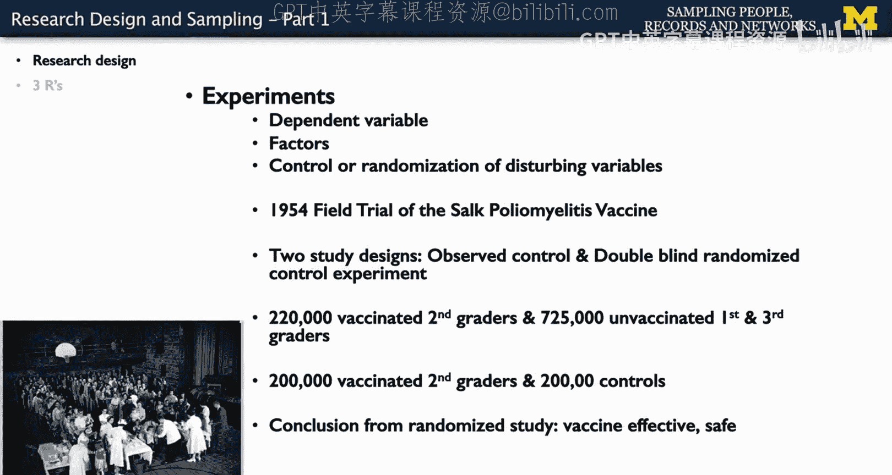

让我们考虑另一个经典研究。这项研究由两位英国医生——多尔和希尔——进行，他们研究了吸烟与各种死因之间的关系。

他们对英国约6万名医生进行了一项**非随机化研究**。他们利用现成的注册名单，向所有医生发送问卷，询问烟草使用情况（包括香烟、鼻烟、咀嚼烟草、烟斗、雪茄等）。他们排除了少数女医生（那是一个不同的时代），但总体上人数很少。

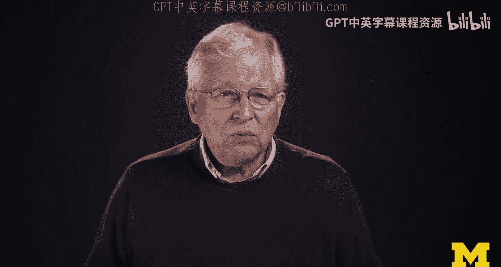

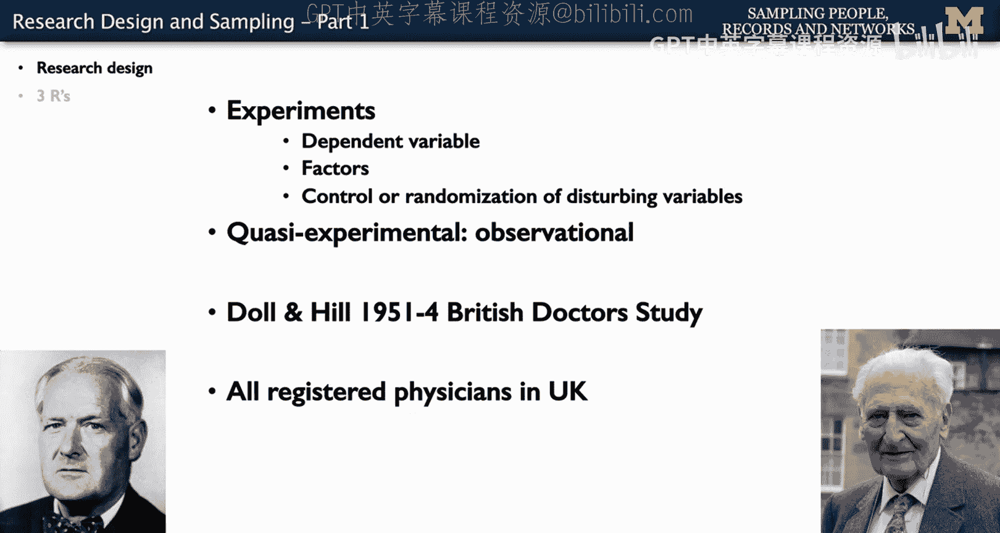

有4万名医生回复了问卷（回复率约三分之二）。然后，他们通过英国的死亡登记系统跟踪这些医生数年，检查每一份死亡记录，找出4万名受访者中去世的人，并记录死因。

**这里没有随机化**，因为他们只是通过问卷观察谁吸烟、谁不吸烟，并没有分配人们吸烟或不吸烟。医生们是自愿选择是否吸烟的。不可能将他们随机分配到吸烟组和非吸烟组（处理组和对照组）。

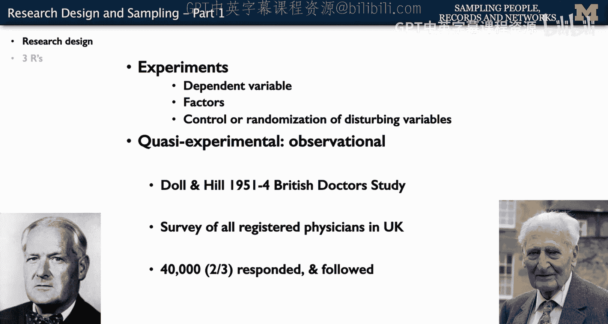

尽管如此，多尔和希尔在短短几年内就确定，**吸烟者的肺癌和心血管疾病发病率要高得多**。差异的规模非常大。但没有人认为他们的研究是决定性的。

它受到了与脊髓灰质炎案例中相同问题的质疑：如何知道吸烟者和非吸烟者在其他方面（例如遗传因素）没有差异？是否可能存在另一个因素，既使吸烟者倾向于吸烟，又导致肺癌？这是当时提出的论点之一。

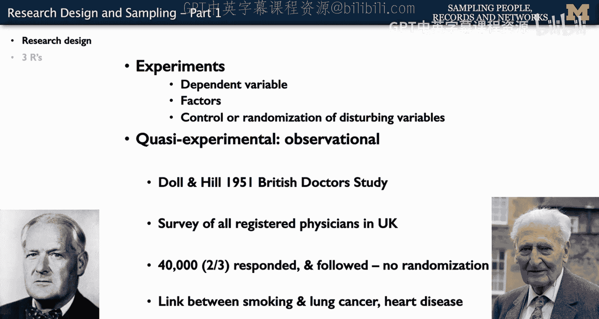

因此，关于此存在争议，大规模的公共卫生行动长期缺失。事实上，这项研究在20世纪50年代进行，直到60年代中期，美国卫生局局长才基于这项研究和其他非随机试验，宣布吸烟与肺癌之间存在联系。

**由于缺乏随机化，他们无法得出明确的因果结论**。随机化在科学家心中是一个非常强大的工具。多尔和希尔所做的这类研究被认为是**准实验**，而非真正的实验。它基于对人们当前暴露情况的观察，以及随后的死亡结果。

---

## 本节总结

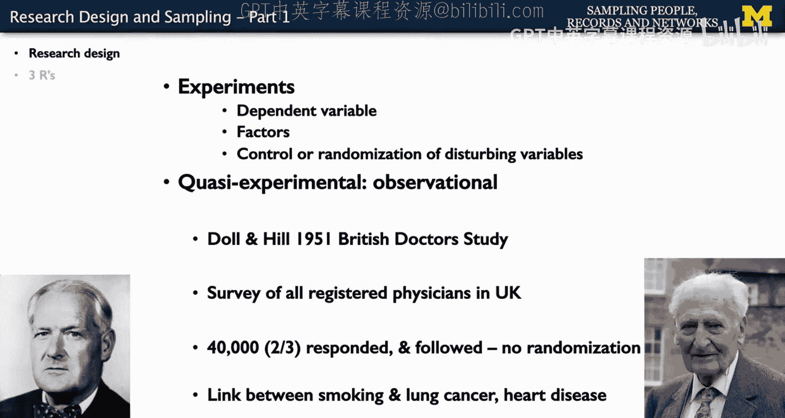

本节课中，我们一起学习了研究设计的性质，通过两个案例了解了随机化在其中的关键作用。在脊髓灰质炎疫苗试验中，随机化使得能够迅速得出可靠结论并采取行动；而在吸烟研究中，缺乏随机化则延缓了因果关系的确认。随机化作为一种客观的统计工具，对于确立处理组与对照组之间的差异至关重要。

接下来，我们将暂停关于研究设计的讨论。在下一节中，我们将继续第一讲，探讨**随机化如何以不同的方式应用于调查抽样**，以及它在抽样过程的不同方面所起的作用。