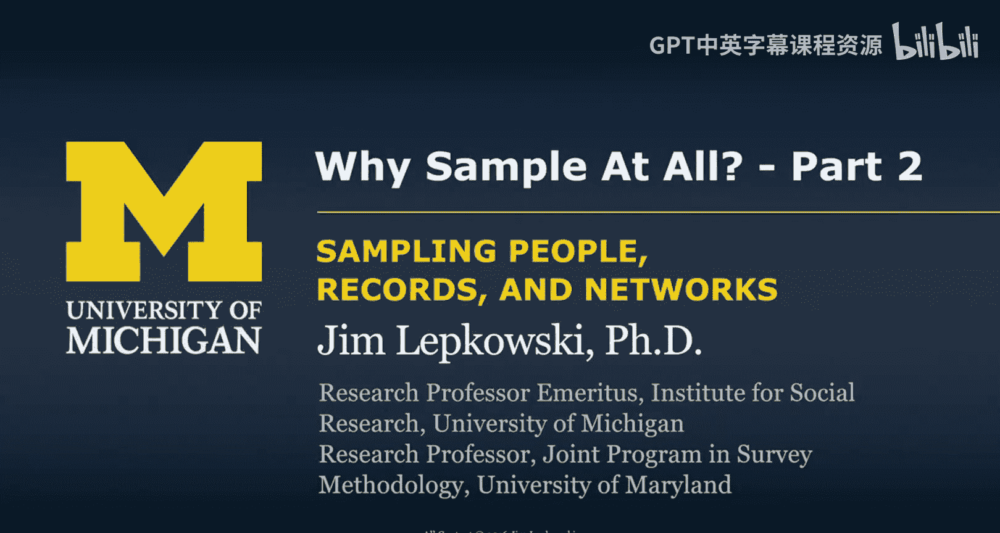
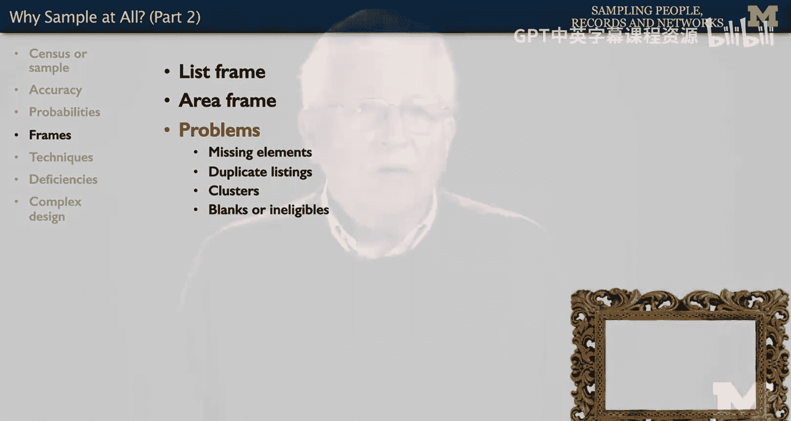
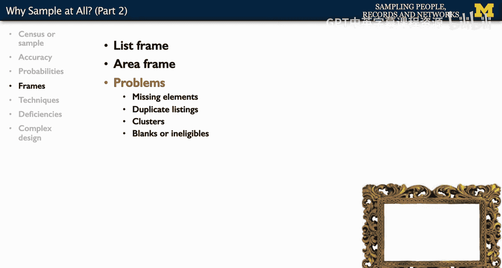
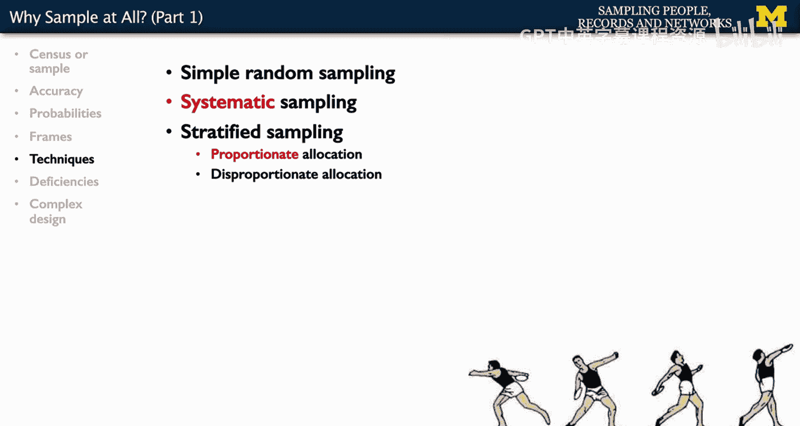
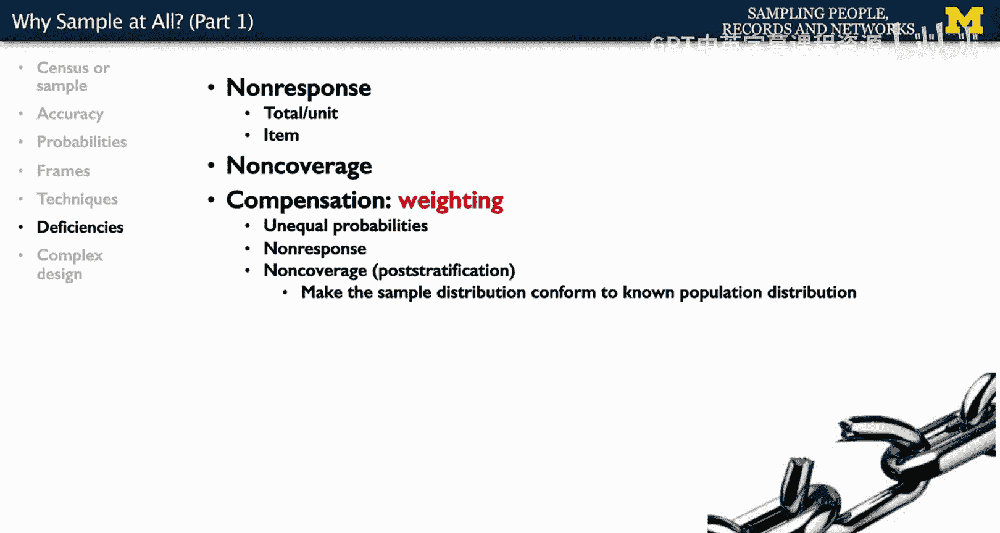
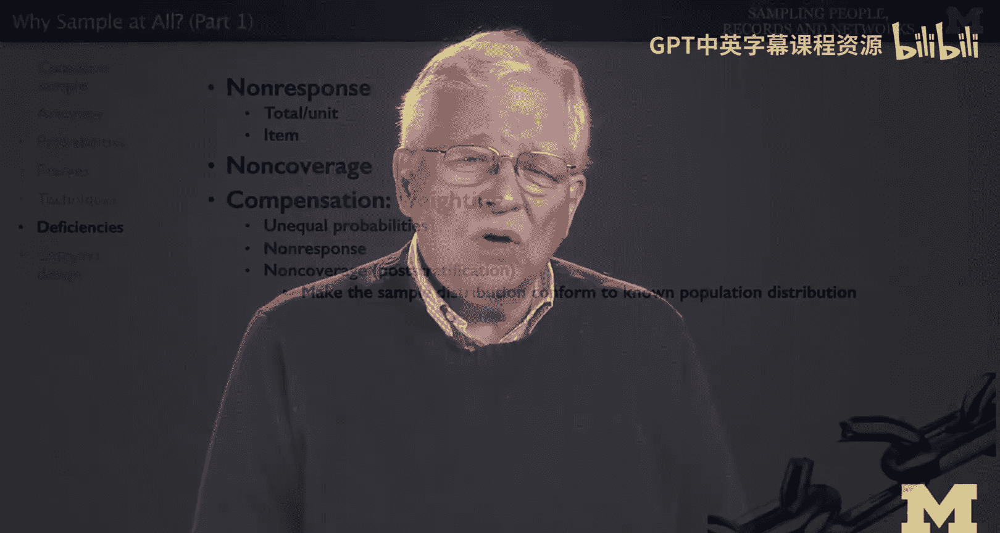
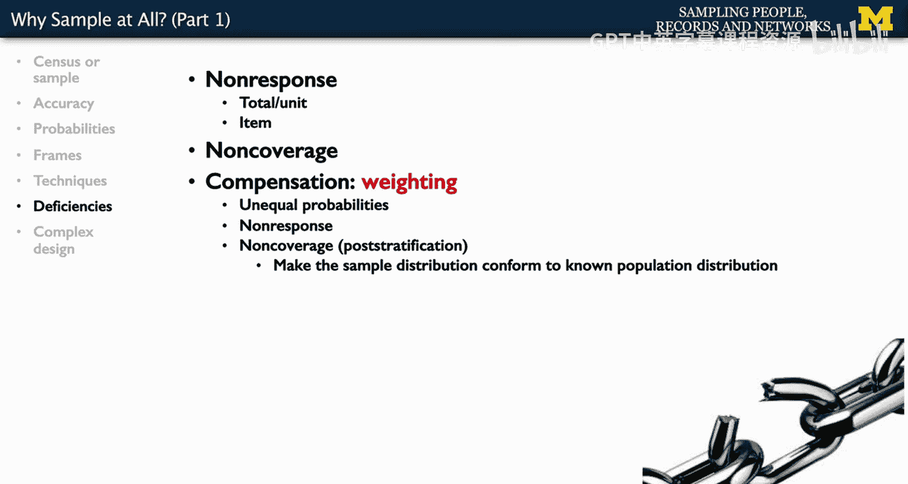
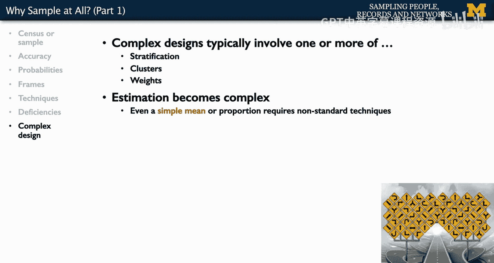
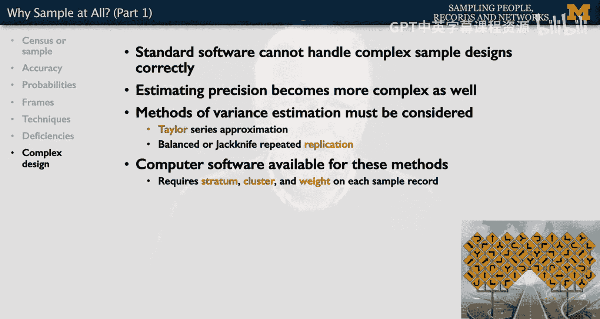
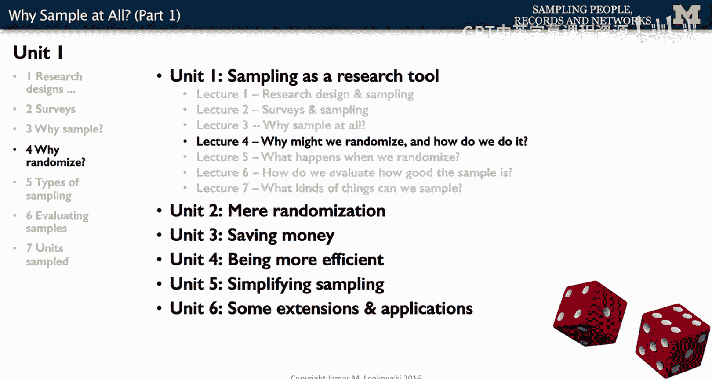

#  084：为何抽样（下）📊

在本节课中，我们将继续探讨抽样这一研究工具。上一节我们介绍了普查与抽样的区别、随机化概率的使用以及相关的抽样技术。本节中，我们将深入探讨抽样框、复杂抽样设计带来的挑战，以及如何应对数据缺失和覆盖不全等问题。

## 抽样框：样本选择的基础

抽样框是一个通用术语，指代用于选择样本的材料集合。通常，我们将其视为一个集中存放的简单单一列表。我们之前讨论的许多技术，如**简单随机抽样**、**分层抽样**和**系统抽样**，都可以直接应用于这类列表。

然而，也存在我们没有简单列表抽样框的情况。这时，我们需要构建更复杂的抽样框。例如，我们可能没有现成的全国人口名单。为了降低构建完整名单的巨大成本，我们可以分阶段、逐步地组装样本，利用现有材料而非创造新材料。

## 多阶段抽样与区域抽样框

区域抽样框是一个典型例子。要抽取一个国家的人员样本，我们不必先费力创建包含所有人的名单。相反，我们可以：
1.  首先，汇编他们居住的地理区域名单（例如，全国所有的区或普查小区）。
2.  然后，从这些区域中抽取一个初级样本。
3.  接着，在被选中的区域内，进一步划分成更小的子单元（如街区），并从中再次抽样。
4.  之后，前往被选中的子单元，列出住房单元并从中抽样。
5.  最后，前往被选中的住房单元，列出其中的人员。

这种“区域-区域-住房单元-人员”的多阶段抽样，涉及多个不同列表的组装，其中一些可能是首次为本次调查而创建。

## 抽样框与总体的匹配问题

即使是在简单的列表情况下，抽样框也可能存在问题：总体中的某些元素可能不在列表中，而列表中的某些条目可能不属于目标总体。对于区域抽样框，匹配问题同样存在。因此，研究者需要设法解决这些问题，确保总体与抽样框（即我们用于选择样本的列表或材料集合）之间达到最佳匹配。

针对这些抽样框，我们应用之前提到的技术。但具体到操作层面，有推荐的标准执行方式。例如，进行**简单随机抽样**就有几种不同的方法。我们将抽样技术视为一套需要遵循的特定步骤和形式。

## 抽样技术的应用场景

抽样技术主要应用于两类场景：
*   **列表抽样框**：技术直接应用于现成的名单。
*   **整群/多阶段抽样**：技术应用于区域样本或多阶段抽样设计，其具体操作有所不同。

## 样本的缺陷与补救措施

无论采用何种技术和抽样框，我们的样本都可能存在缺陷。例如：
*   **无应答**：我们精心从列表中抽取了样本，但在邀请参与研究时，部分个体因不愿提供数据、无法联系到、语言障碍等原因，完全没有提供数据，或对部分问题（如收入）拒绝回答，导致数据缺失。
*   **覆盖不全**：这是抽样框的一个问题，即抽样框未能覆盖总体中的所有元素。这可能是由于抽样框本身的缺陷，也可能是我们的主动选择。例如，我们可能决定不覆盖一个国家中偏远地区的人口，因为前往那里的成本极高，而该地区人口规模较小。排除他们可以节省大量资金，且对最终结论影响甚微。

为了弥补这些缺陷（无应答和覆盖不全），并试图修复抽样链中的断裂，我们会采用一些补偿措施。**加权**就是这样一种技术。它最初用于补偿**不等概率抽样**，但有时也用于调整无应答和覆盖不全的影响。另一种技术是**事后分层**，即试图通过外部控制信息，使样本在结构上更接近总体特征。

## 复杂设计及其影响

此外，我们还必须考虑**复杂设计**。现在我们可以看到，设计中可能包含多种因素：随机化、整群、分层、各种估计程序以及加权。所有这些都偏离了简单的随机抽样。简单随机抽样只是一个起点，我们引入这些偏离是为了节省成本、提高设计效率或纠正各种缺陷。

当我们引入这些不仅仅是随机化的特性时，我们需要计算的估计值就变得越来越复杂。一个简单的均值或比例的计算会因设计的复杂性而变得困难。这种复杂性也反映在我们用于评估结果质量的度量上，例如**标准误**或**置信区间**。为涉及整群、分层、加权等因素的复杂设计计算这些度量，是一项复杂的任务。我们需要能够正确处理这些复杂设计特征的专用软件，而不仅仅是标准统计软件。

因此，我们有必要简要讨论一下**方差估计**。在最后一个单元，我们将简要介绍评估数据质量的不同方法，考虑这种复杂性，并提及一些可用的软件。这些软件使得分析过程对用户透明——只要你提供了正确的设计信息，软件就会处理所有这些复杂计算。

## 设计、估计与软件的协同

我们将看到，随着抽样技术的改变，我们计算估计值的方式也会改变。例如，从简单随机样本转向整群样本时，估计方法就需要调整。我们必须保持抽样设计与估计程序紧密相连，而软件将帮助我们做到这一点。这种复杂性是伴随随机化而来的。既然我们有很多随机选择样本的方式，我们就需要记录样本是如何被选中的，以便使我们的估计尽可能可靠。

## 总结与下节预告

本节课中，我们一起学习了抽样框的概念及其类型（特别是复杂的多阶段区域抽样框），认识了样本可能存在的无应答和覆盖不全等缺陷及其补救措施（如加权），并理解了复杂抽样设计如何增加估计的难度以及对专用分析软件的需求。

在下一讲（第4讲）中，我们将转向五个核心问题中的第二个：我们为何要进行随机化以及应该如何操作？我们将探讨随机数的特性及其在抽样选择中的应用，重点关注使用随机选择的意义和后果，而不过多纠结于具体技术细节。期待下次再见。