#  085：随机化原理与方法 🎲


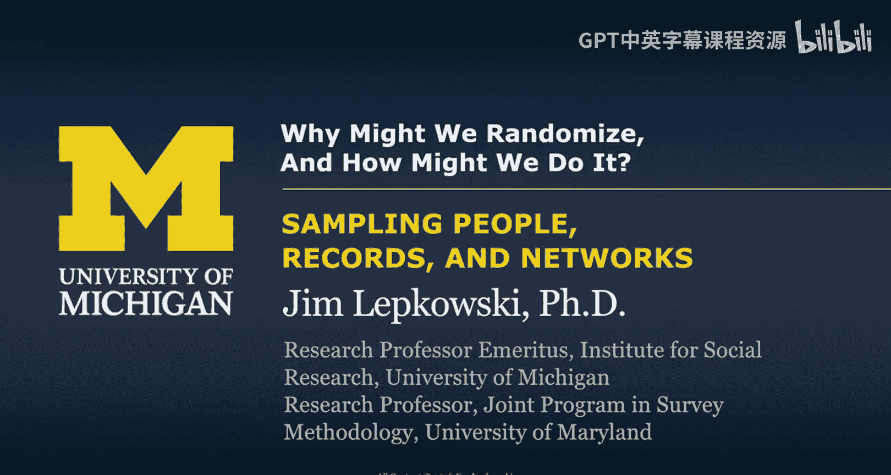


在本节课中，我们将学习抽样调查中的一个核心环节：随机化。我们将探讨什么是随机数、如何利用随机数进行抽样，以及随机化背后的原理和具体操作方法。

在上一节中，我们讨论了抽样的基本概念及其必要性。本节中，我们将具体探讨如何抽取样本，特别是如何使用随机选择，以及为什么这样做至关重要。使用随机选择听起来很科学、很公平，这确实是概率抽样（我们赋予这种方法的标签）的优点。然而，与招募受试者等非正式抽样方法相比，这是一种更复杂的程序，需要付出一定成本。那么，概率抽样能带给我们什么？它的价值有多大？这正是本节课以及接下来几节课要探讨的内容。之后，我们还将通过实际应用来继续讨论。

我们将从以下四个部分展开讨论：
1.  随机数的概念
2.  如何利用随机数进行选择
3.  一个特殊问题：“是否放回”
4.  一个从列表中抽取人员的示例

---

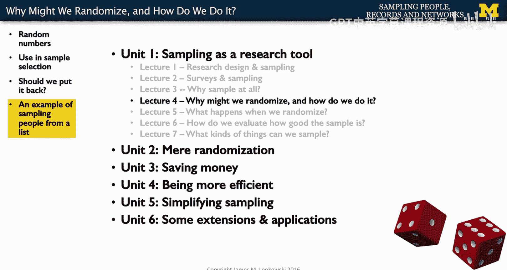


## 随机数的概念

随机数有多种形式。以下是10个随机数：

```
0.49018
0.97446
0.10892
0.61387
0.00000
0.25412
0.79241
0.93155
0.70019
0.56555
```

这些随机数都在0到1之间，带有小数点，有五位数字（也可以有更多位）。它们是由一个系统生成的，该系统能产生0到1之间的随机数。在这个范围内，任何数字被生成的概率都是相等的。无论用五位、一位还是三位数字来表示都可以，核心思想是：该范围内的所有数字被选中的机会均等。

这10个随机数来自所谓的**均匀分布**，即所有数字被选中的概率是均匀、相等的。你无法将它们与非随机数区分开来。理论上，第一个数字0.49018有可能连续出现10次，但这并不影响其随机性。随机数没有限制，我们只知道0到1之间的每个数字被选中的机会均等。

以下是另一组随机数，它们是单位数字：

```
7 1 6 0 3 4 8 2 0 9
5 1 4 9 3 7 2 8 6 0
2 3 1 5 9 7 4 0 8 6
0 9 8 7 6 5 4 3 2 1
3 4 5 6 7 8 9 0 1 2
```

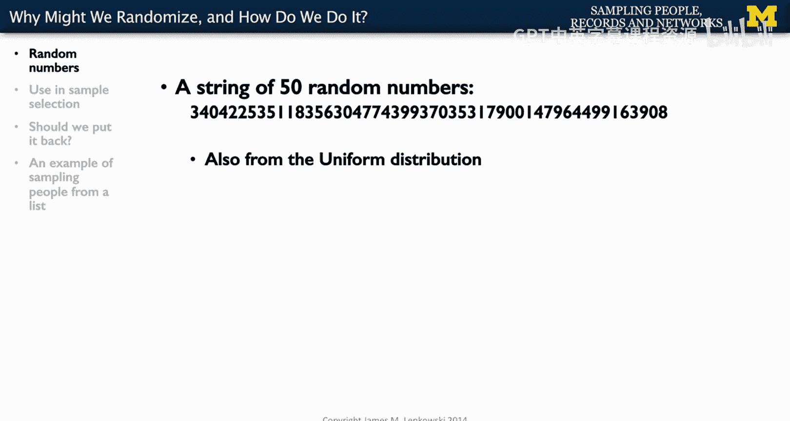


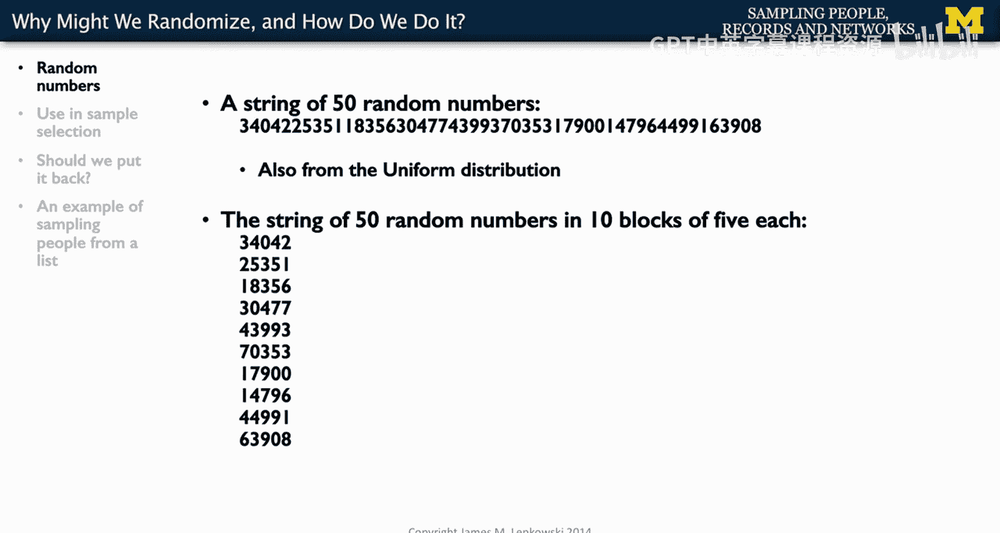

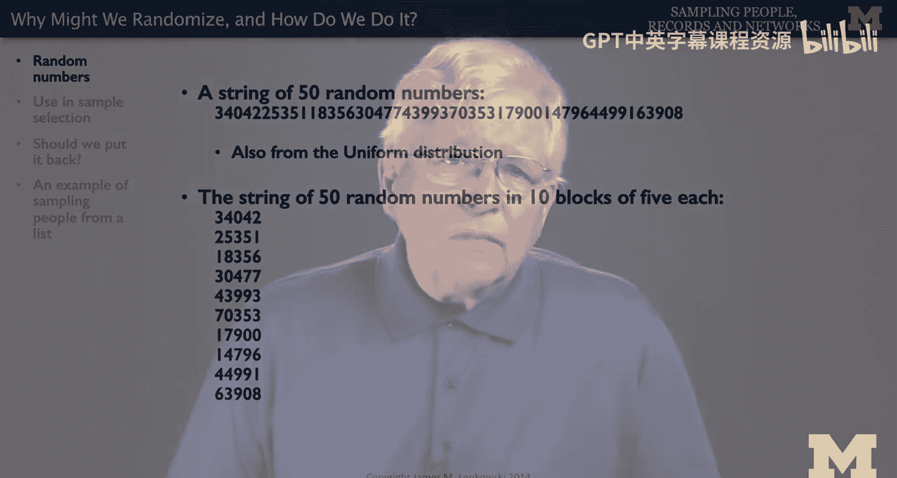

这些是数字0到9。在我们看到的50个位置中，每个位置都有10种可能性（0-9）。这只是一个由50个数字组成的字符串，0到9这10个数字都出现在其中，但在任何一个特定位置，出现的数字都可能是0到9中的任何一个。

它们同样来自均匀分布，但思考方式不同：在任何一个给定位置，数字0到9出现的可能性均等。这里有50个不同的随机数字，每个数字出现的概率相同。

现在我们有了一串随机数字序列。之前我们也有序列，但这个更具体——一个包含50个数字的序列。我们也可以将这些数字以不同方式分组，例如，将这50个数字每五个分成一组，不一定非要像上面那样排成一串。分组只是为了阅读更方便。随机数字通常就是以这种方式生成的：先生成长长的字符串，然后像这样分块写出，以便于查看数字。

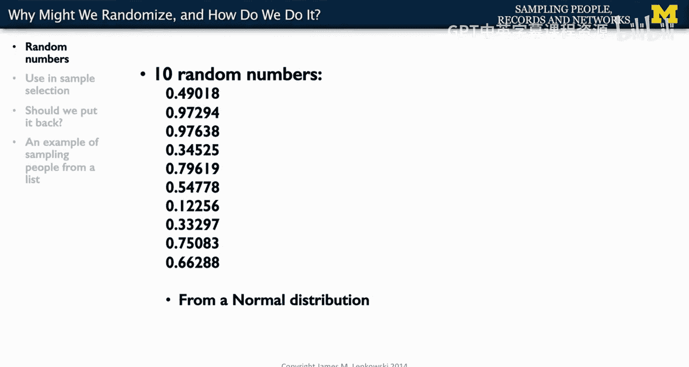


---

## 非均匀分布的随机数

我们也可以使用非均匀分布的随机数字。例如，以下数字来自一个生成系统，该系统生成的数字更倾向于靠近中间值（0到1之间的中间区域），越靠近中间的数字出现频率越高。


```
0.45
0.52
0.61
0.49
0.55
```

这听起来可能有偏差，为什么会有人这样做呢？这是因为这种分布（正态分布）在自然界中经常出现。我们希望通过使用符合这种正态分布的随机数，来模拟现实世界中发生的情况。顺便说一下，这里用大写字母“N”表示的“Normal”，不应理解为“一切本该如此”的“正常”，而应视为一种“标准”分布，因为它在统计实践中出现得非常频繁，被广泛使用。它更多源于法语中的“normal”（标准），而非英语中表示“普通、中间”的“normal”。

---

## 随机数表及其应用

这是一张包含4500个随机数字的表，它们被每五个分成一组。虽然很难看清，但你可以理解这个思路：那些五个一组的块，共有50行和90列，每行有18个五位数块，总计4500个数字。

为什么有人会这样展示呢？有时，根据问题或应用的需要，我们可能需要五位数、两位数或一位数。这样分组使我们更容易查看、阅读和使用它们，例如用一些数字组作为两位数，另一些作为三位数。随机数表出现在教科书中。我的导师莱斯利·基什（Leslie Kish）在他的教科书中就有这样一张表。

这里还有另一种表现形式，来自我最喜欢的一本书——兰德公司（Rand Corporation）出版的《一百万随机数字》。这本书包含从0到9重复出现的一百万个数字序列，它们被每五个分成一组，印在500页上，每页有50行、50列，共2500个数字。他们这样做有一个严肃的目的：展示他们的随机数生成器能够生成看起来随机的数字。由于他们并不完全确信其生成器是真正随机的，所以称之为“伪随机数生成器”。他们希望通过生成一百万次并统计每个数字（0，1，2...）出现的次数，来证明该生成器非常接近一个随机过程。实际上，这本书中唯一的文本就是第一页，简短说明了0、1、2等数字各出现了多少次，其余部分全是数字。

---

## 利用随机数进行抽样选择

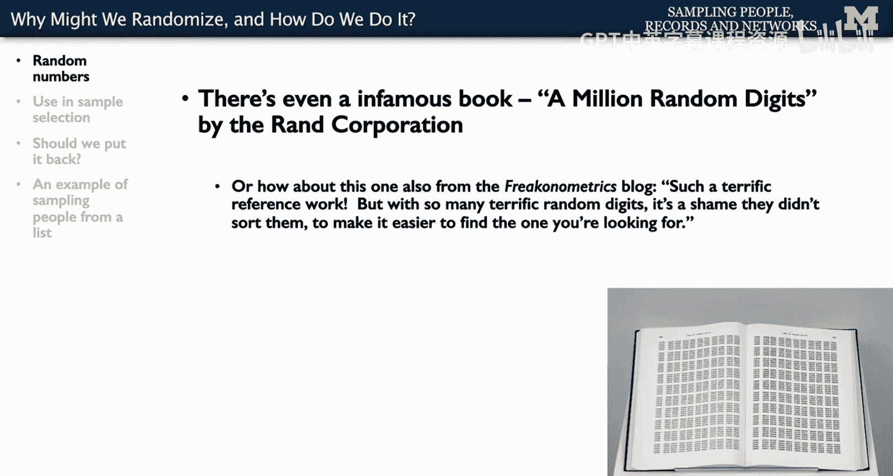


我们可以使用这些随机数来进行选择。这种方法可用于从抽样框中抽取样本。还记得我们在前几节课中提到的抽样框吗？这里有一个抽样框示例，它只是一个列表。这是一个教职员工列表（前25条记录），我们隐去了姓名，但有序号、8位ID号、所属学院/部门、性别、职称和薪资信息。我们将从这个列表中抽取样本（该列表实际包含370条记录，来自密歇根大学的教职员工）。

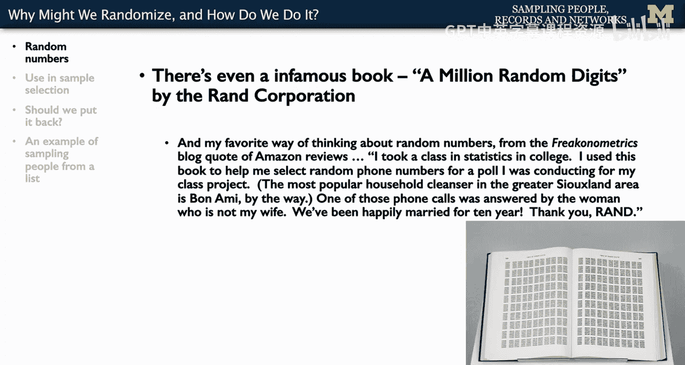


我们的想法是从随机数表中获取一些随机数，并与教职员工的ID号进行匹配。例如，我们可以尝试使用8位ID号，但这会有点复杂，因为我们需要8位数，并且会生成大量根本无法匹配的8位数，效率很低。更好的方法是使用序号。序号允许我们生成从001到370的三位数。我们从那些表中选择的任何三位数随机数字序列，只要与列表中的序号匹配，就是一个被选中的样本。

以下是另一张随机数表（来自与我之前展示的不同的来源），数字被每五个分成一组排列。我们需要开始从这些数字中选择，以匹配我们的列表。

我们从哪里开始？从哪里开始并不重要。你可以闭上眼睛用铅笔点在页面上（一些教科书确实这么写过），但这并非必要。从左上角开始，或者任何你喜欢的地方开始都可以，但要做一些系统化的事情，以便你能跟踪自己的操作过程。

让我来演示一下。例如，我们看第一个数字（一个三位数）。前三位数字是第一个五位数块的前三位：579。我们尝试将其与列表匹配，但列表序号只到370，没有579。我们将其划掉。下一个数字是341（我只取每五位数块的前三位，忽略后两位）。341在列表中，这成为我们的第一个选择，我将其圈出。继续向下，019是下一个，也在列表中（注意前导零，所以我们需要处理像19、1、2这样的数字，序列中也会包含前导零）。019成为我们的一个选择。接着是253、238……我一次做了很多个选择。请注意，当我在这一列中向下进行，到达页面底部（该列有50行）时，我还没有获得足够的样本量。于是，我回到下一组五位数块（实际上是下一组五位数块的前三位）。这只是我遍历列表的方式。你也可以选择使用第一个五位数块的后两位和下一个五位数块的第一位，这都不重要，只要你能跟踪并记录自己所做的事情即可。

---

## “是否放回”的问题

这里出现了一个问题：在抽取过程中，同一个数字有可能出现不止一次。事实上，在我实际使用的序列中，数字238就出现了两次。那么我们应该如何处理？应该选择它两次吗？这就引出了“是否放回”的问题。

这里有两种选择：保留它或丢弃它。
*   **如果保留它**（当它第二次被抽中时仍然算作一次选择），这被称为**有放回抽样**。
*   **如果丢弃它**（使其在后续抽取中不再有资格被选中），这被称为**无放回抽样**。

有放回意味着一旦我们选中某个元素，会将其放回列表中，使其有资格再次被选中。无放回意味着我们将其从列表中取出，使其没有资格在后续被选中。这对我们将要研究的一些问题会产生影响。

通常**更倾向于选择无放回抽样**，因为它能带来更好的样本。这里的“更好”并非指样本的外观（有些人可能会这么想），而是指关于我们所获数据质量的统计特性。

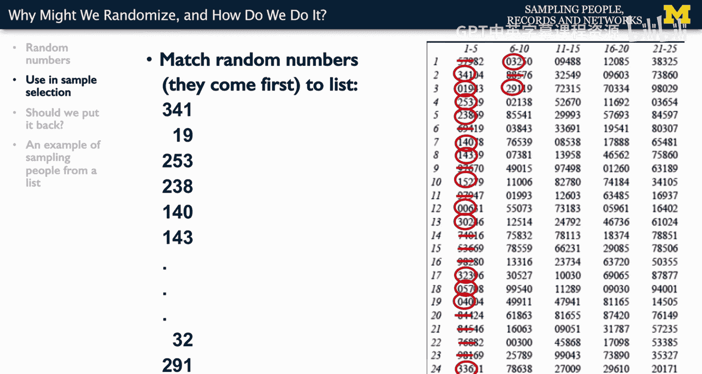


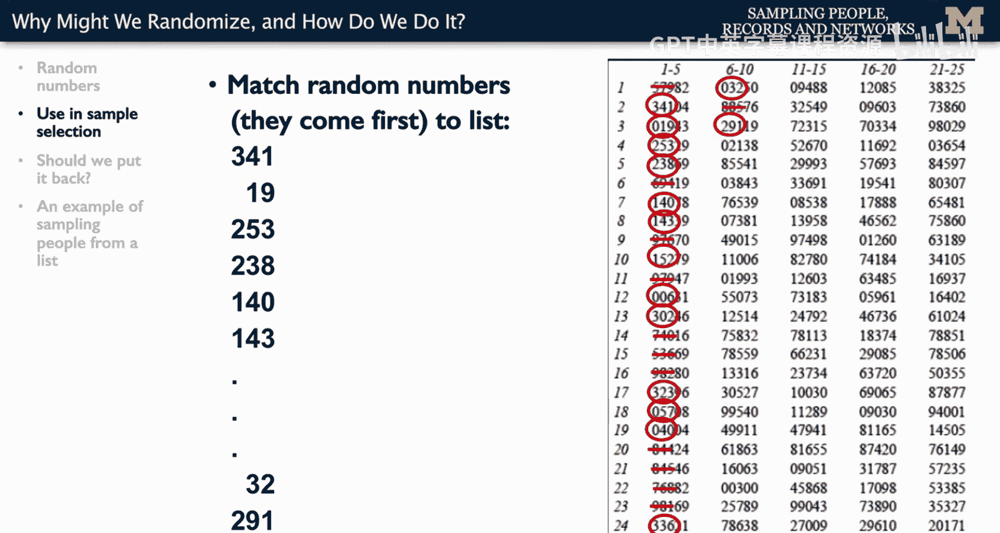

---

## 示例：从列表中抽样人员

回到我们的样本，这是整个样本（20个被选中的记录）。现在按照被选中的顺序从1到20编号，你可以看到列表的随机性。这是一个随机序列。我们还在其中加入了收入数据（以千美元计）作为示例并进行计算。我们可以看到，这个样本的平均收入是78.6（千美元）。这就是我们得到的结果，也是我们想要的。我们完成了一个从列表中抽取人员并计算结果的示例。


接下来，我们将探讨随机化带来的后果。你可能认为我们已经看到了，但并非如此。我们需要从统计角度理解一些影响，这将是第五课的内容：关于随机化如何影响我们的数据质量，以及我们如何评估这种质量。

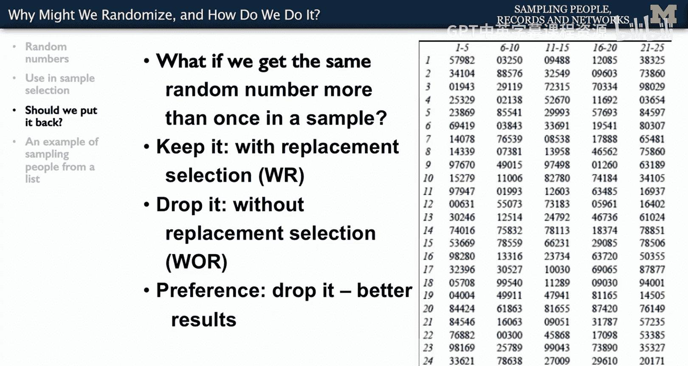


---

## 总结

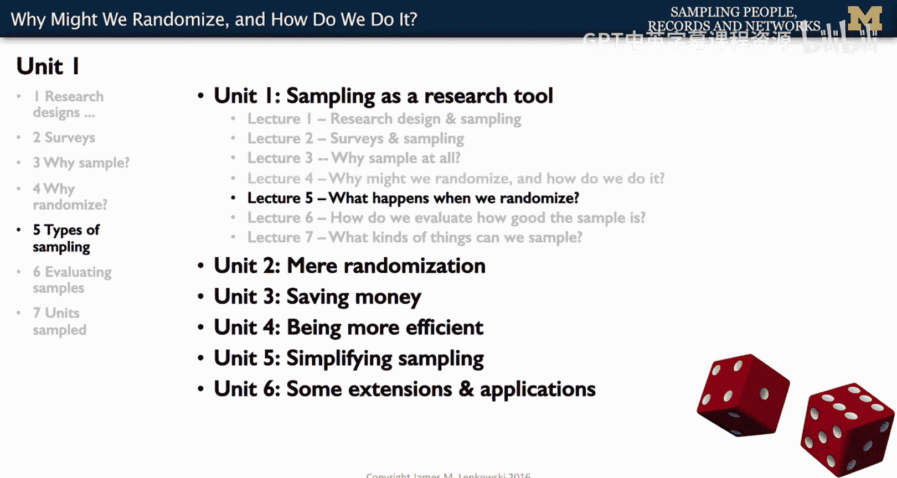


在本节课中，我们一起学习了随机化的核心原理与操作方法。我们首先了解了随机数的概念及其不同形式（如均匀分布和正态分布）。接着，我们探讨了如何利用随机数表从抽样框（如人员列表）中系统地抽取样本，并演示了具体的操作步骤。我们还讨论了抽样中“有放回”与“无放回”的区别及其对样本统计性质的影响。最后，通过一个计算样本平均收入的实例，我们看到了随机化抽样的实际应用结果。理解这些基础是评估抽样数据质量、进行科学统计推断的关键前提。