#  086：随机化实施效果


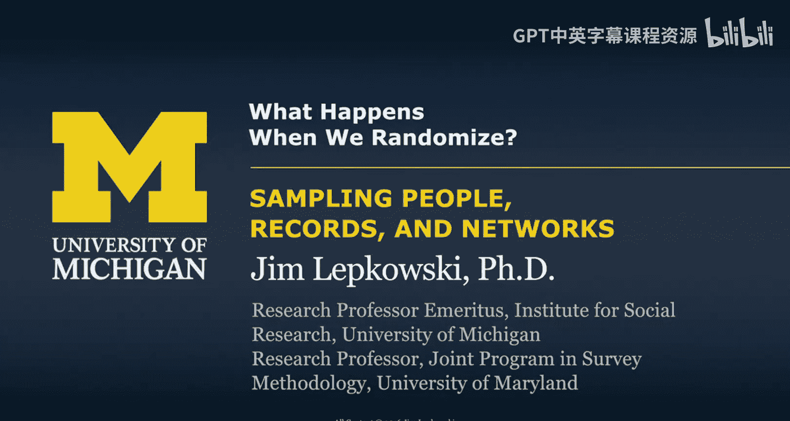


## 概述

在本节课中，我们将学习随机抽样的实施效果及其后果。我们将通过一个七步流程，从定义总体开始，到最终构建一个表达不确定性的置信区间，来理解随机抽样如何让我们仅凭一个样本就能评估结果的可靠性。

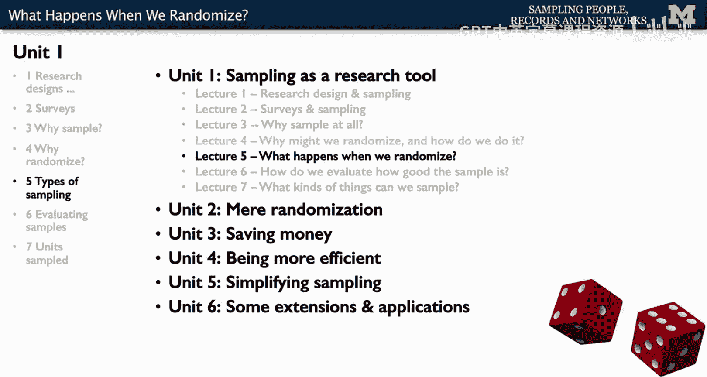


上一节我们介绍了随机抽样的基本概念和操作。本节中，我们来看看当我们真正执行随机抽样时，会产生哪些后果，以及我们如何量化这些后果带来的不确定性。

---

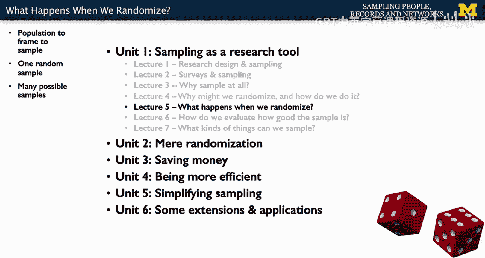


## 第一步：定义总体 👥

抽样过程的第一步是明确定义我们研究的**总体**。总体是我们感兴趣的所有元素的集合。例如，它可以是某大学的所有教职员工、一段时间内的所有交易记录，或任何其他我们想研究的完整群体。

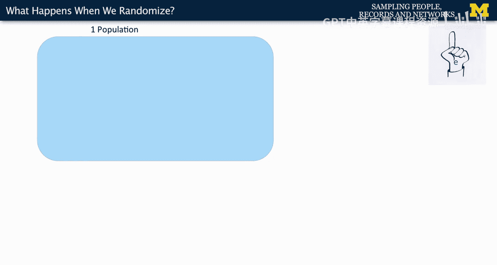

在图中，这个总体被形象地表示为一个集合，其中的每个点代表一个元素（例如一位教职员工）。


---

## 第二步：获取抽样框 📋

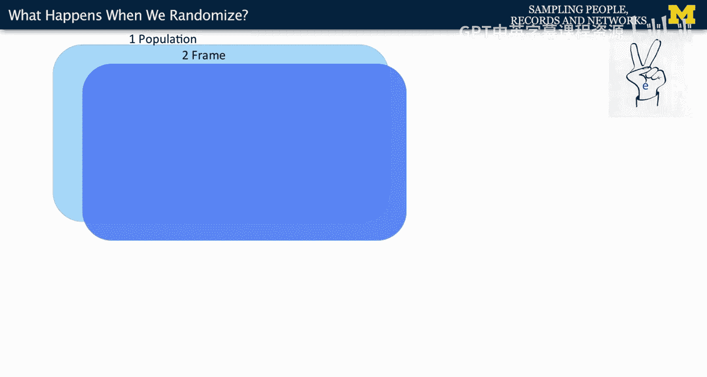


在实际操作中，我们几乎不可能获得包含总体中每一个元素的完美名单。因此，我们需要一个**抽样框**——一个用于抽样的实际列表（例如教职员工名册）。

抽样框通常与总体不完全一致。它可能遗漏了总体中的一些元素（覆盖不足），也可能包含了一些不属于总体的元素（过度覆盖）。图中两个部分重叠的圆圈展示了总体与抽样框之间的关系。

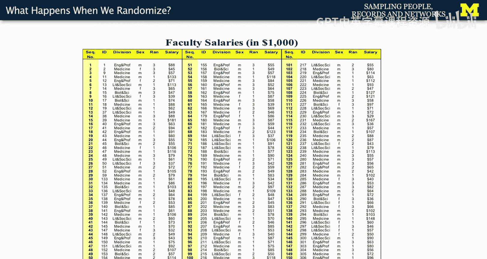


---

## 第三步：从抽样框中抽取随机样本 🎲

有了抽样框后，第三步是使用随机方法（如随机数表）从中抽取一个**样本**。样本是抽样框的一个“微观缩影”。

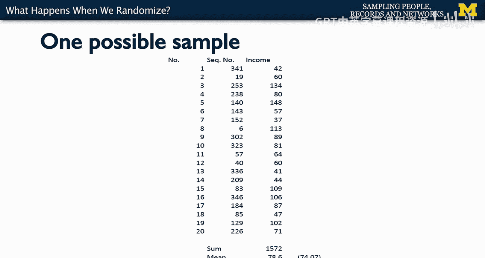

例如，从一个包含370名教职员工的名单（抽样框）中，我们使用随机数表抽取了20人作为样本。随后，我们访谈了这20人，获得了他们的收入数据，并计算了样本的平均收入。

**代码示例（概念性）**：
```python
# 假设 faculty_frame 是包含370个教职员工ID的列表
import random
sample = random.sample(faculty_frame, 20)
# 然后调查这20人，计算平均收入 sample_mean
```


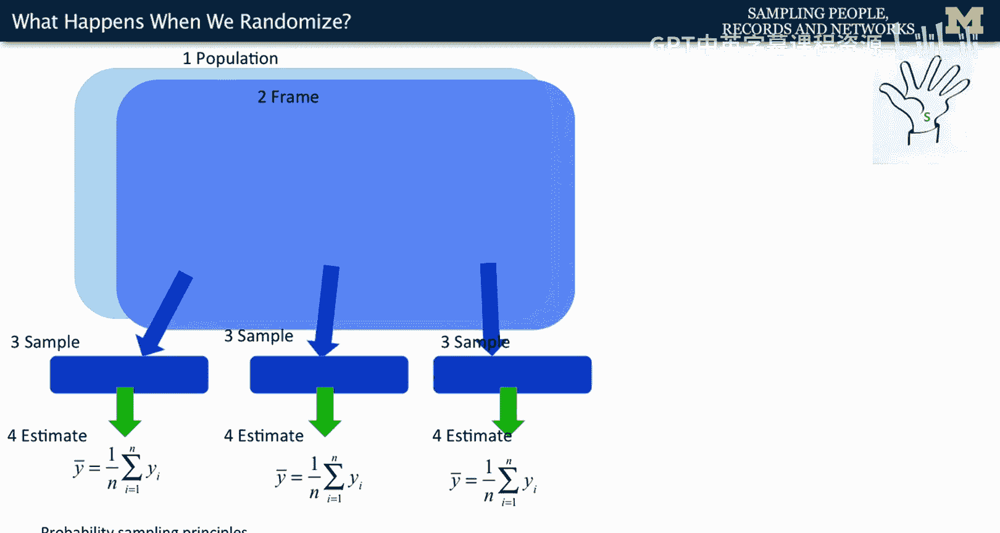

---

## 第四步：计算样本估计值 📊


从样本中，我们可以计算出一个**估计值**，例如样本平均收入。这个值是我们对总体平均收入的最佳猜测。


然而，由于我们只调查了总体的一小部分（20/370），这个样本均值几乎不可能是总体的真实均值。样本估计值与真实值之间存在误差。


---

## 第五步：想象所有可能的样本 🌌

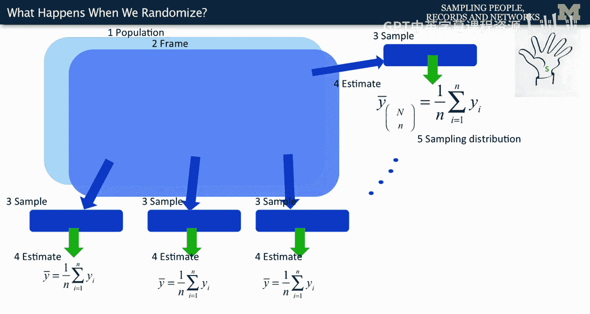

这是关键的概念性一步。我们使用的随机抽样方法意味着，如果回到抽样框，从另一个随机起点重新抽取，我们可能会得到一个完全不同的样本，从而得到一个不同的样本均值。


事实上，从370人中抽取20人的所有可能组合数量是巨大的（有数十亿种可能）。对于每一个可能的样本，我们都可以计算出一个均值。这样，我们就得到了一个由所有可能样本均值构成的**分布**。

这个分布具有一些重要特性：
*   它有一个范围（最小值和最大值）。
*   大多数均值会聚集在中间。
*   在概率抽样下，这个分布会呈现**正态分布**（钟形曲线）的形状。

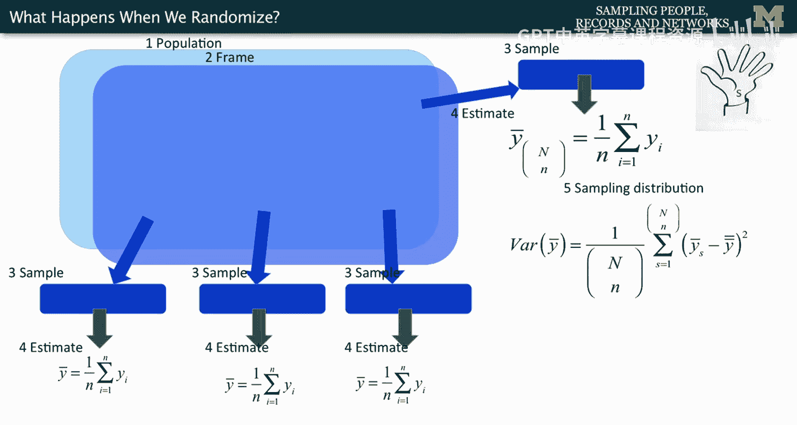

---

## 第六步：计算标准误 📐


我们不可能真的抽取数十亿个样本来查看这个分布的 spread（离散程度）。但幸运的是，统计理论为我们提供了一个解决方案。

通过一个数学公式，我们可以仅利用**一个样本**的数据，来估计所有可能样本均值的离散程度。这个估计值称为**标准误**。

**公式**：
`标准误 (SE) = 样本标准差 / sqrt(样本容量)`

标准误是一个重要的度量，它量化了我们基于当前样本进行估计的**不确定性**。标准误越小，说明不同样本得到的估计值彼此越接近，我们的估计就越精确。

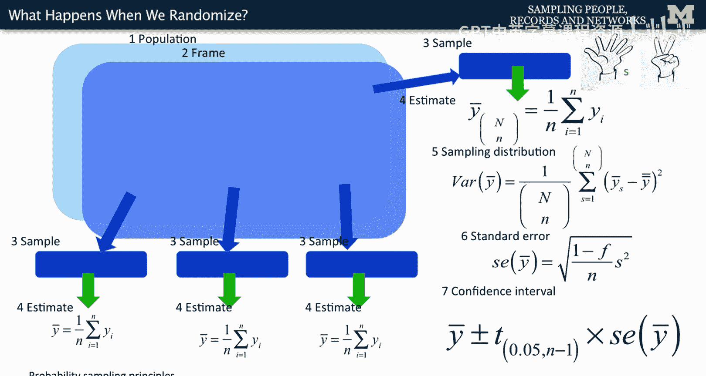

---


## 第七步：构建置信区间 🎯

最后，我们利用样本估计值（如均值）和标准误，构建一个**置信区间**。置信区间提供了一个可能包含总体真实值的范围。

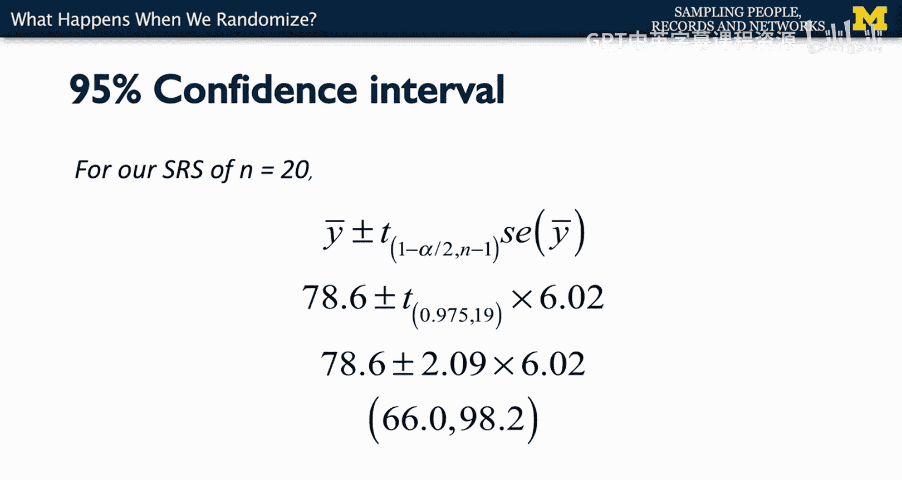

例如，我们可能得到“66到98”这样一个区间，我们的样本均值82位于其中。我们可以这样理解：如果我们用相同方法重复抽样很多次，那么有95%的次数，计算出的区间会包含真实的总体均值。

区间越宽，表示不确定性越大；区间越窄，表示估计越精确。

---


## 总结与核心要点

本节课中，我们一起学习了随机抽样的七步统计流程及其核心价值：

1.  **定义总体**：明确研究对象的全体。
2.  **获取抽样框**：找到用于抽样的实际列表。
3.  **抽取随机样本**：使用随机方法从框中选取元素。
4.  **计算样本估计值**：得到对总体参数的猜测（如均值）。
5.  **理解抽样分布**：概念上认识所有可能样本结果的全貌。
6.  **计算标准误**：利用一个样本来量化估计的变异性。
7.  **构建置信区间**：给出一个包含不确定性信息的估计范围。

这个流程的核心优势在于，**随机化**的机制允许我们仅从**一个样本**出发，通过标准误和置信区间来科学地评估结果的**质量**和**不确定性**。这使我们能够回答“这个数字有多可靠？”的关键问题，而无需进行代价高昂的全面普查。


下一讲，我们将更深入地探讨如何利用这个框架来评估样本的代表性质量。