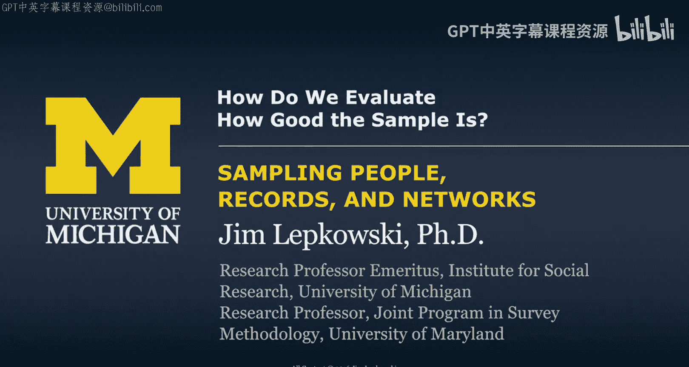
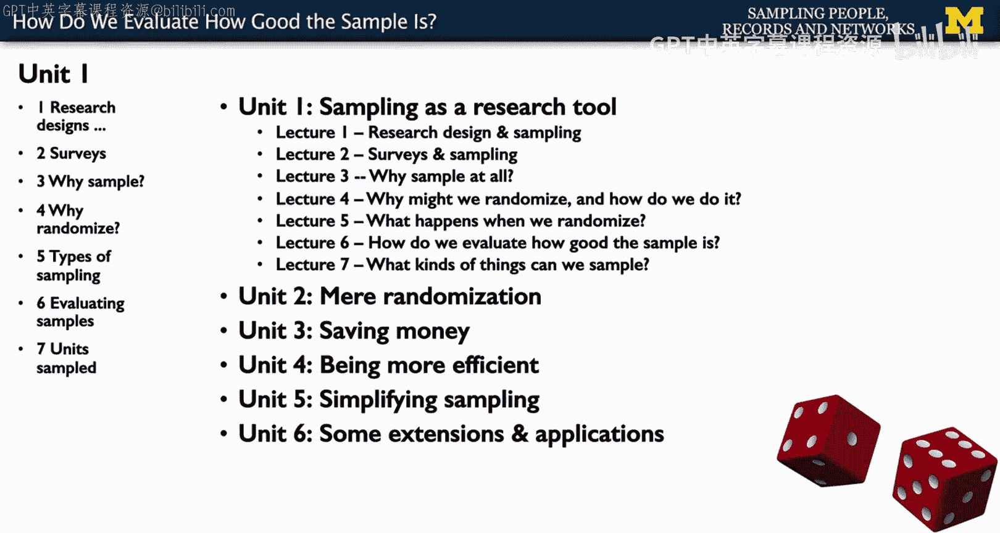
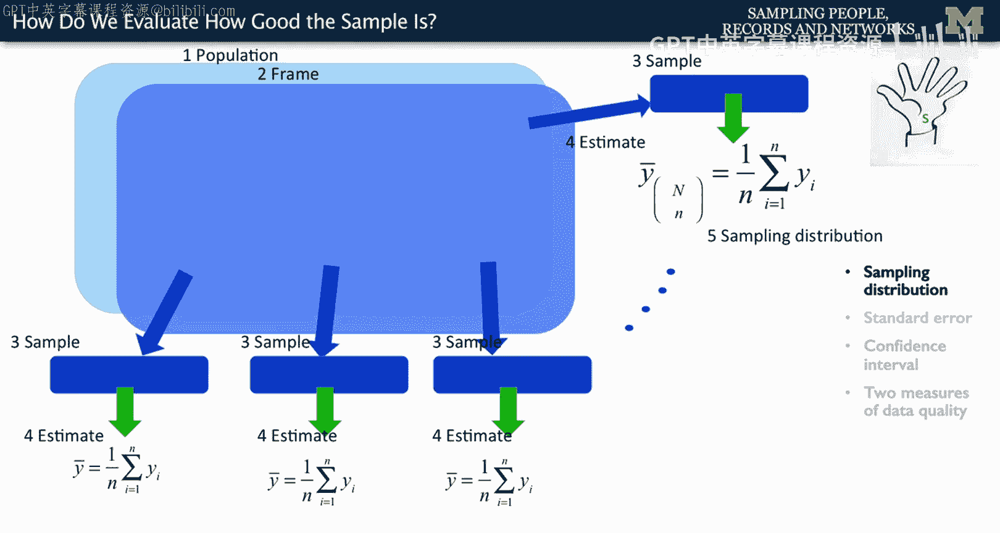
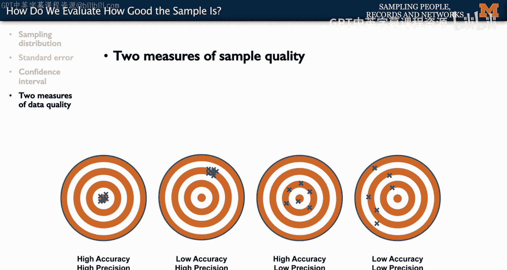
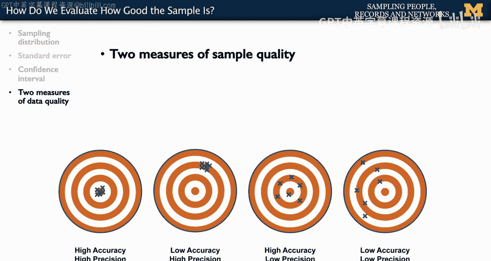
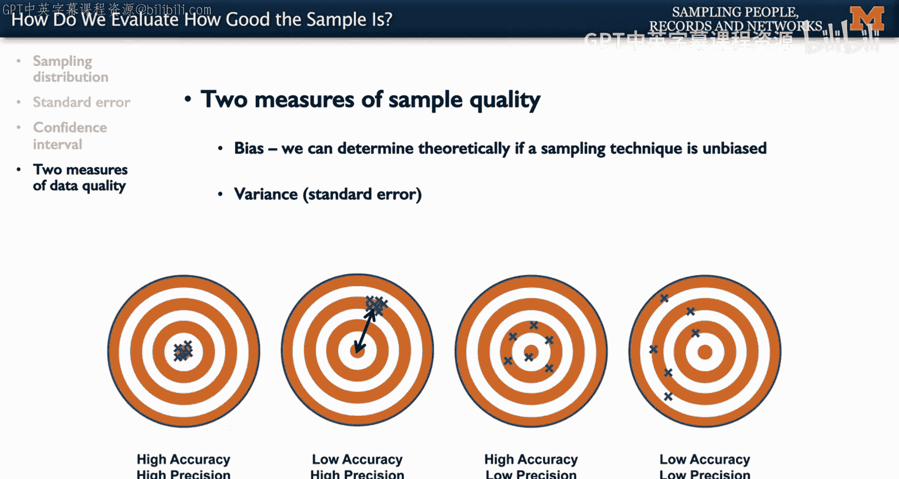
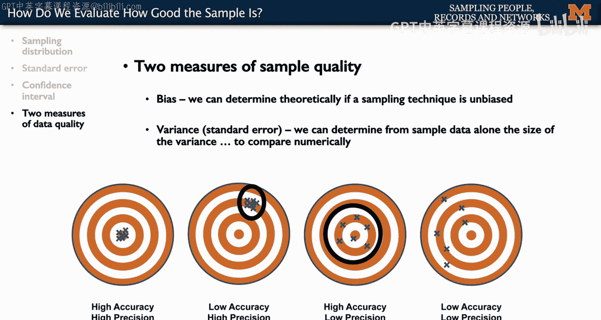
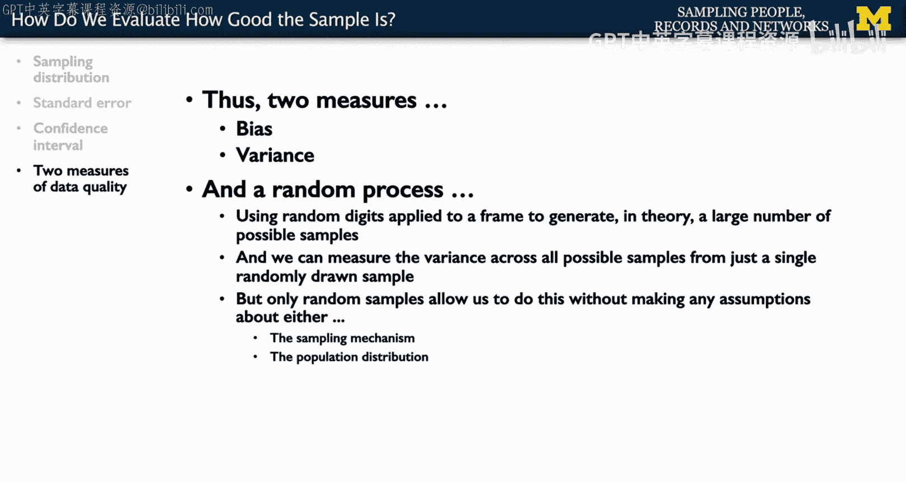
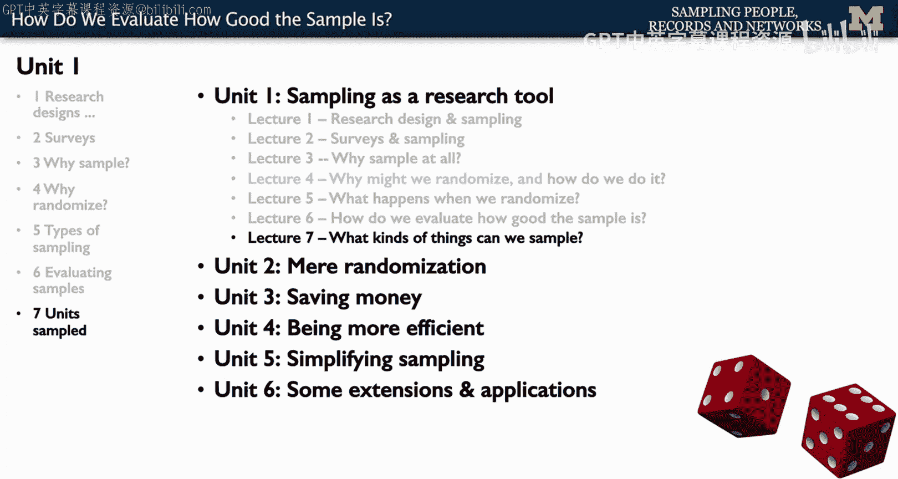

#  087：样本质量评估 📊

在本节课中，我们将学习如何评估一个样本的质量。我们将回顾抽样分布、七步推断过程以及标准误等核心概念，并引入两个衡量数据质量的关键指标：**偏差**和**方差**。

---

上一节我们讨论了随机抽样以及所有可能样本的分布情况。本节中，我们将利用这些知识来评估样本质量。

我们继续沿用第七步推断过程。这个过程始于一个明确的**总体**，接着是与之匹配的**抽样框**。第三步，我们从中抽取一个**样本**。第四步，我们基于这个样本计算一个**估计值**。第五步，我们想象重复这个过程无数次，这就引出了**抽样分布**的概念——即所有可能样本的估计值的分布情况。

从抽样分布中，我们可以计算出所有可能样本估计值的离散程度，即**标准误**。这是第六步。标准误的公式（以样本均值为例）为：
`SE = σ / √n`
其中，`σ` 是总体标准差，`n` 是样本量。在实际操作中，我们通常用样本标准差 `s` 来估计 `σ`。

第七步，我们利用标准误构建**置信区间**，这是一个关于总体参数的不确定性陈述。例如，我们之前得到一个从66到98的区间，这个区间较宽，表明我们的估计不够精确。提高样本量可以缩小标准误，从而获得更窄、更精确的置信区间。

---

现在，我们来看看如何用两个指标来评估样本质量。以下是两种常见的质量情况示意图：

我们可以将每次抽样想象成一次射击，目标是命中靶心（代表总体真实值）。上图展示了四种不同的结果模式：

*   **高精度，高准度**：射击点紧密聚集在靶心周围。
*   **高精度，低准度**：射击点紧密聚集，但整体偏离了靶心。
*   **低精度，高准度**：射击点分散，但它们的中心平均值接近靶心。
*   **低精度，低准度**：射击点分散，且中心平均值偏离靶心。

这引出了衡量样本质量的两个核心维度：

1.  **偏差**：指所有可能样本估计值的**平均值**与总体真实值之间的系统性差距。就像射击时瞄准点整体偏离了靶心。在第二张图中，我们用黑色双箭头标出了这个差距。
2.  **方差**：指样本估计值自身的**离散程度**，通常用**标准误**来衡量。标准误越大，就像射击点散布的圆圈直径越大，表示精度越低。在第三张图中，我们突出了这种较大的散布。

---

理解偏差和方差后，我们来看看如何在实际中评估它们。

**关于偏差**：在理论上，通过分析抽样分布，我们可以判断一个抽样过程是否存在偏差。例如，我们接下来要讲的**简单随机抽样**，在理论上被证明是**无偏**的，这意味着从长期来看，其样本估计值的平均值会等于总体真实值。

**关于方差**：我们可以直接从**一个**具体的样本数据中计算出**标准误**，从而得知所有可能样本的离散程度（即“圆圈”的直径）。这是一个非常强大的特性：我们无需真的抽取无数个样本，仅凭一个正确抽取的概率样本，就能评估整个抽样过程的精度。高精度意味着标准误小，低精度意味着标准误大。

因此，样本质量完全取决于所使用的随机抽样过程。我们可能得到无偏但不够精确的结果，也可能得到有偏但很精确的结果。我们将使用偏差和方差这两个维度来综合评估我们结果的质量。

---

本节课中我们一起学习了评估样本质量的核心框架。我们回顾了从抽样到推断的七步过程，并重点介绍了两个关键质量指标：

*   **偏差**：衡量估计值的系统性误差。
*   **方差**（通过**标准误**衡量）：衡量估计值的随机波动性，即精度。

重要的是，对于**概率抽样**（如简单随机抽样），我们可以从一个样本计算出标准误，并利用理论判断其无偏性。这使得我们能够对结果的质量进行量化评估。

对于非概率抽样（如在商场门口方便抽样），我们无法直接计算标准误或确保无偏性。若想使用类似的推断工具，我们必须额外假设该样本“类似于”随机样本，或者对总体分布做出强假设。

在下一讲也是本单元的最后一讲中，我们将回顾人员、记录和网络这三种不同的总体类型，为后续应用这些随机抽样方法提供具体的背景和框架。