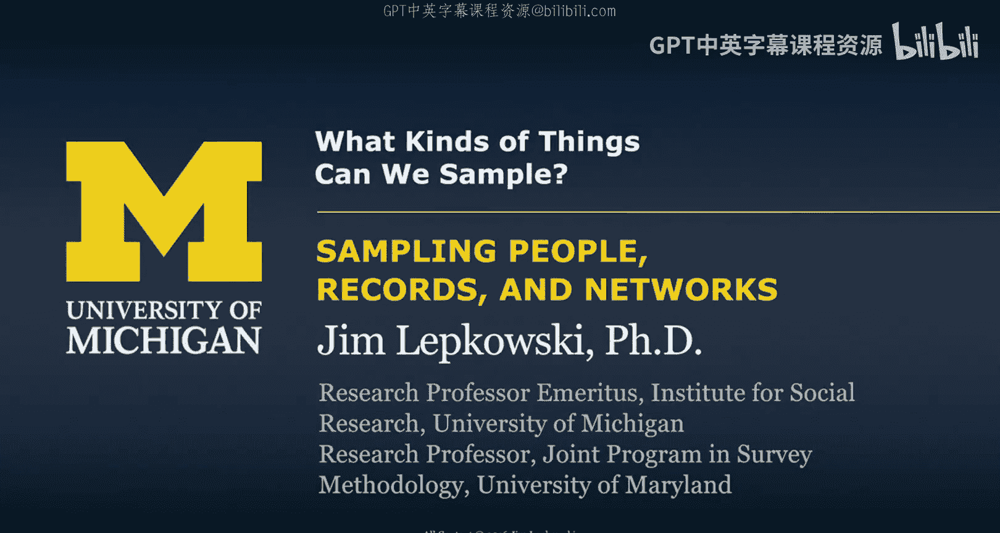
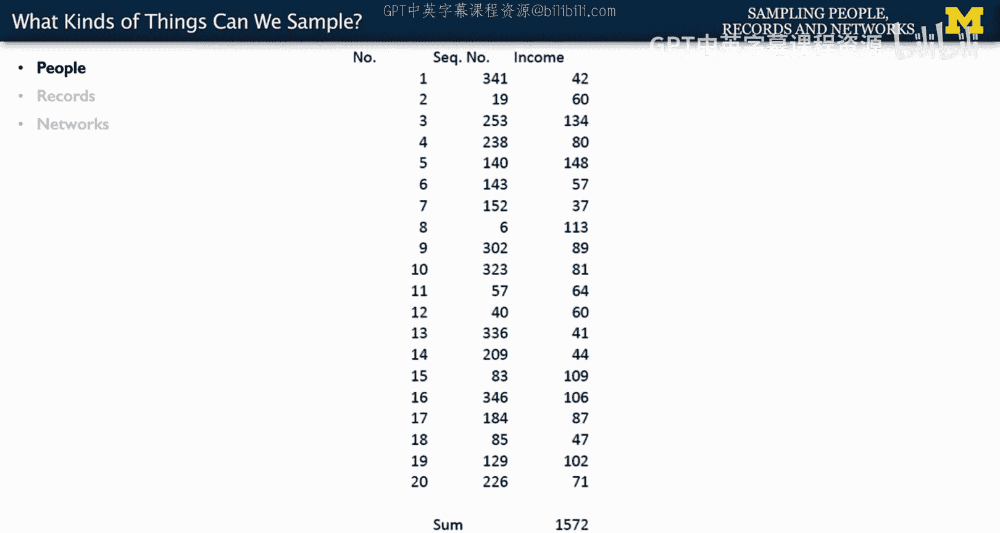
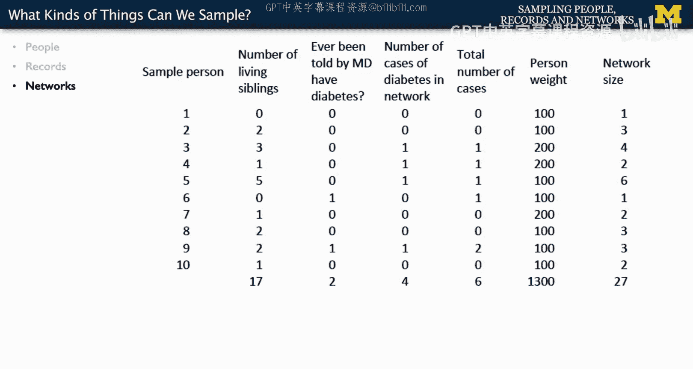
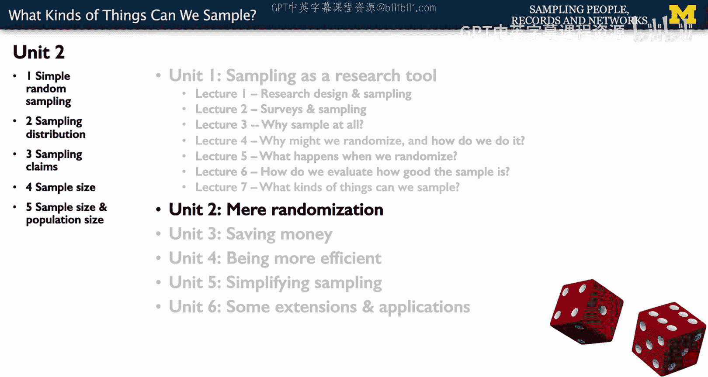

#  088：抽样对象类型 🎯

在本节课中，我们将学习抽样方法如何应用于不同类型的研究对象。我们将探讨对**人群**、**记录**和**网络**进行抽样的具体思路和案例，理解抽样单元在不同情境下的含义。

上一节我们介绍了抽样在调查研究中的基础概念和重要性。本节中，我们来看看这些概念如何具体应用于不同的研究对象。

## 对人群抽样 👥

对人群进行抽样是最常见的形式。抽样单元是明确的个体，例如个人、学生或员工。

以下是密歇根大学教职员工的薪资抽样案例：
*   **总体/抽样框**：一份包含370名教职员工的列表。
*   **数据**：列表中包含序列号、员工ID、所属学院、性别、职称和薪资等信息。
*   **抽样过程**：使用随机数表，从370人中抽取一个容量为20的**简单随机样本**。
*   **分析与推断**：计算样本的平均薪资，并基于**抽样分布**的概念，利用单个样本的变异性来估计所有可能样本的变异性，从而做出统计推断。

这个案例展示了从明确的人群列表中抽取随机样本并进行分析的完整流程。

## 对记录抽样 📄

抽样方法同样可以应用于非人群的对象，例如各种**记录**。此时，抽样单元可能是一笔交易、一份账单或一个事件。

以下是一个信用卡交易记录的假设案例：
*   **总体/抽样框**：一系列信用卡交易记录。
*   **数据**：每条记录包含日期、时间、交易号、类别、子类别和金额等信息。
*   **抽样动机**：我们可能需要对交易进行更详细的分类或编码，而这需要专家意见，耗时耗力。因此，我们只对**样本**记录进行深入分析，而非处理全部数据。
*   **抽样过程**：同样使用随机数字来抽取交易记录。
*   **分析目标**：计算平均交易金额、特定类别交易的比例，或进行回归分析。

这个例子说明，当对每个单元进行深度测量成本过高时，抽样是处理大量记录的有效方法。

## 对网络抽样 🌐

抽样方法还可以应用于更复杂的结构，例如**社会网络**。网络抽样通常从个体开始，然后扩展到与其相连的其他个体。

以下是一个兄弟姐妹网络的抽样案例：
1.  **初始抽样**：首先随机抽取一个**人**作为样本。
2.  **网络数据收集**：访问该样本个体，询问两类问题：
    *   关于**本人**：您有多少位在世的兄弟姐妹？（用于确定网络大小）
    *   关于**网络成员**：您本人以及您的兄弟姐妹中，是否有被医生诊断患有糖尿病？（用于收集网络属性数据）
3.  **抽样复杂性**：在这种设计中，一个个体（例如，一个有三名兄弟姐妹的人）有**多种途径**被选入样本：既可能本人被直接抽中，也可能通过其任何一位兄弟姐妹被间接“带出”。这被称为**多重性抽样**。
4.  **估计挑战**：在进行总体推断时，必须考虑这种不等的入样概率，这比简单随机抽样更为复杂。其基础仍然是概率论，但需要更复杂的计算。

网络抽样展示了如何将抽样方法从单个个体扩展到相互关联的群体。

---

本节课中我们一起学习了抽样在三种不同对象类型上的应用：**人群**、**记录**和**网络**。我们看到，尽管抽样单元（人、交易、网络节点）不同，但**随机抽样**的核心逻辑是相通的。同时，网络抽样也引入了**多重性**等更复杂的概念，为后续学习更高级的抽样技术做了铺垫。

在接下来的第二单元，我们将深入探讨一种仅依赖随机化的基础抽样方法——**简单随机抽样**，并详细研究其性质与后果。