#  090：随机抽样简史 📜

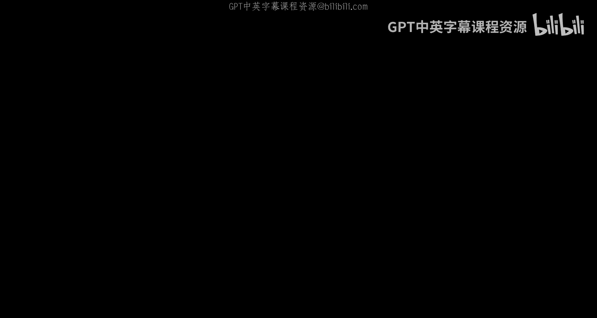

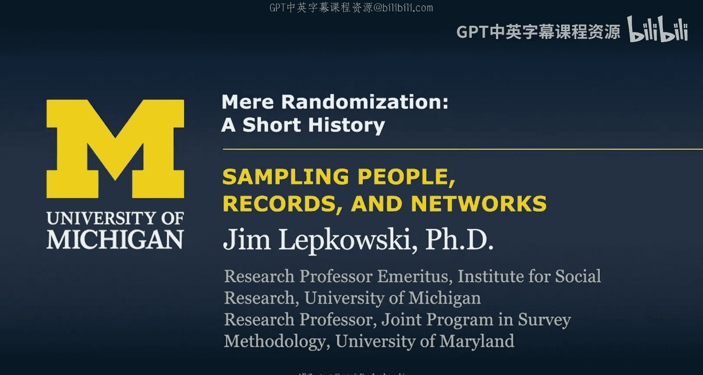

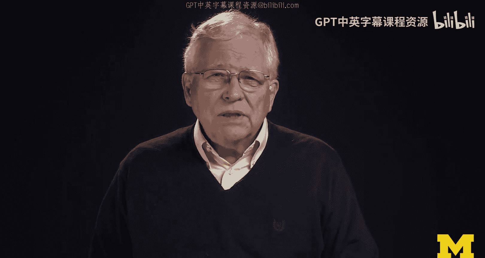

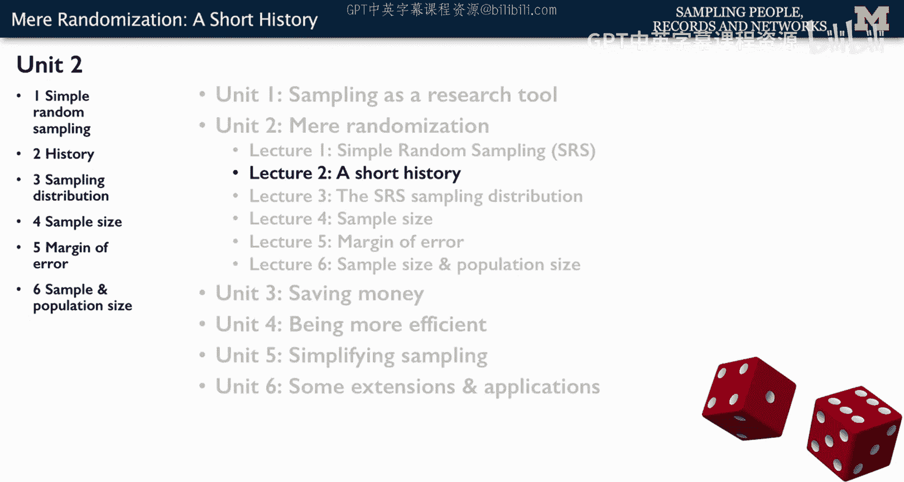

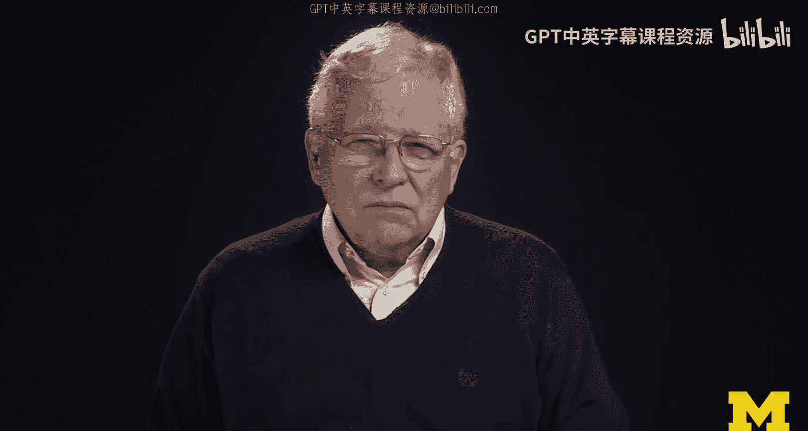

在本节课中，我们将从一个不同的视角，回顾一些我们已经接触过的概念。我们将再次审视从特定规模的总体中抽取样本，以及存在多种可能样本的问题，并探讨其背后的含义。我们将聚焦于**简单随机抽样**的语境，并简要回顾其思想发展史，为我们后续的学习建立一个框架。

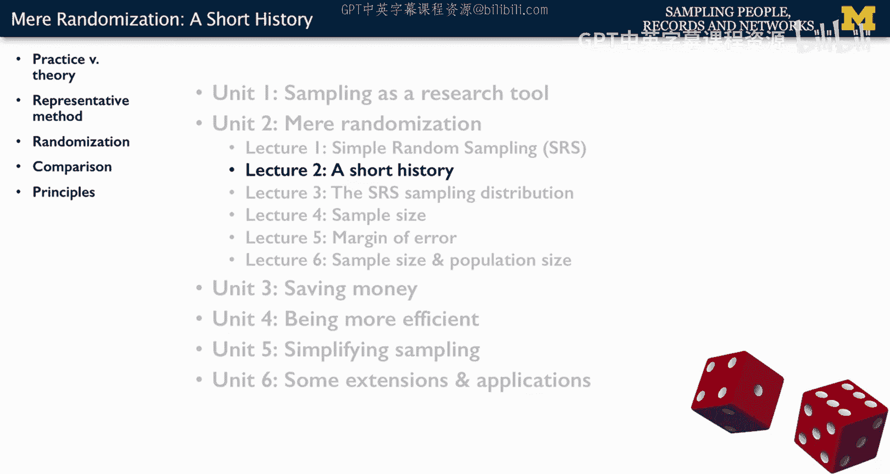

在未来的课程中，当我们深入学习其他抽样设计时，会回想起这部分内容。

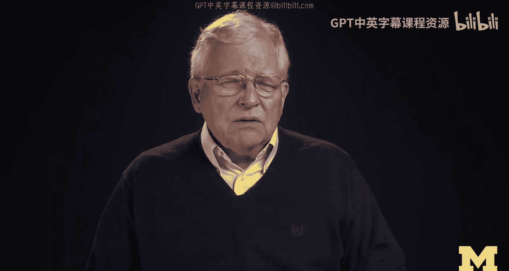

## 历史背景：实践与理论

我们的历史回顾将涉及实践与理论之间的差异、我们已使用过的“代表性方法”这一术语、更多关于随机化的内容，以及代表性方法与随机化方法之间的比较。最后，我们将提炼出一些原则。

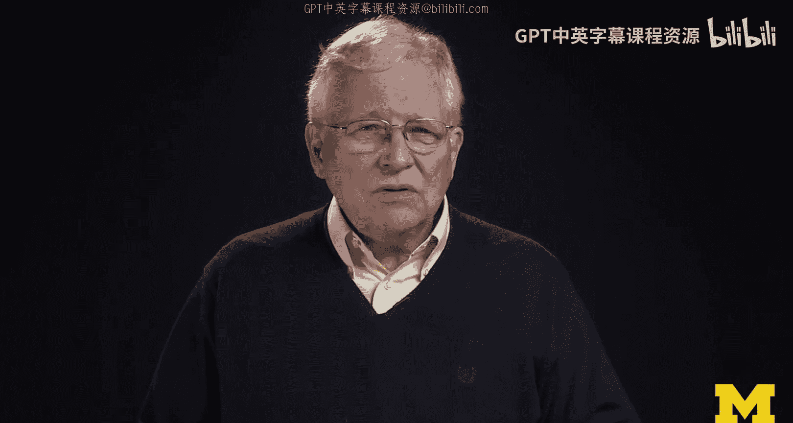

这些原则可以为我们后续决定如何抽取样本提供一个框架。我们今天所谈论的概率抽样，其构建方式源于实践，而非先有理论发展，再从实践中提取。

## 从实践到理论的发展

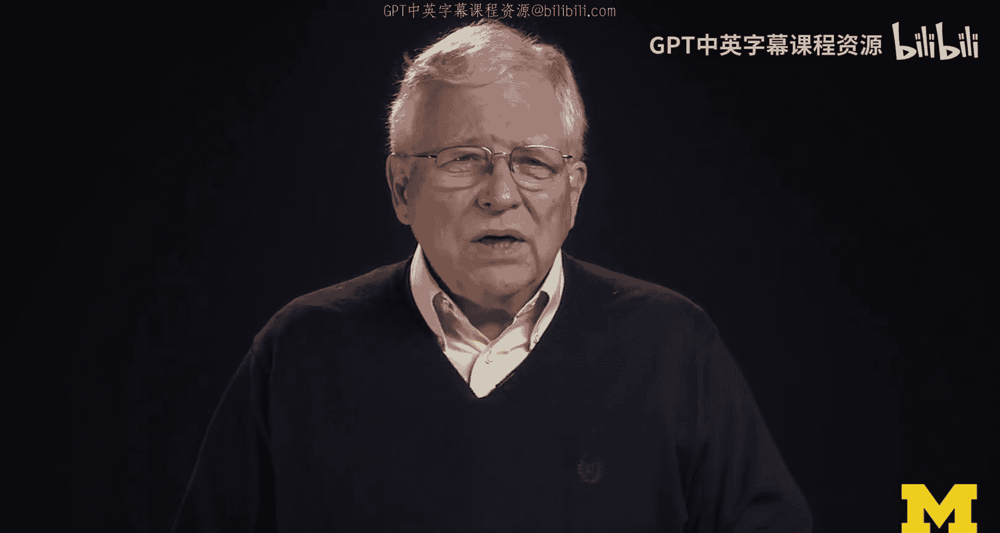

我们所探讨的技术，最初是为了解决实际问题的响应。它们是试图理解总体状况的实践结果。统计理论随后介入，形式化了那些解决实际问题的从业者所做出的隐含假设，有时确认、有时修正、有时则扩展了实践中的做法。

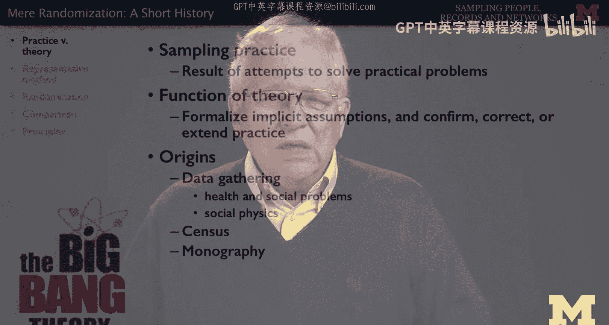

因此，典型的（尽管不是唯一的）发展路径是从实践走向理论。这解释了您已经看到以及我们将要看到的关于这些抽样设计的一些观点。

## 抽样实践的起源

抽样实践的起源，确实源于我们一直在讨论的数据收集调查框架。我们追溯的历史并不久远。那是一个科学兴起的时代，通过系统研究和我们讨论过的研究设计（如实验和观察）来产生新知识的理念，因其对理解物理世界的贡献而广受推崇。

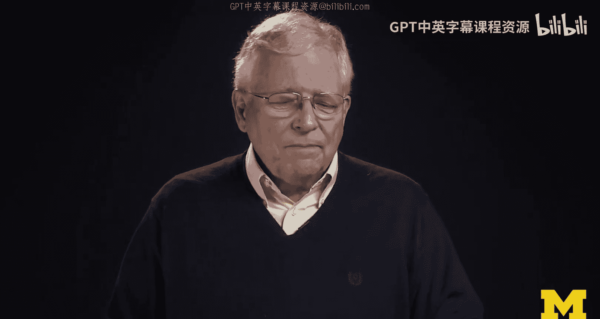

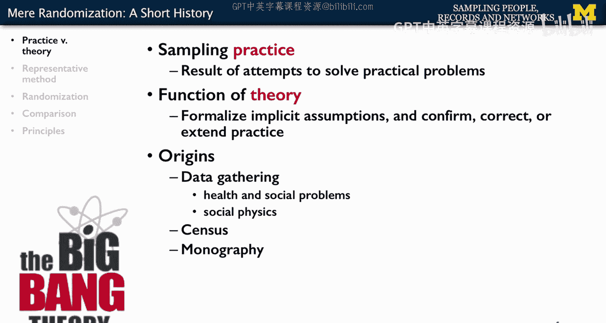

与此同时，人们对健康和社会问题也抱有极大兴趣。许多早期的社会科学家是 philanthropists（慈善家），他们拥有资金（尤其是在经历了工业革命的西北欧），并希望以科学的方式研究工业革命和人口大规模涌入城市中心所带来的影响，就像物理或化学进行研究那样。因此，他们中的一些人自称其研究为“社会物理学”。

## 早期研究方法：普查与专题研究

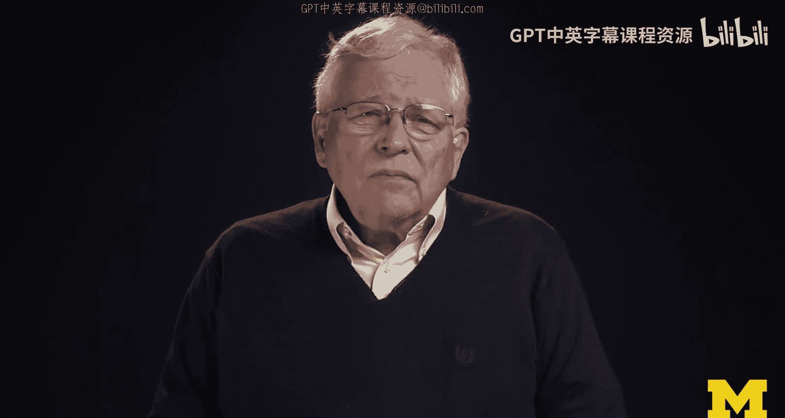

当时，在他们看来，有两种基本的研究方法。

*   **普查**：这是我们已经讨论过的方法。研究者心中有一个明确的总体（例如伦敦某个教区的居民或法国的一个村庄），他们会对该总体中的所有单位进行清点和测量。这使他们确信能够从研究结果推断回该总体。
*   **专题研究**：另一些人认识到，对于他们感兴趣的许多总体（例如整个国家），无法进行普查。于是他们开始进行所谓的“专题研究”，即研究一个“典型”单位（如一个村庄、城镇或社区），然后推广到整个总体。这种方法至今仍在使用，例如美国的“米德尔敦”研究。

## 代表性方法的兴起

对于当时的政府统计人员来说，这两种方法都不完全令人满意。在挪威，首席统计学家凯尔（Kiaer）负担不起为每个新问题都进行普查。他开始构建他所认为的国家的“缩影”——抽取一个样本。这个样本不是单一的典型单位，而是一组单位，当它们组合在一起时，能构成挪威的缩影。他在选择这些单位时利用了先验信息，但没有使用随机选择。这就是“代表性方法”的雏形。

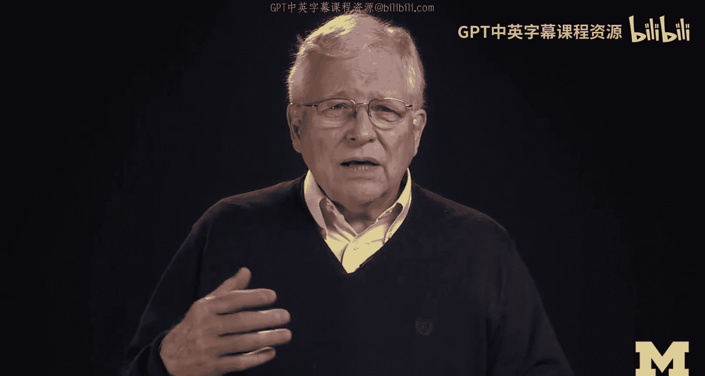

他将这个想法带到了国际统计学会，但遭遇了阻力。一些统计学家（如冯·迈尔）认为必须进行普查；法国学派（如勒·普莱）则主张深入的专题研究。这场争论促使他们成立了一个委员会。

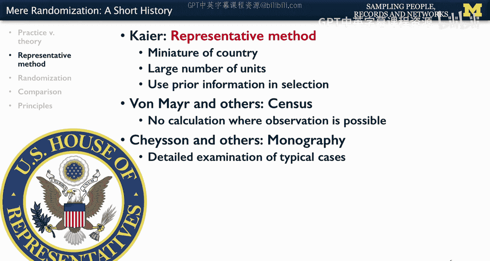

## 代表性方法的局限与随机化的引入

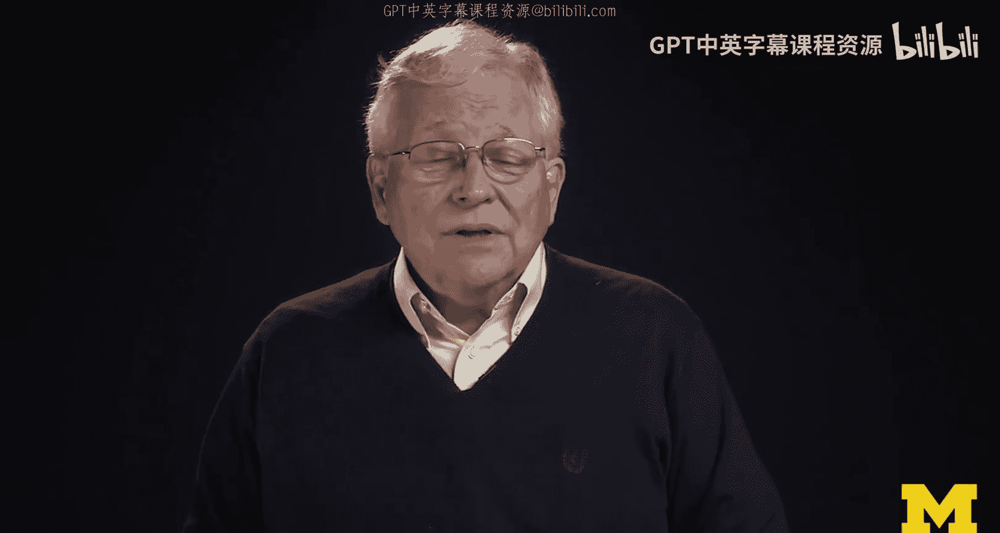

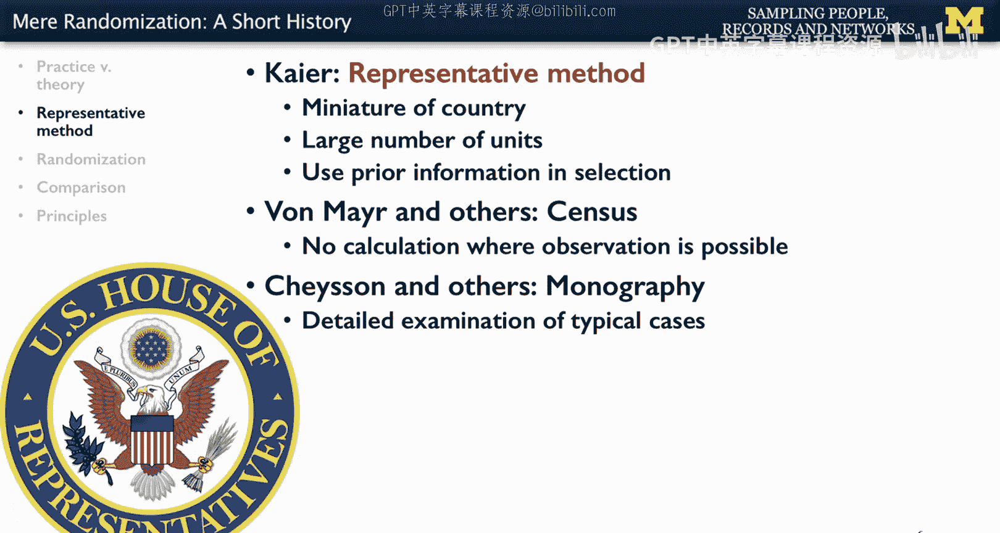

该委员会经过多年讨论后得出结论：普查、代表性方法和专题研究都是研究总体的合适方法。但他们提出一个原则：无论采用哪种方法，都必须确保其“代表”总体。然而，“代表性”在当时并不是一个明确定义的统计术语。

基于“代表性”思想，发展出了一些我们最近讨论过的**非概率抽样方法**，如立意抽样、专家判断抽样，甚至是平衡抽样（确保样本在某些维度上与总体相似）。

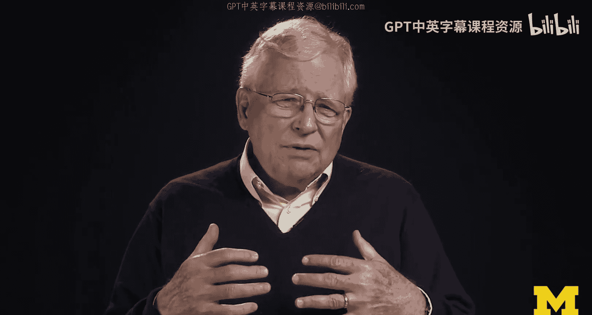

在该报告发布后不久，统计学家鲍利在1906年提出，应将代表性方法与**随机化选择**结合起来。他当时正与在实验中应用随机化的费希尔合作。他认为，应该像在实验中一样，将随机化应用于确定谁在样本内、谁在样本外。

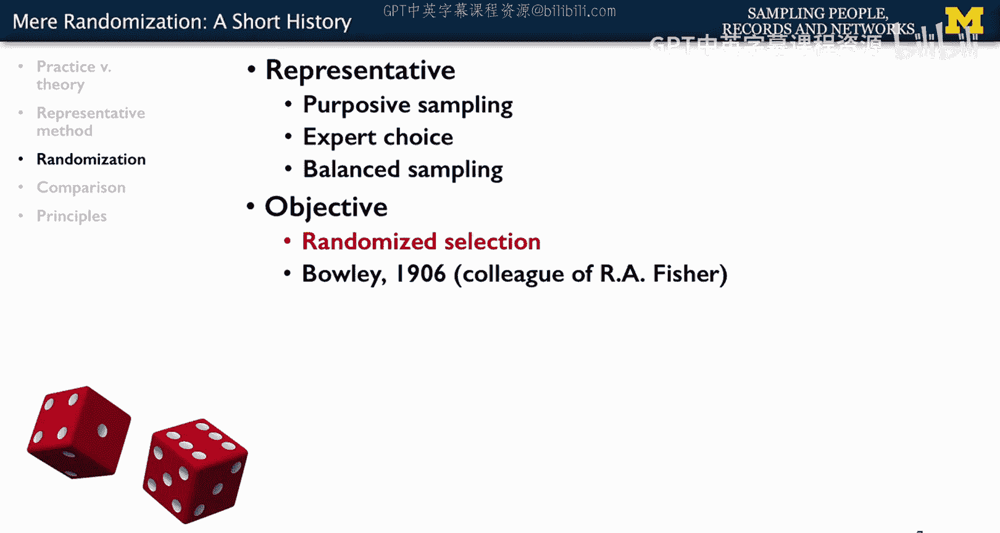

## 内曼的贡献与概率抽学的确立

然而，在整个1910年代和1920年代，随机化并未真正流行起来，它似乎只是一个没有特定目的的附加步骤。直到1934年，统计学家**内曼**发表了一篇论文，系统比较了代表性方法与随机选择方法（即概率抽样）。

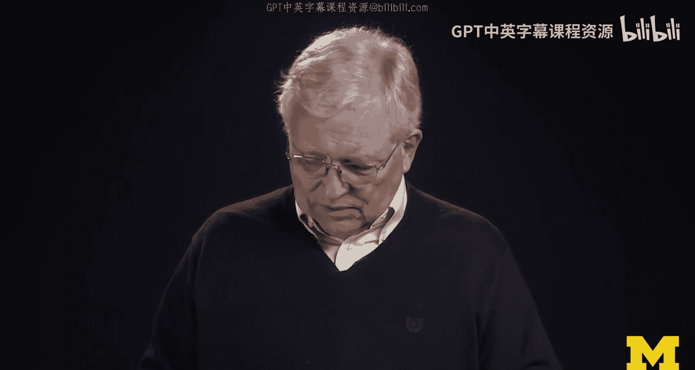

在这篇开创性的论文中，他研究了**重复抽样**的性质。他提出了想象所有可能样本的想法，并考察统计量（估计量）在所有可能样本上的分布，即**抽样分布**。正是通过这项工作，他引入了**置信区间**的概念。

内曼最关心的是，在什么条件下，不同的程序（代表性程序或随机选择程序）能产生有效的估计。他定义并对比了两种类型：

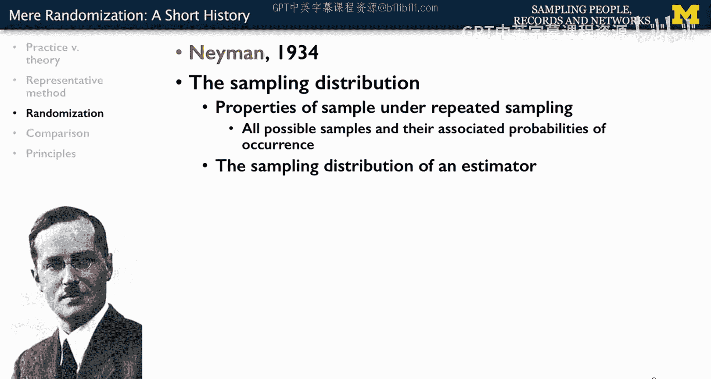

*   **概率抽样**：可以在**不**需要对总体特征分布做任何假设的情况下进行，并能产生无偏估计（我们将在下一课详细讨论）。
*   **立意抽样或平衡抽样**：必须对总体结构做出**很强且通常难以验证**的假设。

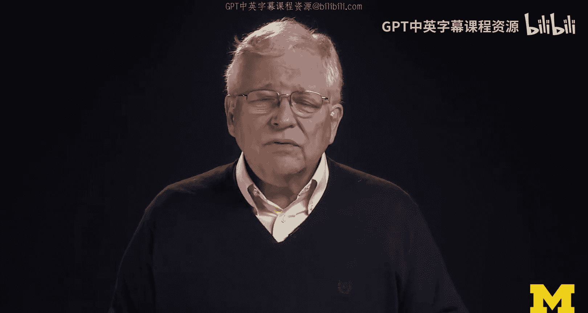

通过对比，内曼指出，概率抽样因其**客观性**而更受青睐。这场从19世纪末到20世纪上半叶的辩论，最终确立了现代抽样调查的基础原则。

## 确立的核心原则

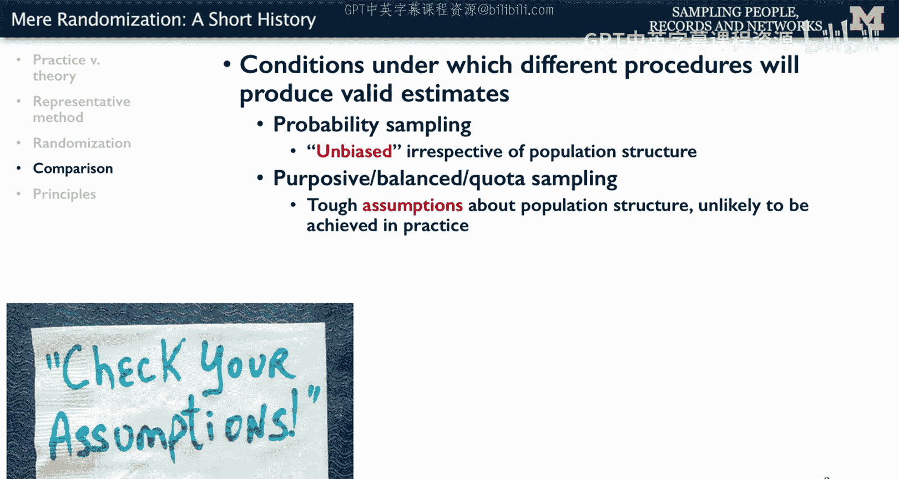

从这场历史辩论中，确立了以下核心原则，这些原则构成了我们当前所讨论内容的基础：

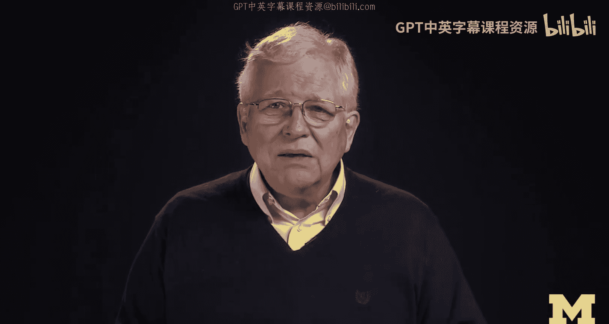

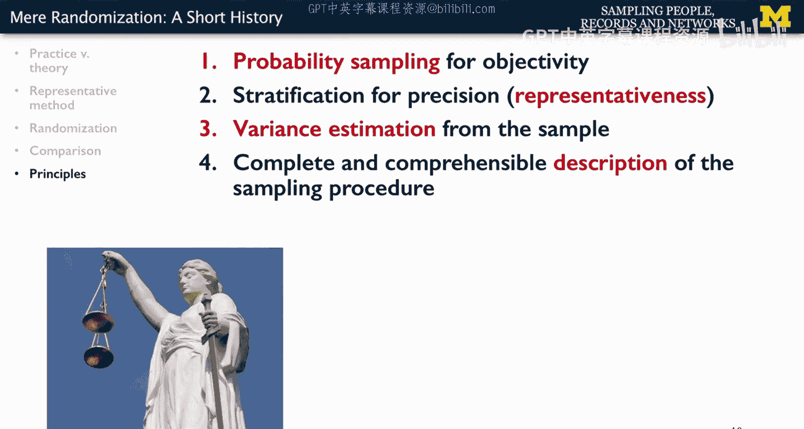

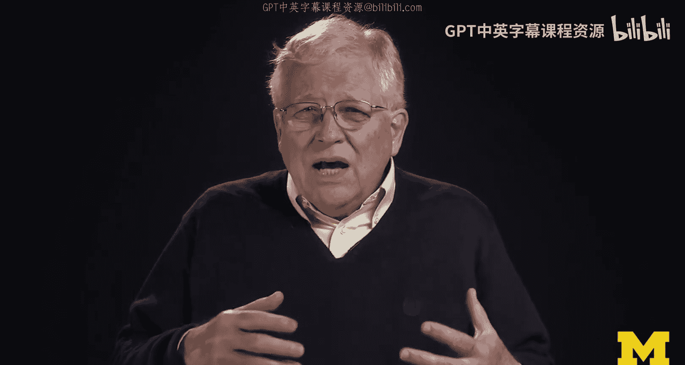

1.  **应采用概率抽样**：因其客观性，且不依赖于对总体结构的强假设。
2.  **应通过分组（如分层）提高代表性**：使代表性更加形式化和精确。
3.  **应评估估计量的质量**：这涉及估计我们讨论过的标准误和置信区间。
4.  **应向数据使用者提供完整的推断信息**：不仅提供对总体参数的估计（如均值、比例），还应以置信区间或标准误的形式提供关于该估计的不确定性度量。
5.  **应提供抽样程序的完整描述**：确保读者能够自行评估研究过程。

## 总结与展望

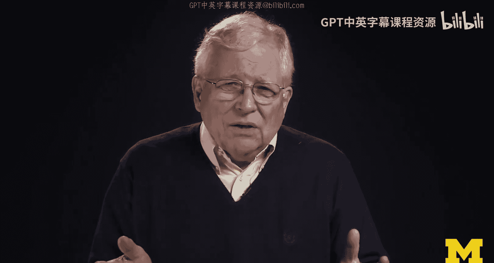

本节课中，我们一起回顾了抽样方法从早期实践（普查、专题研究）到代表性方法，最终发展到**概率抽样**和**统计推断理论**（如置信区间、抽样分布）确立的简史。我们了解了内曼的关键贡献，以及由此确立的现代抽样调查的核心原则。

需要理解的是，与此同时，其他抽样方法也在被使用。但掌握了本节课的内容，您将有能力评估其他抽样方式的优劣。这也是我们在此回顾这段历史的原因。

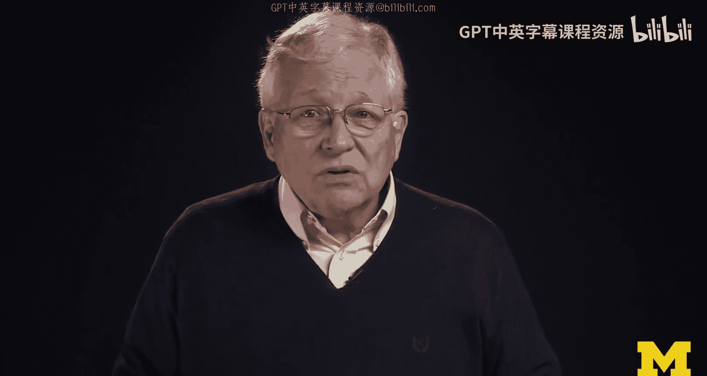

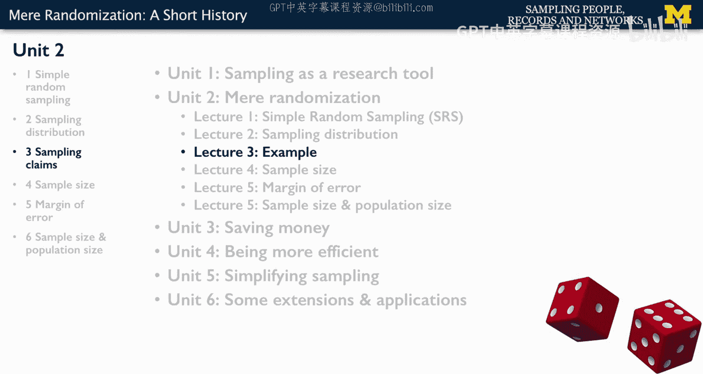

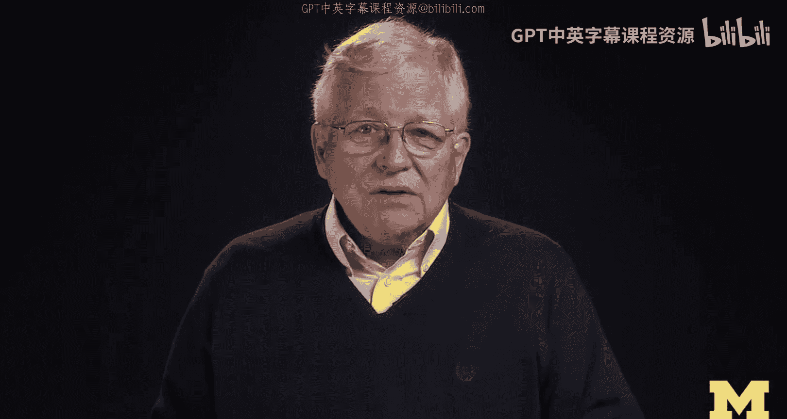

在下一讲中，我们将看一个具体的例子，并研究其中的抽样主张，然后再继续讨论样本容量的问题。