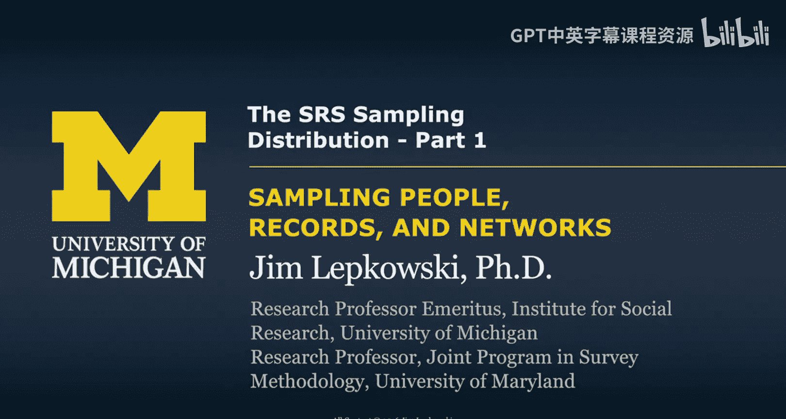
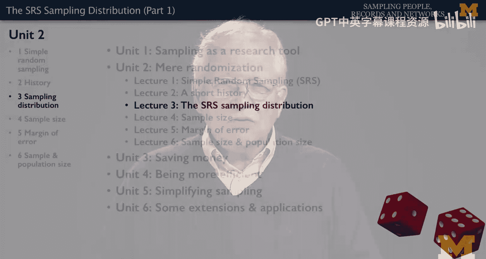
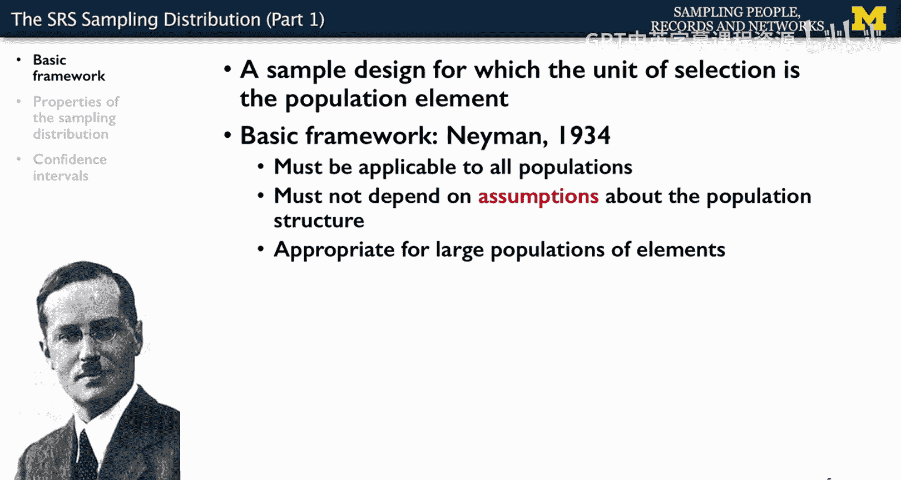
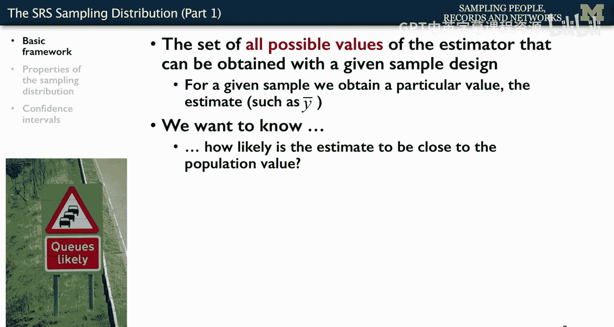
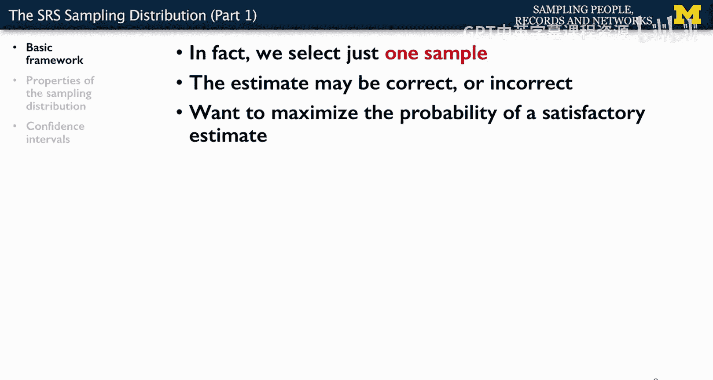
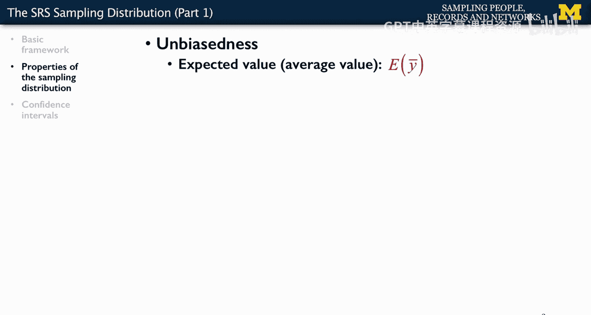
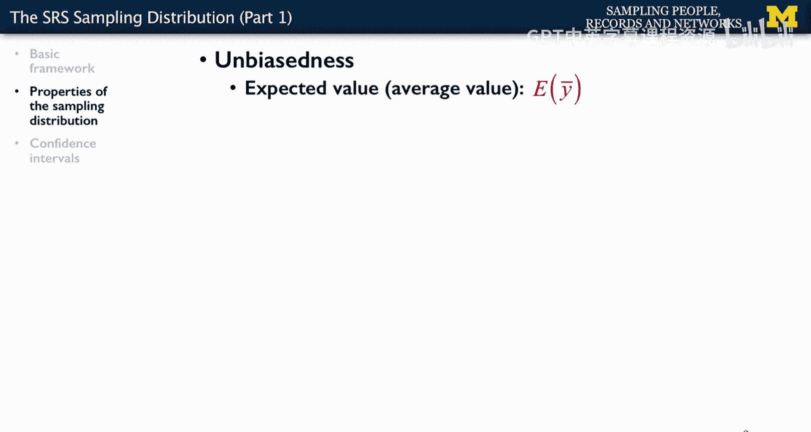
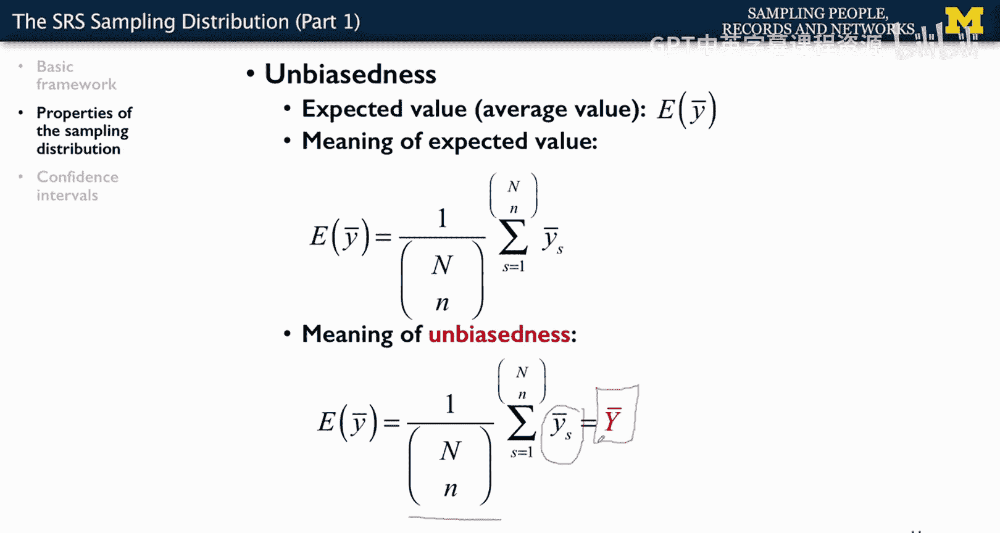
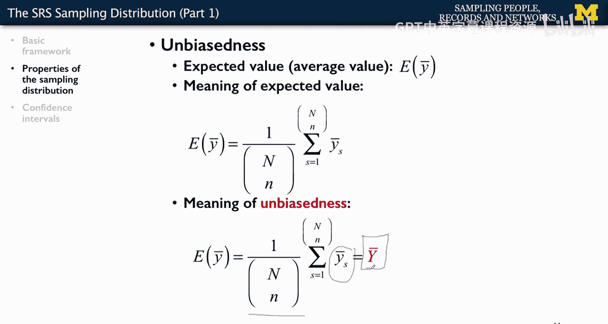
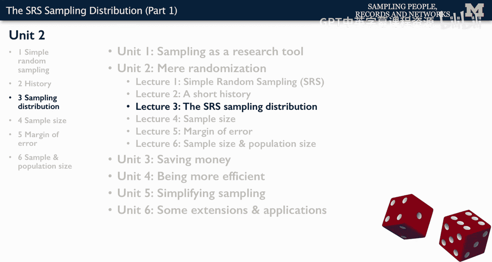

#  091：简单随机抽样（SRS）的抽样分布（上）📊

在本节课中，我们将学习简单随机抽样（SRS）的核心概念——抽样分布。我们将探讨其定义、性质，特别是**无偏性**这一关键特性。理解抽样分布是设计有效抽样方案和计算样本量的基础。

上一节我们介绍了简单随机抽样作为一种客观的抽样方法。本节中，我们来看看其理论核心——抽样分布。

## 抽样分布的基本框架

抽样分布的概念由奈曼在1934年提出。其基本思想是：对于一个给定的总体和抽样设计（如简单随机抽样），我们可以考虑**所有可能被抽出的样本**。每个样本都会计算出一个统计量（例如样本均值 `y_bar`）。所有这些可能样本统计量构成的概率分布，就是**抽样分布**。

这个框架的关键在于“重复抽样”的想象。虽然在实际研究中我们通常只抽取一个样本，但通过思考所有可能样本的结果，我们可以从理论上评估一次抽样结果的可靠性。这个过程是客观的，因为样本选择完全由随机数决定。

我们关心的是，基于单一样本计算出的统计量（如 `y_bar`）与总体真实值（如总体均值 `Y_bar`）的接近程度。由于我们不知道总体真实值，我们需要一个能平均而言得到正确结果，并且能衡量其变异程度的方法。

## 抽样分布的性质：无偏性

我们首先定义抽样分布的第一个重要性质：**无偏性**。

在统计学中，无偏性并非指单次估计没有错误，而是指**估计量的期望值等于被估计的总体参数**。期望值（用符号 `E` 表示）可以理解为所有可能样本估计值的平均值。

以下是衡量样本均值 `y_bar` 无偏性的公式：

`E(y_bar) = (1 / (N choose n)) * Σ (y_bar_s)`

其中：
*   `E(y_bar)` 表示样本均值 `y_bar` 的期望值。
*   `(N choose n)` 是从容量为 `N` 的总体中抽取容量为 `n` 的简单随机样本的所有可能组合数。
*   `Σ (y_bar_s)` 表示对所有可能样本的样本均值 `y_bar_s` 进行求和。

这个公式计算的是所有可能样本均值的平均值。理论证明，对于简单随机抽样，这个平均值恰好等于总体均值 `Y_bar`：

`E(y_bar) = Y_bar`

这意味着，虽然我们某一次抽样得到的样本均值可能高于或低于真实的总体均值，但如果我们能无限次重复抽样并计算这些样本均值的平均值，这个平均值将收敛于总体真值。这就是简单随机抽样对于均值估计的**无偏性**。该性质同样适用于比例等许多其他统计量。

无偏性是一个极其有价值的性质，它保证了我们的估计方法在中心趋势上是正确的。然而，只知道中心位置还不够，我们还需要了解估计值的波动范围。

本节课我们一起学习了抽样分布的基本概念及其无偏性这一核心性质。我们了解到，简单随机抽样提供的估计量在期望意义上是准确的。在下一讲中，我们将继续探讨抽样分布的另一个关键性质——**方差**，并学习如何利用它来构建置信区间，从而量化我们估计的不确定性。