#  095：样本量与总体规模 📊


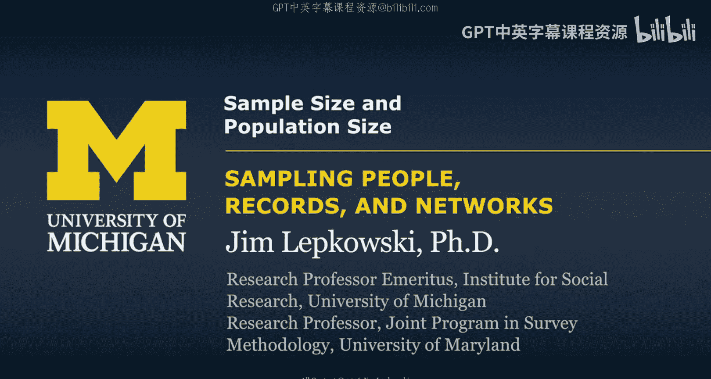


在本节课中，我们将探讨简单随机抽样中一个关键问题：样本量与总体规模之间的关系。我们将通过回顾样本量计算公式，并分析不同规模国家（从中国到图瓦卢）的案例，来理解总体规模如何影响（或不影响）所需的样本量。

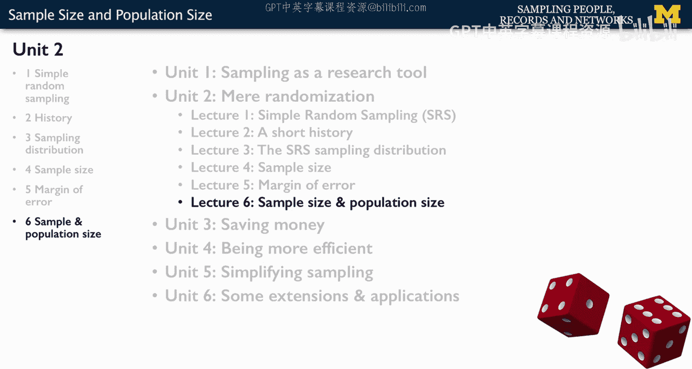


---

## 回顾样本量计算公式

上一节我们介绍了基于边际误差计算样本量的方法。本节中，我们来看看其核心公式，并重点关注其中与总体规模相关的部分。

基于边际误差（Margin of Error）计算简单随机样本所需样本量（n）的公式如下：

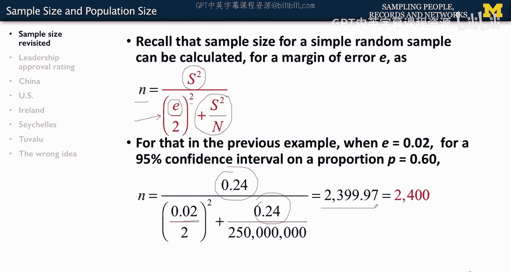

```
n = (S²) / [ (MOE / Z)² + (S² / N) ]
```


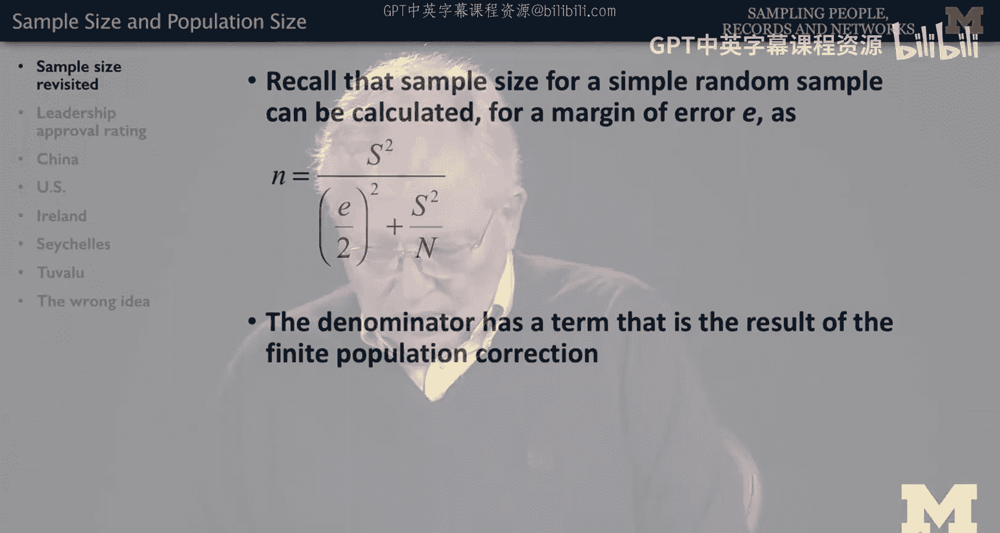

其中：
*   **S²** 是总体方差的估计值。对于比例问题，`S² = p(1-p)`。
*   **MOE** 是期望的边际误差（置信区间宽度的一半）。
*   **Z** 是特定置信水平对应的Z值（例如，95%置信度时，Z ≈ 1.96）。
*   **N** 是总体规模。

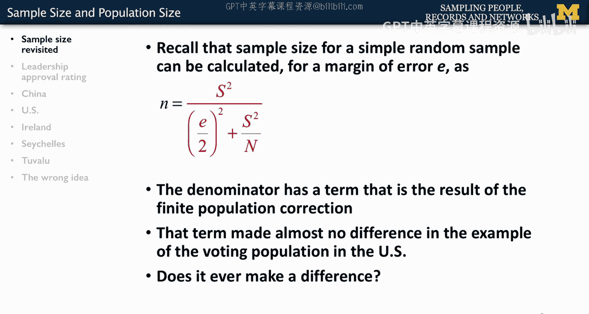


公式分母中的 `(S² / N)` 项被称为**有限总体校正**因子。正是这一项将总体规模（N）引入了计算。

---

## 案例研究：多国领导人民意调查

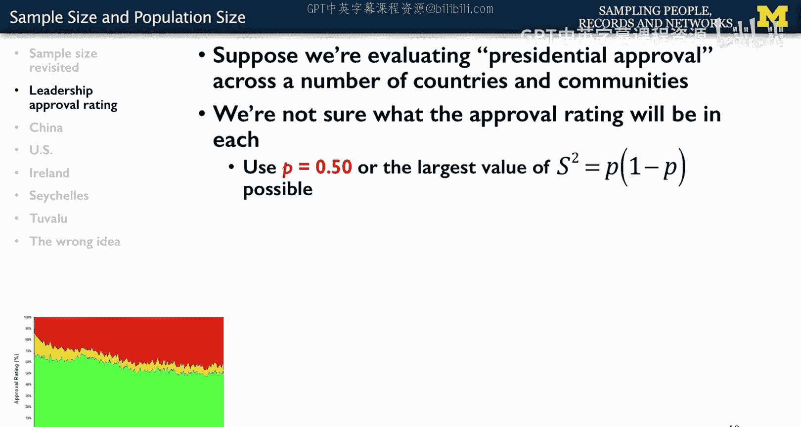

为了探究总体规模的影响，我们假设在多个国家进行一项相同的调查：评估民众对现任领导人的支持率。我们希望所有国家的调查结果都具有相同的精度，即**95%的置信区间，边际误差为±2%（0.02）**。


由于我们无法预知各国的确切支持率（p），为了保守估计（即确保样本量足够），我们采用可能的最大方差，即当 `p = 0.5` 时，`S² = 0.5 * 0.5 = 0.25`。

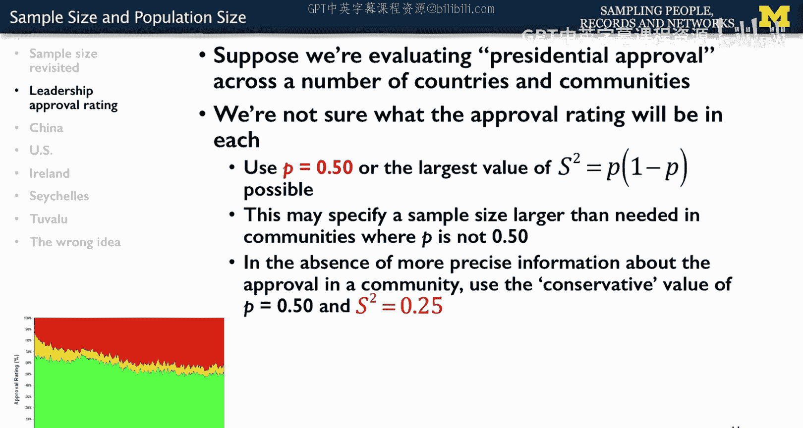

以下是针对不同规模国家的计算示例：


### 1. 中国 🇨🇳
*   **总体规模（N）**：约8亿选民。
*   **计算过程**：将 `S²=0.25`, `MOE=0.02`, `Z=1.96`, `N=800,000,000` 代入公式。
*   **所需样本量（n）**：计算结果约为 **2500**。若忽略有限总体校正（即视N为无穷大），结果也是2500。

### 2. 美国 🇺🇸
*   **总体规模（N）**：约2.5亿选民。
*   **所需样本量（n）**：计算结果仍为 **2500**。即使总体规模仅为中国的三分之一，所需样本量并未增加。

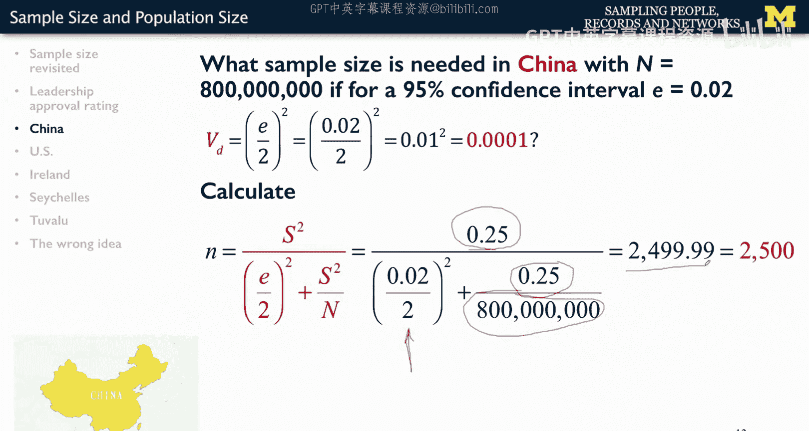

### 3. 爱尔兰 🇮🇪
*   **总体规模（N）**：约320万选民。
*   **所需样本量（n）**：计算结果约为 **2499**。与2500相比，仅“节省”了1个样本单位，实际执行中仍会采用2500。


### 4. 塞舌尔 🇸🇨
*   **总体规模（N）**：约8万选民。
*   **所需样本量（n）**：计算结果降至 **2425**。此时有限总体校正开始产生明显影响，节省了约75个样本。

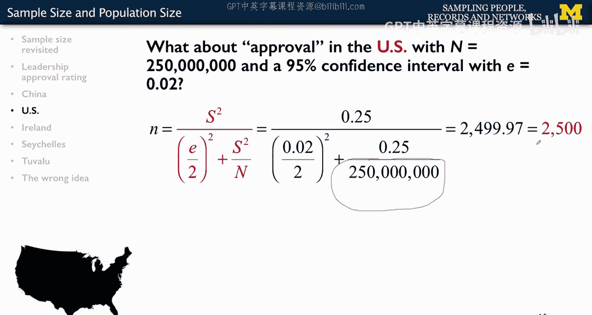

### 5. 图瓦卢 🇹🇻
*   **总体规模（N）**：约8000选民。
*   **所需样本量（n）**：计算结果显著降至 **1900**。对于这种极小的总体，有限总体校正效应非常显著。

---

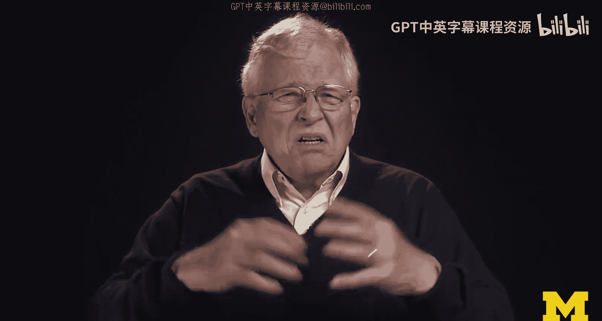

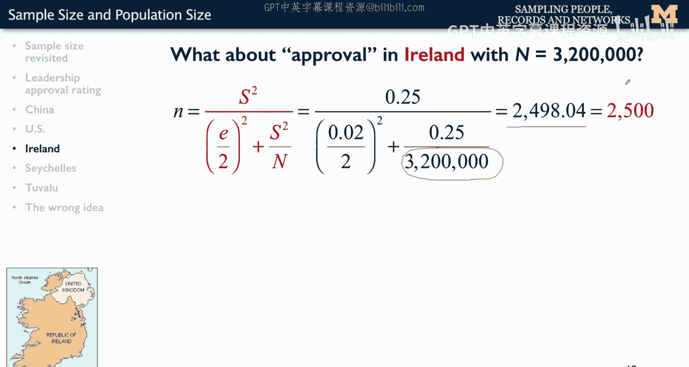

## 核心结论与常见误解

基于以上计算，我们可以总结出两个重要结论：


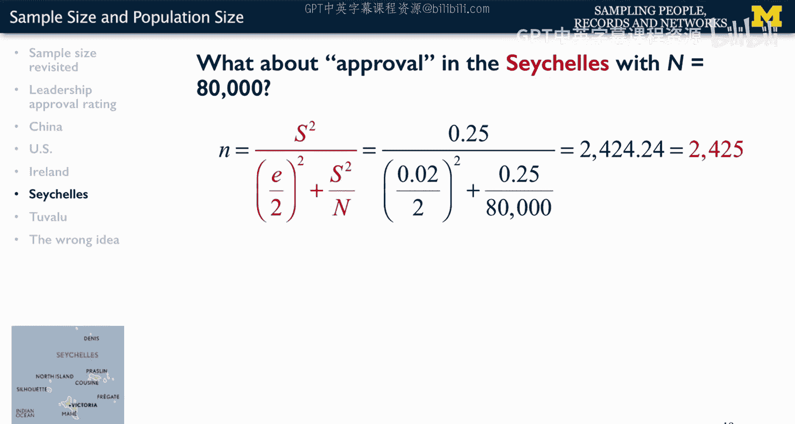

1.  **样本量不随总体规模增大而增加**。对于中国、美国、印度等大规模总体，要达到相同的精度，所需的样本量基本是相同的（本例中约为2500）。
2.  **仅当总体规模非常小时，样本量才会显著减少**。如图瓦卢的例子所示，当总体本身很小时，我们确实可以抽取更少的样本。


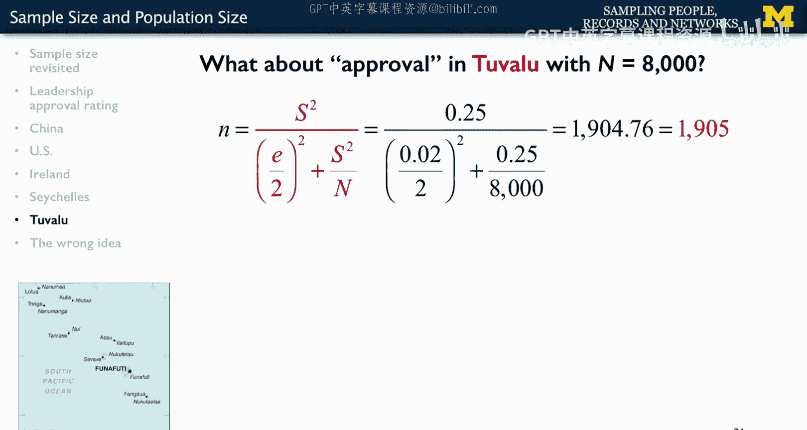


这纠正了一个常见的误解：

**误解**：样本量应根据总体规模的一定比例（例如10%）来确定。即总体越大，样本也必须同比例增大。
**事实**：决定样本量大小的主要因素是**期望的精度（边际误差）**和**总体的异质性（方差）**，而非总体规模本身。在绝大多数涉及大规模总体的调查中，总体规模对样本量的影响微乎其微。

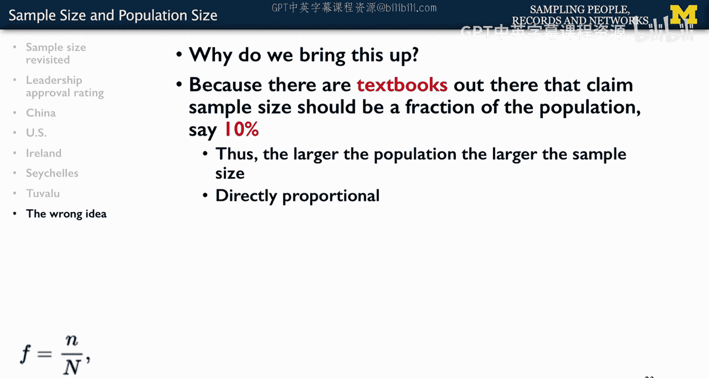

因此，当有人质疑“为何仅用2500个样本就能代表美国2.5亿选民”时，其根源在于误认为样本量应由总体规模决定。实际上，只要抽样是随机的，基于概率统计理论，一个精心计算的、相对较小的样本足以在给定的误差范围内推断庞大总体的特征。


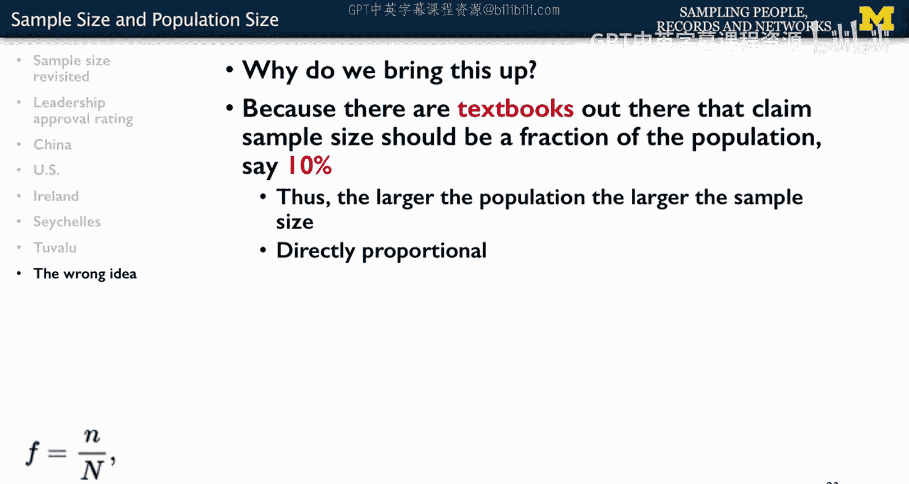

---


## 总结与过渡

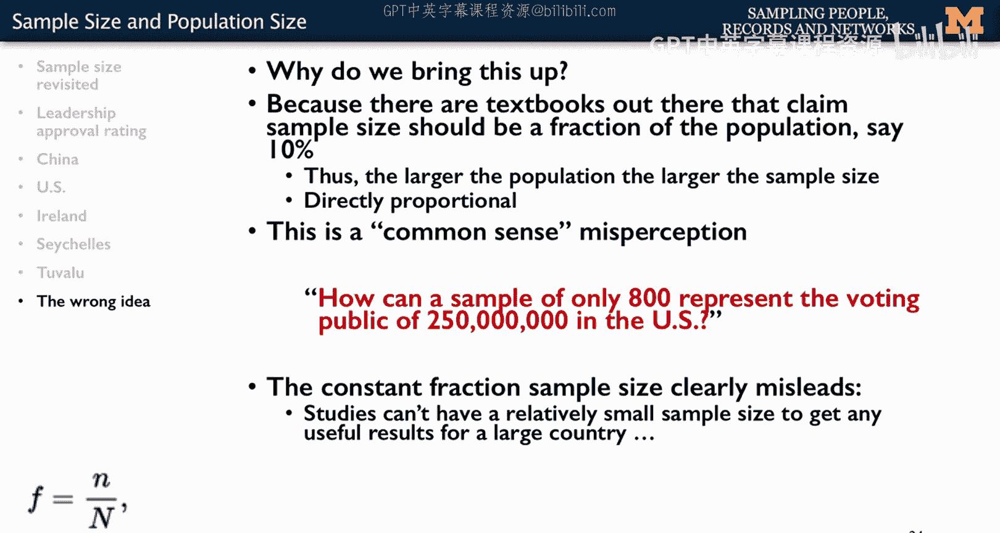


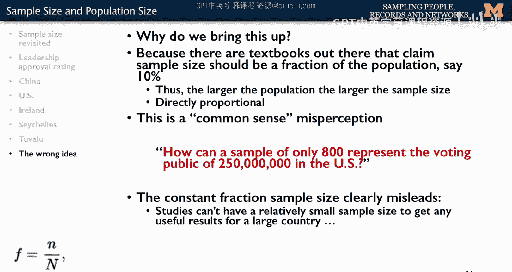

本节课中，我们一起学习了样本量与总体规模的真实关系。关键在于理解，**有限总体校正因子仅在总体规模较小时才对样本量计算产生实质性影响**；对于大多数大规模社会调查，总体规模并非决定样本量的主要因素。


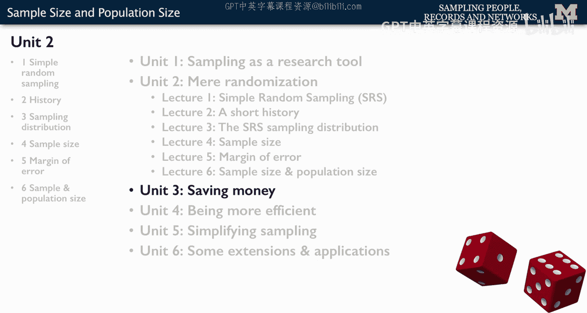

您无需死记硬背这些公式，但应理解其背后的原理：样本量设计是为了控制估计的精度，而非机械地与总体规模挂钩。


从下一单元开始，我们将进入课程的第3部分——“节省成本”，并首先学习**整群抽样**。这是一种通过改变抽样设计来显著降低调查成本的方法，敬请期待。