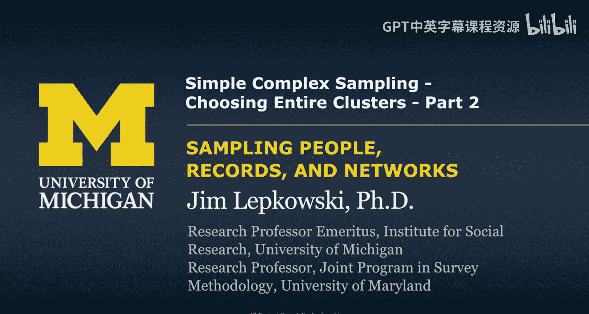
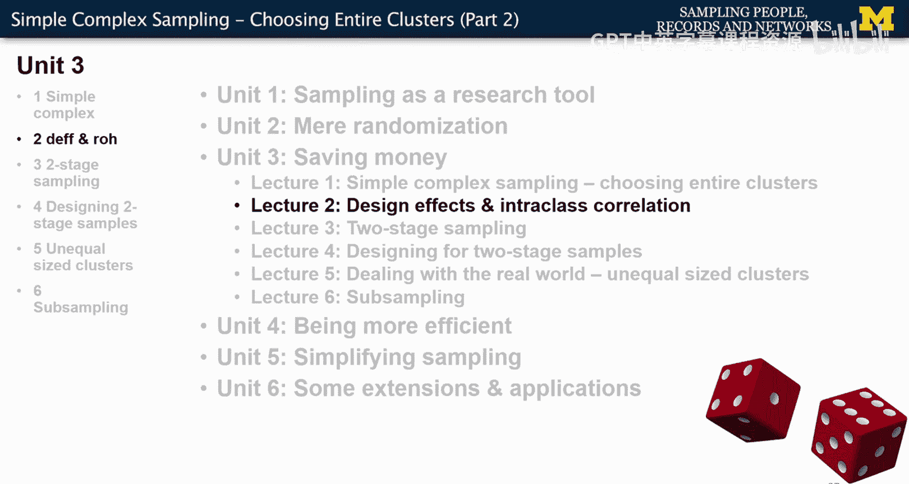

#  097：简单复合抽样：整群抽样（下）📊

## 概述

在本节课中，我们将继续探讨整群抽样。我们将通过一个关于学校免疫接种调查的具体例子，学习如何计算整群抽样下的估计值、抽样方差和置信区间，并理解它与简单随机抽样的核心区别。

## 从街区到教室：一个新的例子

上一节我们以街区为例介绍了整群抽样的基本概念。本节中，我们来看一个涉及学校的例子，以更好地理解计算过程。

假设我们为一个拥有1000间小学低年级教室的学区工作。管理者希望了解这些教室中儿童完全免疫接种的比例。他们面临一个实际问题：他们有一份1000间教室的名单，但没有所有学生的名单。逐一建立学生名单成本高昂。

因此，他们决定采用整群抽样：
*   **总体**：1000间教室（每间有24名学生），总计24，000名学生。
*   **抽样设计**：从1000间教室中，随机抽取10间（`a = 10`）。
*   **数据收集**：调查这10间样本教室中的**所有**学生（共 `10 * 24 = 240` 名学生）。

以下是调查后，按免疫接种比例从低到高排列的10间样本教室的数据：

| 教室编号 | 免疫儿童数 | 儿童总数 | 免疫比例 (p_α) |
| :--- | :--- | :--- | :--- |
| 1 | 9 | 24 | 0.375 |
| 2 | 11 | 24 | 0.458 |
| 3 | 13 | 24 | 0.542 |
| 4 | 15 | 24 | 0.625 |
| 5 | 16 | 24 | 0.667 |
| 6 | 17 | 24 | 0.708 |
| 7 | 18 | 24 | 0.750 |
| 8 | 19 | 24 | 0.792 |
| 9 | 20 | 24 | 0.833 |
| 10 | 21 | 24 | 0.875 |

## 计算总体比例估计值

我们的目标不是了解单个教室的情况，而是估计整个学区的免疫接种比例。在整群抽样中，总体比例的估计值计算如下：

1.  计算样本中免疫儿童总数：`9 + 11 + 13 + ... + 21 = 160`
2.  计算样本中儿童总数：`10 * 24 = 240`
3.  计算样本比例（即总体比例估计值 `p`）：`p = 160 / 240 = 0.667`（或66.7%）

这个估计过程是无偏的。如果我们重复抽取所有可能的10间教室组合并计算其均值，这些均值的平均值将等于真实的总体比例。

## 计算抽样方差与标准误

关键在于评估这个估计值的精确度。在整群抽样中，随机化发生在“教室”层面，而非“学生”层面。因此，我们的“样本量”是教室数量（`a = 10`），而不是学生数量（`n = 240`）。

抽样方差的计算基于教室层面的比例（`p_α`）的变异性。以下是计算步骤：

**1. 计算教室比例间的方差（`S_a^2`）**
这是10个教室比例 `p_α` 围绕其均值（即总体估计值 `p = 0.667`）的离散程度。

公式为：
`S_a^2 = (1 / (a - 1)) * Σ (p_α - p)^2`

代入数据：
`S_a^2 = (1 / 9) * [(0.375-0.667)^2 + (0.458-0.667)^2 + ... + (0.875-0.667)^2] = 0.02816`

**2. 计算估计值的抽样方差（`v(p)`）**
公式结合了有限总体校正因子和教室层面的方差。

公式为：
`v(p) = (1 - f) * (S_a^2 / a)`
其中，`f = a / A = 10 / 1000 = 0.01` 是抽样比。

代入计算：
`v(p) = (1 - 0.01) * (0.02816 / 10) = 0.0027878`

**3. 计算标准误（`se(p)`）**
标准误是抽样方差的平方根，它给出了估计值的可能误差范围。

`se(p) = sqrt(v(p)) = sqrt(0.0027878) ≈ 0.0528`

因此，我们对总体免疫比例66.7%的估计，其标准误约为5.28个百分点。

## 构建置信区间：引入t分布

有了估计值和标准误，我们可以构建置信区间来表述估计的不确定性。在简单随机抽样中，我们通常使用正态分布的Z值（如1.96对应95%置信水平）。

然而，在整群抽样中，我们的“随机事件”数量是教室数（`a=10`），这个数量较小。当样本量（此处指初级抽样单元数量）较小时，用于估计方差 `S_a^2` 的数据点（`a-1=9`个平方差）有限，导致其本身不稳定。此时，正态分布的假设不再理想。

我们需要使用**t分布**，它考虑了这种因自由度（`df = a - 1`）较小而增加的额外变异性。t值比对应的Z值更大，从而产生更宽的置信区间，这更符合小样本的实际情况。

对于95%的置信区间和9个自由度，t值约为2.262。

**计算95%置信区间：**
*   下限：`p - t * se(p) = 0.667 - 2.262 * 0.0528 ≈ 0.548`
*   上限：`p + t * se(p) = 0.667 + 2.262 * 0.0528 ≈ 0.786`

因此，基于这个整群抽样，我们有95%的信心认为该学区儿童的完全免疫接种比例在54.8%到78.6%之间。

## 与简单随机抽样的对比回顾

让我们回顾一下核心区别。如果对24，000名学生进行简单随机抽样（SRS），抽取240名学生：
*   **估计值**：计算方式相同（免疫学生数/总学生数），也是无偏的。
*   **标准误计算基础**：基于**学生**层面的0/1数据的变异性，样本量 `n=240`。
*   **公式（比例估计）**：`se_{srs}(p) = sqrt( [ (1-f) * p*(1-p) ] / (n-1) )`
*   **置信区间**：通常使用Z值（如1.96），因为学生样本量 `n` 较大。

而在整群抽样中：
*   **标准误计算基础**：基于**教室**层面比例 `p_α` 的变异性，样本量是教室数 `a=10`。
*   **公式**：`se_{cluster}(p) = sqrt( [ (1-f) * S_a^2 ] / a )`
*   **置信区间**：必须使用基于自由度 `df=a-1` 的t值。

整群抽样通常更省钱（只需列出并访问10间教室），但代价是，由于同一教室内的学生情况可能相似（群内同质性），导致 `S_a^2` 可能较大，且有效样本量（随机事件数）变小，从而使标准误**增大**，估计精度**下降**。

## 总结

本节课我们一起学习了简单整群抽样（群规模相等）下的数据分析流程：
1.  **计算总体估计值**：直接汇总所有样本群内的观测结果。
2.  **计算抽样方差与标准误**：关键是将抽样过程视为对“群”的简单随机抽样，并基于群统计量（如群比例）的方差 `S_a^2` 进行计算。
3.  **构建置信区间**：由于随机事件数（群的数量）通常较少，必须使用t分布而非正态分布来确定乘数，以得到更可靠的区间估计。

整群抽样是一种在节约成本和名单获取难度与估计精度之间进行权衡的重要方法。在下一讲中，我们将对整群抽样和简单随机抽样的效率进行直接比较。