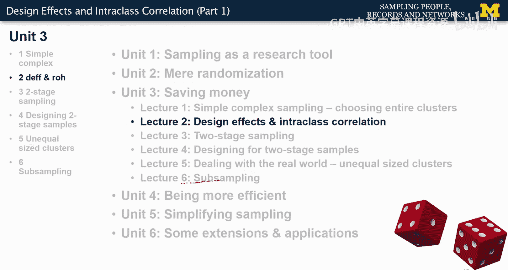

#  098：设计效应与组内相关（上）📊

## 概述
在本节课中，我们将继续探讨整群抽样。我们将学习如何量化整群抽样对估计精度的影响，并引入两个核心概念：**设计效应**和**组内相关**。我们会将整群抽样与相同样本量的简单随机抽样进行比较，以理解其效率差异。

---

## 从比较开始
上一节我们介绍了整群抽样的基本概念。本节中，我们来看看如何量化整群抽样的效率。为了进行比较，我们需要一个共同的衡量标准，就像比较建筑物高度需要一个统一的度量单位一样。

我们将使用**抽样方差**作为比较的基础。这是因为，无论是简单随机抽样还是整群抽样，它们对总体均值的估计都是无偏的，即平均而言都能得到正确答案。然而，这两种方法的抽样方差计算方式不同：简单随机抽样基于个体间的变异性，而整群抽样基于群组间的变异性。

为了进行公平比较，我们必须确保比较的基础相同。我们将在**相同样本量**的前提下，比较整群抽样和简单随机抽样的抽样方差。需要注意的是，在相同样本量下，整群抽样的方差通常更大（即精度更低），但其数据收集成本通常远低于简单随机抽样。

---

## 设计效应：一个比较工具
为了将整群抽样的方差与简单随机抽样的方差进行比较，我们引入一个比率，称为**设计效应**。

以下是设计效应的定义公式：

**DEFF = V_cluster / V_srs**

其中：
*   **DEFF** 代表设计效应。
*   **V_cluster** 是整群抽样（样本量为 `n`）下某个估计值（如比例 `P`）的方差。
*   **V_srs** 是相同样本量 `n` 下，采用简单随机抽样得到的同一估计值的方差。

设计效应是一个比值。如果 DEFF = 1，说明两种抽样方式的精度相同。如果 DEFF > 1（通常如此），则表明整群抽样的方差更大，精度低于相同样本量的简单随机抽样。

### 一个计算实例
回顾之前的例子：我们从1000个班级（每班24名学生）的总体中，随机抽取10个班级，调查了240名学生的免疫接种情况，发现160人完全接种。

*   若将这些数据视为一个**整群样本**，计算出的比例方差为 **0.00276**。
*   若忽略聚类结构，将这些数据视为一个**简单随机样本**，计算出的比例方差为 **0.0009**。

根据公式计算设计效应：
**DEFF = 0.00276 / 0.0009 ≈ 3.07**

这个结果意味着，在此例中，整群抽样的方差大约是简单随机抽样方差的3倍。尽管精度下降，但由于整群抽样在名单编制和实地访问上的成本节约巨大，这种精度损失通常是可接受的。

### 设计效应的用途
设计效应主要有两个用途：

1.  **分析阶段调整**：在分析整群抽样数据时，若初步使用了简单随机抽样的方差公式，可以用设计效应来“放大”方差估计，以反映真实的抽样误差。
    *   **公式**：`V_cluster ≈ DEFF * V_srs`
2.  **设计阶段规划**：在设计新调查时，可以基于预期的设计效应，来估算需要多大的样本量才能达到目标精度。这将在后续课程中详细讨论。

---

## 设计效应的驱动因素：组内同质性
设计效应大于1的根本原因在于群组内部的特征。它主要受两个因素影响：

1.  **群组规模**：每个被选群组中包含的元素数量 `b`。
2.  **组内同质性**：同一群组内元素之间的相似程度。

群组间差异越大（异质性越高），通常意味着群组内元素越相似（同质性越高）。例如，如果学校班级是按能力分班，那么“高能力班”的学生成绩普遍较高，“低能力班”的学生成绩普遍较低。这样，班内学生成绩相似（同质高），而班间差异巨大（异质高）。

为了量化这种组内相似性，我们引入**组内相关**的概念。在统计学中，通常用希腊字母 **ρ** 表示。但在社会调查领域，常使用一个助记符 **ROH**。

**ROH** 代表 **R**ate **O**f **H**omogeneity，即“同质率”。它衡量的是群组内元素间的相关程度。ROH 的值介于0到1之间（实践中通常为正值）。ROH 越接近1，表示群组内元素越相似。

设计效应、群组规模 `b` 和同质率 **ROH** 之间存在明确的数学关系：

**DEFF = 1 + (b - 1) * ROH**

从这个公式可以看出：
*   当 **ROH = 0** 时，**DEFF = 1**。这意味着群组内元素毫无相似性，整群抽样效率等同于简单随机抽样。
*   当 **ROH > 0** 时，**DEFF > 1**。且 `b`（群组规模）越大，或 **ROH**（同质性）越高，设计效应就越大，整群抽样的效率损失就越严重。

### 计算同质率
我们可以利用上面的公式，从已知的设计效应 **DEFF** 和群组规模 `b` 中，反推出同质率 **ROH**。

公式如下：

**ROH = (DEFF - 1) / (b - 1)**

代入之前的例子数据（DEFF ≈ 3.07， b = 24）：
**ROH = (3.07 - 1) / (24 - 1) ≈ 2.07 / 23 ≈ 0.09**

这个结果 **0.09** 就是本例中的组内同质率估计值。它表明，同一个班级内的学生在免疫接种状态上存在一定的相似性，但相关性并不非常强。

---

## 本节总结
本节课我们一起学习了如何评估整群抽样的效率。

*   我们引入了**设计效应**，它通过比较整群抽样与相同样本量简单随机抽样的方差，量化了整群抽样的精度损失。
*   我们探讨了设计效应的驱动因素，特别是**组内同质性**，并用**同质率**来度量它。
*   我们掌握了设计效应、群组规模和同质率三者之间的关系公式：**DEFF = 1 + (b - 1) * ROH**。

理解这些概念和关系，对于正确分析整群抽样数据以及科学设计此类调查都至关重要。在下一节中，我们将继续深入探讨同质性的影响及其在抽样设计中的具体应用。