#  101：两阶段抽样设计（上）📊

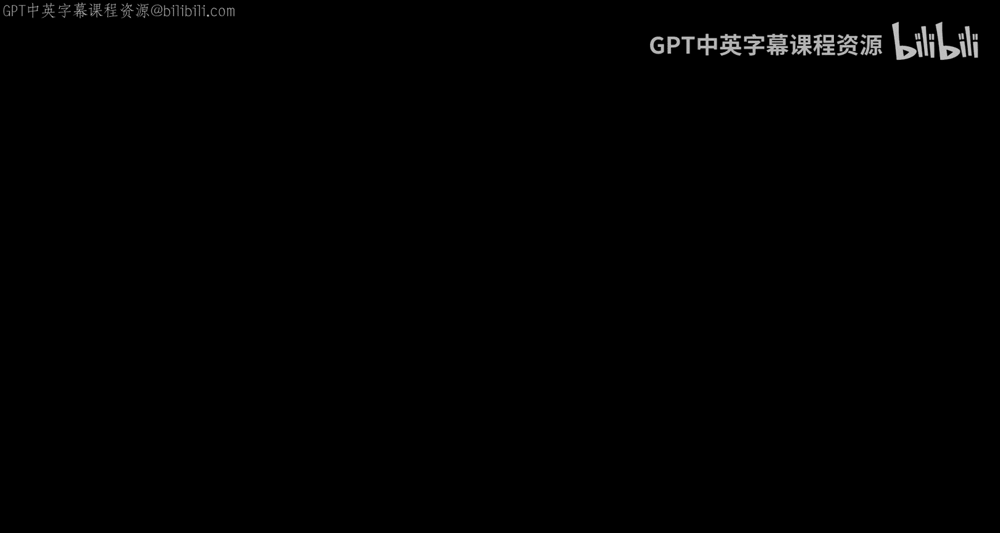

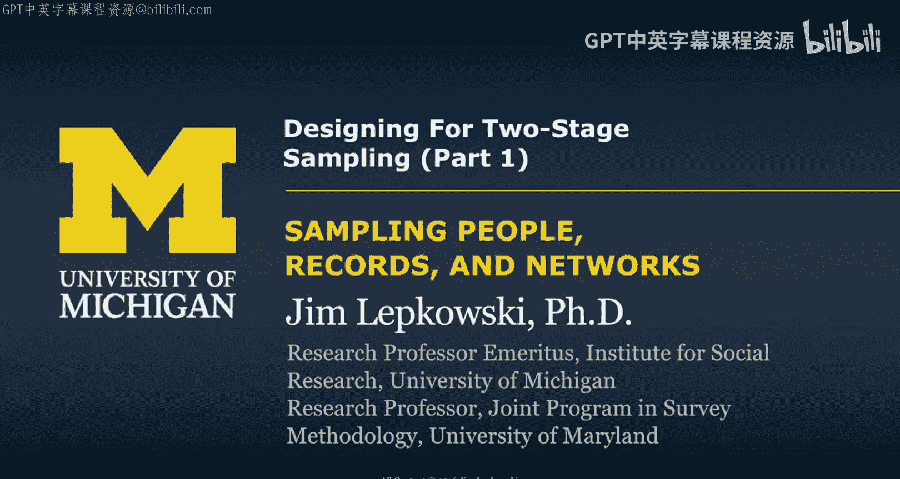

在本节课中，我们将学习如何设计两阶段抽样方案。我们将探讨如何通过预测设计效应、计算样本量以及评估置信区间，来规划一个满足特定要求的抽样设计。

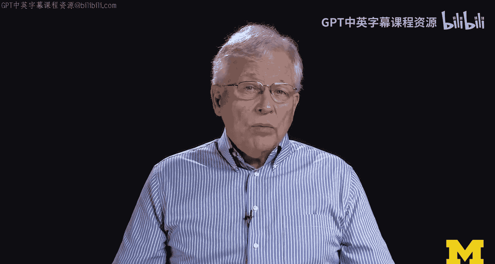

---

## 从估计到设计

上一节我们讨论了简单形式的整群抽样，即从群中抽取所有元素。现在，我们将探讨更复杂的两阶段抽样设计。我们需要做哪些准备，才能选择一个满足客户要求或我们自身期望的样本呢？

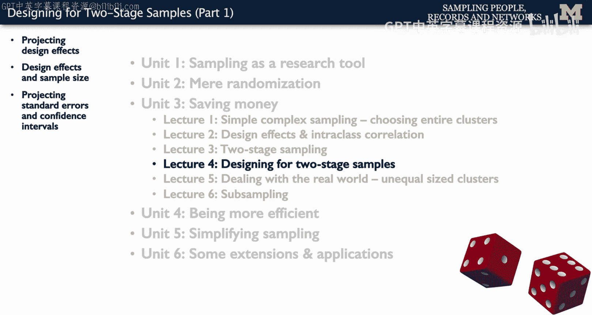

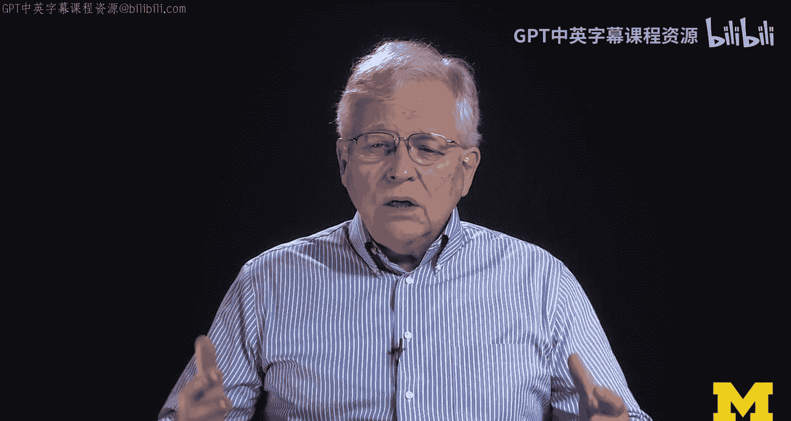

因此，我们从设计的角度出发，目标是找到一种选择样本的方法，以满足特定要求。在本节中，我们将讨论三个核心方面。

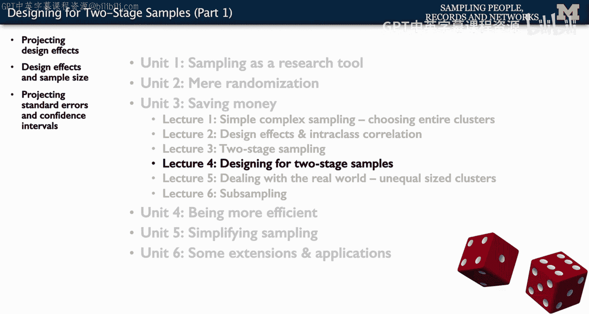

以下是设计时需要考虑的三个关键点：
1.  预测新设计的设计效应。
2.  理解设计效应对样本量的影响。
3.  预测我们设计的标准误和置信区间。

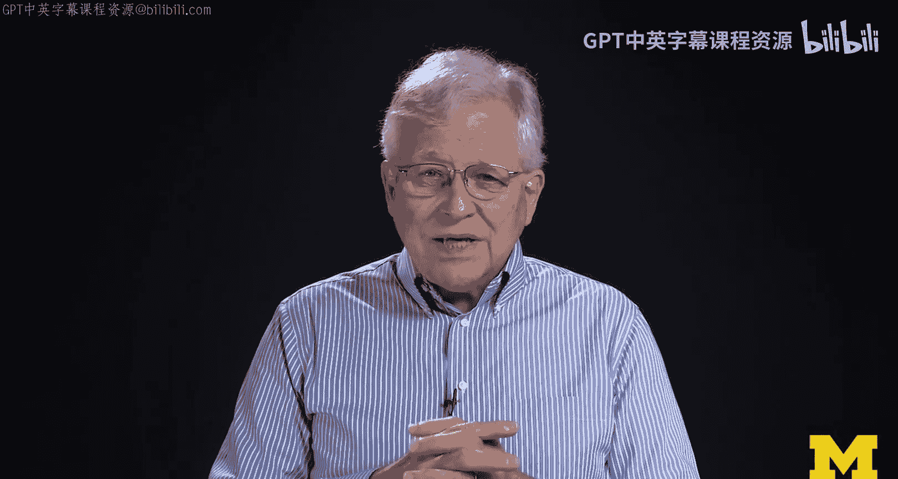

所有这些考虑都是设计新样本、解决新问题这一整体工作的一部分。

---

## 回顾：估计与设计效应

到目前为止，我们所做的主要是**估计**，特别是估计标准误或方差。如果我们讨论方差，自然也会想到标准误，因为标准误是方差的平方根。

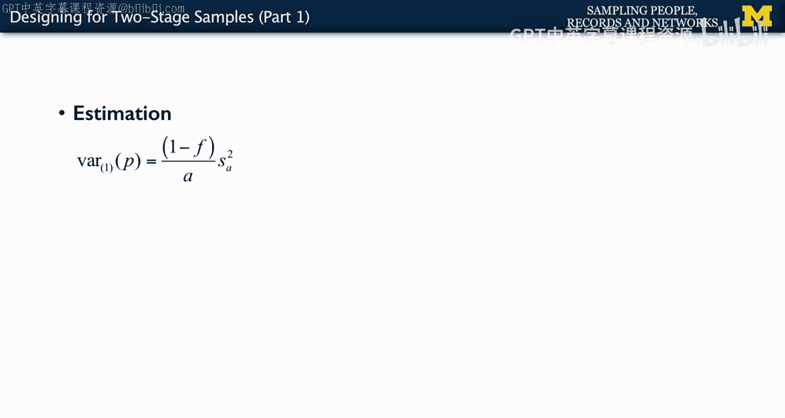

对于一个两阶段整群样本，我们讨论了如何估计一个统计量（例如比例）的方差。对于当前设计（我们称之为设计1），我们使用现有数据套用以下公式进行计算：

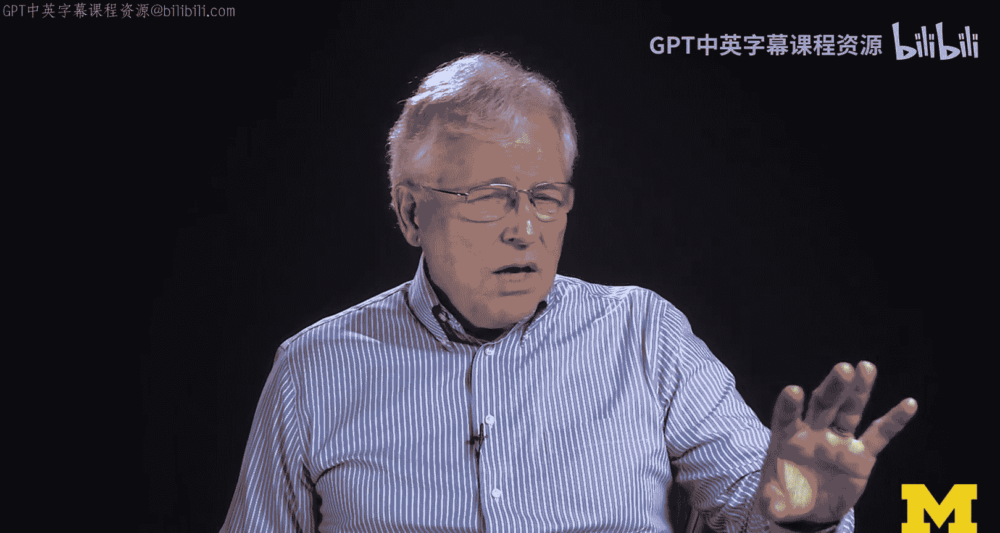

**公式：** `Var(p) = (1 - f) / a * S_a²`

其中：
*   `(1 - f)` 是有限总体校正因子。
*   `a` 是样本中的群数量。
*   `S_a²` 是群特征在群间的变异性。

我们计算方差后，取其平方根即可得到标准误，进而计算置信区间。

但我们还做了另一件事：理解设计对结果的影响。我们将其与简单随机抽样进行比较，引入了**设计效应**的概念。

为了估计设计效应，我们需要用同一组数据计算两个方差：
1.  当前设计（设计1）下该比例的实际方差。
2.  在简单随机抽样假设下，该比例的方差。

对于一个比例，简单随机抽样下的方差计算公式为：

**公式：** `Var_srs(p) = (1 - f) * [p(1-p) / (n-1)]`

然后，我们将这两个方差组合起来，得到设计效应 `Deff`，它是一个比值：

**公式：** `Deff = Var(p) / Var_srs(p)`

按照标准定义，我们将简单随机抽样方差放在分母，作为比较的基准。

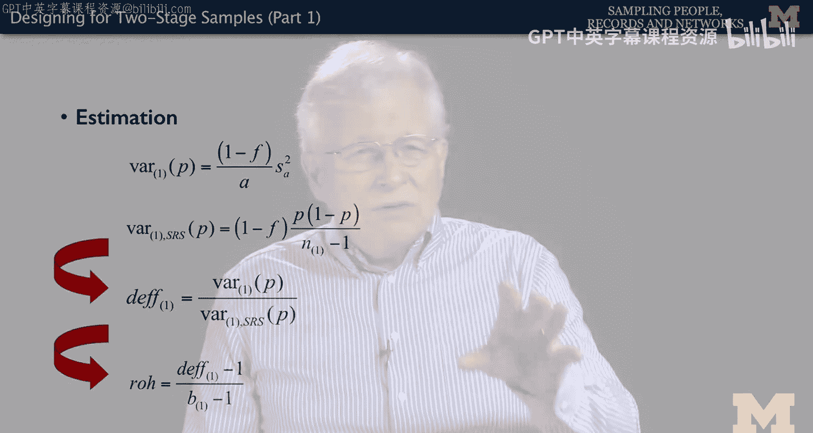

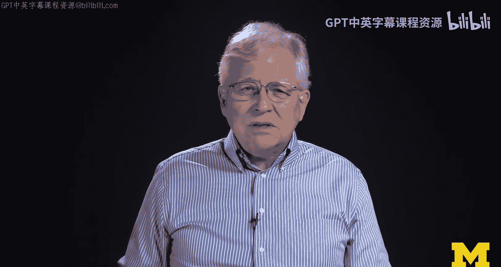

最后，我们从设计效应中提取出驱动因素——**组内同质性系数 `ρ`**。我们通过以下公式估计它：

**公式：** `ρ = (Deff - 1) / (b - 1)`

其中 `b` 是当前设计中每个群的子样本量（元素数量）。这样，我们就得到了同质性系数 `ρ` 的值。

第一条分析路径（估计方差和置信区间）对我们来说最实用。而第二条路径（计算设计效应和 `ρ`）则是为下一步**设计**做铺垫。

---

## 核心：设计预测

接下来，我们将基于现有设计规划新的设计。我们可能在不同总体中进行新应用，也可能在同一总体的不同时间点进行调查，甚至可能改变样本设计（例如改变子样本量 `b`、群数量 `a` 或总样本量 `n`）。

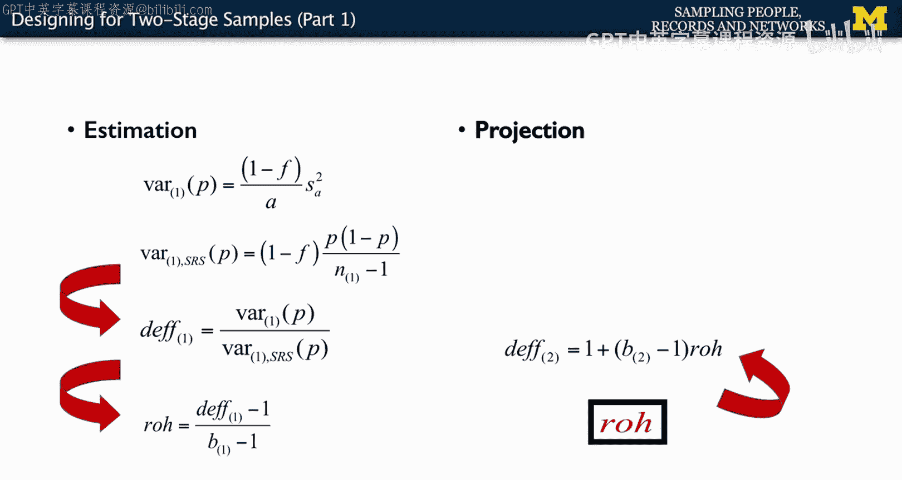

我们需要进行**预测**：在尚未抽取样本的新设定下，结果会怎样？这类似于气候变化预测，我们在不同模型下预测可能发生的情况。

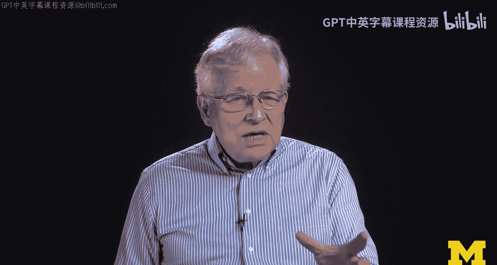

对我们而言，两个关键结果是：均值（或比例）及其标准误。为了预测新设计下的标准误，我们需要利用过去的信息。

我们之前计算的同质性系数 `ρ` 在某种意义上变得可移植。它成为我们进行预测的基础构件。我们将使用从过去调查中计算出的 `ρ` 值来**预测**新设计的设计效应。

请注意，这里我们不是通过方差比来计算设计效应，而是通过以下组合来**计算**一个预测的设计效应：

**公式：** `Deff_proj = 1 + (b_new - 1) * ρ`

我们不会发明一个新的 `ρ`，而是借用过去数据中的 `ρ`，因为我们使用的是非常相似的群（例如，上次用学校，这次还用学校）并测量非常相似的特性（`ρ` 是针对特定变量的）。

同时，如果我们能计算或获得简单随机抽样下的方差，我们就可以结合设计效应和简单随机抽样方差，来**预测**新设计下的实际方差，从而量化我们预期的不确定性。

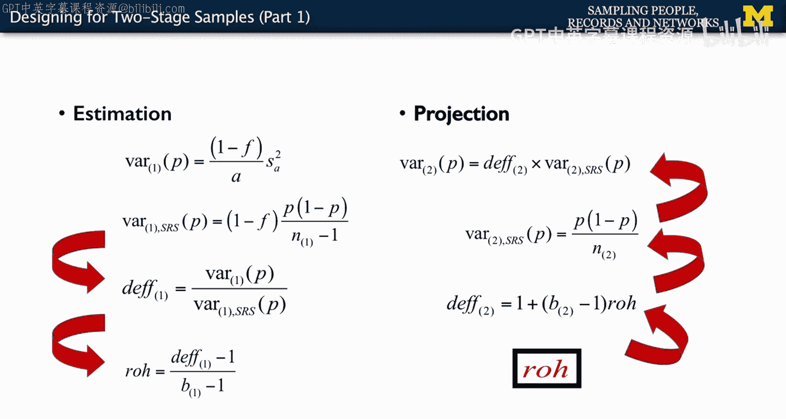

我们可以计算简单随机抽样方差。为了简化计算，这里我们忽略有限总体校正因子 `(1-f)`，对于一个比例，其公式为：

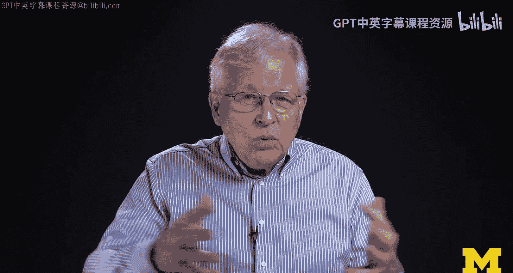

**公式：** `Var_srs_proj = p(1-p) / n_new`

我们有了新的子样本量 `b_new`、新的总样本量 `n_new`、旧的 `ρ` 值，以及一个对比例 `p` 的假设（可以使用过去值或根据预期变化设定新值）。

现在，我们有了构建最终**预测抽样方差**的所有要素：

**公式：** `Var_proj = Deff_proj * Var_srs_proj`

这个预测的抽样方差告诉我们能预期多大的不确定性。特别是当我们将其与 t 统计量或 z 统计量结合以得到 95% 置信区间时。

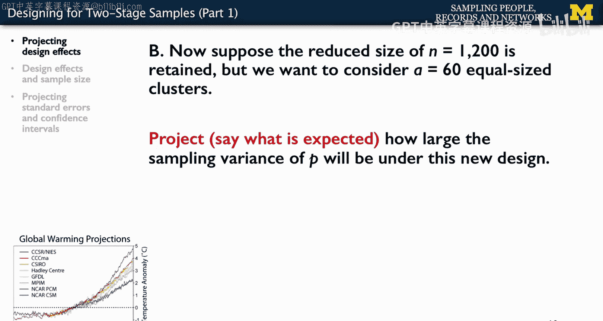

---

## 应用示例：比较两种设计方案

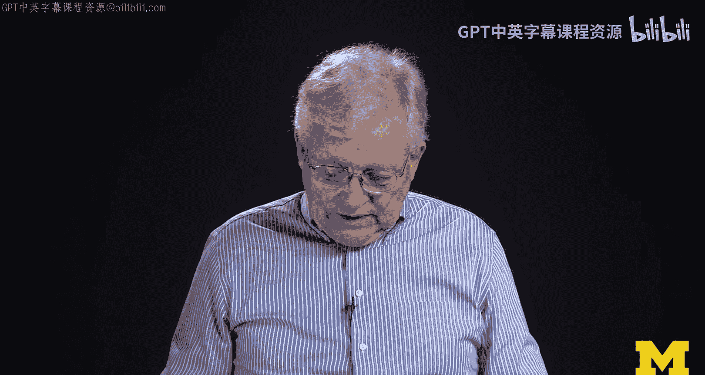

让我们看一个例子。假设我们之前有一个样本：总样本量 `n=2400`，分布在 `60` 个群中，每个群有 `b=40` 个观测值。

现在，我们计划对同一总体再次调查，但资源只能支持一半的样本量，即 `1200` 个案例。我们考虑两种达到此样本量的方案：

*   **方案 A**：通过减少群数量来削减样本量（群数量减半）。
*   **方案 B**：通过减少子样本量来削减样本量（每个群内元素减半）。

问题是：在这两种新设计下，我们预期的样本比例 `p` 的抽样方差（和标准误）分别是多少？

我们拥有进行这种预测的工具。基本模型涉及设计效应、同质性系数 `ρ` 和子样本量 `b`，以及一个简单随机抽样方差，我们可以用设计效应对其进行调整以反映整群效应。

**对于方案 A 的预测步骤：**
1.  计算新设计下的预测设计效应 `Deff_proj`（使用旧的 `ρ` 和旧的 `b=40`，因为子样本量没变）。
2.  计算新样本量 (`n=1200`) 和假设比例 (`p=0.4`) 下的简单随机抽样方差 `Var_srs_proj`。
3.  计算预测方差：`Var_proj = Deff_proj * Var_srs_proj`。

**对于方案 A：**
*   设计效应 `Deff_proj = 1 + (40 - 1) * ρ`。假设 `ρ` 来自旧设计，计算得 `Deff_proj ≈ 2.18`（与旧设计相同）。
*   简单随机抽样方差 `Var_srs_proj = 0.4*0.6 / 1200 = 0.0002`。
*   预测方差 `Var_proj = 2.18 * 0.0002 = 0.000436`。

**对于方案 B 的预测步骤：**
重复上述步骤，但将 `b` 从 40 替换为 20，`ρ` 和 `p` 的假设值不变。

**对于方案 B：**
*   设计效应 `Deff_proj = 1 + (20 - 1) * ρ`。计算得 `Deff_proj ≈ 1.575`。
*   简单随机抽样方差 `Var_srs_proj` 不变，仍为 `0.0002`（因为总样本量 `n` 仍是 1200）。
*   预测方差 `Var_proj = 1.575 * 0.0002 = 0.000315`。

**结果比较：**

| 设计 | 总样本量 (n) | 群数量 (a) | 子样本量 (b) | 设计效应 (Deff) | 预测方差 (Var_proj) |
| :--- | :--- | :--- | :--- | :--- | :--- |
| 原始设计 | 2400 | 60 | 40 | 2.18 | 0.000218 |
| 方案 A | 1200 | 30 | 40 | 2.18 | **0.000436** |
| 方案 B | 1200 | 60 | 20 | 1.575 | **0.000315** |

通过比较可以看出：
*   在方案 A 中，通过将群数量减半来将总样本量减半，导致预测方差**翻倍**（从 0.000218 到 0.000436）。反之，如果通过加倍群数量来加倍样本量，方差会减半。
*   在方案 B 中，通过将子样本量减半但保持群数量不变来达到相同总样本量，设计效应降低，预测方差为 0.000315，**小于方案 A 的方差**。

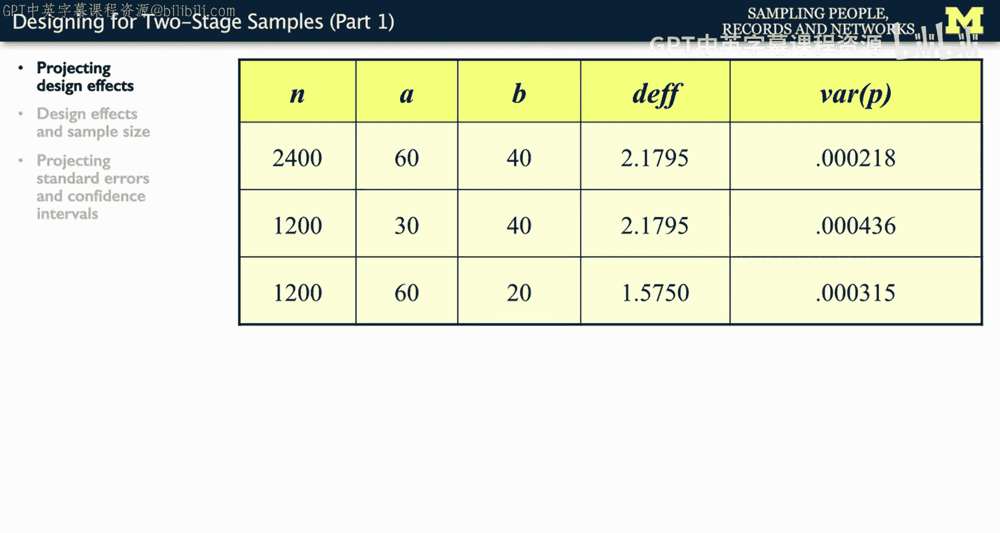

现在我们有了量化的方法来比较不同方案，并可以据此决定使用哪种方法更优。

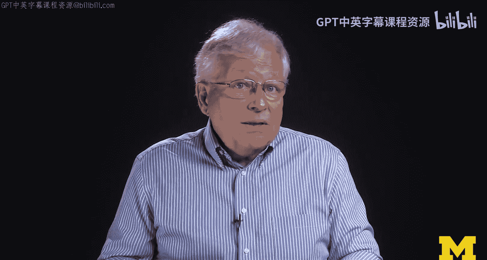

---

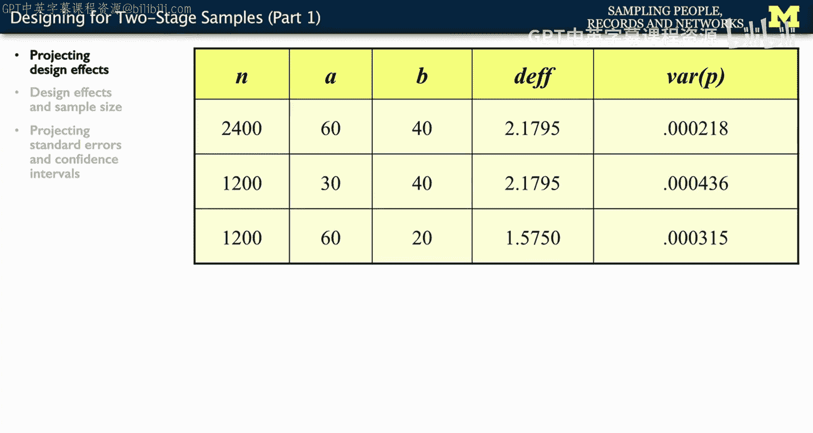

## 本节总结与下节预告

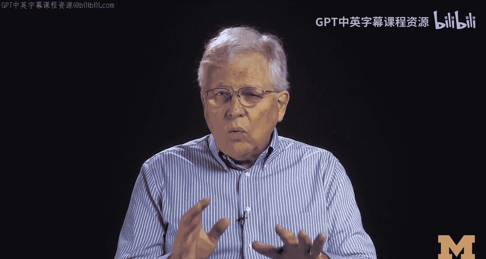

本节课中，我们一起学习了如何为两阶段抽样进行设计预测。我们回顾了从估计方差到计算设计效应和同质性系数 `ρ` 的过程。核心在于，利用过去的 `ρ` 值，结合新设计的参数（`b_new`, `n_new`），可以预测新设计下的设计效应和抽样方差，从而在实施前评估不同设计方案的效率。

我们通过一个例子比较了两种削减样本量的方案，发现**保持更多的群数而减少每个群内的样本量（方案 B）**，通常能获得更小的预测方差（即更高的精度），因为设计效应降低了。

在结束本讲之前，我们还有两个重要问题需要探讨：
1.  设计效应对**样本量确定**的影响。
2.  这些预测方差对**置信区间宽度**的影响。

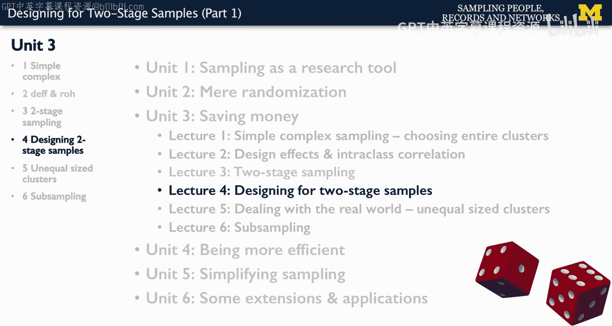

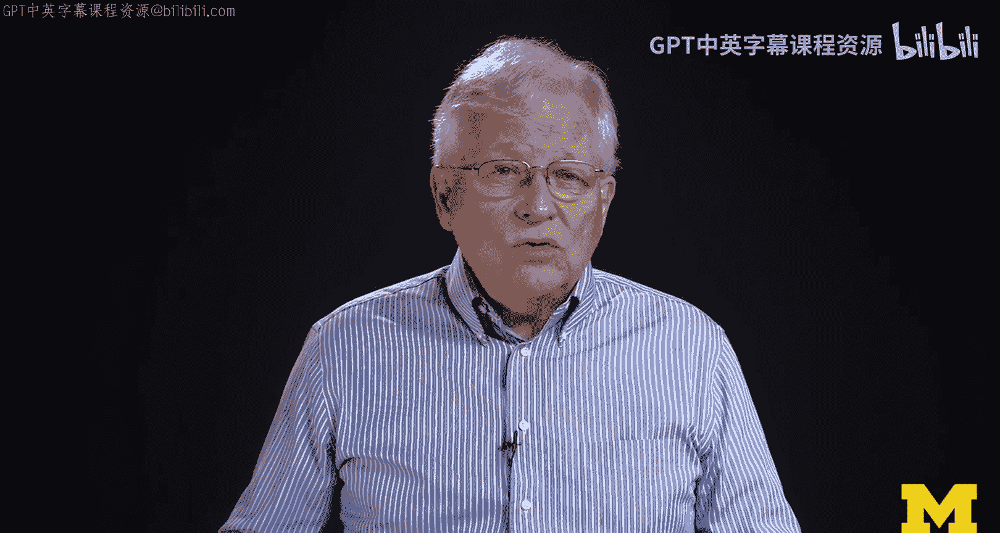

我们将在下一部分（两阶段抽样设计（下））中详细研究这些问题。