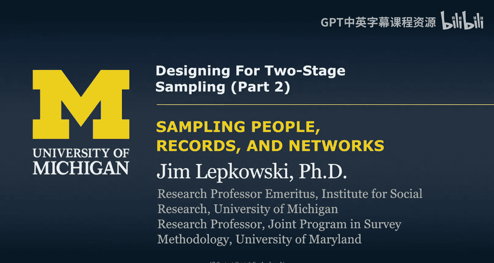
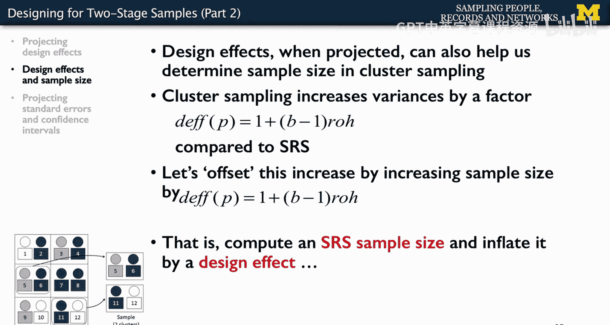
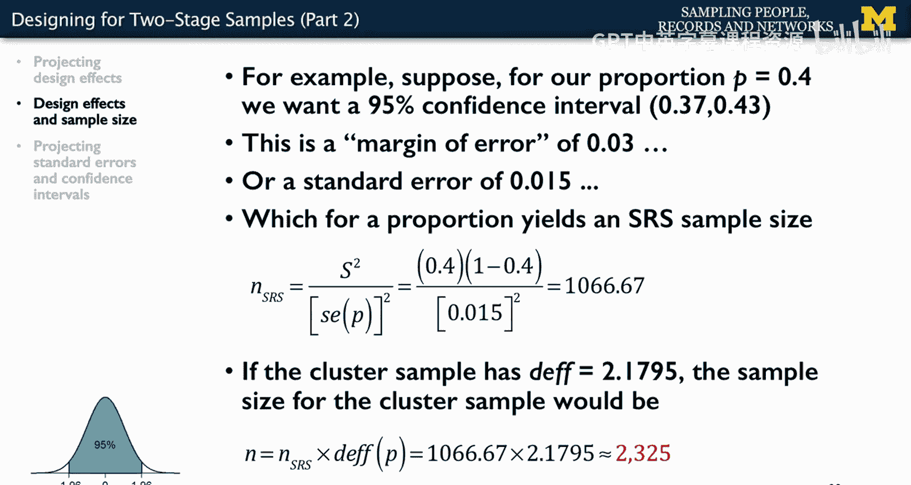
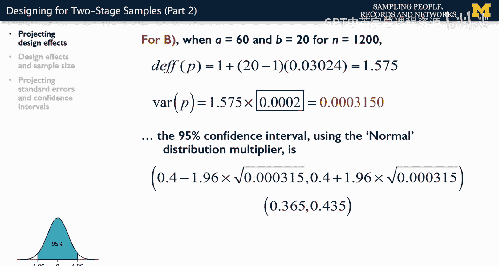
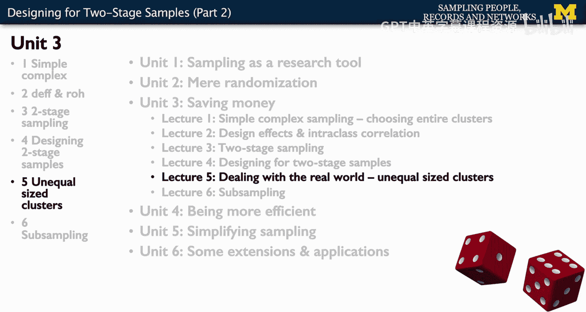

#  102：两阶段抽样设计（下）📊

在本节课中，我们将继续学习两阶段抽样设计。我们将探讨两个核心主题：设计效应及其对样本量的影响，以及如何为新设计预测标准误和置信区间。

上一节我们介绍了设计效应的概念及其在方差计算中的应用。本节中我们来看看如何利用设计效应来确定样本量，并综合运用这些知识进行预测。

## 设计效应与样本量确定

我们知道，整群抽样会使方差增加一个因子，这个因子就是设计效应。方差增加的公式为：**1 + (B - 1) * ρ**。我们可以利用过去的信息和选定的群内样本量 `B` 来预测这个效应。

设计效应是与简单随机抽样进行比较的。为了抵消因设计效应而增加的方差，我们可以通过增加样本量来实现。具体做法是，从一个简单随机抽样所需的样本量出发，然后将其乘以设计效应进行“膨胀”。

需要记住的是，整群抽样通过仅汇编选定群内的元素清单或减少需要前往的群数量，可以节省大量成本。

## 样本量计算示例

假设在简单随机抽样的设计过程中，我们确定要估计的比例约为 `0.4`，并希望得到一个令客户满意的 `95%` 置信区间，范围在 `0.37` 到 `0.43` 之间。

这个置信区间对应的误差幅度为 `±0.03`。对于 `95%` 的置信区间，其乘数约为 `1.96`（或近似为 `2`）。因此，我们可以从误差幅度反推出所需的标准误：`0.03 / 1.96 ≈ 0.015`。

这意味着，为了实现这个置信区间，我们需要的抽样方差应为标准误的平方：`0.015² = 0.000225`。

对于一个简单随机样本，其样本量计算公式为（假设总体很大，忽略有限总体校正）：
`n_srs = S² / V_d`
其中，`S²` 是元素方差，`V_d` 是期望的抽样方差。

对于比例估计，元素方差 `S²` 可近似为 `p * (1 - p)`，即 `0.4 * 0.6 = 0.24`。

因此，简单随机抽样所需的样本量为：
`n_srs = 0.24 / 0.000225 ≈ 1066.67`

然而，如果我们采用整群抽样，设计效应会导致方差膨胀，从而使置信区间变宽。为了将置信区间宽度恢复到目标范围，我们需要增加样本量。

如果预测的设计效应为 `2.18`，那么整群抽样所需的样本量应为：
`n_cluster = n_srs * 设计效应 = 1066.67 * 2.18 ≈ 2325`

## 预测不同设计的置信区间

我们还可以利用设计效应和预测过程，进一步评估不同设计方案下的置信区间表现。

假设我们考虑另一种设计方案 `B`：抽取 `60` 个群，每个群内抽取 `20` 个元素，总样本量为 `1200`，预测设计效应为 `1.58`。

以下是计算其 `95%` 置信区间的步骤：
1.  首先计算简单随机抽样下的方差：`V_srs = p*(1-p)/n = 0.24/1200 = 0.0002`。
2.  用设计效应调整方差，得到整群设计下的预测方差：`V_cluster = V_srs * 设计效应 = 0.0002 * 1.58 = 0.000316`。
3.  计算标准误：`SE = sqrt(V_cluster) = sqrt(0.000316) ≈ 0.01778`。
4.  计算 `95%` 置信区间的误差幅度：`ME = 1.96 * SE ≈ 1.96 * 0.01778 ≈ 0.0348`。
5.  因此，预测的置信区间为：`0.4 ± 0.0348`，即大约 `(0.365, 0.435)`。

可以看到，由于设计效应不同，即使总样本量不同，最终的置信区间宽度也可能相近。

## 课程总结与下节预告

本节课中我们一起学习了：
1.  如何利用预测的设计效应来确定整群抽样所需的样本量，以抵消方差膨胀的影响。
2.  如何综合运用预测的标准误和设计效应，为新设计方案构建预测的置信区间。

这些是抽样设计过程中的基本要素。掌握了这些，我们就能更好地规划和评估整群抽样调查。

在下一讲（第3单元第5讲）中，我们将进入更贴近现实的世界：处理**规模不等的群**。届时我们将放松“所有群规模相同”的约束，学习如何处理不等规模群情况下的抽样设计问题。敬请继续学习。