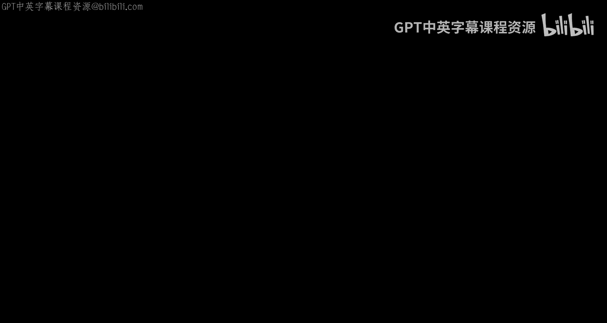
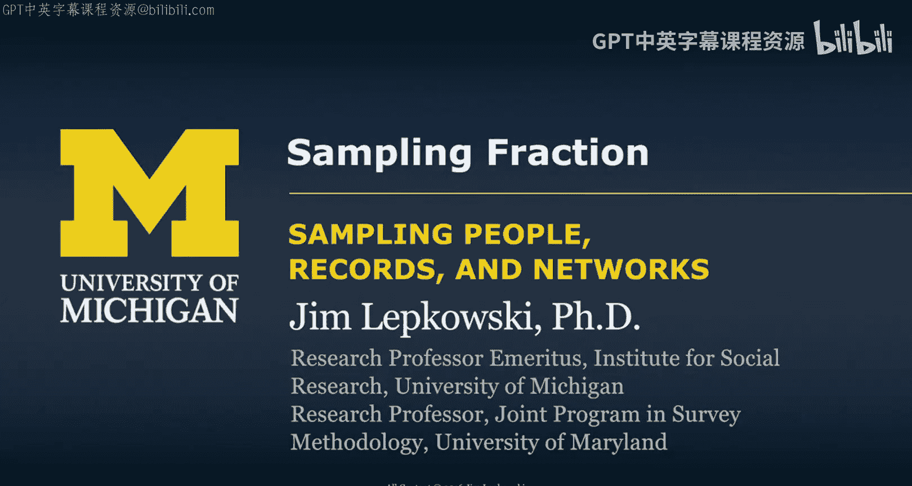
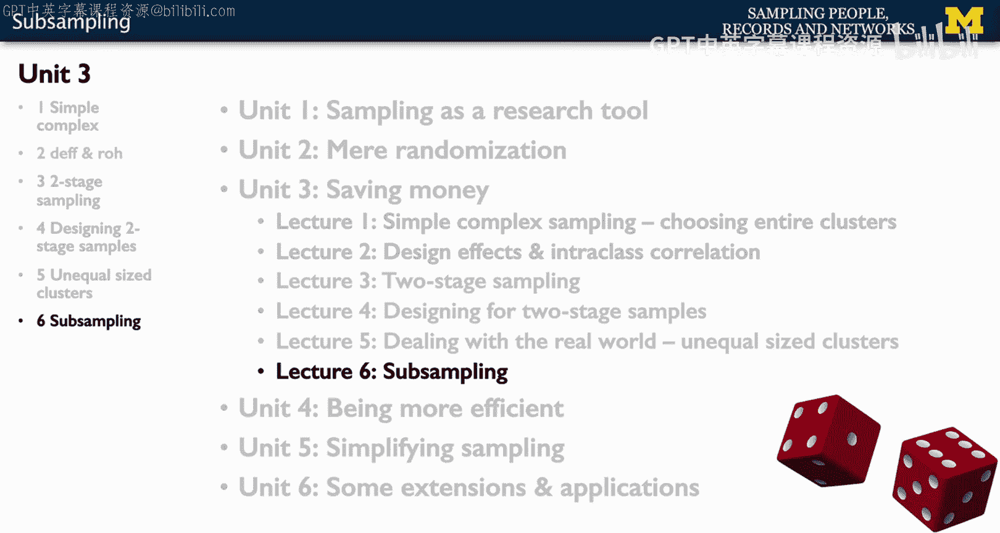
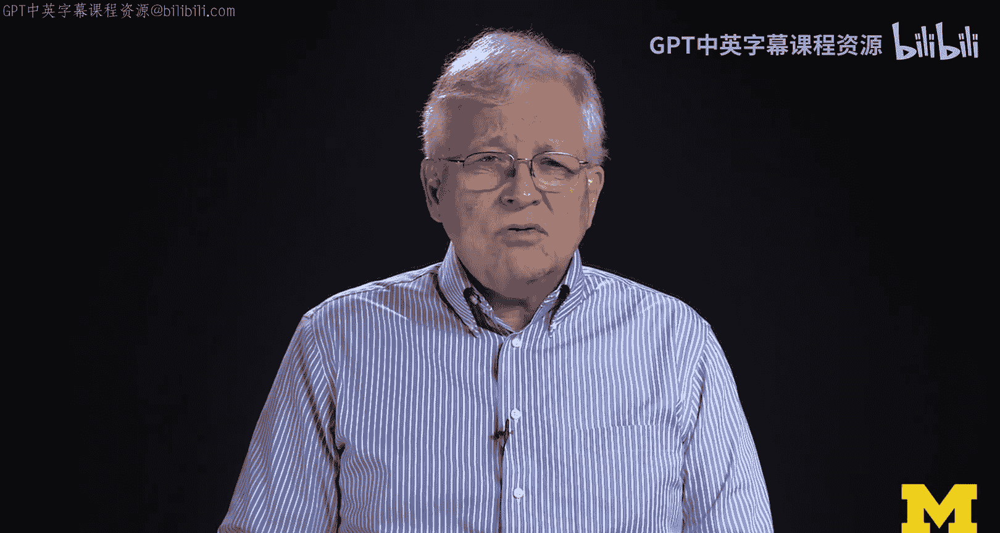
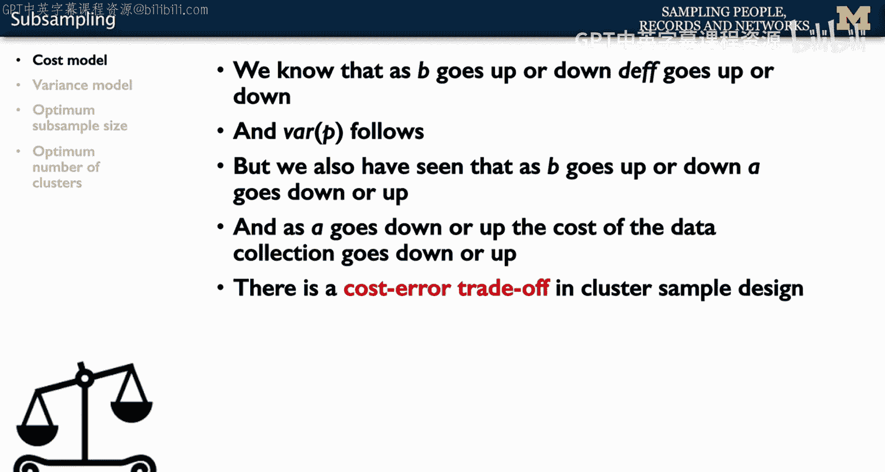
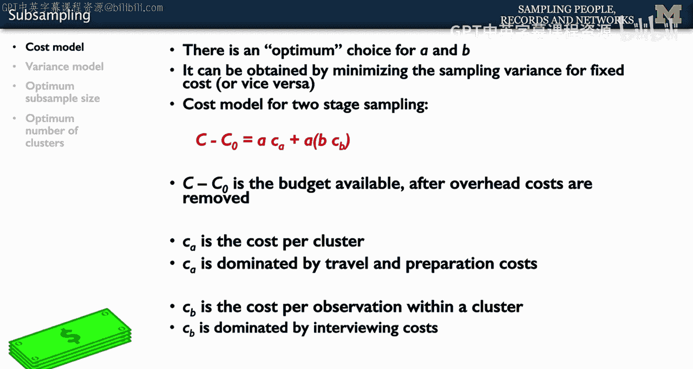
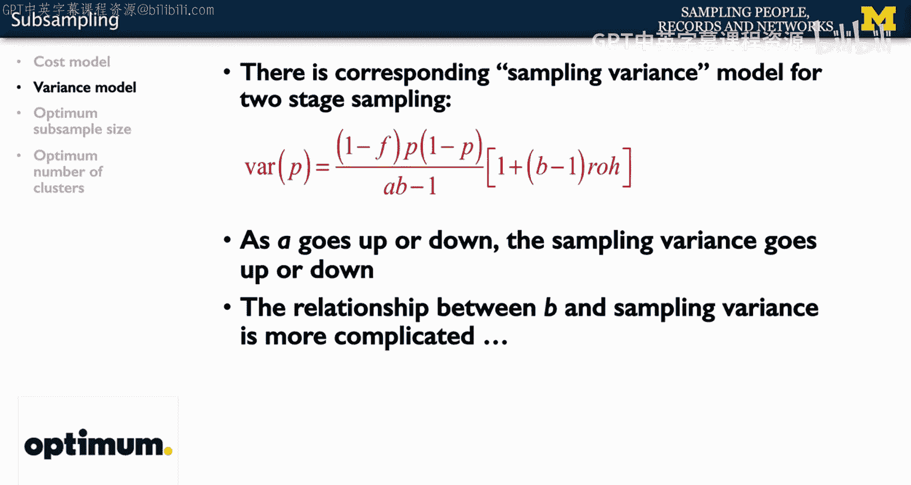
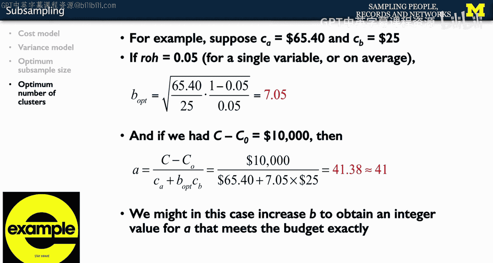
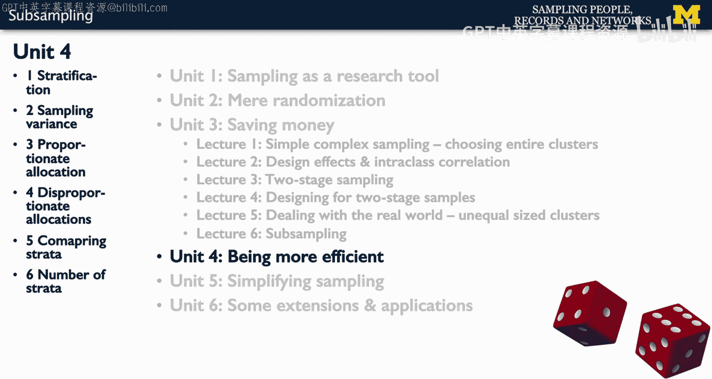

#  105：抽样比例 📊

在本节课中，我们将学习整群抽样设计的最后一个关键环节：如何确定最优的子样本规模（即每个群内应抽取的元素数量 `B`）。我们将结合成本模型和方差模型，找到在固定预算下能使抽样方差最小的 `B` 值，并据此确定应抽取的群数 `A`。

上一节我们探讨了不同子样本规模 `B` 对设计效应和标准误的影响。本节中，我们将具体分析如何选择 `B` 值，并理解其背后的成本与误差权衡。

## 成本与方差的权衡

在整群抽样中，子样本规模 `B` 是一个核心设计参数。它直接影响两方面：
1.  **方差**：`B` 通过设计效应影响抽样方差。设计效应公式为：
    **`设计效应 = 1 + (B - 1) * ρ`**
    其中 `ρ` 是群内同质性系数。`B` 增大，设计效应通常增大，导致方差增大。
2.  **成本**：在固定总样本量或固定预算下，`B` 增大，意味着可抽取的群数 `A` 必须减少，从而可能降低总成本（因为与访问每个群相关的启动和差旅成本较高）。

因此，设计整群抽样时，需要在成本（受 `A` 影响）和误差（受 `B` 影响）之间进行权衡。我们的目标是：在满足预算约束的前提下，找到使抽样方差最小的 `A` 与 `B` 组合。

## 建立成本模型

为了量化分析，我们需要一个成本模型。一个典型的成本模型如下：

**`总可用预算 = A * C_a + A * B * C_b`**

以下是该公式各部分的解释：
*   **`A * C_a`**：这是与抽取和访问群相关的成本。`C_a` 代表每个群的固定成本，主要包括差旅费、与群内机构（如学校、社区）的前期沟通协调成本等。这部分成本通常较高。
*   **`A * B * C_b`**：这是与收集群内元素数据相关的成本。`C_b` 代表在群内收集一个元素数据的平均成本（如访谈费、测试费）。`B` 是每个群内抽取的元素数量。

这个模型将总预算分解为与群数量 `A` 和群内样本量 `B` 相关的两部分。

## 建立方差模型

我们已知整群抽样的方差公式可以表示为：

**`方差 = [ (1 - f) * S^2 / (A*B - 1) ] * [1 + (B - 1) * ρ]`**

这个模型清晰地显示了方差如何同时依赖于群数 `A` 和群内样本量 `B`。`A` 增大通常能降低方差，但 `B` 对方差的影响是双重的：既通过分母 `(A*B)`，也通过设计效应 `[1 + (B - 1)*ρ]`。

## 求解最优子样本规模 `B`

我们的目标是在固定预算约束下，最小化上述方差。通过数学优化（如拉格朗日乘数法），可以推导出使方差最小的最优 `B` 值公式：

**`B_opt = sqrt( (C_a / C_b) * ((1 - ρ) / ρ) )`**

这个公式揭示了如何根据成本参数和同质性系数来确定 `B`：
*   **`C_a / C_b`（成本比）**：如果访问每个群的固定成本 `C_a` 很高，那么一旦到达一个群，就应该多做一些调查（`B_opt` 增大），以分摊高昂的固定成本。反之，如果群内单个元素的调查成本 `C_b` 很高，那么在每个群内就应该少做一些调查（`B_opt` 减小）。
*   **`(1 - ρ) / ρ`（同质性比）**：如果群内同质性 `ρ` 很高（元素很相似），那么从同一个群内多抽取元素带来的新信息很少，此时应减少 `B_opt`。反之，如果同质性 `ρ` 很低，则可以增大 `B_opt`。

## 确定群数 `A` 与实例

一旦计算出最优的 `B_opt`，我们就可以利用成本模型反推出在固定预算下可以承担的群数 `A`：

**`A = 总可用预算 / (C_a + B_opt * C_b)`**

计算出的 `A` 可能需要取整，而 `B_opt` 通常保留小数，因为它代表的是平均每个群应抽取的元素数，在实际操作中可以通过在不同群分配不同的样本量来实现这个平均值。

以下是一个计算实例：
假设用于数据收集的预算为 $10,000，`C_a = $65`，`C_b = $25`，根据以往研究，关键变量的平均群内同质性 `ρ = 0.05`。
1.  计算最优 `B`：
    `B_opt = sqrt( (65 / 25) * ((1 - 0.05) / 0.05) ) = sqrt( 2.6 * 19 ) ≈ sqrt(49.4) ≈ 7.03`
2.  计算群数 `A`：
    `A = 10000 / (65 + 7.03 * 25) = 10000 / (65 + 175.75) = 10000 / 240.75 ≈ 41.54`
3.  实际设计：将 `A` 向下取整为 41 个群。为了用尽预算，可以略微调整 `B` 的平均值至约 7.15。由于最优值附近方差函数变化平缓，这样的微调对效率影响很小。

## 整群抽样设计步骤总结

基于最优子样本规模的设计，可以归纳为以下步骤：
1.  **估计参数**：根据前期研究或类似调查，估计关键变量的群内同质性系数 `ρ`。
2.  **核算成本**：估算访问每个群的固定成本 `C_a` 和在群内调查每个元素的平均成本 `C_b`。
3.  **计算最优B**：使用公式 **`B_opt = sqrt( (C_a / C_b) * ((1 - ρ) / ρ) )`** 计算最优子样本规模。
4.  **确定A与总样本量**：在给定预算下，计算可抽取的群数 `A`，并得到总样本量 `n = A * B_opt`。
5.  **评估精度**：基于确定的 `A`、`B_opt` 和 `ρ`，计算预期的设计效应、抽样方差和置信区间，评估设计是否满足精度要求。

本节课中我们一起学习了如何通过平衡成本和方差来确定整群抽样的最优子样本规模。我们引入了成本模型和方差模型，并推导出计算最优 `B` 值的核心公式。这是设计高效、经济的整群抽样的关键一步。

在下一个单元中，我们将转向另一种利用辅助信息提高样本效率的方法：分层抽样。我们将学习如何利用已知的总体信息（如年龄、地区）对总体进行分层，从而抽取更具代表性、精度更高的样本。敬请关注。