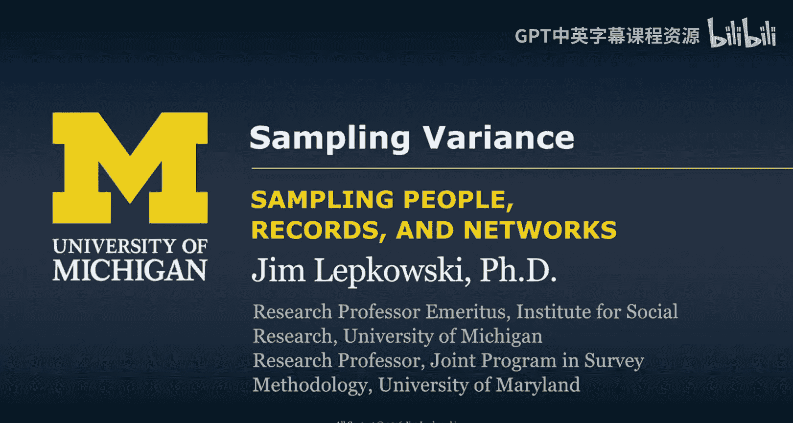
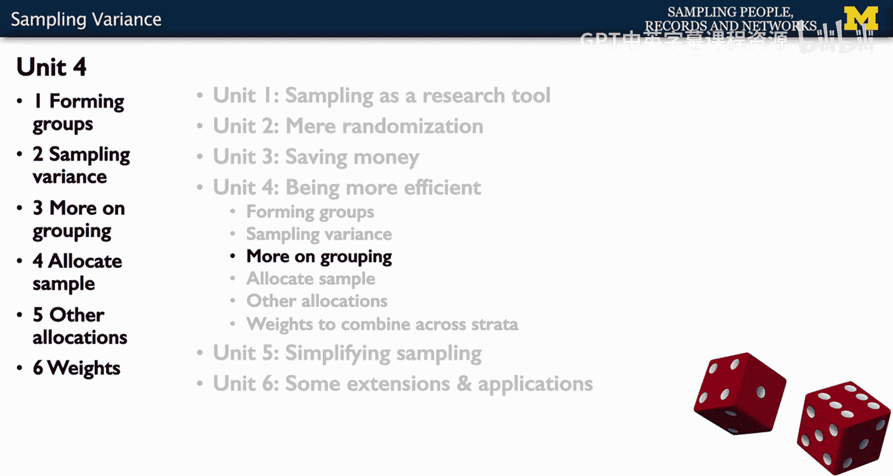

#  107：分层抽样的抽样方差 📊

在本节课中，我们将学习分层随机抽样中抽样方差的计算方法。我们将了解如何通过分层来改变抽样分布，并评估其效率相对于简单随机抽样的提升。

---

上一节我们介绍了分层抽样的基本概念和分配过程。本节中，我们来看看分层随机样本的抽样方差会发生什么变化。

可以想象，当我们进行分层时，抽样分布会发生变化，就像整群抽样一样。我们需要观察这个新的抽样分布，其变异性是比简单随机抽样（我们的基准比较）更大还是更小。这是我们计算整群抽样设计效应时分母所使用的比较基准。

我们的前提是，我们已经将总体（例如400名教师）划分并识别出一个抽样框，将其分为若干组（例如三组，图中展示了两组），并从每组中分别抽取一个样本。然后，我们计算了每个组的估计值，并跨组（本例中是三组）进行合并。

现在，通过这个过程计算出的均值的抽样方差会发生什么变化？理论上，你会预期它与均值估计的情况非常相似。我们将计算每个层（组）内的抽样方差，然后将它们合并。

因此，我们看到了抽样方差。记住抽样方差的一般定义，并进行代数推导，得出我们可以使用的均值抽样方差表达式，结果将是这样的。它将涉及每个组内单独的抽样方差，并跨层求和，但需要加权。不过，这里的权重不是使用 **W_h**（即每个层在总体中的比例），而是使用 **W_h** 的平方。为什么是平方？因为我们处理的是方差，我们处于平方维度上。我们需要取平方根来得到标准误，但我们处理的是方差，所以包括权重因子在内的一切都需要平方。

这意味着，当我们计算这种估计值时，我们将计算每个层内的估计抽样方差。我们将不再使用 **Var(ȳ_h)**，而是使用 **var(ȳ_h)**。两者都乘以 **W_h²**，但在后一种情况下，我们得到的是估计抽样方差，因为我们使用了样本中的数据来计算该方差。我们将它们合并以获得整体的估计抽样方差。

这些层内的抽样方差是什么？这取决于我们如何抽取样本。在我们的例子中，我没有说明，但让我们假设，当我从每个层中抽取样本时（例如，从第一层抽取23名助理教授），我将该分配视为一个简单随机样本。这意味着在每个层内，我们将像处理简单随机抽样一样计算抽样方差。我们需要一个索引来跟踪它。因此，在最后一行你会看到，每个层均值 **ȳ_h** 的方差是 **(1 - f_h) / n_h * S_h²**。我们需要知道每个层内的元素方差 **S_h²**。我们需要取该层内的样本个案（例如23个），并计算这些个体工资的变异性，使用与之前完全相同的元素方差公式：每个值 **y_h** 减去该层内的均值 **ȳ_h**。我们进行三次抽样方差计算，每个层一次，每次基于不同的元素方差。

因此，我们需要层内方差来完成这个计算。让我们假设我们在每个层内进行了简单随机抽样。

我们回到我们的展示，并完成了这个计算。我们取了23个助理教授的样本个案，计算了 **S_h² = 125**。我们对15个样本副教授做了同样的事情，得到 **S_h² = 250**。对于正教授，样本中的42人，他们的平均平方偏差 **S_h² = 500**。注意，随着工资水平的增加，方差也在增加。通常，抽样方差（或更好的度量是抽样标准差，即方差的平方根）与均值之间存在关系，在现实世界中这种情况并不少见。

所以，这里我们需要将所有内容结合起来。这有点超出我们当前的范围，但我还是要过一遍。我们需要知道 **W_h²**。我们知道 **W_h**，例如0.2875或0.1875。我们还需要知道每个层的抽样分数 **f_h**，以及 **(1 - f_h)**，例如1 - 0.2。我们需要 **S_h²** 和样本大小 **n_h**。如果把所有这些放在一起，虽然看起来有点复杂，但你现在应该知道其中的逻辑元素了。我真正关心的是你理解这种计算的逻辑，它源于如何为第一层选择样本并估计其均值的抽样方差。

最终结果，总的估计抽样方差是 **3.453**，它有三个组成部分（每个层贡献一个）：**W_h²**、**(1 - f_h)**、**S_h²** 和分母中的样本大小 **n_h**。这些表达式全部相加，合并后得到整体抽样方差 **3.453**。我们将取其平方根以获得标准误，用于构建置信区间。

我们刚刚完成了步骤6的A和B部分：A是计算每个层内的元素方差，B是用 **W_h²** 因子将它们组合起来，跨层相加。

还有最后一步，即步骤7：构建置信区间。这是我们表达估计值不确定性的方法，同时考虑了均值、标准误以及该均值的分布特性。在这种情况下，该均值将呈正态分布，我们将利用这一点来构建置信区间。

所以，我们的最后一步，步骤7，构建置信区间。我们将使用与之前相同的过程：均值加减误差幅度。但误差幅度由两个因素驱动：t值和标准误。我们将在这里使用t值，需要计算随机事件的数量并减去1。在这种情况下，我们在每个层内减去1，然后得到那个t值，用它乘以标准误来形成误差幅度，最后构建置信区间。

自由度是多少？我们的样本中有多少个随机事件？总共有80个。但在第一层有23个，并且在该层我们还计算了一个均值，这个均值改变了那里随机化的自由度数量。所以，我们实际上有 **n_1 - 1 = 22** 个来自第一层的自由度，**n_2 - 1 = 14** 个来自第二层的自由度，以及 **n_3 - 1 = 41** 个来自第三层的自由度。总体相加，我们有 **80 - 3 = 77** 个自由度。因此，我们查t值表，得到 **t = 1.991**（不是1.96）。我们使用t值是因为我们对每个 **S_h²** 的质量有一些不确定性。我们是在汇总每个 **S_h²** 的稳定性因子，将它们加在一起，并用它来选取t值。

因此，95%的置信区间取该t值乘以标准误，然后从均值中加减。你可以看到最终结果：我们的95%置信区间从 **71.05** 到 **78.45**。

好了，但还没完全结束。就像在整群抽样中一样，我们想知道这与简单随机抽样相比如何。所以，让我们通过讨论设计效应和有效样本量来总结一下。

当我们讨论抽样方差时，我们得到的方差 **3.453** 与相同样本量的简单随机样本会得到的方差相比如何？这就是设计效应 **deff**。对于简单随机样本，分母是我们现在缺少的。我们将把相同的数据当作一个简单随机样本来处理（尽管它实际上是来自分层随机样本的80个案例），并错误地计算均值方差的估计值。我们需要通过单独的计算来计算 **S²**。我们知道抽样分数 **f**，但不知道 **S²**。所以我们将取80个值计算 **S²**，这里是 **647.8**。

因此，对于一个来自400总体的、样本量为80的样本（抽样分数为0.2），在简单随机抽样下的均值抽样方差是 **6.478**。这就是我们要比较的分母。我们将实际的抽样方差 **3.453** 除以 **6.478**。现在，这与整群抽样相反。在按比例分配和我们案例中组间均值差异的特定情况下，我们得到了一个小于1的设计效应。通过在我们的抽样设计中使用辅助信息，我们实现了方差的降低。

事实上，这是一个相当大的降低，抽样方差减少了 **47%**。

让我们思考一下这47%的方差减少对我们的有效样本量意味着什么，就像我们对整群样本所做的那样。在那里，我们取实际样本量除以设计效应。所以这里我们取 **80** 除以 **0.53**，结果我们看到我们的样本有效容量相当于 **150** 个案例。我们实际上有80个，但由于通过按比例分配的分层随机抽样获得的效率增益，我们实际上得到了一个更大的有效样本，相当于增加了70个案例。方差减少了47%，但就有效样本量而言，我们获得了70个案例的改进，几乎使我们的总样本量翻倍。

或者，我们真正处理的是标准误。标准误的增益没有方差的增益那么大。我们的标准误获得了 **27%** 的增益。

这对我们来说是一个巨大的回报。这清楚地证明了我们在进行样本选择时应该进行分层。我总是建议进行分层。这是一种强烈的说法，但这就是为什么在实践中我不做简单的随机抽样。分层是直接且容易做到的。我总是会考虑它，并思考如何应用它，以便我能利用潜在的精度增益。

我们可以想象一个分布图，横轴是样本量增加，纵轴是标准误。我们看到，对于简单随机抽样，那条曲线是下降的（非线性）。随着样本量的增加，我们获得了精度增益。现在我们看到，如果我们进行正确的分配（并非所有分层样本都能给我们带来精度增益，正如我们将看到的），分层会使整个分布向下移动。

我们已经知道，整群抽样会使分布向上移动。所以，我们有了这两种相互抵消的力量。如果我们要进行整群抽样，我们最好对群进行分层，而不仅仅是对元素。这样，我们可以从分层中获得潜在的精度增益，而几乎总是从整群抽样中遭受精度损失。最后，我们稍后会讨论加权。在这里，我们实际上没有加权，每个层的权重效应相同。加权，正如我们将在第6单元看到的，除非它与我们研究的现象直接相关，否则会增加我们的方差。

---

本节课中我们一起学习了分层抽样的抽样方差计算、置信区间的构建以及设计效应的概念。理解了抽样方差的变化后，让我们在下一讲中回到分组问题，在扩展分层随机抽样的发展之前，先补充几个因素。我们将在本单元的第3讲中进行。