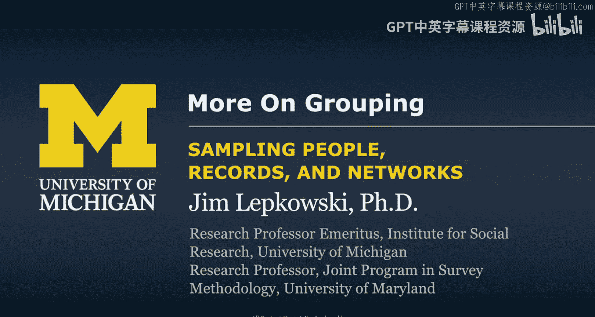
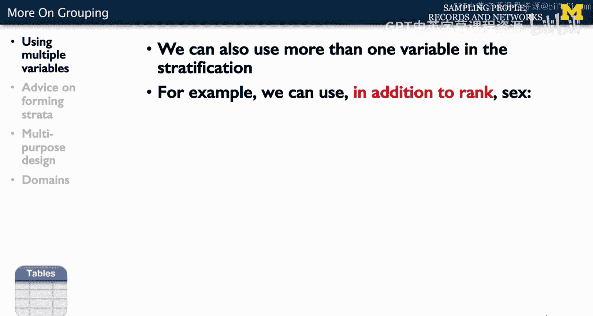
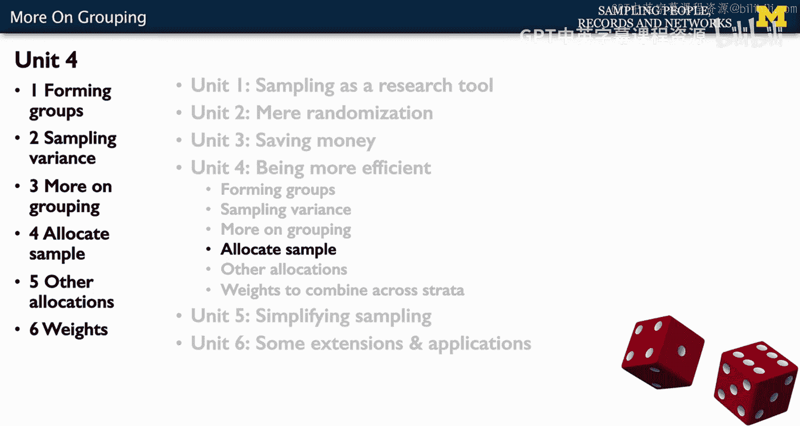

#  108：分组策略进阶 🧩




在本节课中，我们将深入探讨分层抽样中的分组策略。我们将学习如何使用多个变量进行分组，如何选择最佳的分层变量，以及如何处理多目的调查和子域估计等复杂情况。




---

上一节我们介绍了分层抽样的基本概念和分组方法。本节中，我们来看看如何通过更精细的分组策略来进一步提升抽样的效率和精度。

## 使用多个变量进行分层

在分组过程中，使用多个变量是可行且明智的。这类似于制作一个交叉表。例如，我们不仅可以根据教师的“职称”分组，还可以结合“性别”和“院系”来创建更精细的组别。

**公式示例：**
假设我们有两个分层变量：`Rank`（职称）和`Sex`（性别）。我们可以通过交叉分类来创建新的分层：
```
Strata = CrossTabulation(Rank, Sex)
```
这样，原本基于“职称”的3个组，就可以扩展为6个组（例如：女性助理教授、女性副教授、女性正教授、男性助理教授等）。

使用多个变量的核心目的是**减少组内方差**。当组内的个体特征越相似（同质性越高），组间的差异就越大，最终合并各组结果时，我们就能获得更高的估计精度。这就像在线性回归模型中添加更多的预测变量，每个变量都能帮助我们解释结果变量（如收入）的更多变异。

以下是使用多个变量进行分层和样本分配的示例步骤：
1.  确定分层变量（如职称、性别）。
2.  计算每个交叉分组的总体大小（`N_h`）和权重（`W_h`）。
3.  根据总体比例，将总样本量（如80）按比例分配到各个组中。

## 如何选择分层变量

既然可以使用多个变量，那么应该如何选择最佳的分层变量呢？核心原则是：**寻找能使组内同质性最大化、组间异质性最大化的变量**。

换句话说，我们希望不同组之间的均值差异尽可能大。例如，我们知道不同性别和不同职称的教师收入存在显著差异。利用这些已知的社会结构现象，可以创建出均值差异明显的组别。

选择分层变量时，可以参考以下建议：
*   **解释力强**：选择那些对结果变量（如收入）方差解释力最强的变量。
*   **数据可得**：分层变量信息通常来自人口普查、行政记录或既往调查。
*   **结合先验知识**：利用我们对社会现象的理解（如不同院系的薪酬差异）来选择变量。
*   **可合并小类**：如果某些交叉分类的群体规模过小，可以将其与相邻类别合并，以确保每个层都有足够的样本量。

## 多目的调查中的分层

在实际调查中，我们很少只测量一个结果变量。一个全国性的家庭调查可能同时收集资产、健康、心理福祉等多方面信息。这种多目的调查使分层策略变得复杂。

一个好消息是，我们之前讨论的**按比例分配的分层抽样方案**，对于多目的调查中的绝大多数变量而言，通常都能带来精度的提升。因此，按比例分层是一个很好的起点策略。

## 子域估计与样本分配

有时，调查目标不仅包括总体估计，还需要为特定子群体（即“域”）提供独立的估计。例如，在加拿大，政府需要按月估计全国失业率，同时也需要为10个省份分别提供精确的失业率估计。

在这种情况下，简单的按比例分配可能行不通。如果某个省份人口很少（如沿海的海洋省份），按比例分配到的样本量会很小，无法产生可靠的省级估计。

解决方案是采用**非比例分配**。例如，加拿大劳动力调查可能会给每个省份分配**相同**的样本量（如每个省3000户），以确保所有省份都能获得同等精度的估计。这种为特定域进行估计的需求，深刻影响了我们最终的样本分配决策。

---

本节课中，我们一起学习了分层抽样中更高级的分组策略。我们了解到使用多个变量可以提升精度，选择变量应追求组间差异最大化，并且要考虑到多目的调查和子域估计对样本分配的特殊要求。



下一讲，我们将深入探讨样本分配问题，这是将分层抽样效率最大化的关键环节。