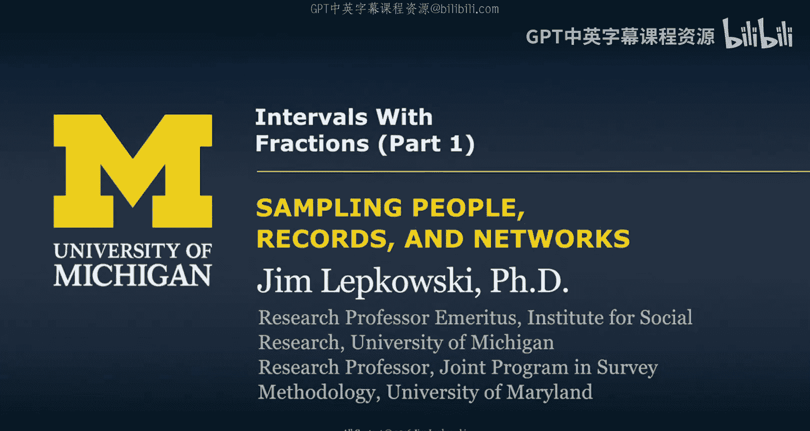
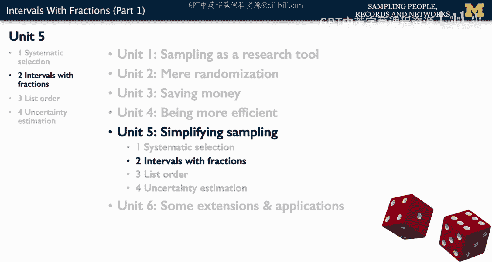
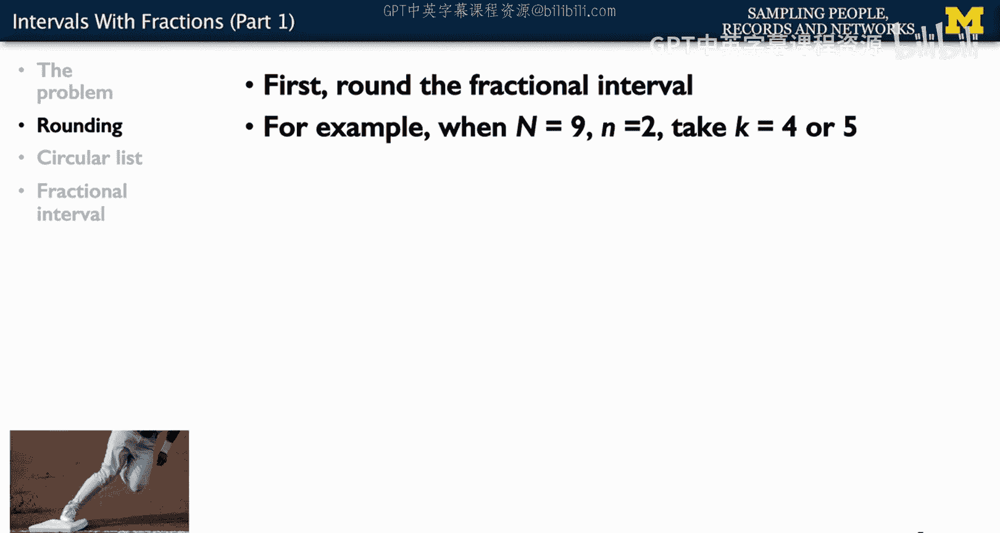
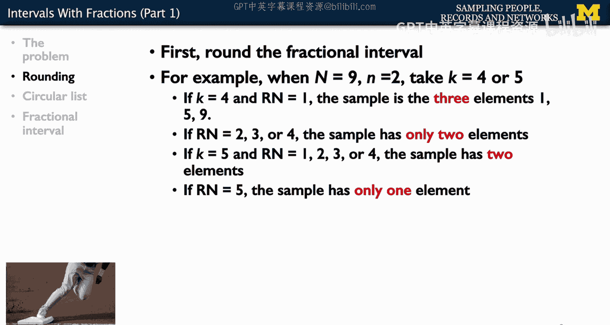
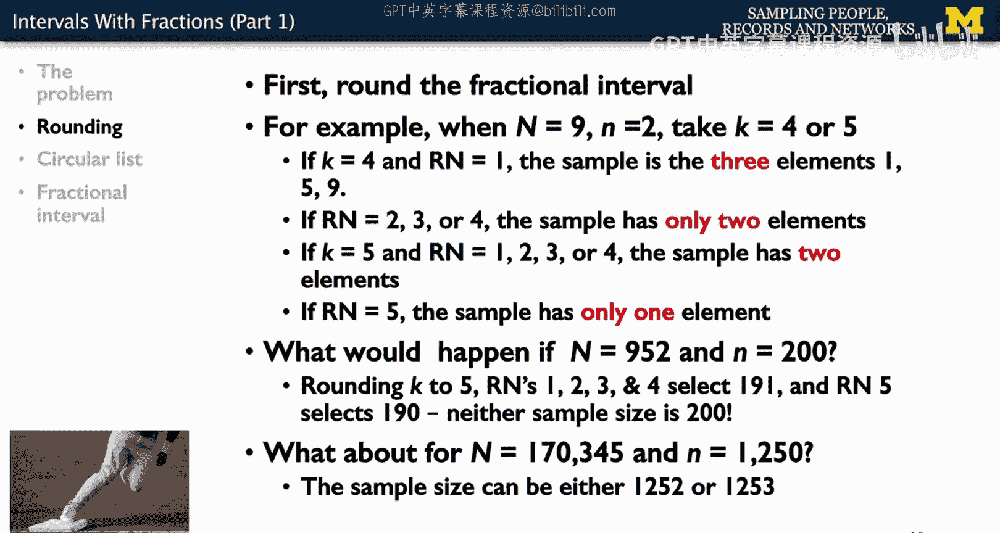
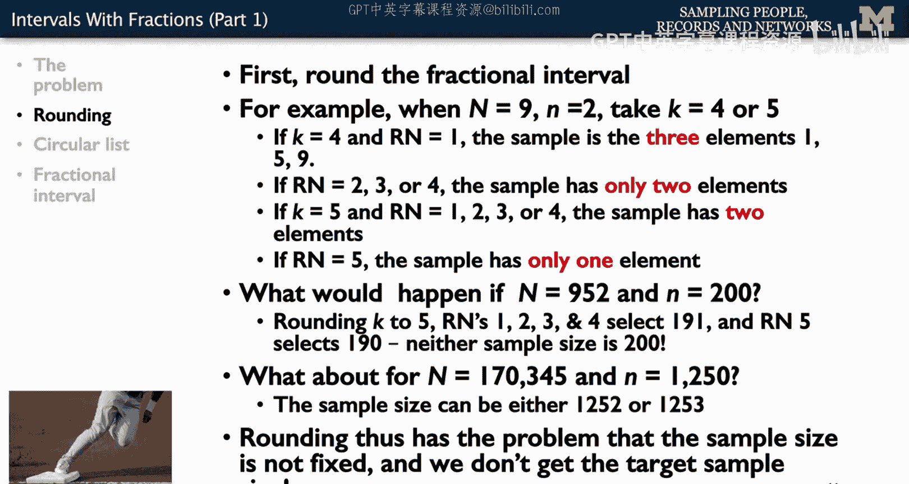
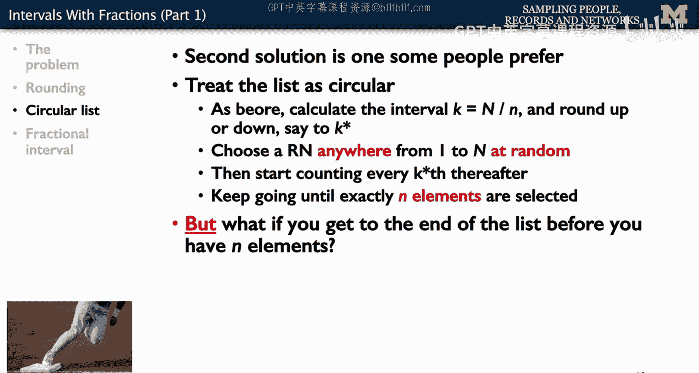
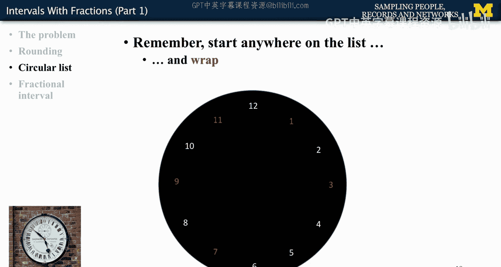
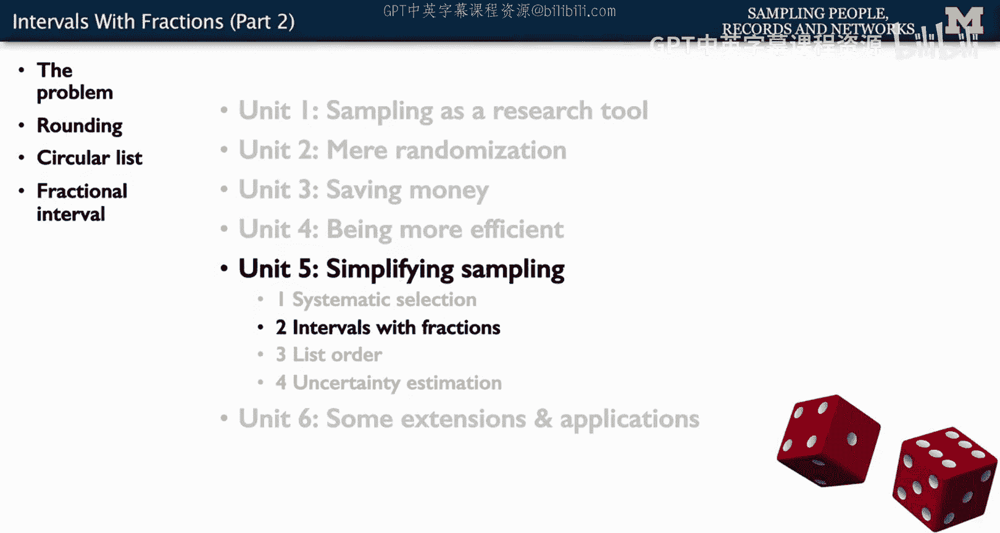

#  113：分数间隔处理（上）📊

在本节课中，我们将要学习系统抽样中的一个具体问题：当抽样间隔（K）的计算结果不是整数，而是带有小数时，应如何处理。我们将首先明确问题所在，然后探讨两种初步的解决方案：**四舍五入法**和**循环列表法**。

## 问题概述

在上一节中，我们介绍了系统抽样的基本原理和操作步骤。其核心流程是：首先计算抽样间隔 **K = N / n**，其中 **N** 是总体大小，**n** 是样本大小；然后从 **1 到 K** 中随机选择一个起点；最后，通过不断累加 **K** 来选取后续样本。

然而，当 **N** 无法被 **n** 整除时，**K** 将是一个小数。例如，总体 **N=9**，样本 **n=2**，则 **K = 9 / 2 = 4.5**。这带来了一个实际问题：我们无法在列表中“每隔4.5个”单位进行抽样。

## 解决方案一：四舍五入法

最直观的解决方案是将小数间隔 **K** 四舍五入为一个整数 **K\***。但这种方法会带来两个主要问题。

以下是四舍五入法操作步骤：
1.  计算理论间隔 **K = N / n**。
2.  将 **K** 四舍五入（可以向上取整、向下取整或按常规规则）为整数 **K\***。
3.  从 **1 到 K\*** 中随机选择一个起点 **r**。
4.  依次选取编号为 **r, r+K\*, r+2K\*, ...** 的元素，直到超出列表范围。

**问题分析：**
*   **样本量不固定**：最终的样本量会因随机起点 **r** 的不同而在 **n** 附近波动（通常是多一个或少一个）。
*   **无法精确达到目标样本量**：即使取平均值，最终样本量也可能与计划的 **n** 有出入。

**举例说明：**
假设 **N=9, n=2**，则 **K=4.5**。
*   若取 **K\* = 4**（向下取整）：
    *   随机起点 **r=1**，则样本为第 **1, 5, 9** 号元素，共3个。
    *   随机起点 **r=2**，则样本为第 **2, 6** 号元素，共2个。
*   若取 **K\* = 5**（向上取整）：
    *   随机起点 **r=1**，则样本为第 **1, 6** 号元素，共2个。
    *   随机起点 **r=5**，则样本仅为第 **5** 号元素，共1个。

由此可见，四舍五入法虽然简单，但会导致样本量不稳定。如果研究对预算或样本量有严格要求，这就不是一个理想的方案。

## 解决方案二：循环列表法

为了解决样本量不固定的问题，我们可以采用“循环列表”法。想象列表首尾相连，形成一个环（如同钟表表盘）。

以下是循环列表法操作步骤：
1.  计算理论间隔 **K**，并将其四舍五入为整数 **K\***（通常向下取整）。
2.  随机起点 **r** 不再局限于 **1 到 K\***，而是可以从列表中的**任何位置**（即 **1 到 N**）随机选取。
3.  从起点 **r** 开始，每次累加 **K\*** 选取样本。
4.  当选取的编号超过列表末尾 **N** 时，则“绕回”列表开头继续计数，直到抽满 **n** 个样本为止。

**举例说明：**
假设 **N=12, n=5**，则 **K = 12 / 5 = 2.4**。我们向下取整，令 **K\* = 2**。
随机起点 **r = 7**。
*   第一个样本：7
*   第二个样本：7 + 2 = 9
*   第三个样本：9 + 2 = 11
*   第四个样本：11 + 2 = 13（超过12）。我们绕回开头：13 - 12 = 1
*   第五个样本：1 + 2 = 3
最终样本为：**7, 9, 11, 1, 3**，正好5个元素。

这种方法确保了无论随机起点如何，最终都能获得精确的样本量 **n**。它的缺点在于，列表被视作一个环，理论上第一个和最后一个元素在概率上“相邻”了，这有时在逻辑上可能显得不自然。

## 本节总结

本节课我们一起探讨了系统抽样中遇到分数间隔时的挑战。我们分析了两种初步的解决方案：
1.  **四舍五入法**：简单直接，但会导致**样本量不固定**，可能无法满足精确的样本量要求。
2.  **循环列表法**：通过将列表视为环形，并从任意点开始抽样，确保了**固定的样本量**，但改变了列表首尾的逻辑关系。

这两种方法各有优劣，适用于不同的场景。在下一节中，我们将继续探讨第三种更精确的解决方案——**分数间隔法**，它能在保持样本量固定的同时，避免循环列表法的逻辑问题。