#  115：系统抽样（三）：列表顺序的影响 📊

在本节课中，我们将探讨系统抽样中一个关键但常被忽视的方面：抽样列表的排列顺序。列表顺序与系统抽样方法的结合，会直接影响样本的性质和抽样精度。我们将分析几种常见的列表顺序类型及其影响。

上一节我们讨论了如何处理分数间隔等实际问题，本节中我们来看看列表顺序如何与系统抽样相互作用。

## 列表顺序与抽样结果的关联

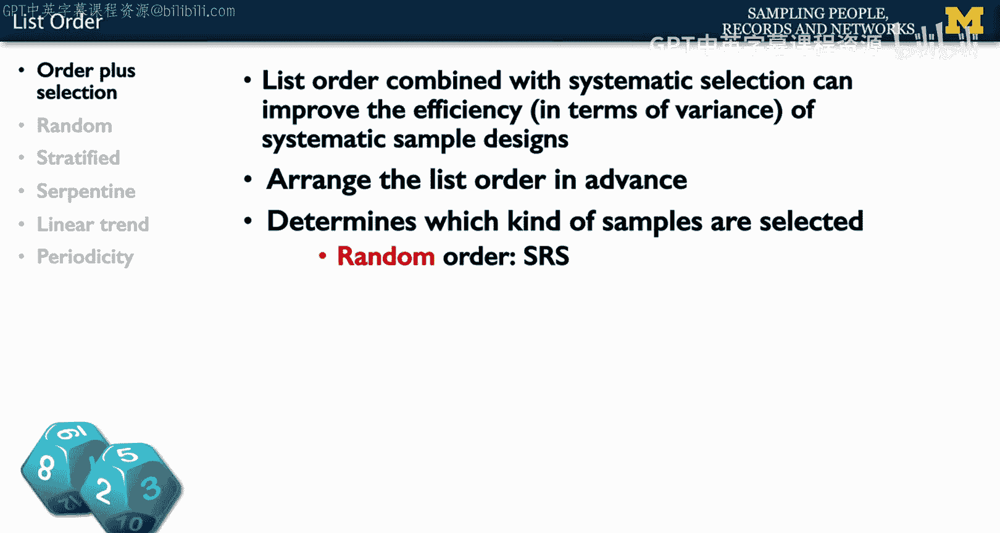

列表顺序，结合系统选择过程，会产生可能意想不到的结果。这种组合决定了我们最终得到的样本类型。

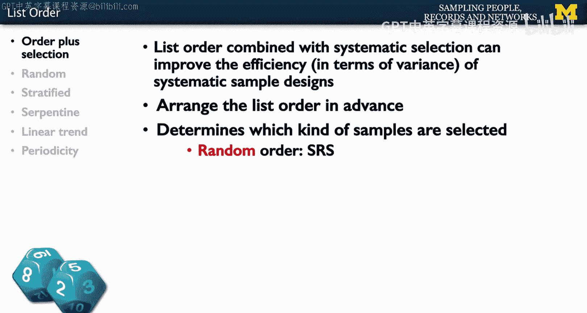

以下是几种主要的列表顺序类型及其影响：

### 1. 随机顺序列表

如果列表顺序是随机的，那么对其进行系统抽样，本质上等同于简单随机抽样。

**实现方法**：可以预先为列表中的每个个案分配一个0到1之间的随机数，然后按此随机数对列表进行排序。此时列表处于随机顺序。

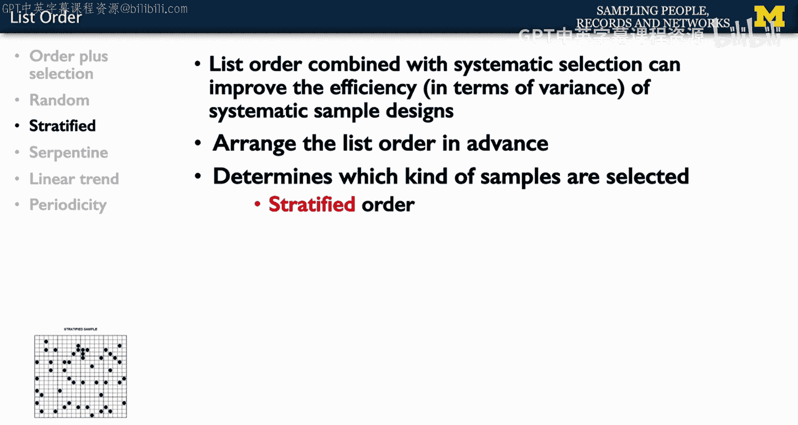

**核心概念**：
*   **排序过程**：`列表.sort(key=随机数)`
*   **抽样结果**：系统抽样 ≈ 简单随机抽样

例如，在我们的交易记录列表中，如果交易按发生时间顺序记录，且交易时间与交易金额无关，那么该列表相对于“金额”这个研究变量而言就是随机顺序的。从这样的列表中系统抽样，效果等同于简单随机抽样。

### 2. 分层顺序列表

我们可以通过预先操作，使列表顺序对应于案例的某些类别。这能让我们在抽样时，隐含地实现分层抽样。

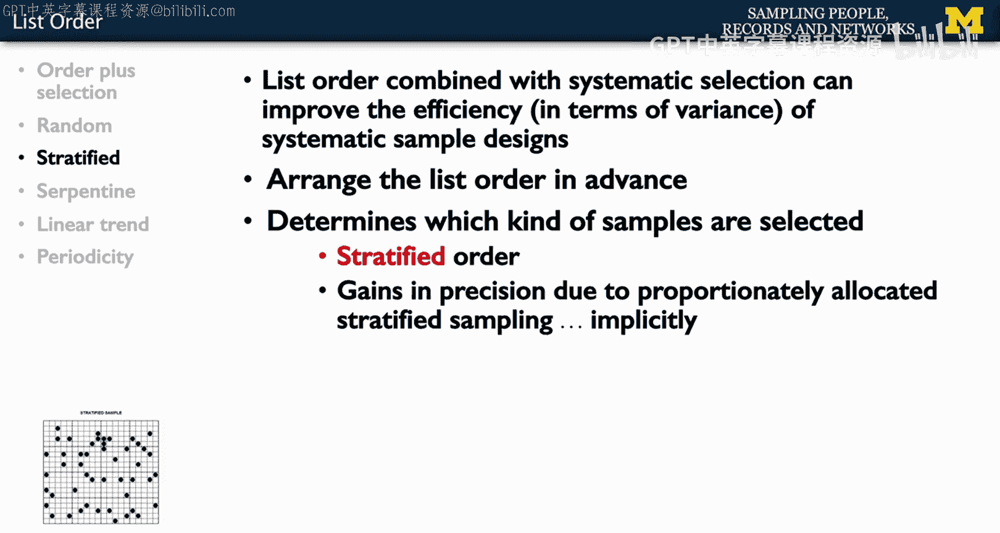

**操作方式**：例如，将列表按“性别”排序，所有女性教职员在前，男性教职员在后。然后对整个排序后的列表应用系统抽样（使用同一个随机起点和固定间隔）。这样，我们从女性群体和男性群体中抽取的样本量，将精确地与其在总体中的比例成比例。

**核心概念**：这被称为 **“隐含分层”**。我们无需显式地划分层并计算每层的分配样本量，排序和系统抽样过程自动为我们完成了按比例分配的分层抽样。

**更复杂的排序**：我们还可以进行双重排序，例如先按“行业类别”排序，再在每个类别内按“子类别”排序。这样，系统抽样就能隐含地实现基于两个变量的分层，如果研究变量（如交易金额）与这些类别相关，将能有效提高抽样精度。

**分配特点**：即使某组（层）的理论样本量是小数（如10.2），系统抽样也能实现真正的按比例分配——大约20%的随机起点会从该组抽到11个样本，80%的随机起点会抽到10个样本。

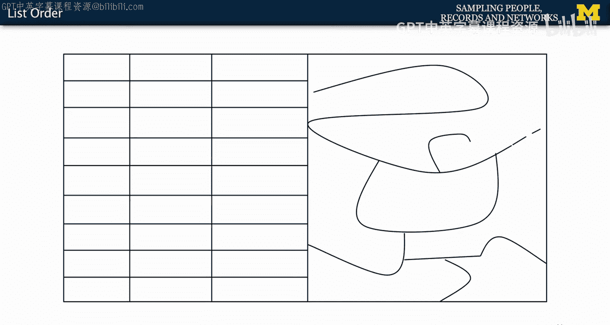

### 3. 蛇形顺序列表

这种顺序在地理抽样中尤为常见。例如，对一个区域的街区进行编号时，采用“蛇形”顺序（从左到右，下一行从右到左，依此类推）。

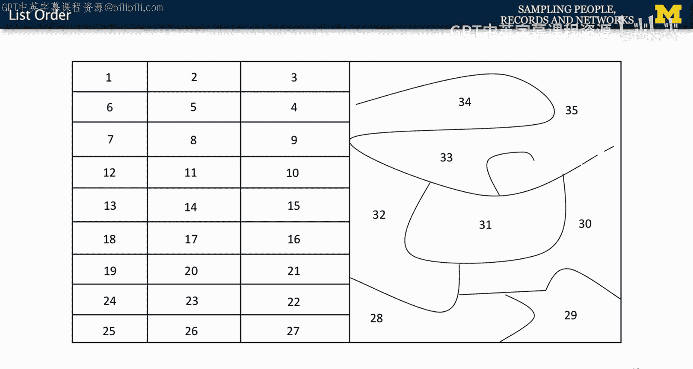

**应用场景**：假设一个社区有35个街区，按蛇形顺序编号为1到35。如果我们要从中系统抽取5个街区（间隔为7），无论随机起点是几，抽出的样本都能在地理上均匀地覆盖整个区域，包括社区的老区和新区分。

**优势**：这种顺序能确保样本在地理空间上具有良好的分布，如果研究变量（如居民收入、房屋价值）与地理位置相关，蛇形排序结合系统抽样就能隐含地实现地理分层，提高样本代表性。

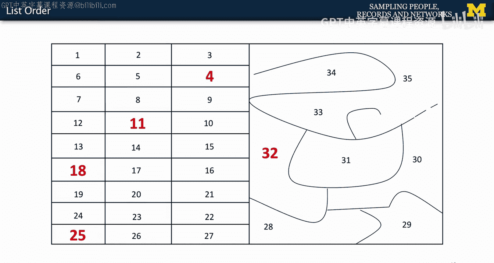

### 4. 线性趋势顺序列表

当列表按研究变量的值单调递增或递减排列时，就形成了线性趋势顺序。

**潜在担忧**：有人担心，如果随机起点恰好落在列表前端（低值区）或后端（高值区），会导致样本均值系统性偏低或偏高。

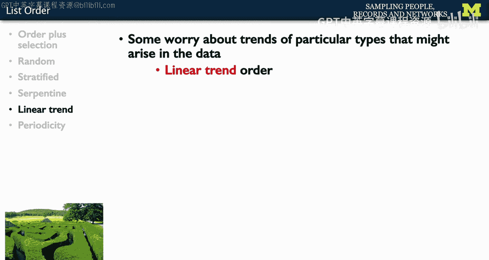

**实际影响**：尽管存在上述担忧，但从抽样分布的角度看，线性趋势顺序下的系统抽样通常能带来**显著的精度提升**，其样本均值的方差非常小。这与某些分层抽样的效果类似。线性趋势本质上是一个有利特征。当然，在实践中若遇到强线性趋势，可以考虑使用多个随机起点等更复杂的设计来规避潜在风险。

### 5. 周期性顺序列表

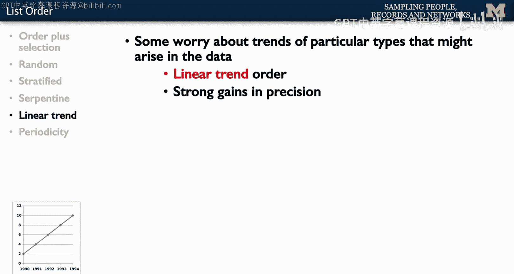

当列表顺序呈现出周期性波动时（例如，数值高低交替出现），就需要特别警惕。

**主要风险**：如果抽样间隔恰好与波动周期相同或成倍数关系，样本可能会全部集中在高值点或低值点，导致严重的估计偏差。

**结论**：周期性是系统抽样中需要尽力避免的问题。一旦怀疑列表存在周期性，通常不应采用系统抽样方法。

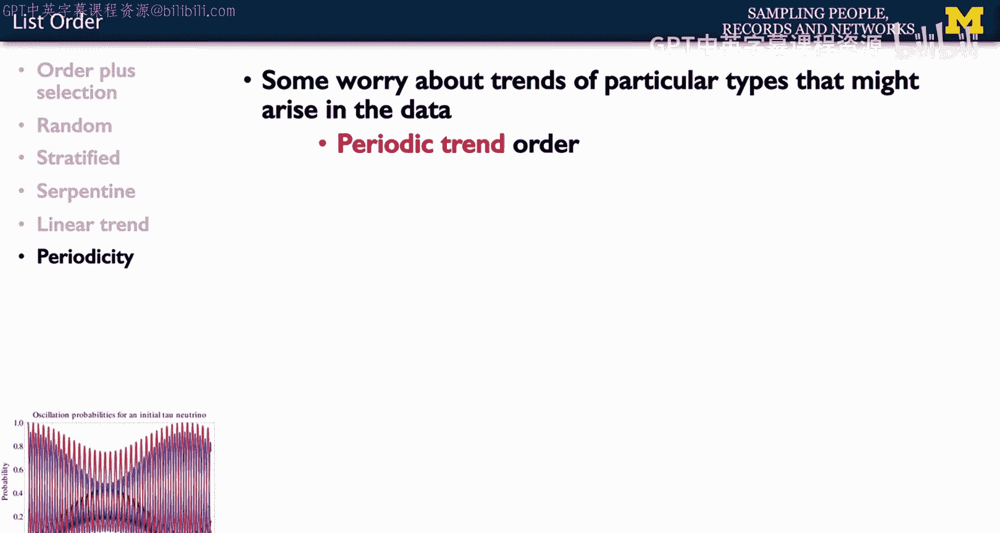

## 总结与核心要点

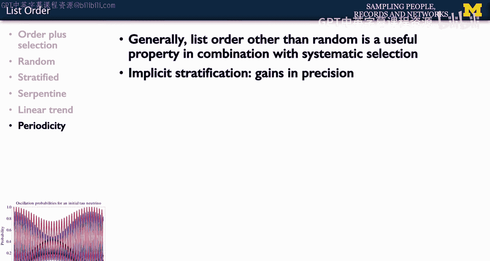

本节课我们一起学习了列表顺序对系统抽样的重要影响。

*   **列表顺序是系统抽样的关键组成部分**：它并非中性，而是与抽样方法结合，共同定义了最终样本的性质。
*   **顺序类型决定抽样效果**：
    *   **随机顺序**产生简单随机样本。
    *   **分层/蛇形顺序**能实现**隐含分层抽样**，带来精度增益。
    *   **线性趋势顺序**通常能提高精度，但需注意潜在偏差。
    *   **周期性顺序**是危险信号，应避免使用系统抽样。
*   **顺序的来源**：顺序可能是列表固有的，需要我们识别；也可能是基于我们拥有的辅助变量（如性别、地区）主动排序施加的。
*   **核心收益**：通过利用或创造有利的列表顺序（如分层顺序），系统抽样可以便捷地获得与按比例分配分层抽样相当的精度提升，而无需复杂的层划分与样本量分配计算。

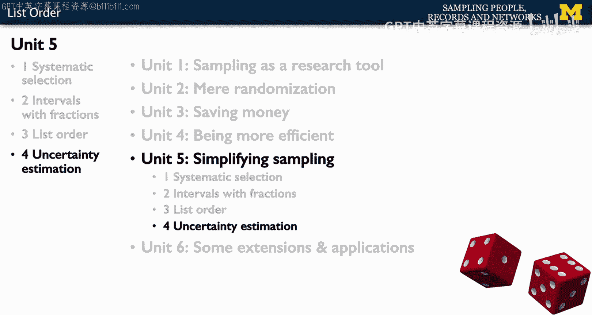

然而，这种隐含的分层也带来了一个挑战：我们如何估计此类样本的抽样方差？如何量化所获得的精度增益？这将是本单元下一讲，也是系统抽样部分的最后一个主题——系统抽样下方差的估计。