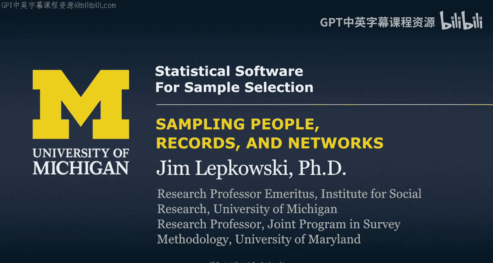
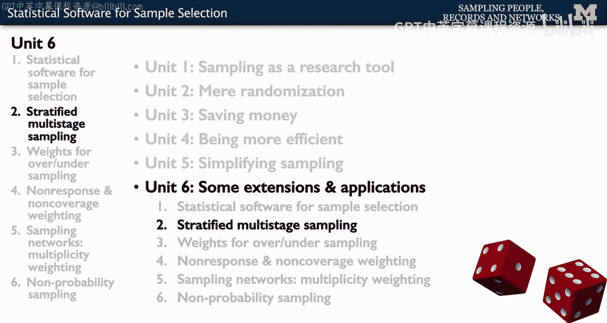

#  117：抽样统计软件 📊

在本节课中，我们将学习如何使用统计软件进行样本选择。我们将以一个具体的普查街区数据框为例，演示在R统计系统中实现四种基本抽样设计的过程。通过本课，你将了解将数据导入软件、执行抽样命令以及提取样本结果的基本流程。

---

## 数据框与抽样目标

我们使用的数据框包含975个普查街区（即总体元素）。每个街区记录了三个变量：一个序列号、租户自住住房单元数量和业主自住住房单元数量。我们的目标是从这个总体中抽取一个大小为20的样本，抽样比约为1/48.75。

以下是数据框前30行的示例，展示了基本的所有权和租赁信息：

| 序列号 | 租户自住数 | 业主自住数 |
| :--- | :--- | :--- |
| 1 | 12 | 23 |
| 2 | 5 | 18 |
| 3 | 0 | 45 |
| ... | ... | ... |

你无需仔细查看所有细节，只需知道我们将从这个具体的列表中抽取样本。

---

## 软件准备步骤

在使用任何统计软件进行抽样前，都需要完成一些数据准备步骤。在R系统中，这个过程通常包括以下几步。

以下是准备工作的核心步骤：

1.  **设置工作目录**：使用 `setwd()` 函数指定数据文件在计算机上的存储路径。
2.  **读取数据**：使用 `read.table()` 函数将数据文件读入R环境，并存储为一个数据对象（例如命名为 `frame`）。需要指定文件路径、是否包含表头以及列分隔符（本例中为制表符）。
3.  **检查数据**：使用 `View(frame)` 或 `head(frame)` 等命令查看数据对象，确保975个案例和3个变量都已正确导入，没有数据损坏。

完成这些步骤后，数据框就准备好用于抽样了。

---

## 加载抽样程序包

R系统通过“程序包”来扩展功能，不同的程序包提供不同的专用命令。对于抽样任务，有一个非常实用的程序包叫做 `sampling`。

我们需要使用 `library(sampling)` 命令来加载这个程序包。这样，R系统就能识别并使用该程序包内建的各种抽样函数了。

---

## 实施四种抽样设计

上一节我们准备好了数据和工具，本节中我们来看看如何具体实施四种不同的抽样设计。我们将使用同一个数据框和相同的样本量（n=20），分别进行不放回简单随机抽样、放回简单随机抽样、系统抽样以及与规模大小成比例的概率抽样。

以下是每种设计的实现方法：

### 1. 不放回简单随机抽样
*   **命令**：`Sam.SRSWOR <- SRSWOR(N=975, n=20)`
*   **过程**：该命令会生成一个长度为975的指示向量 `Sam.SRSWOR`，其中20个位置标记为1（表示被选中），其余为0。
*   **提取样本**：使用 `which(Sam.SRSWOR == 1)` 函数识别被选中的行号，然后从 `frame` 数据框中提取这些行，即可得到最终的20个样本案例。

### 2. 放回简单随机抽样
*   **命令**：`Sam.SRSWR <- SRSWR(N=975, n=20)`
*   **区别**：此时生成的指示向量中，值可能为0、1、2...，因为同一个案例可能被抽中多次。例如，值2表示该案例被抽中了两次。
*   **提取样本**：使用 `which(Sam.SRSWR >= 1)` 来识别所有被抽中至少一次的案例。如果需要记录重复次数，还需将重复因子合并到样本数据中。

### 3. 系统抽样
*   **准备**：首先创建一个包含每个单元入样概率（πi = 20/975）的向量 `prob.sys`。
*   **命令**：使用 `UPsystematic(pik=prob.sys)` 函数进行系统抽样，结果存入 `Sam.sys` 对象。
*   **提取样本**：方法与之前相同，使用 `which(Sam.sys == 1)` 从 `frame` 中提取样本案例。系统抽样的间隔约为48.75，因此样本案例间的间隔会在48和49之间变化。

### 4. 与规模大小成比例的概率抽样
*   **命令**：例如使用 `UPbrewer(pik=prob.pps)`，其中概率 `prob.pps` 与每个街区的“业主自住住房单元数量”成比例。
*   **注意**：由于有些街区的业主自住数为0，计算出的入样概率也为0，软件会给出警告。这是正常现象，说明这些街区没有机会被抽中。
*   **提取样本**：流程与上述方法一致，生成指示向量后，再从其对应的数据框中提取样本案例。

---

## 总结与展望

本节课我们一起学习了使用统计软件（以R为例）进行样本选择的基本流程。我们了解了从数据准备、加载程序包到执行具体抽样命令（包括不放回/放回简单随机抽样、系统抽样和PPS抽样）的完整步骤。关键在于理解软件首先生成一个抽样指示向量，然后再根据这个向量从原始数据框中提取出最终的样本案例。

掌握利用软件抽样可以大大提高效率，避免手动抽样的繁琐和错误。在 `sampling` 这样的程序包中，还包含我们未涵盖的数十种其他抽样技术。

在接下来的讲座中，我们将探讨如何组合不同的抽样技术，例如将分层与整群抽样结合，进行分层多阶段抽样。

---