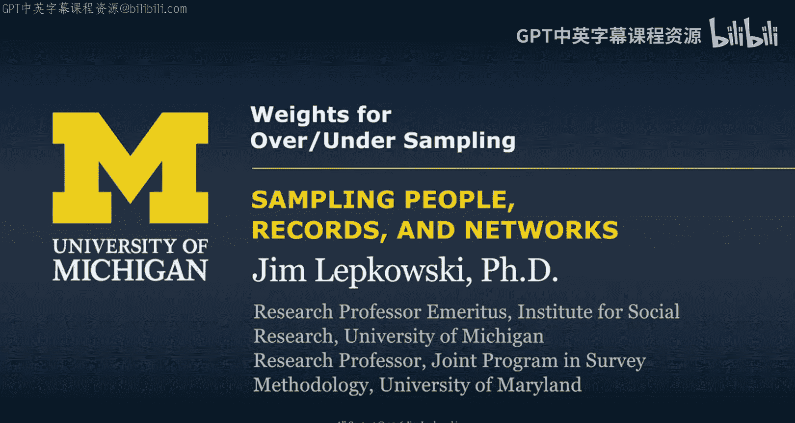
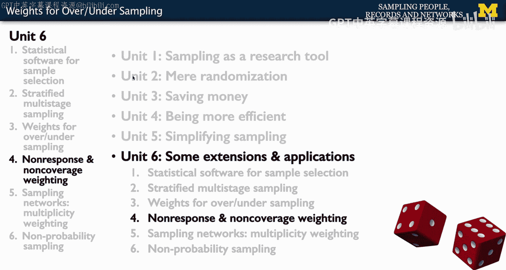

#  119：超-欠抽样权重 ⚖️

在本节课中，我们将学习抽样调查中的一个核心概念：权重。我们将重点探讨当样本设计涉及超抽样或欠抽样时，如何通过权重来调整估计值，以准确反映总体情况。理解权重对于分析复杂的调查数据至关重要。

## 权重的基本框架 🧩

上一节我们介绍了分层抽样，本节中我们来看看权重的基本框架。权重过程可以比作一个漏斗及其逆向操作。

我们从一个抽样框开始，它代表总体，包含 **N** 个元素，但我们对其所知甚少。然后，我们通过某种概率机制（抽样分数 **n/N**）抽取一个样本，样本量为 **n**，每个元素被选入样本的概率为 **π**。样本包含的信息更详细。

为了从样本估计总体参数（如均值），我们需要“逆向”操作，将样本结果“膨胀”回总体规模。这通过应用权重来实现，权重通常是抽样概率的倒数 **1/π**。这样，我们就能在一个“人工构建”的总体（规模为 **N**，信息来自样本）上进行计算，并评估估计的不确定性。

## 等概率抽样与加权估计 📊

在等概率抽样方法中，每个元素的入选概率 **π** 相同，等于抽样分数 **n/N**。此时，每个样本元素的权重 **w** 也相同，为 **1/π = N/n**。

计算样本均值时，未加权估计公式为：
`ȳ_unweighted = (Σ y_i) / n`

由于所有权重相同，它们在分子分母中会相互抵消，因此未加权估计是有效的。未加权估计实际上是加权估计在所有权重相等时的一个特例。

加权估计的通用公式为：
`ȳ_weighted = (Σ w_i * y_i) / (Σ w_i)`
其中，**w_i = 1 / π_i**。

## 超抽样与欠抽样的权重应用 🎯

现在，我们来看一个需要应用不同权重的具体场景：分层抽样中的超抽样与欠抽样。

假设我们要研究美国10年级学生的测试成绩。总体约有400万学生。我们根据学校享受免费或减价午餐的学生比例（作为社会经济地位的代理指标）将总体分为两层：“高比例”层（低收入，约80万学生）和“低比例”层（高收入，约320万学生）。

以下是两种不同的样本分配方案：

**1. 比例分配**
*   目标：使样本能准确代表总体构成。
*   方法：每层使用相同的抽样率。例如，若总样本量为12000，则“高比例”层样本量 = 12000 * (80万/400万) = 2400，“低比例”层样本量 = 9600。
*   权重：由于每层内抽样概率相同，权重在层内恒定。虽然可以计算权重，但在合并估计时它们会抵消，因此使用未加权估计即可。

**2. 等额分配（涉及超/欠抽样）**
*   目标：提高对较小群体（此处为“高比例”层）估计的精度，或便于进行层间比较。
*   方法：每层抽取相同数量的样本。例如，每层各抽6000名学生。
*   后果：这导致对“高比例”层进行了**超抽样**（抽样率高于总体比例），对“低比例”层进行了**欠抽样**。如果直接计算未加权样本均值，结果会偏向于超抽样层（此处为低收入层）的特征。
*   解决方案：必须使用权重进行校正。权重为入选概率的倒数：
    *   “高比例”层权重 **w_high = 1 / (6000/800000) ≈ 133.33**
    *   “低比例”层权重 **w_low = 1 / (6000/3200000) ≈ 533.33**
    在计算总体均值时，需使用这些权重进行加权平均，从而校正因不等概率抽样带来的偏差，得到对总体真实均值的无偏估计。

## 核心要点总结 📝

本节课中我们一起学习了权重的核心概念与应用：
1.  **权重的本质**：是样本元素代表总体中个体数量的倍数，通常为抽样概率的倒数 **1/π**。
2.  **等概率抽样**：当所有元素入选概率相同时，未加权估计是有效的。
3.  **不等概率抽样**：当设计包含超抽样或欠抽样（如分层抽样中的等额分配）时，不同元素有不同的权重。
4.  **加权估计**：必须使用加权公式 `ȳ_weighted = (Σ w_i * y_i) / (Σ w_i)` 来计算总体参数，以校正因不等概率抽样引入的偏差。
5.  **权重的目的**：使得在满足特定研究需求（如提高子群估计精度）的抽样设计下，最终仍能获得对总体参数的有效估计。

权重是处理复杂调查数据的基础。在接下来的课程中，我们将探讨权重如何进一步用于调整调查中常见的无回答和覆盖不全等问题。