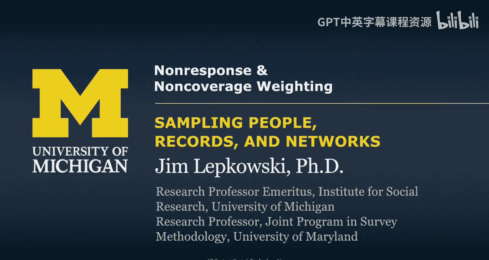
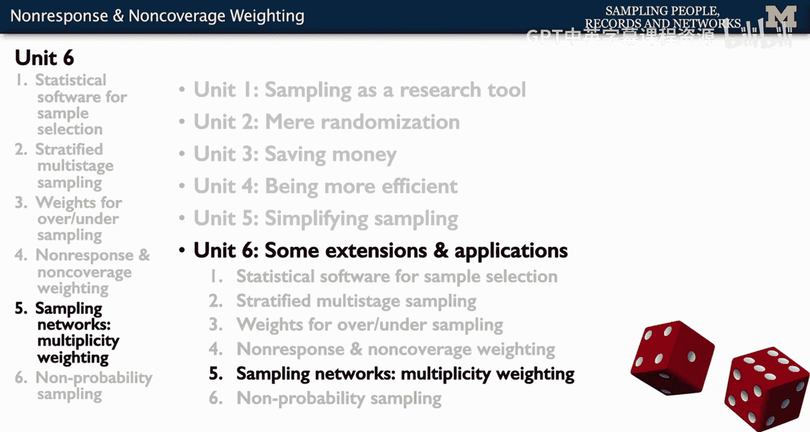

#  120：无应答与未覆盖加权 📊

在本节课中，我们将学习如何处理调查数据中两个常见问题：**无应答**和**未覆盖**。我们将探讨如何通过加权调整来补偿这些问题，以确保样本估计能够更准确地反映总体情况。课程将涵盖无应答加权、事后分层校准，以及如何将这些权重与之前的抽样权重结合起来。

---

## 从样本到受访者

上一节我们介绍了为应对抽样比例不均而进行的加权调整。本节中，我们来看看当样本中的部分个体未能提供数据时，我们该如何处理。

在调查中，并非所有被抽中的个体都会参与或完成调查，这种现象称为**无应答**。无应答可能导致样本出现偏差，特别是当无应答在不同子群体中比例不同时。我们的目标是从实际收集到的**受访者样本**出发，通过加权调整，使其能代表我们最初设计的**完整样本**。

## 无应答加权调整

以下是处理无应答的一种常见方法，其核心是假设无应答在特定组内是随机发生的。

假设我们从一个包含400万10年级学生的总体中，抽取了一个12,000人的样本。样本分为“都市区”和“非都市区”两组。在数据收集后，我们发现两组学生的应答率不同：

*   **都市区学生**：样本8,000人，实际应答5,600人。应答率为 `5,600 / 8,000 = 0.7`。
*   **非都市区学生**：样本4,000人，实际应答3,400人。应答率为 `3,400 / 4,000 = 0.85`。

总体应答率为75%，但两组之间存在差异。如果我们假设组内的无应答是随机的，那么组内的应答率就可以被视为一种“抽样率”。为了补偿无应答带来的样本缩减，我们计算其**逆数**作为无应答调整权重：

*   **都市区权重**：`1 / 0.7 ≈ 1.43`
*   **非都市区权重**：`1 / 0.85 ≈ 1.18`

这意味着，在后续分析中，每个都市区受访者的数据将被视为代表约1.43个原始样本中的都市区个体，而非都市区受访者则代表约1.18个个体。这补偿了因无应答导致的样本构成变化。

## 组合多种权重

在实际操作中，调查数据通常需要同时调整多种偏差。例如，我们的样本可能已经因为对“低收入家庭学生”的过度抽样而有了初始权重，现在又需要加上无应答调整权重。

以下是组合权重的步骤：

1.  **确定分组**：根据所有相关维度（如收入水平、居住区域）对样本进行交叉分组。
2.  **计算各类权重**：
    *   **抽样权重 (W1)**：补偿过度或不足抽样。
    *   **无应答权重 (W2)**：补偿不同组间的无应答差异。
3.  **计算最终权重**：将同一组内的所有权重**相乘**。

假设我们有两个维度：
*   **免费/减价午餐资格**：高比例组（权重=1），低比例组（权重=4，因过度抽样）。
*   **居住区域**：都市区（无应答权重=1.43），非都市区（无应答权重=1.18）。

那么，一个来自“都市区、低比例午餐资格”组的受访者的最终权重计算如下：
`最终权重 = 抽样权重 × 无应答权重 = 4 × 1.43 = 5.72`

通过这种方式，我们为每个受访者计算出一个综合权重，同时校正了抽样设计和无应答带来的影响。

## 事后分层校准

即使经过上述调整，加权后的样本分布仍可能与总体在关键变量（如家庭结构）上存在差异。这时，我们可以使用**事后分层**进行校准。

假设我们从外部数据（如人口普查）得知，10年级学生中来自单亲家庭的比例应为30%。但在我们加权后的9,000名受访者样本中，该比例仅为20%。为了校准这一差异，我们计算事后分层权重：

*   **单亲家庭组权重**：`总体比例 / 样本比例 = 0.30 / 0.20 = 1.5`
*   **其他家庭组权重**：`0.70 / 0.80 = 0.875`

这个权重将应用于已经过抽样和无应答加权的数据。它上调了单亲家庭受访者的贡献，下调了其他家庭受访者的贡献，从而使样本在家庭结构分布上与总体一致。

## 构建最终权重

最终，一个受访者的完整权重是所有这些调整因子的乘积。它可能包含三个部分：

`最终权重 = 抽样设计权重 × 无应答调整权重 × 事后分层校准权重`

以下是一个简化的例子，展示了如何为不同特征的受访者计算最终权重：

| 午餐资格 | 居住区域 | 家庭结构 | 抽样权重 (W1) | 无应答权重 (W2) | 事后分层权重 (W3) | **最终权重 (W1×W2×W3)** |
| :--- | :--- | :--- | :--- | :--- | :--- | :--- |
| 高 | 都市区 | 单亲 | 1 | 1.43 | 1.5 | **2.145** |
| 高 | 都市区 | 其他 | 1 | 1.43 | 0.875 | **1.251** |
| 低 | 非都市区 | 单亲 | 4 | 1.18 | 1.5 | **7.08** |
| 低 | 非都市区 | 其他 | 4 | 1.18 | 0.875 | **4.13** |

如表示例，最终权重差异很大，这反映了不同子群体被选入最终分析样本的综合概率不同。分析软件（如R、Stata、SPSS）在计算均值、总值等统计量时，会使用这些权重进行加权运算。

---

本节课中我们一起学习了调查数据处理中关键的加权技术。我们首先探讨了如何使用**无应答权重**来补偿因部分样本未回答而造成的偏差。接着，我们了解了如何将无应答权重与基础的**抽样设计权重**相结合。最后，我们介绍了**事后分层校准**，这是一种通过外部总体信息对样本进行微调的方法，以确保样本在重要特征上与总体保持一致。理解这些权重是如何构建和组合的，对于正确分析和解读任何复杂调查数据都至关重要。