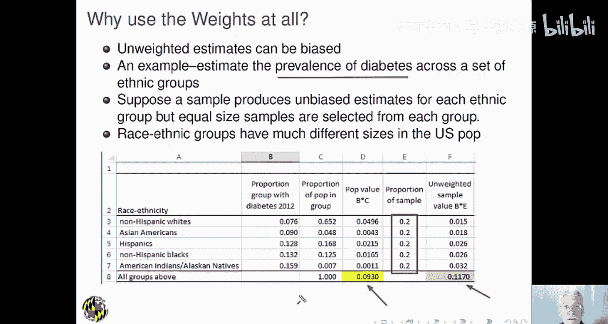

#  123：课程5：缺失数据处理、加权与插补导论

在本课程中，我们将学习如何处理缺失数据、加权与插补。我是密歇根大学和马里兰大学的研究教授理查德·瓦利安特。本课程也包含来自马里兰大学教授弗雷克·克罗伊特的贡献。

我们将涵盖四个模块：加权的一般步骤、实施加权的具体步骤、如何通过软件实现这些步骤，以及针对缺失项目的加权处理。现在，我们从加权的基本介绍开始。

## 🎯 加权的目的

加权的主要目的是将样本扩展到完整的有限总体。我们试图用这个小样本世界来推断更大的总体世界，而权重就是实现这一扩展的工具。

加权旨在实现几个具体目标。一是纠正样本或抽样框的覆盖问题。很多时候，我们有一个定义好的目标总体，但实际能从中抽取样本的抽样框，其覆盖范围与目标总体并不完全一致。我们需要通过加权来调整这种差异。

加权的另一个重要步骤是，如果拥有辅助数据，可以利用它们来创建无偏且更精确的估计量。

## 🖼️ 总体、抽样框与样本的关系

让我们通过一张图来理解这个情况。图中灰色的椭圆代表我们试图推断的目标总体 `U`。矩形代表我们实际能从中抽取样本的抽样框 `F`。

可以看到，这两个区域并不完全重叠。图中右上方的区域属于目标总体，但不在抽样框内。这意味着由于各种原因，我们无法从这部分总体中抽取样本。例如，假设我们调查企业，但企业名单过时了，一些新成立的企业未被包含在内。

图中右下方的区域 `F - U` 则代表另一个问题：这部分单位在我们的抽样框内，但它们不属于目标总体（灰色椭圆）。当我抽取样本（图中橙色椭圆）时，它既覆盖了目标总体的一部分，也覆盖了抽样框中不属于总体的那一部分。

因此，在进行推断时，我必须剔除样本中那些不符合条件（即不属于总体）的单位。同时，我需要将样本中属于总体的那部分，不仅扩展到抽样框内但未被抽中的其他单位，还要扩展到抽样框外但属于总体的那部分单位。这种扩展需要基于一些重要的假设，但试图将样本单位扩展到整个总体是标准的操作流程，即使样本可能并未覆盖所有单位。

## ⚖️ 权重与估计量的关系及权重尺度

权重与估计量紧密相连。权重的尺度可以变化。

一种缩放权重的方法是让它们估计有限总体总量。另一种方法是强制让权重之和等于样本量。这两种方法都会用到。缩放至样本量之和的权重被称为**归一化权重**。

归一化权重的做法部分源于过去调查数据分析软件不易获得的时代。当时的想法是，如果进行涉及自由度计算的分析，旧版软件通常会报告为“权重之和减去模型参数个数 `P`”。如果权重被缩放为估计总体总量，这个和会非常巨大（例如在美国，关于人口的权重和可能超过3亿），这显然不符合一个样本量为1000的调查所应有的自由度概念。通过归一化，权重之和减去 `P` 会得到一个更合理的数字，即样本量减去 `P`。

在本课程中，我们将主要处理缩放为估计总体总量的权重。这是大多数联邦政府机构采用的标准方法，因为总体总量（如失业总人数）是这些调查中的重要指标。

## ❓ 为何必须使用权重？

以下是一个简单的例子，用以说明问题的关键。如果有一个来自有限总体的样本，一种做法是完全忽略权重，并希望结果正确。

假设我们要估计不同种族群体中糖尿病的患病率。样本对每个种族群体都产生了无偏估计，但每个群体被抽取的样本量是相等的。然而，这些群体在总体中的实际规模是不同的。

考虑以下种族群体：非西班牙裔白人、亚裔美国人、西班牙裔、非西班牙裔黑人、美国印第安人和阿拉斯加原住民。假设样本中发现的各群体糖尿病患病率如下表B列所示，而各群体在总体中的比例如C列所示。

| 种族群体 | B: 样本患病率 | C: 总体比例 |
| :--- | :--- | :--- |
| 非西班牙裔白人 | 0.076 | 0.65 |
| 亚裔美国人 | 0.083 | 0.06 |
| 西班牙裔 | 0.123 | 0.16 |
| 非西班牙裔黑人 | 0.138 | 0.12 |
| 美国印第安人和阿拉斯加原住民 | 0.159 | 0.01 |

计算总体患病率的方法是：将每个群体的样本患病率乘以其在总体中的比例，然后求和。即 `总体患病率 = Σ(B列 * C列)`。计算结果是 `0.093`，即 **9.3%**。

现在，进一步假设样本在各群体中是均匀分配的，即每个群体占样本的20%（如下表E列）。如果进行未加权的分析（即忽略各群体在总体中的不同规模），相当于计算 `Σ(B列 * E列)`。

| 种族群体 | B: 样本患病率 | E: 样本比例 (未加权) |
| :--- | :--- | :--- |
| 非西班牙裔白人 | 0.076 | 0.2 |
| 亚裔美国人 | 0.083 | 0.2 |
| 西班牙裔 | 0.123 | 0.2 |
| 非西班牙裔黑人 | 0.138 | 0.2 |
| 美国印第安人和阿拉斯加原住民 | 0.159 | 0.2 |

未加权分析的结果是 `0.117`，即 **11.7%** 的患病率。这与真实的总体值 **9.3%** 相差甚远。

这个偏差产生的原因是，样本在各群体间是等额分配的，但各群体在总体中的规模差异很大，并且我们关心的指标（糖尿病患病率）在各群体间也存在显著差异。在这种情况下忽略权重，就会得到有偏的估计。这就是为什么我们必须使用权重。

在后续章节中，我们将详细讨论如何计算这些权重。

## 📝 总结

本节课我们一起学习了加权的基本概念。我们了解到，加权的核心目的是将样本结果扩展到目标总体。这涉及到处理抽样框覆盖不全的问题，并可能利用辅助数据提高估计精度。我们通过图示理解了总体、抽样框和样本之间的关系，并明确了权重与估计量密不可分，且有权重尺度（如总体总量尺度与归一化尺度）之分。最后，通过一个糖尿病患病率的例子，我们直观地看到了当样本结构与总体结构不一致且研究变量在子群间存在差异时，不使用权重会导致估计结果产生严重偏差。这奠定了我们在后续课程中深入学习具体加权方法的基础。