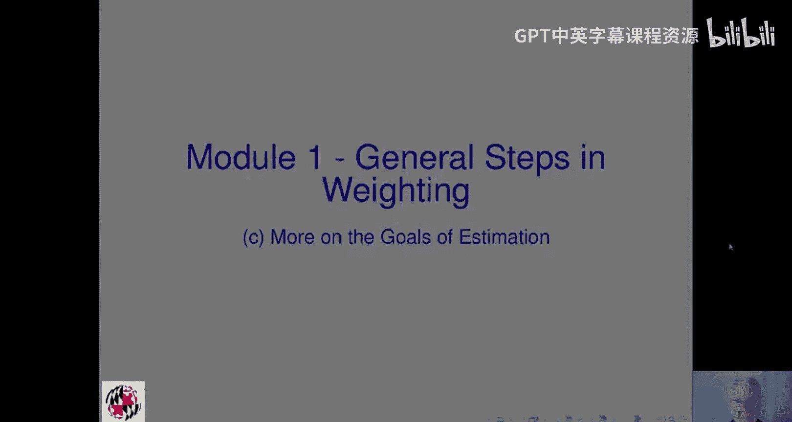
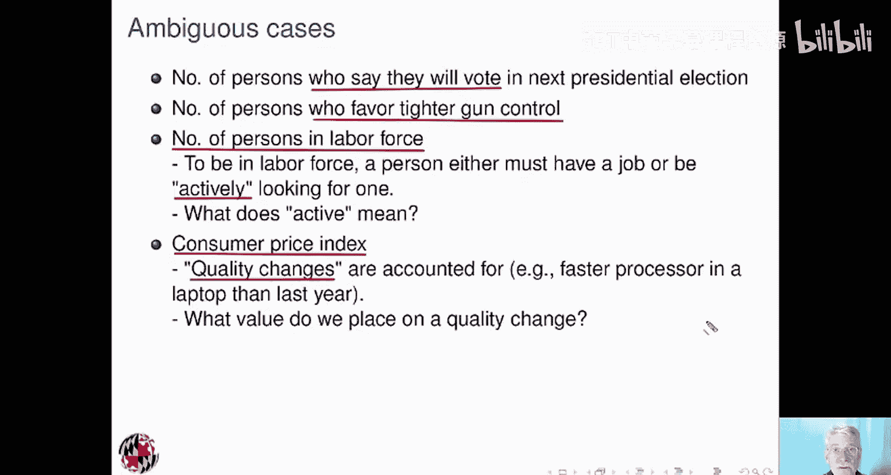

#  125：估计目标 🎯

在本节中，我们将更深入地探讨有限总体估计的目标。我们将学习如何通过“普查思维”来明确估计目标，并识别在定义这些目标时可能遇到的明确与模糊情况。

## 概述

估计的核心是明确我们试图测量的“目标”。一个有效的方法是进行一个思想实验：如果我们不是进行抽样调查，而是对总体中的每一个单元都进行了普查，我们会得到什么值？这个值就是**普查值**，它是我们通过样本试图估计的终极目标。

上一节我们介绍了估计的基本概念，本节中我们来看看如何清晰地定义这个“目标值”。

## 为何要思考“普查值”？

要求自己描述“如果进行普查会得到什么”非常有用。这主要有两个关键作用：

1.  **迫使你明确目标总体**：这是最关键的一点。它帮助你聚焦于“我到底想对谁做出推断？”
2.  **排除抽样过程的复杂性**：它让你暂时忽略抽样设计、选择方法和数据收集过程等技术细节，纯粹思考最终想要得到的汇总度量。

这个思想实验——“如果我拥有总体中每个单元，并能正确观测其值，我将如何组合这些值以得到我想估计的量”——能促使你思考许多重要问题。例如，你的样本能否覆盖你感兴趣的全部总体？即使进行普查，对我感兴趣的量的测量是否存在模糊性？

## 明确与模糊的估计目标示例

以下是估计目标的一些具体例子，它们展示了定义可能清晰或模糊的不同情况。

### 明确的估计目标（相对而言）

以下例子中的目标定义通常被认为是相对明确的。我将其标注为“相对”，是因为在精确定义时，总存在出现模糊性的可能。

*   **华盛顿特区在2015年1月1日的居住人口数量**：这看起来很明确。但仔细想想，在1月1日当天有人迁入或迁出，以哪个具体时刻为准？如何判定一个人是否“居住”在DC？这类问题可能出现。
*   **舒张压高于90毫米汞柱的人数**：只要能够正确测量血压，这似乎很明确。但这取决于所使用的测量仪器，不同仪器的校准精度可能不同。
*   **在包含2015年9月12日的那一周内的全职员工数量**：这是美国劳工统计局用于收集某类就业数据的定义，是一个操作化相对清晰的例子。

### 模糊的估计目标

以下例子则更能说明定义估计目标时可能遇到的模糊性。

*   **将在下次选举中投票的人数**：你必须在选举前询问人们是否会投票。但说“会”的人可能最终没去投票，而说“不会”的人可能又去投了。在民意调查中，“可能投票者”的界定至今仍是调查机构面临的一大难题。
*   **支持加强枪支管制的人数**：在美国这是一个重要议题。“加强枪支管制”意味着什么？是对所有枪支还是特定类型？管制程度如何？这可能是一个模糊的概念。
*   **劳动力人口数量**：这是联邦政府希望估计的关键经济指标。要成为劳动力，一个人必须有工作或正在积极寻找工作。但你必须向人们解释“积极寻找”的含义，并且他们必须正确理解你的解释，这其中存在产生模糊性的机会。
*   **消费者价格指数（CPI，常被称为通货膨胀率）**：对大多数经济体而言，这都是一个关键经济统计量。使其测量变得相当模糊的一个主要因素是“质量变化”。例如，去年和今年购买一台电脑，今年你可能用同样的钱买到一台性能好得多的电脑（处理器更快、存储容量更大、内存更多）。经济学家试图对此进行调整，因为你花的钱获得了更多价值，但具体如何调整并不完全清晰。

## 总结

本节课中我们一起学习了如何通过设想“普查值”来明确估计的目标。我们了解到，这一过程有助于聚焦目标总体并暂时剥离抽样复杂性。同时，我们通过实例分析了估计目标可能清晰明确，也可能因定义、测量或解释问题而变得模糊不清。在开始任何调查之前，仔细思考“如果进行普查，我会如何计算我想要的量”是一个至关重要的良好实践。