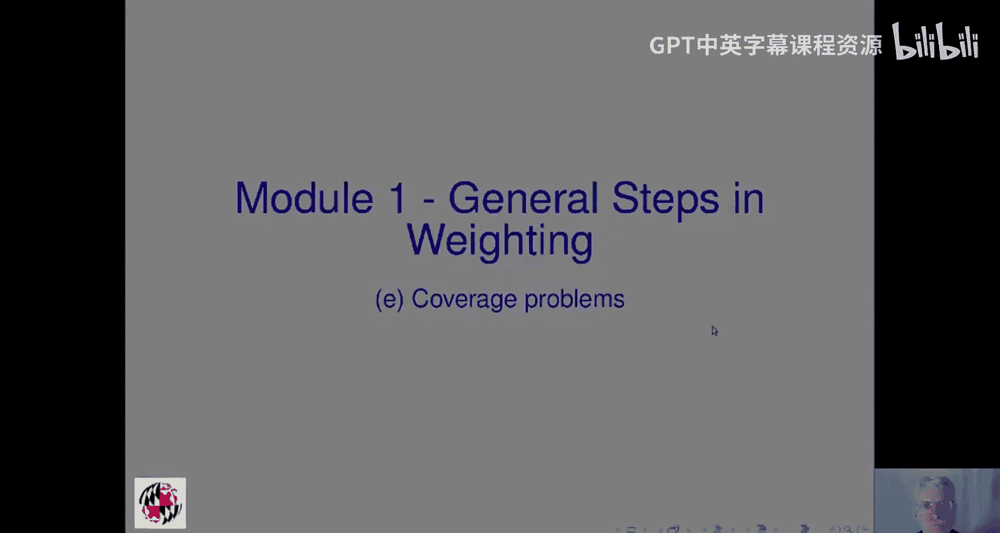
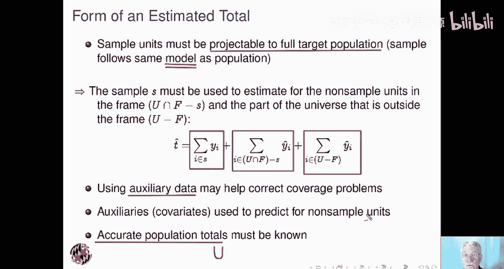

#  127：覆盖问题 📊

在本节课中，我们将学习调查研究中一个至关重要的问题：覆盖问题。我们将了解什么是覆盖不足与覆盖过度，它们如何影响调查结果，以及如何通过统计方法进行调整，以确保样本能有效代表目标总体。

---

覆盖问题是调查中的一个重大问题，值得深入探讨。我们需要将这个概念理解透彻。覆盖问题可能表现为**覆盖不足**或**覆盖过度**，我们需要对这两种情况都进行处理。

以下是**覆盖过度**的一些例子，我们之前也提到过：
*   你可能有一个包含已倒闭企业的企业名录框架。这属于覆盖过度，因为你包含了实际上已不属于当前研究总体的单元。
*   你可能有一个组织成员名单，其中包含了一些已退出的成员。这些人同样不符合调查资格。

处理这类问题的标准方法是：一旦确定某些单元不符合资格，就将它们从样本中剔除，并且在用于估计的样本计算中也排除它们。

另一个方向的问题是**覆盖不足**。例如：
*   一个志愿者网络调查小组可能遗漏了老年女性群体。
*   一个企业名录框架可能没有包含新近成立的企业。许多企业的变动性很大，例如餐馆的开业和倒闭非常迅速，因此很难维护一个实时更新的企业名录框架。所以，这是一个相当常见的问题，具体取决于你抽样的总体。

---

面对这些覆盖问题的例子，你可以采取以下两种策略之一：
*   **重新定义目标总体**：声明你的调查结果仅代表你能够覆盖到的那类单元。
*   **进行统计调整**：将你从中抽样的“覆盖总体”扩展到可能更大的“目标总体”。

回想一下我们之前看过的维恩图，重新审视这些图示会很有帮助。

我们感兴趣并试图估计的**总体总值**实际上由两部分组成。如果我们看“总体”与“抽样框”相交的部分，即图中灰色总体与矩形抽样框重叠的区域，这是我们实际从中抽取样本的部分。

而“总体减去抽样框”的部分，即图中总体在抽样框之外的部分，是我们没有抽取任何样本的部分。但如果我声称这些单元也是我研究总体的一部分，我就需要为这部分进行推断或预测。这就是推断问题：我们如何进行这种预测？

---

为了理解我们如何进行这种预测，再次审视**总体总值估计量**的形式会很有帮助。为了让样本能够有效地推断到完整的目标总体，样本在某种意义上需要遵循与完整总体相同的模型。这只是一种统计学的说法，即样本需要代表你所关注的目标总体，而这种代表性是我们将更详细探讨的“模型意义”上的代表性。

因此，我的估计量在概念上包含三个部分：
1.  **样本部分**：对于落入我样本中的单元，我直接将它们的观测值 `Y_i` 相加，得到这部分的总值。
2.  **框内非样本部分**：对于我的抽样框所覆盖、但未被抽中的总体部分，我需要为其中的每个单元 `i` 预测一个值 `Ŷ_i`，并将这些预测值相加。
3.  **框外部分**：对于抽样框未能覆盖的总体部分，我需要（显式或隐式地）为这些我无法通过样本直接观测的单元构造预测值。

这正是**统计估计**发挥作用的地方。通常，我们会使用辅助数据。正如之前提到的，我们需要协变量。这些协变量需要同时与**覆盖情况**和我们试图测量的**目标变量**相关。此外，我们还需要图中所示总体 `U` 的准确总体总量信息。这就是我们试图在此达成的总体目标和基本框架。

---

本节课中，我们一起学习了调查中的覆盖问题。我们明确了覆盖不足与覆盖过度的概念及其例子，并探讨了通过重新定义总体或进行统计调整来解决这些问题的策略。关键点在于，为了从样本有效推断总体，我们需要利用辅助数据和模型，对未被样本直接覆盖的总体部分进行预测，从而构建一个完整的总体估计。理解这个框架对于设计严谨的调查和进行有效的分析至关重要。