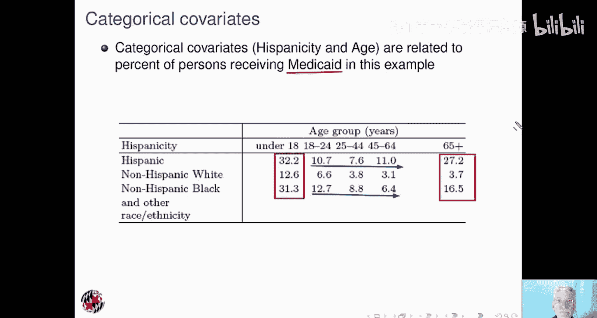

#  128：精度提升方法

在本节课中，我们将学习如何利用辅助数据来提升调查估计的精度。我们将通过几个例子，了解如何借助变量之间的关系来获得更精确的估计结果。

## 利用定量辅助变量提升精度

上一节我们介绍了辅助数据的基本概念，本节中我们来看看如何具体应用。一个主要的应用场景是提升估计的精度。这里我将通过几个例子简要说明。

让我们看两张图。这两种情况都假设我们有一个单一的协变量 `x`。`x` 可以是一个定量变量，例如企业去年的员工数量。同时，我们有一个分析变量 `Y`，例如企业今年的员工数量。

*   在左侧的图中，我们可以看到 `Y` 和 `X` 之间存在一种近似线性的强相关关系。随着 `X` 增加，`Y` 也倾向于增加。我们可以利用这种强关系来改进我们的估计。
*   在右侧的图中，`Y` 和 `X` 之间仍然存在关系，但强度稍弱，因为数据点在我画的这条线上下更为分散。尽管如此，随着 `X` 上升，`Y` 仍然呈现上升趋势，我们在估计时当然也可以利用这一点。

因此，我们需要学习如何形式化地实现这一点。

## 利用分类辅助变量提升精度

协变量不一定是定量变量。分类变量同样可以非常有用。

这里有一个表格，展示了种族/民族（Hispanicity）和年龄组与接受医疗补助（Medicaid）比例之间的关系。Medicaid是美国针对低收入人群的医疗援助计划。

以下是表格数据的解读：

*   **行变量**：种族/民族（Hispanic, Non-Hispanic White, Non-Hispanic Black, Other）
*   **列变量**：年龄组（Under 18, 18-24, 25-44, 45-64, 65+）
*   **单元格数值**：该群体中接受Medicaid的百分比

从这个表格中，我们可以观察到一种梯度模式：
*   在18岁以下和65岁以上这两个极端年龄组，接受Medicaid的比例相对较高。
*   在工作年龄组（18-64岁），比例则显著降低，并且在白人和黑人群中，比例有从18-24岁到45-64岁逐渐降低的趋势。

这是一个典型的例子，说明一个二分类变量（是否接受Medicaid）与种族/民族、年龄等分类变量之间存在关系。我们可以在估计中利用这种关系来提高估计的精度。

## 总结

本节课中，我们一起学习了如何利用辅助数据提升估计精度。我们看到了无论是定量变量（如员工数量）之间的强线性关系，还是分类变量（如种族、年龄）与目标变量之间的关联模式，都可以被形式化地用于改进调查估计，从而得到更可靠、更精确的分析结果。关键在于识别并利用这些变量之间存在的系统关系。