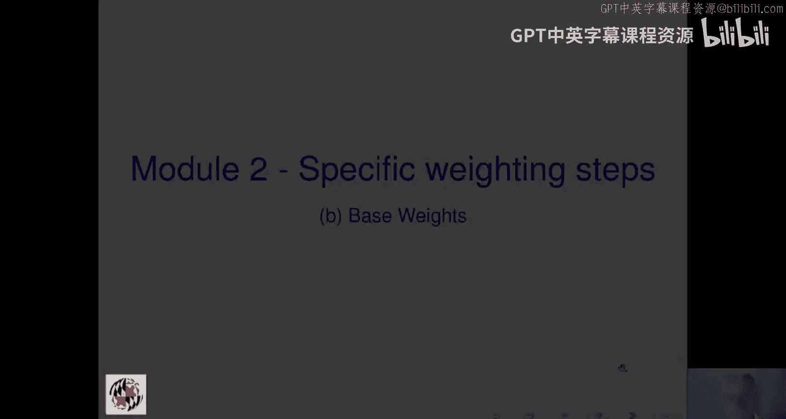
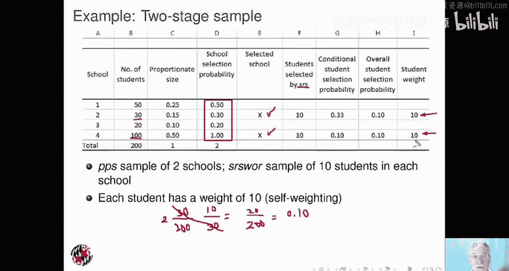

#  131：基础权重计算 🧮

在本节课中，我们将学习如何为不同类型的抽样设计计算基础权重。基础权重是样本单元代表其所属总体单元数量的倒数，是后续加权调整的起点。

上一节我们介绍了基础权重的概念，本节中我们来看看具体的计算示例。

## 分层简单随机抽样示例

首先，我们来看一个分层简单随机抽样的例子。假设我们有一个由五个行业分层（制造业、零售业、批发业、服务业、金融业）构成的总体，我们需要从中抽取样本。

以下是各层的总体规模与样本量：

*   制造业：总体规模 600， 样本量 50
*   零售业：总体规模 1200， 样本量 50
*   批发业：总体规模 800， 样本量 50
*   服务业：总体规模 2300， 样本量 50
*   金融业：总体规模 500， 样本量 50

基础权重的计算公式为：**权重 = 层总体规模 / 层样本量**。

根据此公式，我们得到各层的基础权重：

*   制造业权重：600 / 50 = **12**
*   零售业权重：1200 / 50 = **24**
*   批发业权重：800 / 50 = **16**
*   服务业权重：2300 / 50 = **46**
*   金融业权重：500 / 50 = **10**

这意味着，在制造业层中，每一个被抽中的单位代表总体中的12个单位；在零售业层中，每一个被抽中的单位代表总体中的24个单位，以此类推。

一个重要的特性是：**所有样本单元的基础权重之和等于总体规模**。例如，制造业层权重总和为 12 * 50 = 600，将所有五层的权重总和相加，正好等于总体规模5000。在分层简单随机抽样中，这一特性总是成立。

## 与规模成比例的概率抽样示例

接下来，我们看一个与规模成比例的概率抽样示例。假设总体包含4所学校，学生总数200人，我们希望抽取一个样本量为2的PPS样本。

以下是各学校的学生数及计算过程：

1.  **学校A**：学生数50， 规模比例 50/200 = 0.25， 选择概率 2 * 0.25 = 0.5， 基础权重 1 / 0.5 = **2.0**
2.  **学校B**：学生数30， 规模比例 30/200 = 0.15， 选择概率 2 * 0.15 = 0.3， 基础权重 1 / 0.3 ≈ **3.33**
3.  **学校C**：学生数20， 规模比例 20/200 = 0.10， 选择概率 2 * 0.10 = 0.2， 基础权重 1 / 0.2 = **5.0**
4.  **学校D**：学生数100， 规模比例 100/200 = 0.50， 选择概率 2 * 0.50 = 1.0， 基础权重 1 / 1.0 = **1.0**

假设我们最终抽中了学校B和学校D。那么样本的基础权重分别为3.33和1.0，它们的总和是4.33，并不等于总体规模4（所学校）。**在PPS抽样中，基础权重之和通常只是总体规模的一个估计，而非精确值**。

## 两阶段抽样示例

最后，我们考察一个两阶段抽样的例子。我们沿用上例中的4所学校作为初级抽样单元，并采用PPS方法抽取了学校B和学校D。

现在，我们在每个被抽中的学校内进行第二阶段抽样：从学校B的30名学生中简单随机抽取10名；从学校D的100名学生中简单随机抽取10名。

以下是学生最终权重的计算过程：

*   **学校B内的学生**：
    *   第一阶段选择概率（学校被抽中）：0.3
    *   第二阶段条件选择概率（学生在校内被抽中）：10 / 30 ≈ 0.333
    *   整体选择概率：0.3 * 0.333 = 0.1
    *   基础权重：1 / 0.1 = **10**

*   **学校D内的学生**：
    *   第一阶段选择概率：1.0
    *   第二阶段条件选择概率：10 / 100 = 0.1
    *   整体选择概率：1.0 * 0.1 = 0.1
    *   基础权重：1 / 0.1 = **10**

可以看到，尽管两所学校的规模不同，但最终所有被抽中学生的**基础权重都是10**。这是因为学校规模（30和100）在计算条件概率时被抵消了。整体选择概率简化为：**(样本学校数) * (每校学生样本量) / (学生总数)** = 2 * 10 / 200 = 0.1。

这种设计被称为**自加权样本**，所有最终样本单元具有相同的权重。当没有先验信息表明某些子群对降低估计方差更有价值时，这种设计既方便又高效。

---

本节课中我们一起学习了三种常见抽样设计下的基础权重计算：在分层简单随机抽样中，权重之和精确等于总体规模；在与规模成比例的概率抽样中，权重之和是总体规模的估计；在特定设计的两阶段抽样中，可能得到所有单元权重相同的自加权样本，这为后续分析提供了便利。理解这些基础权重的计算原理，是进行正确调查推断的第一步。