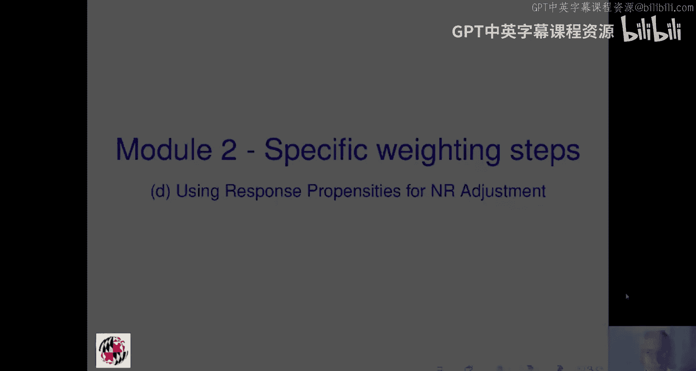
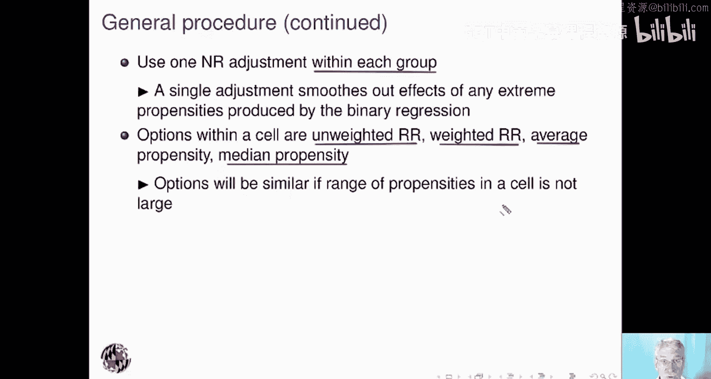

#  133：应答倾向建模与无应答调整

在本节课中，我们将学习如何估计无应答单元的应答倾向，并利用这些倾向进行无应答调整，以修正调查数据中的偏差。

## 概述

上一节我们介绍了无应答偏差的概念。本节中，我们将深入探讨一种具体的调整方法：基于应答倾向建模的分组调整法。这种方法的核心是建立一个模型来预测每个样本单元的应答概率，然后根据预测概率进行分组，并在组内进行统一的调整。

## 应答倾向建模的一般步骤

以下是进行应答倾向建模与调整的一般流程。

### 1. 建立二元回归模型

首先，我们需要建立一个二元回归模型来预测应答概率。模型的因变量是**应答状态**（1表示应答，0表示无应答）。自变量是可用于预测应答行为的**协变量**。这些协变量必须在应答者和无应答者上都没有缺失值。

*   **常用模型**：逻辑回归是最典型的选择。
*   **其他模型**：Probit回归、互补双对数回归也可使用。这些模型通常会给出相似的应答概率预测值。

模型的数学形式可以表示为：
`P(Response=1 | X) = f(Xβ)`
其中，`f` 是链接函数（如逻辑函数），`X` 是协变量向量，`β` 是模型系数。

### 2. 估计应答倾向并分组

拟合模型后，我们可以为**所有样本单元**（包括应答者和无应答者）计算出预测的应答概率（即应答倾向）。

接下来，我们根据这个预测概率对所有单元进行排序（从低到高）。然后，将排序后的单元划分为若干个组。

*   **分组目的**：将具有相似应答倾向的应答者和无应答者归入同一组。例如，在低应答倾向组中，同时包含预测概率最低的应答者和无应答者。
*   **分组数量**：5组是一个常见的选择，但并非固定不变。如果样本量足够大，创建更多组可以使组内倾向值的范围更小，从而形成更同质的组。

这种方法的优点是，我们创建了一个单一的变量（预测概率）来对样本进行排序和分组，它综合了多个协变量的信息，是一种高效的汇总方法。

### 3. 组内调整

分组完成后，我们在**每个组内**应用一个统一的无应答调整因子。

*   **调整方法**：在同一个组内，我们可以使用未加权的应答率、调查加权的应答率、组内平均倾向值或中位数倾向值作为调整因子。如果组内倾向值范围很小，这些方法的结果会非常接近。
*   **调整作用**：使用单一的组内调整因子，可以平滑掉二元回归模型可能产生的极端倾向值的影响。这通常被认为是有益的，因为我们未必完全信任模型的预测。

这种思路借鉴了Rosenbaum和Rubin为观察性数据分析开发的倾向得分匹配方法，本质上是为无应答分析创建了一个“伪分配概率”。

## 软件实现

在实际操作中，我们可以借助统计软件来自动完成上述建模、预测和分组的过程。在后续课程中，我们将看到一些能够执行这些步骤的软件工具。

## 总结

本节课我们一起学习了基于应答倾向建模的无应答调整方法。我们首先通过二元回归模型预测每个样本单元的应答概率，然后根据预测概率进行分组，使组内单元具有相似的倾向。最后，在每个组内应用统一的调整因子来修正无应答偏差。这种方法通过综合多个变量信息并平滑极端值，为处理调查数据中的无应答问题提供了一种稳健的解决方案。