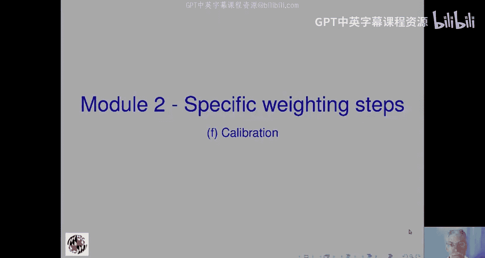
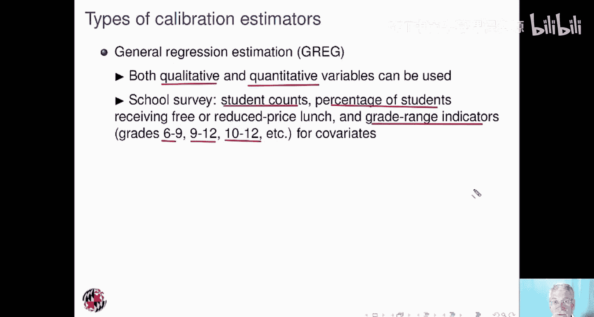

#  135：加权与校准 📊

在本节课中，我们将要学习调查数据处理的最后一个通用步骤——校准。我们将了解其核心思想、优势、如何选择协变量，并介绍几种具体的校准方法。

---

上一节我们介绍了加权处理中的无应答调整，本节中我们来看看加权过程的最后一步：校准。校准的核心思想是利用协变量数据，同时校正覆盖误差并降低标准误差。

为了实现这一目标，校准方法会利用已知的总体或普查总量数据。这种方法的一个显著优势是：我们只需要知道样本中受访者的协变量具体数值，而无需知道那些未应答单元或未被抽中单元的具体信息。我们只需要掌握这些协变量在总体中的合计值即可。

为什么这是一个优势？因为它允许我们使用比无应答调整更广泛的协变量集合。因为在无应答调整中，我们必须同时知道应答者和无应答者的协变量值。通常，我们很难拥有一个既适用于应答者又适用于无应答者的大规模协变量集。相反，基于普查数据，我们可能掌握许多不同协变量的总体信息。

---

## 如何选择协变量？

选择协变量时，应遵循以下两个原则：
1.  协变量应与“被抽样框覆盖的可能性”相关。
2.  协变量应与“分析变量”相关，即能较好地预测分析变量。

理想情况下，选择的协变量应同时满足以上两点。

---

## 具体的校准方法

以下是几种属于校准类别的具体方法：

**1. 事后分层**
事后分层可能是最简单的一种方法。在样本被抽取、数据被收集之后，你将应答者分类到不同的组中（因此称为“事后”）。然后调整权重，使得每个事后层内的权重之和等于该层协变量对应的总体总量。这些事后层的定义就构成了协变量。

*   **示例**：在一项家庭调查中，我们可以按“年龄×种族×性别”进行事后分层。
*   **要求**：要实施事后分层，我们必须拥有这个多维交叉分类的普查计数，并且这些数据的时间点必须与调查时期非常接近，否则我们就是在调整到一个与调查数据集不可比的总量上。

**2. 边缘加权**
边缘加权法只需要知道协变量的边缘计数（即单变量分布的总量）。在事后分层的例子中，我需要“年龄×种族×性别”的三维交叉表。但如果使用边缘加权法，我只需要年龄、种族、性别的各自边缘普查计数，而不需要完整的交叉表。

*   **实际优势**：即使你拥有三维交叉的总体计数，你的样本在某些交叉单元格中的数量可能非常少甚至为零。但边缘加权法不会受此限制，因为你的样本在各边缘分类上的数量可能足够。

**3. 广义回归估计量**
广义回归估计量的核心思想本质上是利用回归模型来预测非样本单元的值。

*   **优势**：它允许混合使用定性和定量变量作为协变量。
*   **示例**：在一项学校调查中，我们可以使用的协变量包括：学生数量、享受免费或减价午餐的学生百分比。我们还可以为每所学校设置年级指标（例如，是否覆盖6-9年级、9-12年级等），将这些指标作为协变量。
*   **灵活性**：这种混合使用定性与定量协变量的能力，使得广义回归估计量成为一个非常灵活的选择。

---

本节课中我们一起学习了调查数据加权处理的校准步骤。我们了解到，校准利用已知的总体协变量信息来同时改善覆盖误差和估计精度。其关键优势在于仅需样本单元的协变量具体值。我们探讨了选择协变量的原则，并介绍了三种主要的校准方法：**事后分层**、**边缘加权**和**广义回归估计量**，每种方法各有其适用场景和优势。掌握这些方法有助于我们根据实际数据情况，选择最合适的工具来提升调查估计的质量。