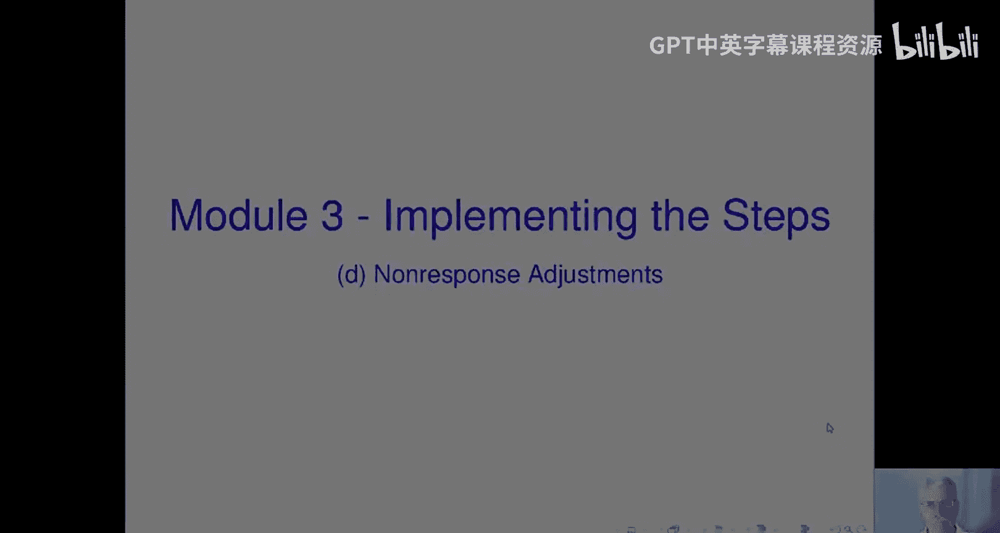
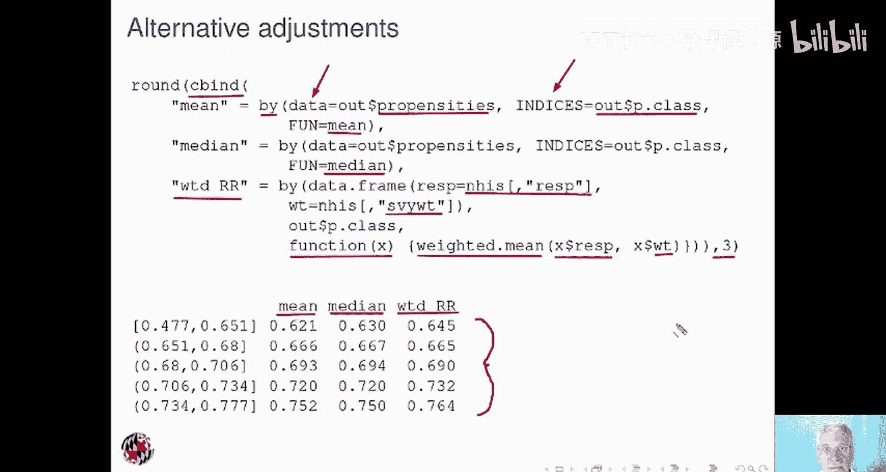

#  139：无应答调整方法 📊




在本节中，我们将学习如何使用**响应倾向类别**进行无应答调整。这种方法通过估计样本单元的应答概率，并将它们分组，从而对调查权重进行调整，以弥补因部分样本未应答而可能导致的偏差。

上一节我们介绍了无应答调整的基本概念，本节中我们来看看如何具体实施基于响应倾向类别的调整方法。

## 核心概念与步骤

其核心思想可总结为以下步骤：
1.  **估计响应倾向**：使用模型（如逻辑回归）为每个样本单元估计一个应答概率。
2.  **排序与分组**：将估计出的倾向得分从低到高排序，并将整个样本（包括应答者和无应答者）划分为若干个类别。关键点在于，每个类别中的**初始样本单元总数**应大致相等。
3.  **计算调整因子**：在每个类别内部，计算一个统一的调整因子（如该类的平均应答率）。
4.  **调整权重**：对每个类别内的应答者，将其基础权重乘以该类调整因子的倒数。

**公式**：对于类别 *k* 中的应答者 *i*，其调整后权重为：
`调整后权重_i = 基础权重_i * (1 / 调整因子_k)`

此方法适用于概率样本，也可用于计算非概率样本的准随机化权重。

## 使用R软件实现

我们将使用 `PracTools` 包中的 `pclass` 函数来完成这一过程。以下是具体操作步骤。

首先，加载必要的包和数据。

```r
require(PracTools)
data(nhis)
```

接下来，我们调用 `pclass` 函数来创建响应倾向类别。我们使用逻辑回归模型，以年龄、性别、西班牙裔身份和种族作为预测变量。

```r
out <- pclass(formula = resp ~ age + factor(sex) + factor(hisp) + factor(race),
              data = nhis,
              type = "unweighted",
              link = "logit",
              numcl = 5)
```

参数说明：
*   `formula`: 定义逻辑回归模型。
*   `data`: 使用的数据集。
*   `type`: 指定为“unweighted”进行未加权回归，若数据有权重则可选“weighted”。
*   `link`: 指定连接函数，此处为“logit”。
*   `numcl`: 指定要创建的类别数量，此处为5。

## 检查分类结果

创建类别后，我们需要检查分类是否合理。

查看每个类别分配的样本数量及倾向得分范围：

```r
table(out$pclass)
```

此命令输出一个表格，显示五个类别各自的倾向得分范围和样本数量。目标是每个类别的总样本量大致相等。

确认所有样本都被分配了类别：

```r
sum(is.na(out$pclass))
```
结果应为0，表示无缺失值。

查看倾向得分的总体分布：

```r
summary(out$propensities)
```
这将显示所有样本单元倾向得分的最小值、最大值和分位数，帮助我们了解得分的分布范围。

我们还可以通过箱线图直观查看每个类别内倾向得分的分布：

```r
boxplot(out$propensities ~ out$pclass,
        xlab = "Propensity Class",
        ylab = "Estimated Response Propensity")
```
从箱线图中，我们可能会发现某些类别（尤其是低倾向类别）内得分的分布范围较广，存在离群值。这引出了下一个关键点：在类别内部，是使用统一的调整值，还是使用每个样本个体估计的倾向得分？

## 选择类别内的调整因子

由于模型拟合可能不完美，直接使用个体倾向得分进行调整风险较高。更稳健的做法是在每个响应倾向类别内部使用一个统一的调整值。

以下是几种常用的统一调整值计算选项：

*   **未加权平均倾向**：使用模型估计的该类内所有样本倾向得分的平均值。
*   **加权平均倾向**：使用基础权重加权的倾向得分平均值。
*   **中位数倾向**：使用该类内倾向得分的中位数（如上文箱线图中的黑线）。
*   **未加权应答率**：该类内**应答者数量**除以**总样本数量**。
*   **加权应答率**：使用基础权重计算的加权应答率。

选择其中一种方法，然后将该类内每个应答者的输入权重乘以该调整值的倒数。

以下代码演示如何计算和比较前三种选项：

```r
# 计算每个类别的未加权平均倾向
mean_adj <- by(data = out$propensities,
               INDICES = out$pclass,
               FUN = mean)

# 计算每个类别的中位数倾向
median_adj <- by(data = out$propensities,
                 INDICES = out$pclass,
                 FUN = median)

# 计算每个类别的加权应答率 (需要原始数据中的权重和应答变量)
weighted_rr <- by(data = data.frame(resp = nhis$resp),
                  INDICES = out$pclass,
                  FUN = function(x) weighted.mean(x$resp, w = nhis$svywt))

# 将结果合并查看
round(cbind(mean = mean_adj, median = median_adj, weighted_RR = weighted_rr), 3)
```

比较不同方法得出的调整因子。通常它们差异不大，分析师可以根据实际情况或偏好进行选择。有理论和实证研究表明，使用未加权应答率可能是一个简单有效的选择。

## 其他方法与总结

除了基于逻辑回归的响应倾向类别法，之前提到的**回归树**也是创建调整类别的有效算法。它通过递归分割样本来自动寻找最佳分组，同样值得考虑。



本节课中我们一起学习了无应答调整的响应倾向类别法。我们了解了其核心步骤：估计倾向、排序分组、计算统一调整因子并调整权重。通过R语言的 `PracTools` 包，我们实践了如何创建倾向类别、检查分组效果，并探讨了类别内不同调整因子的选择。最后，我们提到了回归树作为另一种可行的调整方法。掌握这些方法有助于在数据分析中更有效地处理无应答偏差。