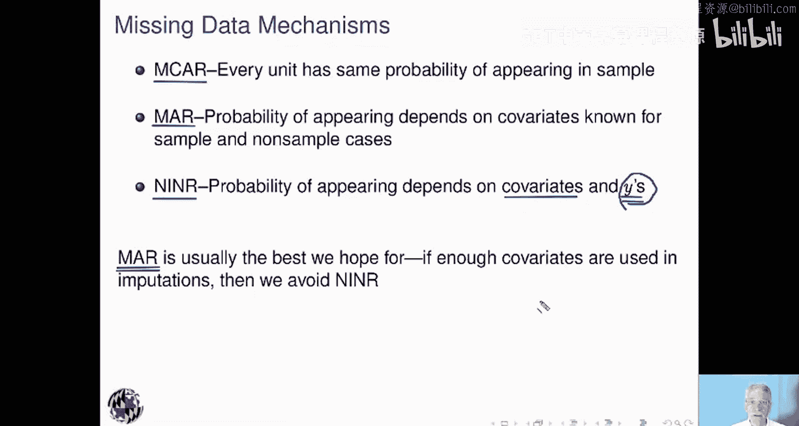

#  142：缺失数据插补的必要性 📊

在本节课中，我们将要学习如何处理调查数据中普遍存在的缺失值问题。具体来说，我们将探讨为什么需要进行数据插补，以及处理缺失数据的不同方法及其潜在影响。

---

## 缺失数据的类型与编码

上一节我们介绍了缺失数据是调查中的常见问题。本节中，我们来看看缺失数据的两种主要类型及其在统计软件中的编码方式。

缺失数据至少有两种类型：
1.  **完全缺失**：整个案例没有任何数据。这可能发生在两种情况下：一是该单元最初就没有被抽样；二是被抽样但完全没有回应。
2.  **部分缺失**：案例中某些变量的值缺失。

不同的统计软件对缺失值有不同的默认编码标准。了解这些编码至关重要，以避免将表示缺失的代码误当作真实数据进行分析。

以下是常见统计软件的缺失值编码：
*   在 **R** 语言中，默认使用 `NA` 表示缺失值。
*   在 **SAS** 中，使用 `.A` 到 `.Z`、单个点 `.` 或 `._` 表示缺失值。
*   在 **Stata** 中，使用 `.A` 到 `.Z` 以及单个点 `.` 表示缺失值。

此外，特定的调查可能会使用特殊代码来区分不同类型的缺失原因。例如，`99`、`9` 或 `-9` 常被用来表示缺失。因此，在分析他人提供的数据集时，务必确认其用于表示缺失的特殊编码。

---

## 处理缺失数据的方法

了解了缺失数据的类型后，我们来看看处理这些缺失案例的几种常见方法。

以下是三种主要的处理方法：

1.  **完全案例分析**：如果一个案例在任何变量上存在缺失值，就将其从数据集中完全删除。这种方法看似简单，但可能过于极端，因为它丢弃了所有不完整的案例。
2.  **可用案例分析**：在进行特定分析时，只使用在所涉及变量上完整的案例，而忽略这些案例在其他变量上是否缺失。例如，在运行 Y 对几个 X 的回归时，只使用这些变量都完整的案例。这比完全案例分析能利用更多数据，但依然丢弃了部分信息。
3.  **插补法**：为缺失值“填空”。通过估算并填充缺失值，你可以在每次分析中使用所有案例，这无疑增加了可用于分析的样本量。当然，这意味着你使用的并非全是真实数据，因此需要采用适当方法来考虑这一事实。

---

## 完全案例分析的局限性与缺失机制

虽然完全案例分析操作简单，但它存在几个重要问题。理解这些问题需要回到鲁宾和利特尔定义的缺失数据机制。

完全案例分析的主要问题包括：
*   **估计偏差**：如果存在缺失数据的单元与完全观测到的案例在系统上存在差异，那么丢弃它们可能导致有偏的估计。例如，假设男性和女性在 Y 值上存在系统性差异，且男性的缺失案例更多。如果直接丢弃这些缺失案例，样本中男女的分布将无法反映总体情况，从而导致估计偏差。
*   **样本量损失**：如果你试图拟合的模型包含许多变量，那么完全案例可能非常少，仅仅为了进行简单分析就会丢弃大量数据。
*   **隐含的插补**：在丢弃缺失案例时，对于许多分析（如估计均值和总和），你实际上是在隐含地用完全案例的平均值来插补那些缺失案例。这可能是一种很差的插补方法。

因此，我们需要寻找更好的处理方式。这引出了三种缺失数据机制：
*   **完全随机缺失**：每个单元（或每个项目）出现在样本中的概率相同。公式表示为：`P(缺失 | 数据) = P(缺失)`。
*   **随机缺失**：在考虑了一些协变量之后，缺失与观测值无关。这意味着我们可以基于已知的协变量对缺失值进行合理的估算。公式表示为：`P(缺失 | 数据) = P(缺失 | 观测到的数据)`。
*   **非随机缺失**：缺失的概率不仅取决于协变量，还关键地取决于你试图分析的 Y 变量本身。这是最糟糕的情况，因为对于缺失的案例，我们无法观测到 Y 值。

通常，**随机缺失**是我们所能期望的最好情况。我们希望通过考虑尽可能合理的协变量，为我们提供一种智能地插补缺失案例的方法，正如我们希望通过加权调整来获得近似无偏估计一样。

---

本节课中，我们一起学习了缺失数据插补的必要性。我们区分了缺失数据的类型和编码，比较了完全案例分析、可用案例分析和插补法这三种处理策略的优缺点，并深入探讨了完全案例分析的局限性及其与缺失数据机制（完全随机缺失、随机缺失、非随机缺失）的关系。理解这些概念是进行有效且无偏的数据分析的基础。在接下来的视频中，我们将进一步深入探讨插补的具体细节。