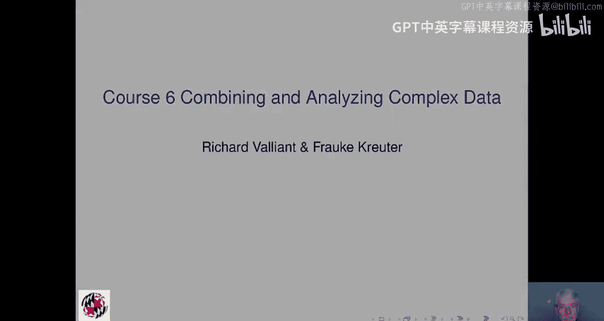
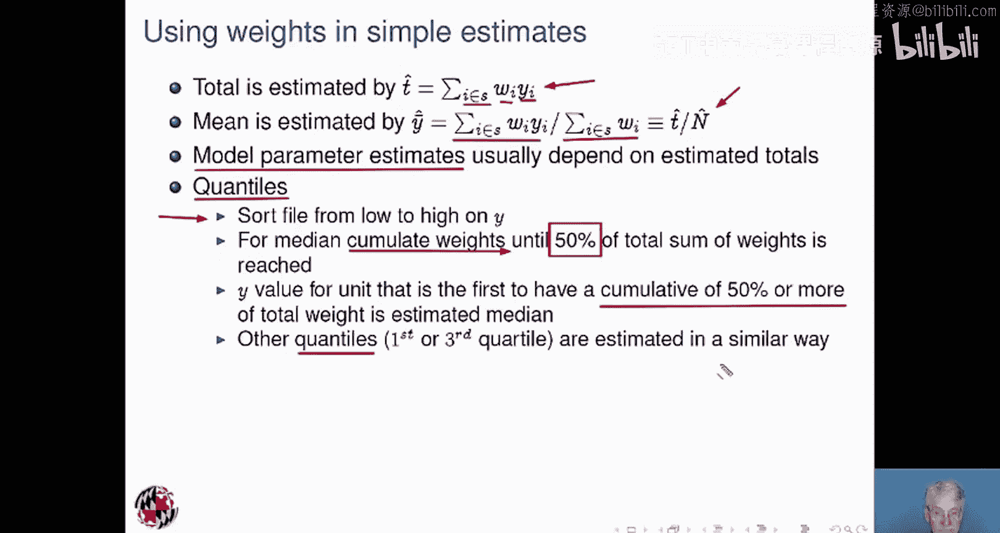

#  149：基础估计概述

在本节课中，我们将学习复杂调查数据的基础估计方法，包括如何估计均值、总和以及分位数，并了解在分析复杂样本时为何必须考虑权重和设计效应。

## 课程概述

欢迎来到第五门课程：复杂数据的合并与分析。本课程由 Richard Valiant 和 Fraca Croyer 讲授。课程内容涵盖多个模块。第一模块“基础估计”将讨论在复杂样本中如何估计均值、总和及分位数。第二模块“模型拟合”将探讨如何估计线性回归模型和逻辑回归等非线性模型的参数，并介绍相关软件。第三模块将介绍记录连接的基本方法，这是一个日益重要的主题。第四模块将探讨与数据连接相关的伦理问题，这些问题在不同国家可能有所不同，因此值得了解。

## 基础估计：总和与均值

上一节我们介绍了课程的整体结构，本节中我们来看看基础估计的核心内容，即总和与均值。

在复杂调查设计中，一个关键点是必须考虑权重。如果样本是总体的一个等概率缩影，那么所有单位将拥有相同的权重，分析会简化许多。然而，由于抽样设计中存在不同的入选概率、无回答调整或需要校准到外部控制总量，我们通常需要为不同单位赋予不同的权重。这些权重具有实际意义，不应被忽略。

此外，在复杂样本分析中，还需要考虑多阶段选择中的加权对标准误估计的影响。幸运的是，已有现成的软件可用于分析复杂样本，我们将在后续提供多个使用示例。

总和是最容易讨论的估计量。如果权重被缩放至能将样本“投影”到总体规模，那么总和的估计方法如下：

**公式**：`估计总和 = Σ (权重_i * 数据值_i)`，其中 `i` 属于样本集合 `S`。

这里的 `y` 变量可以是收入。如果 `y` 是0或1，它也可以代表患有糖尿病的人数或供水受到污染的人数等。

对于均值的估计，我们只需将估计的总和除以权重的总和：

**公式**：`估计均值 = (Σ (权重_i * 数据值_i)) / (Σ 权重_i)`。

如果权重被缩放至能估计总体总和，那么权重的总和就是总体单位数量的估计值。同样，如果只对某个子组（例如样本中的男性）求和，其结果将是该子组（男性）在总体中数量的估计值。这是构建复杂调查权重的标准方法带来的便利。

模型参数估计通常依赖于估计的总和。因此，如果掌握了估计总和的方法，通常也就能够估计模型参数，相关软件中也内置了相应的程序。

## 分位数估计

上一节我们讨论了总和与均值的估计，本节我们来看看分位数的估计方法，它与前两者有所不同，且可用的软件选择更为有限。

以下是估计分位数的算法步骤：

1.  **确定变量**：首先确定要进行分位数估计的定量变量，例如收入或受教育年限。
2.  **排序数据**：根据该 `Y` 变量将数据文件从低到高排序。
3.  **累积权重**：每个单位都有其权重，我们开始累积这些权重，直到达到特定百分比点。
4.  **确定分位数值**：查看累积权重首次达到或超过目标百分比（例如50%对应中位数）时，所对应的那个单位的 `Y` 值，该值即为分位数估计值。

以下是具体说明：

*   **估计中位数**：累积权重，直到达到总权重和的50%。找到第一个累积权重达到或超过50%的单位，其 `Y` 值即为中位数估计值。
*   **估计其他分位数**：例如第一四分位数（25%）或第三四分位数（75%），只需累积权重至相应的百分比点（25%或75%），然后查看对应单位的 `Y` 值即可。

由于样本的离散性，有时可能需要进行一些舍入处理，但这类操作通常已内置在软件中。分位数估计中较困难的部分在于估计其精度度量，我们后续也会讨论。

## 总结与预告

本节课中，我们一起学习了复杂调查数据的基础估计概念。我们了解到，在分析时必须考虑权重和设计效应。我们介绍了总和与均值的估计公式，并解释了权重的总和可以估计总体或子组的规模。此外，我们还讲解了分位数的估计算法，包括排序数据和累积权重的步骤。

在下一节视频中，我们将深入介绍可用于这些分析的软件。