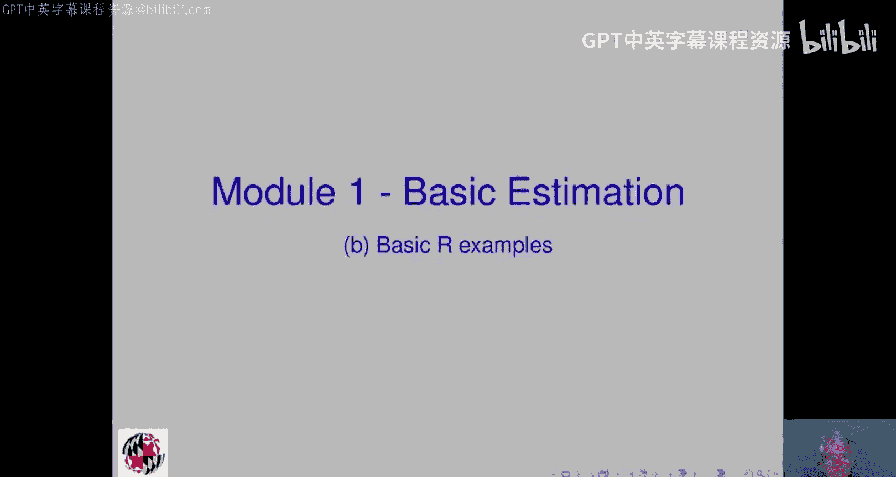
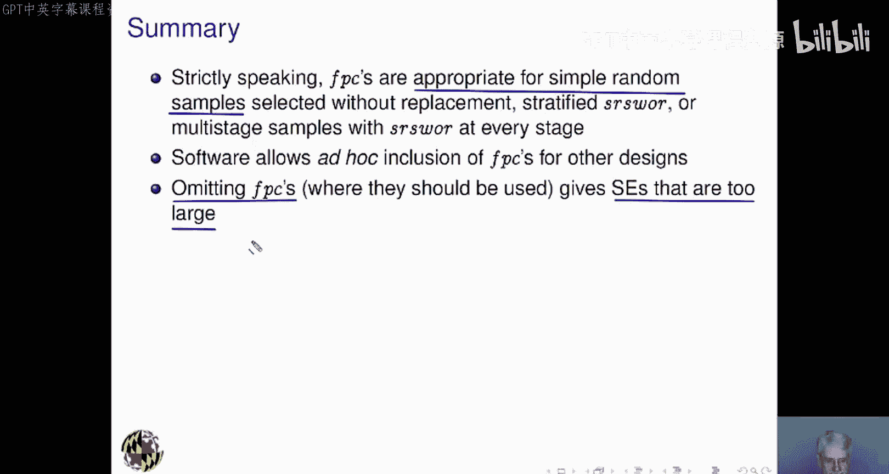

#  150：R语言基础示例




在本节课中，我们将学习如何在R语言中使用`survey`包来分析复杂抽样设计的数据。我们将通过一个分层简单随机抽样的实例，演示如何指定抽样设计、计算调查权重、纳入有限总体校正因子，并最终计算变量的均值及其标准误。

## 加载必要的包与数据

首先，我们需要加载分析所需的R包和数据。我们将使用`PracTools`包中的NHIS数据集，以及`sampling`和`survey`包。

```r
# 加载必要的包
library(PracTools)
library(sampling)
library(survey)

# 加载并准备NHIS数据
data(NHIS)
# 将数据附加到搜索路径，方便后续调用变量
attach(NHIS)
```

## 执行分层抽样

上一节我们加载了数据，本节中我们来看看如何从总体中进行分层抽样。我们的目标是从NHIS数据中，按教育水平（变量`Educ_R`）分层，每层抽取100个个体，使用不放回的简单随机抽样方法。

以下是具体步骤：

1.  首先，我们需要按分层变量对数据集进行排序。
2.  然后，使用`sampling`包中的`strata`函数执行抽样。

```r
# 1. 按分层变量 Educ_R 对数据进行排序
NHIS_sorted <- NHIS[order(NHIS$Educ_R), ]

# 2. 执行分层抽样
# strata参数指定分层变量
# size参数指定每层的样本量，这里每层抽100个
# method参数指定为“srswor”，即不放回简单随机抽样
ST_sam <- strata(data = NHIS_sorted,
                 stratanames = "Educ_R",
                 size = rep(100, 4),
                 method = "srswor",
                 description = TRUE)
```

执行上述代码后，控制台会输出每层的总体数量和被选中的样本数量，例如第一层有1964个单元，我们从中抽取了100个。

## 计算调查权重

抽样完成后，我们需要为样本中的每个个体计算调查权重。权重通常是选择概率的倒数。

```r
# 从抽样结果对象中提取样本数据
sam_dat <- getdata(NHIS_sorted, ST_sam)

# 计算调查权重：权重 = 1 / 选择概率
# 选择概率存储在ST_sam对象的Prob列中
sam_dat$svy_wt <- 1 / ST_sam$Prob

# 查看权重的范围
range(sam_dat$svy_wt)
```
权重范围从约2.95到19.65，表明不同个体被抽中的概率不同，需要在分析中通过权重进行校正。

## 指定抽样设计

现在我们已经有了样本数据和权重，接下来需要使用`survey`包中的`svydesign`函数来正式定义我们的抽样设计。这是告诉软件如何处理复杂设计（如分层、整群、权重）的关键步骤。

以下是定义设计的参数：
*   `ids`: 指定整群变量。本例为简单随机抽样，没有整群，因此设为`~1`。
*   `strata`: 指定分层变量，这里是`~Educ_R`。
*   `weights`: 指定权重变量，这里是`~svy_wt`。
*   `data`: 指定包含样本数据的数据框。
*   `fpc`: 指定有限总体校正因子。这里我们传入选择概率本身。

```r
# 创建包含有限总体校正（FPC）的设计对象
NHIS_dsgn <- svydesign(ids = ~1,
                        strata = ~Educ_R,
                        weights = ~svy_wt,
                        data = sam_dat,
                        fpc = ~Prob)

# 创建另一个不包含FPC的设计对象用于对比
NHIS_dsgn.nofpc <- svydesign(ids = ~1,
                              strata = ~Educ_R,
                              weights = ~svy_wt,
                              data = sam_dat)
```
**关于FPC的说明**：在`survey`包中，如果`fpc`参数的值在0到1之间，软件会将其解释为选择概率 \\( \\pi_i \\)，并自动在方差计算中使用 \\( 1 - \\pi_i \\) 作为校正因子。如果值大于1，则被解释为层总体大小 \\( N_h \\)。

## 计算总体均值

设计对象创建好后，我们就可以进行估计了。首先，我们使用`svymean`函数来计算整个样本中年龄（`Age`）的均值及其标准误。

```r
# 使用包含FPC的设计计算年龄均值
mean_with_fpc <- svymean(~Age, design = NHIS_dsgn)
print(mean_with_fpc)

# 使用不包含FPC的设计计算年龄均值
mean_without_fpc <- svymean(~Age, design = NHIS_dsgn.nofpc)
print(mean_without_fpc)
```
包含FPC时，估计的年龄均值为45.88，标准误为0.976。不包含FPC时，均值相同（因为FPC不影响点估计），但标准误略高，为1.012。这说明忽略FPC会高估不确定性。

## 计算域（子组）估计

在实际分析中，我们经常需要计算不同子组（域）的统计量。例如，我们想看看不同教育水平下年龄的均值有何不同。

我们可以使用`svyby`函数来实现按域分组计算：

```r
# 按教育水平（分层变量）分组计算年龄均值（使用含FPC的设计）
domain_means_fpc <- svyby(~Age, by = ~Educ_R, design = NHIS_dsgn, FUN = svymean)
print(domain_means_fpc)

# 按教育水平分组计算年龄均值（使用不含FPC的设计）
domain_means_nofpc <- svyby(~Age, by = ~Educ_R, design = NHIS_dsgn.nofpc, FUN = svymean)
print(domain_means_nofpc)
```
输出结果会显示每个教育水平组的年龄均值和标准误。对比两者可以发现，忽略FPC会导致所有组的标准误被高估，高估幅度从2.6%到近23%不等。

```r
# 计算忽略FPC导致标准误高估的百分比
se_increase <- (domain_means_nofpc$se / domain_means_fpc$se - 1) * 100
print(se_increase)
```

## 关于有限总体校正（FPC）的总结

本节课中我们一起学习了如何在R中处理复杂抽样调查数据。最后，我们对有限总体校正因子进行总结：

1.  **严格适用情况**：FPC理论上最适用于**不放回的简单随机抽样**或**分层不放回简单随机抽样**。在这种情况下，纳入FPC可以更准确地估计方差。
2.  **软件中的灵活处理**：即使对于其他抽样设计（如PPS抽样），许多软件也允许以特定方式纳入FPC。这虽然在数学上不完全严格，但可以作为考虑“不放回”带来的精度增益的一种实用方法。
3.  **忽略FPC的影响**：如果忽略FPC（例如因为信息不足），你得到的标准误通常会**偏大**。这使得置信区间更宽，估计结果更为“保守”。在某些存在无法量化的额外误差来源的调查中，这种保守的做法可能并非坏事。
4.  **核心权衡**：是否包含FPC，是一个在**估计精度**与**所需信息的可获得性/准确性**之间的权衡。当无法获得准确的总体信息时，报告一个稍大的标准误是常见且可接受的做法。



通过本教程，你应该掌握了使用R语言`survey`包分析复杂抽样数据的基本流程：从抽样、赋权、定义设计对象，到进行总体和域估计，并理解有限总体校正的作用。