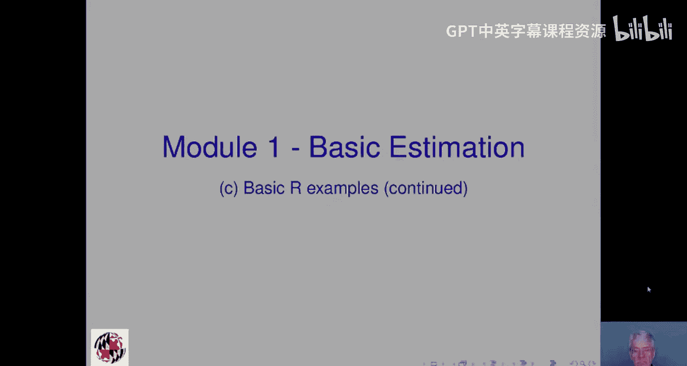
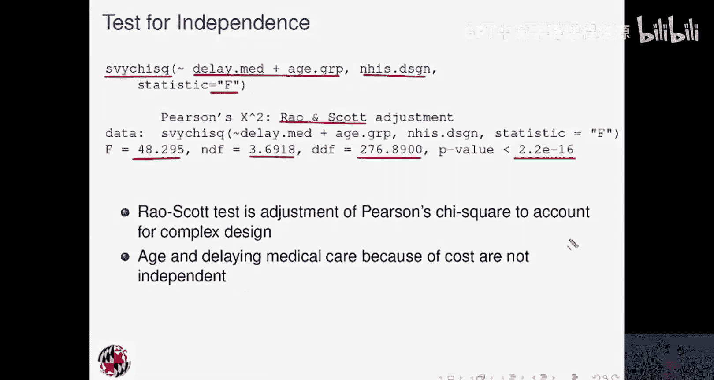

#  151：R语言基础示例续 🧮




在本节课中，我们将继续学习如何使用R语言处理复杂的调查数据设计。我们将使用一个更复杂的数据集，演示如何定义多阶段抽样设计，并比较复杂抽样设计与简单随机抽样在估计结果上的差异。

上一节我们介绍了如何使用R语言处理简单的调查数据设计。本节中，我们将使用一个更复杂的数据集，演示如何定义多阶段抽样设计，并进行相应的数据分析。

## 加载数据与定义设计对象

首先，我们需要加载必要的R包和数据。我们使用`NHIS.large`数据集，它来自美国国家健康访谈调查，包含21,588个个体，75个层，每层有2个初级抽样单位，共计150个PSU。

```r
require("PracTools")
require("survey")
data("NHIS.large")
```

接下来，我们定义一个调查设计对象，以便R语言知道如何处理数据的复杂结构。

```r
design_nhis <- svydesign(
  ids = ~PSU,
  strata = ~Stratum,
  weights = ~SVYweight,
  data = NHIS.large,
  nest = TRUE
)
```

参数`nest = TRUE`表示PSU在每个层内是独立编号的。`survey`包默认使用“最终聚类”方差估计量，它假设PSU是有放回抽取的。

## 分析延迟医疗护理的比例

我们将分析一个名为“因费用延迟医疗护理”的变量。这是一个二分变量，表示个体在过去一年中是否因费用问题延迟就医。

以下是使用`svyby`函数计算各年龄组延迟医疗护理比例的方法。

```r
age_ms <- svyby(
  formula = ~factor(DelayMed),
  by = ~AgeGroup,
  design = design_nhis,
  FUN = svymean,
  na.rm = TRUE
)

results <- age_ms[, c(2, 4)]
rownames(results) <- age_ms$AgeGroup
colnames(results) <- c("Proportion", "Std.Error")
print(round(results, 4))
```

输出结果显示，年轻人和老年人的延迟医疗护理比例较低，而工作年龄人群的比例较高。这与美国的医疗保险覆盖情况有关。

## 与简单随机抽样比较

为了理解复杂抽样设计的影响，我们将其与忽略抽样设计的简单随机抽样结果进行比较。

以下是手动计算简单随机抽样下比例和标准误的代码。

```r
# 重新编码变量为0/1
delay_binary <- abs(NHIS.large$DelayMed - 2)

# 计算各年龄组的比例
age_ms_srs <- by(
  data = delay_binary,
  INDICES = NHIS.large$AgeGroup,
  FUN = mean,
  na.rm = TRUE
)

# 计算简单随机抽样的标准误
n <- table(NHIS.large$AgeGroup)
se_srs <- sqrt(age_ms_srs * (1 - age_ms_srs) / n)

# 比较比例和标准误
ratio_prop <- round(age_ms_srs / results[, 1], 2)
ratio_se <- round(se_srs / results[, 2], 2)
comparison <- cbind(ratio_prop, ratio_se)
colnames(comparison) <- c("P_hat Ratio", "SE Ratio")
print(comparison)
```

比较结果显示，使用权重对点估计（比例）影响不大，但对标准误的影响非常显著。简单随机抽样的标准误明显低估了真实的不确定性，这会导致置信区间过窄。

## 卡方独立性检验

我们还可以检验“延迟医疗护理”与“年龄组”是否独立。鉴于比例表格中显示的差异，我们预期会拒绝独立性假设。

以下是使用`svychisq`函数进行复杂抽样设计下的卡方检验的代码。

```r
chi_test <- svychisq(
  formula = ~DelayMed + AgeGroup,
  design = design_nhis,
  statistic = "F"
)
print(chi_test)
```

输出结果提供了F统计量、分子自由度、分母自由度和p值。p值接近于零，因此我们拒绝独立性假设，结论是年龄与延迟医疗护理在统计上不独立。



本节课中我们一起学习了如何用R语言处理复杂的多阶段调查数据。我们定义了调查设计对象，分析了分类变量的比例，比较了复杂抽样与简单随机抽样的结果差异，并执行了考虑设计效应的卡方检验。关键点在于，忽略复杂抽样设计会严重低估标准误，导致错误的统计推断。