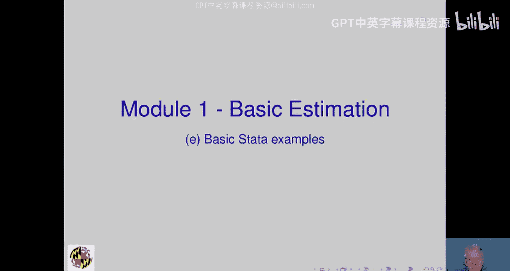
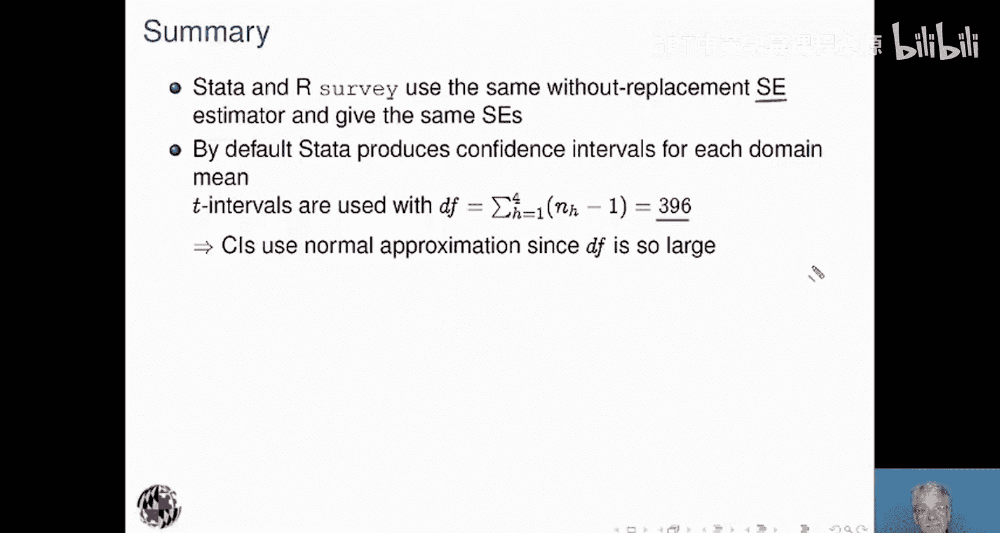

#  153：均值估计




## 概述
在本节课中，我们将学习如何在Stata软件中，使用调查数据包进行均值估计。我们将回顾在R软件中完成相同任务的过程，并详细说明在Stata中指定抽样设计、计算加权均值及其标准误的步骤。

## 从R到Stata：均值估计的实现
上一节我们介绍了如何使用R的`survey`包计算比例表格。本节中，我们来看看如何在Stata中实现相同的均值估计过程。

在Stata中，与在R中一样，首先需要指定样本设计。以下是实现方法。

### 指定抽样设计
在Stata中，使用`svyset`命令来指定抽样设计。这是必须调用的核心语句，它需要几个参数。

以下是`svyset`命令的基本语法结构：
```stata
svyset psu_variable [pweight=weight_variable], strata(stratum_variable) fpc(fpc_variable)
```
*   **psu_variable**：指定初级抽样单位字段。
*   **pweight=weight_variable**：在方括号内给出调查权重变量。
*   **strata(stratum_variable)**：在括号内指定分层变量。
*   **fpc(fpc_variable)**：在括号内指定包含有限总体校正因子的字段（如果存在）。

上面代码中加下划线的部分对应Stata中需要你提供的字段名，即分层变量和FPC变量，我们稍后会具体填写。

除了这些，还可以指定其他设计特征，例如，如果使用复制权重方差估计量（如刀切法、平衡重复复制或自助法），复制权重是主要可指定的选项之一。这些在Stata和R的survey包中都是可能的。

### 实例分析：NHIS数据
让我们看一个与之前在R中分析过的相同例子。

之前，我们从NHIS（全国健康访谈调查）总体中，抽取了一个分层简单随机样本（不放回），并且包含了按层计算的有限总体校正因子。以下是在Stata中的操作步骤。

首先，我将R中的样本数据文件以Stata格式写出，并保存在Stata可以找到的位置。在Stata中读取该文件的命令是：
```stata
use sampledata.dta, clear
```
其中，`.dta`是Stata数据文件的标准后缀，`, clear`选项表示清除内存中的任何现有数据。

接着，我执行`svyset`语句。在这个案例中，没有明确的PSU，但有一个名为`ID`的计数器，所以我将其指定为PSU。
```stata
svyset id [pweight=svyweight], strata(edc_r) fpc(prob)
```
*   调查权重`pweight`是`svyweight`。
*   分层变量`strata`是重新编码的教育值`edc_r`。
    *   注意：Stata变量名中可以使用下划线，但不能在中间使用句点，这与R的规则正好相反。
*   有限总体校正因子`fpc`我指定为`prob`变量。这里再次应用了那个规则：如果软件看到一个介于0和1之间的值，它会将其解释为抽样分数，Stata正是这样处理的。

执行上述命令后，Stata会反馈一系列信息，说明它从你的语句中理解了什么：它确认了调查权重，告诉你它将使用线性化或泰勒级数方差估计量，说明了处理缺失单元的方式，并确认了分层变量`edc_r`和FPC变量`prob`。这一切都符合我们的预期。

### 计算调查加权均值
以下是来自`mean`过程的输出行。

在Stata中，有一个很好的惯例：如果你在通常的Stata命令前加上`svy:`前缀，Stata会将其解释为“执行这个常规过程，但使用调查特定的方法”。因此，计算均值`mean`时，它将使用权重，并且在估计标准误时，会考虑分层和聚类设计。

我再次计算`age`的均值，这与我们在R中所做的相同。
```stata
svy: mean age, over(edc_r)
```
在Stata中，`over()`类似于R中的`by`。这里我按分层`edc_r`进行计算。

然后，它向我反馈了一些关于发现的良好信息：有400个PSU（初级抽样单位），观察总数为400，这与我们预期的一致。有趣的是，此处权重的总和恰好等于总体大小，这是因为我们获得的是一个具有固定层大小的分层简单随机样本。

因此，我们使用的实践工具总体中，总体大小为3，911。

设计自由度是通过在每个层内减去1来计算的。我有4个层，400个PSU，因此自由度为396。这意味着它将使用正态近似来计算置信区间。

接着，它给出了一个清晰易读的均值表格。如果回顾R的输出，你会发现平均年龄的均值和标准误与此处完全相同。

另一个优点是，它会自动计算置信区间。例如，第一个年龄组的平均年龄置信区间约为39.53到46.42。如前所述，由于自由度很大，这里使用的是正态近似。

## 总结
本节课中我们一起学习了在Stata中进行调查加权均值估计的方法。总结如下：



1.  Stata和R使用了相同的不放回抽样标准误估计量，这符合分层简单随机不放回抽样的预期，并给出了相同的标准误。
2.  默认情况下，当请求表格时，Stata会为每个域均值生成置信区间。
3.  本例中，自由度为396，因此软件将使用T分布来获取乘数。但由于自由度很大，T分布实际上已接近标准正态分布，因此本例中看到的正是这种类型的置信区间。