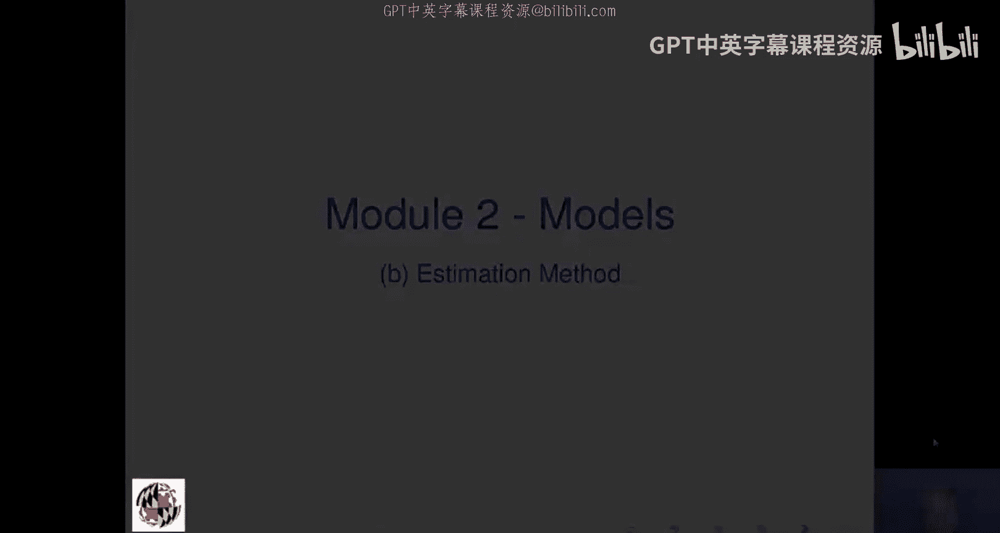
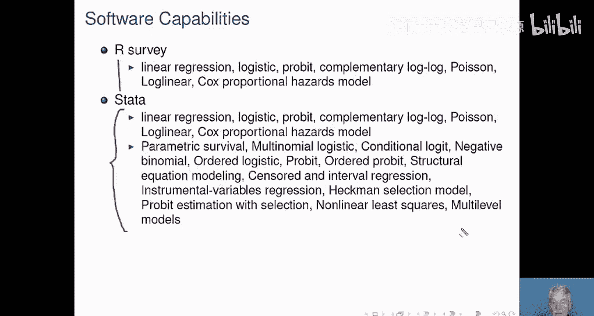

#  157：估计方法 🧮




在本节课中，我们将学习如何估计模型参数。我们将重点介绍一种名为“伪最大似然估计”的技术，这是分析调查数据的软件包中常用的方法。我们将了解其基本步骤，并认识一些能够实现此方法的软件工具。

---

上一节我们介绍了调查数据分析的模型框架，本节中我们来看看如何实际估计这些模型的参数。

我们将使用一种名为**伪最大似然估计**的技术。该技术在分析调查数据的软件包中均有提供，因此是我们的学习目标。其实现步骤在概念上相当简单，但计算细节可能非常复杂，我们不会深入探讨这些细节。

核心思想是，首先写下所谓的**全有限总体似然函数**。如果你了解数理统计，它就是样本中所有观测值的联合分布。然后，我们推导出一些被称为**估计方程**的式子。因此，第一步就是完成这项工作，**假设我们进行了一次普查，即样本包含了整个有限总体**。

这些估计方程的一个优点是，它们通常看起来像是有限总体总和，其中涉及与模型相关的某种残差总和。

例如，对于线性回归，估计方程的形式如下：

```
∑_{i ∈ S} w_i * x_i * (y_i - x_i^T * β_hat) = 0
```

其中：
*   `∑_{i ∈ S}` 表示对样本集合 `S` 中的所有单位求和。
*   `w_i` 是调查权重。
*   `x_i` 是模型中的协变量向量。
*   `(y_i - x_i^T * β_hat)` 是残差，即观测值 `y_i` 与协变量线性组合预测值之间的差。
*   `β_hat` 是待估计的模型参数。

一旦得到这个方程，接下来的思路就是将其设为零，然后找出求解 `β_hat` 的方法。这就是可能出现复杂性的地方。在线性回归中，求解相对直接；但在逻辑回归等模型中，求解则更为困难。

以下是能够执行此类估计的软件及其支持的模型：

*   **R语言的 `survey` 包**：可以处理线性回归、逻辑回归、Probit模型、互补双对数模型、泊松回归、对数线性模型以及Cox比例风险模型。这是一个相当丰富的模型集。
*   **Stata软件**：选择更为广泛。它包含了R `survey` 包支持的所有模型，以及许多计量经济学家感兴趣的其他模型，例如多项逻辑回归、有序逻辑Probit模型、删失与区间回归、Heckman选择模型、一般非线性最小二乘法和多水平模型。如果你使用Stata，这将是一个非常棒的工具集。

我们将在后续视频中详细探讨这些内容。

---



本节课中，我们一起学习了模型参数的估计方法。我们了解到，**伪最大似然估计**是处理复杂调查数据时常用的技术，其核心在于构建并求解**估计方程**。我们还简要介绍了R和Stata等软件中提供的丰富模型支持，为后续的实际分析奠定了基础。