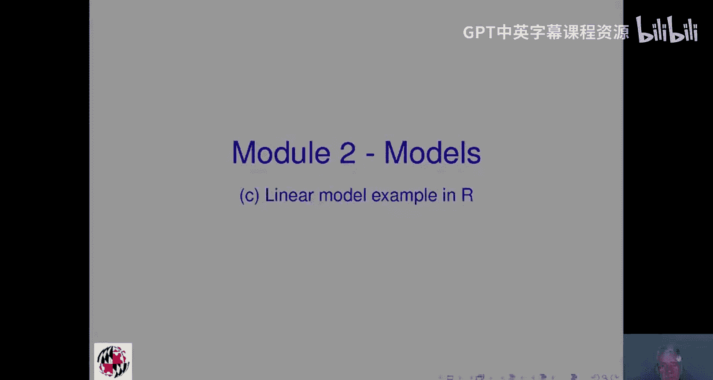
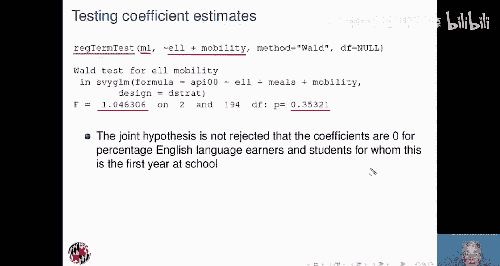

#  158：线性模型 🧮




在本节课中，我们将学习如何在R语言中，使用`survey`包来拟合一个考虑复杂抽样设计（如分层、整群和权重）的线性回归模型。我们将通过一个实际的数据集示例，演示从设置调查设计对象到拟合模型、解读结果以及进行系数联合检验的完整流程。

上一节我们介绍了复杂抽样设计的基本概念，本节中我们来看看如何在实际建模中应用这些设计。

## 设置调查设计对象

首先，我们需要加载`survey`包并准备数据。我们将使用该包内置的“学术表现指数”（API）数据集。该数据集包含了加州所有学生数超过100的学校信息，以及基于这些数据的多种概率抽样样本。

以下是设置调查设计对象的步骤：

1.  **加载包与数据**：使用`library(survey)`加载包，并通过`data(api)`加载数据集。
2.  **定义设计对象**：使用`svydesign()`函数。对于本例中的分层简单随机抽样样本`apistrat`，我们需要指定：
    *   `id = ~1`：表示没有整群设计。
    *   `strata = ~stype`：按学校类型（`stype`）进行分层。
    *   `weights = ~pw`：使用抽样权重（`pw`字段）。
    *   `data = apistrat`：指定使用的数据集。
    *   `fpc = ~fpc`：指定有限总体校正因子（FPC），这在某些层的抽样比例较大时很重要。

对应的R代码如下：
```r
library(survey)
data(api)
dstrat <- svydesign(id = ~1, strata = ~stype, weights = ~pw, data = apistrat, fpc = ~fpc)
```

## 拟合线性回归模型

在定义了调查设计对象`dstrat`之后，我们就可以使用`svyglm()`函数来拟合广义线性模型。在本例中，我们拟合一个线性回归模型。

我们想要研究2001年的学术表现指数（`api00`）与以下预测变量之间的关系：
*   `ell`：学校中英语学习者（非英语母语学生）的百分比。
*   `meals`：符合膳食补助条件的学生百分比（作为低收入指标）。
*   `mobility`：本学年新入校学生的百分比。

以下是拟合模型的代码：
```r
m1 <- svyglm(api00 ~ ell + meals + mobility, design = dstrat)
```
这行代码的含义是：以`api00`为因变量，以`ell`、`meals`和`mobility`为自变量，在考虑`dstrat`所定义的复杂抽样设计的前提下，拟合一个线性模型，并将结果保存在对象`m1`中。

## 解读模型结果

我们可以使用`summary()`函数来查看详细的模型结果。

```r
summary(m1)
```
输出结果将包含以下关键信息：
*   **系数估计值 (Coefficients Estimate)**：每个预测变量对应的回归系数。
*   **标准误 (Std. Error)**：考虑抽样设计后系数估计的标准误差。
*   **t值 (t value)**：系数估计值除以其标准误，用于检验该系数是否显著不为零。
*   **P值 (Pr(>|t|))**：与t值对应的p值。通常p值小于0.05表明该系数在统计上显著。

从示例输出可知：
*   `(Intercept)` 和 `meals` 的系数具有很高的统计显著性（p值很小）。
*   `ell` 和 `mobility` 的系数则不那么显著（p值较大）。

## 进行系数联合检验

有时，我们可能需要检验一组系数是否**同时**为零（例如，检验两个不显著的变量是否可以从模型中移除）。`regTermTest()`函数可以用于此目的。

例如，我们想联合检验`ell`和`mobility`的系数是否都为零：
```r
regTermTest(m1, ~ ell + mobility, method = "Wald")
```
*   `m1`：我们之前拟合的模型对象。
*   `~ ell + mobility`：指定要检验的变量。
*   `method = "Wald"`：指定使用Wald检验方法。

检验结果会提供一个F统计量及其p值。如果p值大于0.05（如示例中的0.35），则我们不能拒绝原假设，即这两个变量的系数同时为零。这从统计上支持了“`ell`和`mobility`对预测`api00`没有显著贡献”的观察结论。

本节课中我们一起学习了如何在R中为复杂抽样调查数据建立线性回归模型。关键步骤包括：使用`svydesign()`定义抽样设计，使用`svyglm()`拟合模型，以及使用`regTermTest()`对一组系数进行联合显著性检验。这些方法确保了我们的统计推断考虑了抽样设计的复杂性，从而得到更有效的估计和检验。



在下一个视频中，我们将继续探讨此模型的诊断方法。