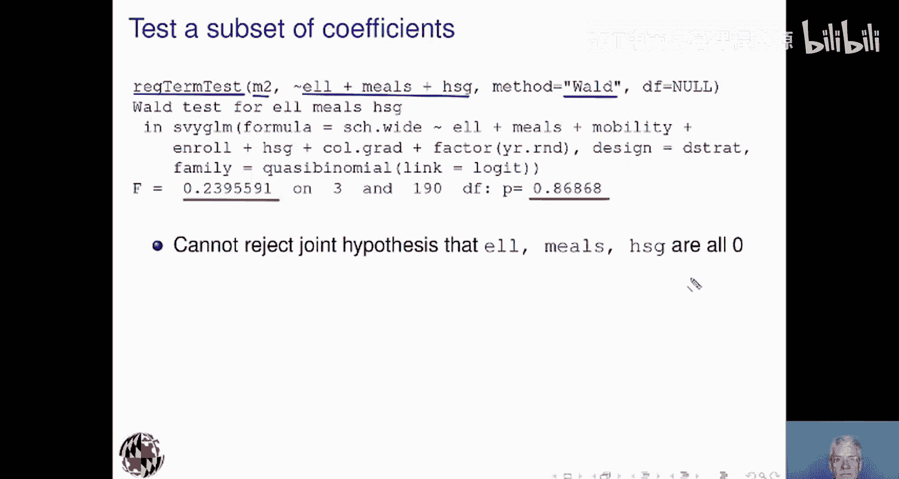

#  161：R语言中的逻辑回归模型 📊


在本节课中，我们将学习如何在R语言中拟合逻辑回归模型。我们将使用一个学术表现数据集，通过逻辑回归来预测学校是否达到了API分数的全校性增长目标。课程内容包括模型拟合、系数子集检验以及分类预测变量的优势比解读。

---

## 数据准备与模型设定

首先，我们需要加载必要的R包并准备数据。我们将使用`survey`包中的学术表现数据集（API数据）。以下是数据集中我们将要使用的变量：

*   **`sch.wide`**：学校是否达到增长目标的指示变量（是/否）。
*   **`ell`**：英语学习者的百分比。
*   **`meals`**：享受补贴餐食的学生百分比。
*   **`mobility`**：学生流动性百分比。
*   **`enrollment`**：学校的注册学生人数。
*   **`hsg`**：父母为高中毕业生的百分比。
*   **`col.grad`**：父母拥有大学学位的百分比。
*   **`yr.rnd`**：学校是否为全年制学校的指示变量（是/否）。

以下是加载数据并创建调查设计对象的R代码：

```r
require(survey)
data(api)
dstrat <- svydesign(id=~1, strata=~stype, weights=~pw, data=apistrat, fpc=~fpc)
```

上一节我们介绍了数据和变量，本节中我们来看看如何设定逻辑回归模型。

## 拟合逻辑回归模型

在R中，我们使用`svyglm`函数来拟合逻辑回归模型，这与拟合线性模型使用的是同一个函数。关键区别在于需要指定`family`参数。

以下是拟合以`sch.wide`为因变量，其他变量为预测变量的逻辑回归模型的代码：

```r
m2 <- svyglm(sch.wide ~ ell + meals + mobility + enrollment + hsg + col.grad + yr.rnd,
             design = dstrat,
             family = quasibinomial(link = "logit"))
summary(m2)
```

在`family`参数中，我们指定`quasibinomial(link = "logit")`来执行逻辑回归。如果使用`link = "probit"`，则拟合的是概率单位模型；使用`link = "cloglog"`则拟合互补双对数模型。

运行`summary(m2)`后，我们可以查看模型输出，重点关注各个预测变量的显著性。例如，`enrollment`（注册人数）可能高度显著，而`mobility`（流动性）和`col.grad`（父母大学学历百分比）可能在10%的水平上显著。其他变量如`yr.rnd`（全年制学校）可能接近但不完全达到显著性水平。

## 检验系数子集

与线性模型类似，我们可以检验一组系数是否同时为零。这通过`regTermTest`函数实现。

假设我们想检验`ell`（英语学习者百分比）、`meals`（补贴餐食百分比）和`hsg`（父母高中学历百分比）这三个变量的系数是否同时为零。以下是操作代码：

```r
regTermTest(m2, ~ ell + meals + hsg)
```

函数将执行Wald检验，并返回F统计量、自由度及p值。例如，结果可能显示p值为0.8686，远大于0.05，表明没有足够证据拒绝这三个系数同时为零的原假设。这意味着在模型中，这三个预测变量可能对结果没有显著的联合影响。

## 总结与下节预告

本节课中我们一起学习了如何在R中执行逻辑回归分析。我们涵盖了从数据准备、使用`svyglm`函数拟合模型，到使用`regTermTest`函数对一组系数进行显著性检验的完整流程。



在下一节视频中，我们将进一步探讨如何在逻辑回归模型中估计和解释**优势比**，特别是针对分类预测变量，这将帮助我们更直观地理解变量效应的大小。