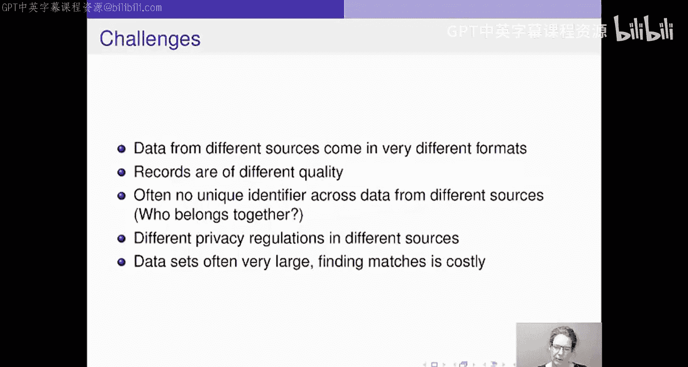
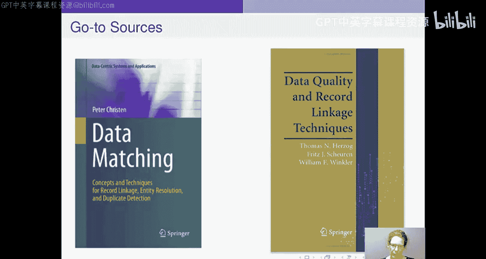

#  164：记录链接的意义

在本节课中，我们将要学习记录链接的基本概念、动机及其在数据整合中的重要性。我们将从现实世界的例子出发，理解为什么需要链接不同来源的数据，并初步了解其面临的挑战。

## 课程概述

记录链接，或称数据匹配，是将来自不同数据源的、指向同一实体的记录进行识别和连接的过程。随着电子化数据的爆炸式增长，这项技术变得日益重要。

## 动机

毫无疑问，各行各业收集的数据越来越多。公共部门、私营部门、特定研究者或个人都在进行数据收集。例如，你去诊所时，信息不再手写记录，而是全部电子化捕获。我们的许多财务记录都以电子方式保存和处理，留下了数据痕迹。我们大多拥有会员卡或信用卡，每次使用都会产生交易数据。商店中用于处理食品购买的扫描仪也在产生数据。所有这些都被保存下来，并创建了独立的文件，理论上可以合并在一起以形成完整的图景。

社会保障记录等文本记录的数据出现时间更长一些。但这个领域真正的新事物是我们留下的所有社交媒体痕迹，如短信、博客等。虽然想象一个所有这些数据都被汇集起来使用的世界有些令人不安，但从研究者的角度来看，我们有很大的希望可以从这些数据中创造新的见解，甚至可能以更低的成本实现。

实际上，已经有一些非常成功的例子。例如，朱莉娅·莱恩曾大力推动的“纵向雇主-家庭动态”项目。该项目是美国人口普查局经济研究中心的一部分。在这个项目中，美国各州与人口普查局共享失业保险收入数据以及季度就业和工资普查数据。人口普查局自身又向该数据库添加了行政数据和调查数据。这项工作的使命是能够创建关于工人、雇主和工作的动态信息，并减少任何额外的数据收集负担。

试想一下，如果通过调查问卷向所有这些人询问他们的就业历史、收入、开始和结束工作的时间，以及这些收入是否产生了社会保障福利等，那将是一个巨大的负担。因此，分析已有的数据似乎是更实际的做法，但这并不像人们想象的那么普遍。事实上，许多国家目前正在努力解决如何解锁那些被孤立在不同机构中的数据的问题，例如美国各联邦州或地方机构的数据。

美国国家科学院的国家统计委员会刚刚发布了一份报告，探讨如何从整体上（不仅仅是技术层面）结合行政数据，涉及隐私问题、访问权限、谁应该有权这样做、何时可以进行，以及如何总体上更多地利用行政数据等。这是一个在全球范围内广泛讨论的议题。

希望通过这些努力，能够提高现有数据源的质量，或者减少从受访者那里收集这些数据的负担。如前所述，希望新的研究问题能够得到解答。

## 挑战

然而，这些努力面临着挑战。数据来自不同的来源，格式多种多样。记录的质量参差不齐。所有这些数据中没有统一的唯一标识符。不清楚哪些记录真正属于同一个人，以及我们如何找出这些匹配。此外，不同数据源之间的隐私法规也存在差异。当数据量非常大时，找到正确的匹配可能成本相当高昂。

## 推荐阅读

基于以上动机介绍，我想向您推荐两本书。一本是彼得·克里斯滕的《数据匹配》，本演示文稿大量借鉴了该书中的材料。另一本是斯普林格出版社出版、存在时间更久一些的，由托马斯·赫兹勒等人合著的《数据质量与记录链接技术》。通过这两本书，您可以很好地掌握这个主题。当然，我们不能在Coursera网站上免费提供这些材料，但我仍然鼓励您查看当地的图书馆是否有这些书，或者考虑购买。

我们在网页上还提供了额外的信息和更短的文章。希望这些材料能为您提供足够的背景知识。

## 总结

本节课中，我们一起学习了记录链接的核心动机：整合分散在不同来源中的数据以形成更完整的视图，并支持新的研究。我们也认识到这一过程面临数据格式不一、缺乏统一标识符、质量差异、隐私法规和计算成本等主要挑战。理解这些是进行有效记录链接的第一步。