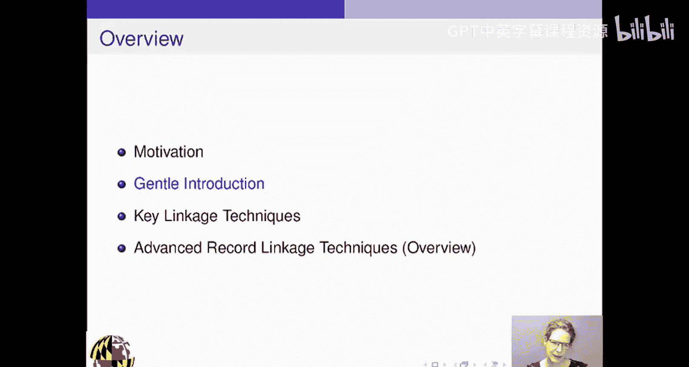
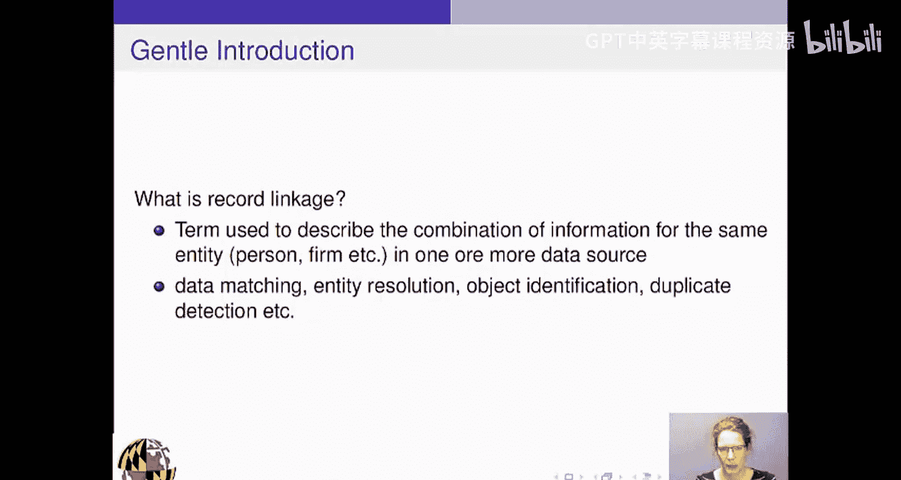
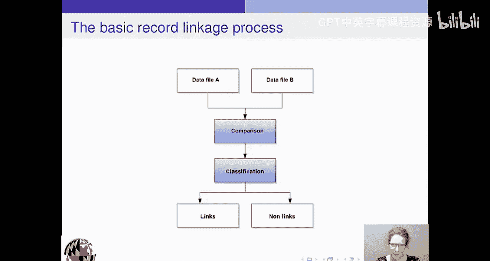
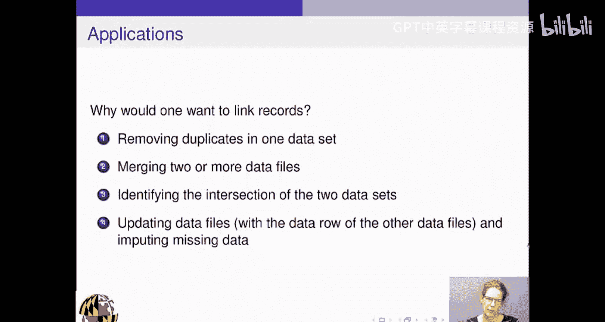
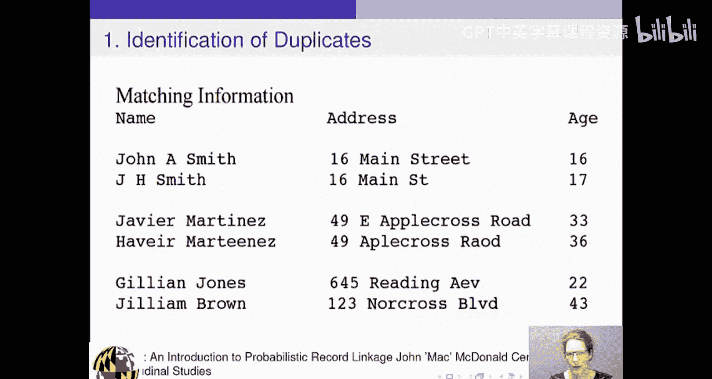
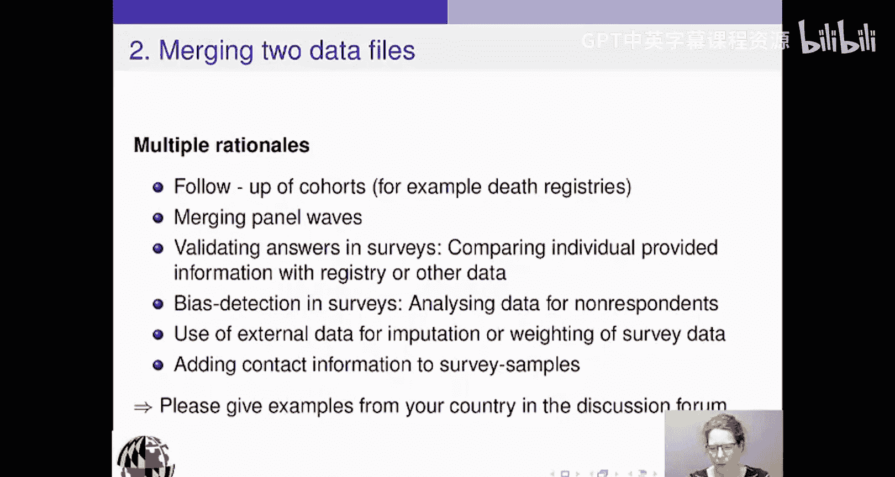
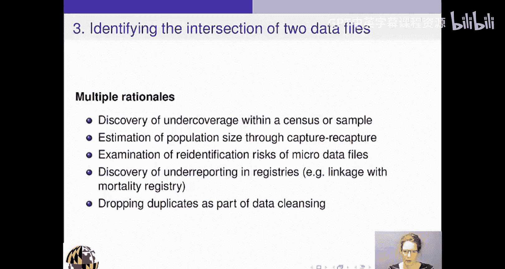
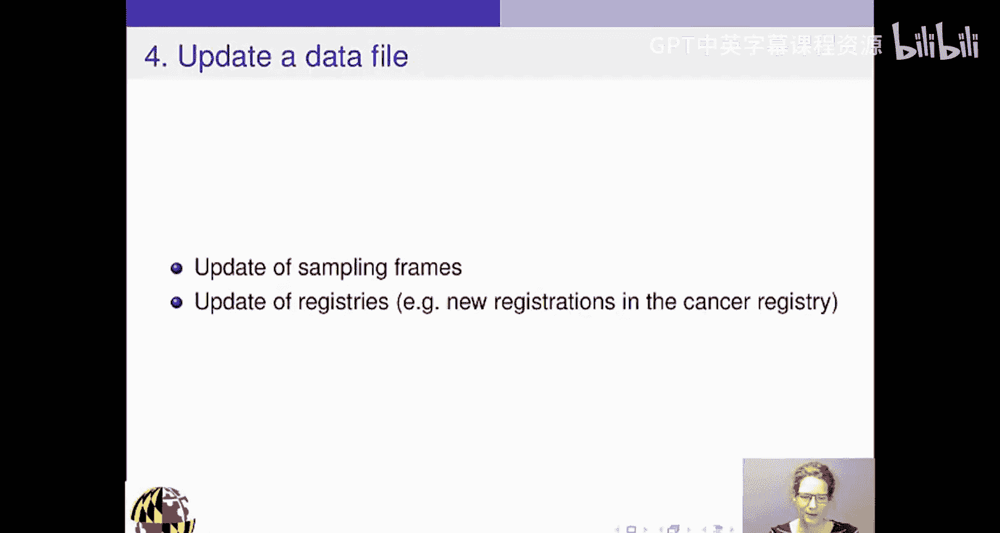

#  165：记录链接入门指南 📚

在本节课中，我们将要学习一个在数据科学和调查研究中至关重要的技术——记录链接。我们将了解它的基本概念、应用场景以及在实际操作中可能遇到的挑战。

---

## 什么是记录链接？🔍

记录链接这个术语用于描述将同一实体（无论是个人还是其他对象）在一个或多个数据源中的信息进行组合的过程。其目标是找到存在于不同数据源或可能存在于同一数据源中的记录。

这项技术在其他学科中可能以不同名称出现。例如，它有时被称为**数据匹配**。计算机科学家有时称之为**实体解析**或**对象识别**。**重复检测**是另一个有时被使用的术语。在健康研究和其他应用领域的统计学中，**记录链接**是最常用的术语，这也是我们在此将使用的术语。

---

## 基本概念与理想模型 📊

记录链接的基本思想是：你有两个数据文件，A 和 B。你比较数据文件中的每条记录，然后决定是否可以链接它们。答案是“是”或“否”。这就是理想世界中的情况。

然而，现实情况往往并非如此简单，我们稍后将讨论其原因。

---

## 记录链接的应用场景

在讨论挑战之前，我们先看看为什么要链接这些记录。以下是几个主要的应用场景。

### 1. 识别并移除重复记录

如果只涉及一个数据集，即你比较 A 与 A，那么这项技术可以帮助你移除重复项。在进行统计分析（如计算平均值或百分位数）之前，你可能需要确保没有包含本应视为一个案例的多个重复记录。

以下是一个例子，展示了三个可能多次出现在记录中的人：
*   **John A. Smith** 和 **J. H. Smith**：地址相同，年龄相近，很可能是同一个人，可能是拼写或录入错误。
*   **Javier Martinez** 和 **Javier Martines**：西班牙语名字，可能被不熟悉发音的人拼错。
*   **Jilln Jones** 和 **Jilln Brown**：街道名和年龄组都不同，很可能不是同一个人。

这个例子已经让我们初步感受到了记录链接的挑战。

### 2. 合并两个数据文件

合并数据文件有几个原因：
*   **纵向追踪**：例如，你可能有一个调查数据，希望在一段时间后跟进，查看受访者是否健在，这时可以将其与死亡登记记录进行匹配。
*   **合并调查面板波次**：通常，你希望有一个不依赖于姓名和地址的唯一标识符来合并多次的调查数据。
*   **验证调查答案**：将个人提供的信息与其他数据源（如行政数据）进行比较，以评估调查数据的质量。
*   **检测调查偏差**：将调查数据与行政数据匹配，可以分析无应答者的特征，从而检测调查中的偏差。
*   **插补或加权**：链接的外部数据可以为调查数据的插补或加权提供额外信息。
*   **补充联系信息**：例如，从单独来源链接电话号码到调查样本。

这些应用在健康、犯罪、反恐等多个领域都非常普遍。

### 3. 识别两个数据文件的交集

这种应用通常在以下情况出现：
*   **评估覆盖范围**：比较抽样框与普查数据，查看谁未被覆盖。
*   **估计总体规模**：通过捕获-再捕获方法进行估计。
*   **检查微数据文件的再识别风险**。
*   **发现登记数据中的漏报情况**。

这些例子都是通过查看两个数据文件的交集来进行估计。

### 4. 更新数据文件

一个常见的例子是电话调查中的双框抽样。我们有一个固定电话框和一个手机号码框，它们需要被合并，但也需要去重，以确保每个受访者只对应一个电话号码（或明确知晓多个号码的情况），以便正确计算抽样概率。

---

## 总结

本节课中，我们一起学习了记录链接的基础知识。我们了解到，记录链接是将不同数据源中关于同一实体的信息进行组合的过程，它在数据清洗、合并、验证和更新等多个环节发挥着关键作用。尽管其基本思想是直接比较和匹配记录，但在实际操作中，由于数据错误、格式不一致和标识符缺失等问题，这个过程会变得复杂。在接下来的课程中，我们将深入探讨记录链接的具体方法和面临的挑战。