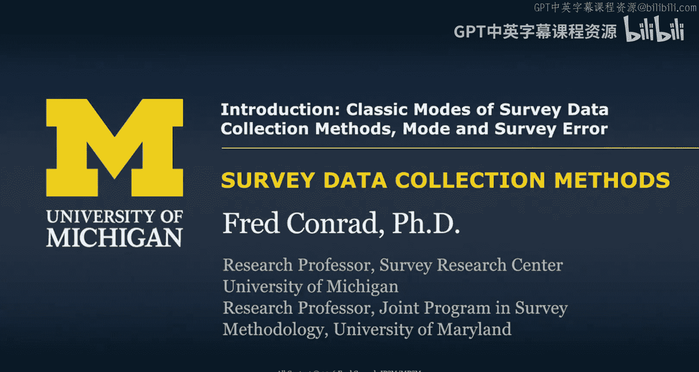
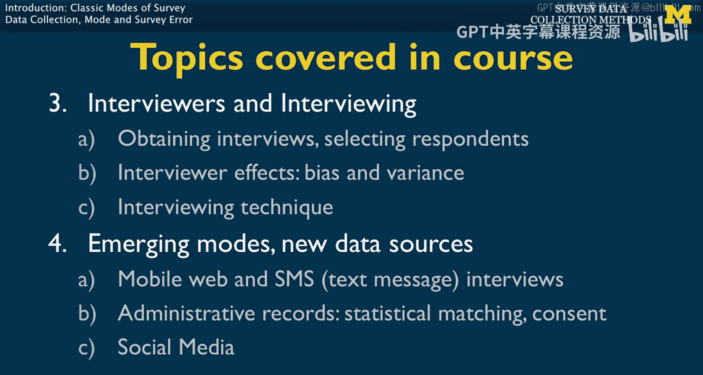

# 密歇根大学《调查数据收集和分析（2-6：方法、社调问卷设计、抽样、缺失数据、分析）｜Survey Data Collection and Analytics》 p01 0_1.1 课程定位说明.zh_en -BV1fw4m1e7Zh_p1-

Greetings， I'm Fred Conrad， I'm a survey methodologist and psychologist at the University of Michigan。

 the program in Sur methodology within the Institute for Social Research。

 and also a research professor at the Joint program in Survey methodology at the University of Maryland。

Welcome to data collection methodsths， web， telephone， and face to face。

 it's one of the courses in the specialization。The first lesson which we're now in is an introduction and followed by a discussion of what I think of as the classic modes of survey data collection in particular。

 telephone face to face and mail questionnaires， and then we'll talk about mode of data collection。

 what we mean by mode， there are a number of different notions。

 and I want to make sure we're on the same page and the concept of a survey error and how mode and survey error are related。

 for example， some modes may increase non-response and the potential for non-response error。

So what is this course， it's to look at the cost error trade offs inherent in all data collection decisions。

So you can generally reduce error， and we'll talk about the different kinds of error。

 you can generally reduce error by investing more resources。

 so by increasing your cost as a researcher you can generally reduce error。

 or if you can tolerate a certain amount of error， then you may be able to collect the data at reduced cost。

This course is a scientific view of survey data collection by which I mean that it's based on findings in the scientific literature。

 the published peer reviewed literature， by and large， it's not about experiences and anecdotes。

 although these are a legitimate source of information when designing a survey and in particular data collection procedures。

 but our focus here is on the scientific literature。

And it's a comprehensive perspective on survey design that seeks to improve overall quality。

 which is a way of saying that we were looking at all the different sources of error that can occur at different points in the survey process and looking at how they play out as one increases the other might decrease and so on。

 so it's an overall perspective on the design of data collection。

What the course is not is how to do a course， so this isn't really a credential for going out and doing your own survey you'll get a certain amount of that in other courses in the specialization。

 but this course is really more conceptual and again more about what's in the scientific literature Of course we hope this provides or serves as the basis for practical activity but that's not really the focus of the course。

It's not a course on how to design questionnaires， there is a questionnaire design course in the specialization。

 we'll refer to some of those ideas throughout this course， but that's not what this course is about。

It's not a review of the entire survey process， so for example。

 we say very little about sampling or waiting in this course。

It's not of course based on opinions or feelings on the topics， as I said。

 it's really about the published literature。It's not a course in statistics。

 although statistical concepts and notation will be used somewhat throughout the course。

So what do we cover in the course well in the current segment， the introduction。

 we'll talk about mode of data collection， what do we mean by mode。

 and how are modes and survey error related in particular， what I think of as the classic modes。

 face to face， telephone and mail。We'll talk about one particular source of error nonres in a little more detail than the others。

 it does come up quite often and it's while all the sources of error are important to consider。

 we'll focus on non-res in the introduction。In the second lesson we'll talk about self-administ and online data collection in particular automated self-admin。

 so we'll talk about automation in interviews， so for example interviewers in face to face interviews often use a computer device。

 a laptop or a tablet and this is known as computer assististed self interviewviewing。

 interviewers read the questions and enter answers directly into the device and we'll also talk about self-administ in which the interviewer turns the device over to the respondent to enter answers to what are generally considered sensitive questions and the idea is that this gives the respondent in a certain amount of privacy one of those modes is called audio computer assististed self- interviewviewing or aAsie which the respondent hears the questions over headphones maybe sees the question on the screen and selects and answer and enters that。

To the device。We'll talk about online or web data collection where there are no interviewers involved it's completely self administered。

 there are a number of issues there involving the different sources of error， coverage。

 nonresse measurement。And then we'll talk about mixed mode surveys。

In which different modes are combined in the process of collecting data for a particular study。

That raises the issue of in some mixed mode designs of giving the respondent a certain amount of choice over how they complete the questionnaire and so we'll discuss the issue of respondent mode choice we then switch to discussion of interviewers and interviewing which really breaks down into a couple of components so interviewers end up doing many tasks actually besides interviews probably the most important task besides the interview that is asking questions and recording answers is obtaining the interviews or recruiting sample members to become respondents to participate so obtaining interviews and then in the case of household surveys once the sample member or member of the household that has been sample agrees to participate there's often a within household selection process in which one of the household members not necessarily the member who the interviewer has been talking to is selected through a random process we'll talk about both。

recruitmentcruitment process and the selection of respondents within households。

We'll talk about so-called interviewer effects in which the interviewers may introduce two kinds of error。

 what are known as bias and variance， the point here is that interviewers add value in many ways which we'll discuss。

 but there are costs as well， the fact that an interviewer for example may administer a questionnaire differently from another interviewer can introduce a certain amount of interviewer related variance。

 which is generally not a good thing， so we'll talk about those types of interviewer effects。

As well as interviewer effects that might be due to enduring characteristics of the interviewer。

 such as race， gender， age， etc。The fourth and final lecture will really focus on new and emerging modes of data collection and new data sources。

The new modes that we will discuss really are mobile web will have spoken about more conventional web surveys that are administered on a desktop computer or a laptop typically responding on a smartphone has become increasingly common either in a browser or in a specialized app the survey industry is really catching up with what the public has kind of demanded through their use of mobile devices。

 and so we'll discuss。Mile web and also the use of SMS or text message messages for conducting interviews。

 which is a little different than mobile web， actually doesn't have to happen on a smartphone。

 but often does and has a more kind of turn based structure a more back and forth structure than web questionnaires self administered on a smartphone have。

We'll also talk about administrative records as an alternative data source to use administrative records requires typically matching the data of a survey respondent or just a member of the public with the individuals identified in the records。

 and so these are not necessarily easy to do and requires a certain amount of statistical guesswork。

 informed guesswork， as well as consent by the respondents to allow their survey responses and administrative records to be linked。

 but the great promise of administrative records is that it can reduce burden on members of the public by making it unnecessary to ask them questions。

 survey questions when the answers are already when the answers already exist in administrative records。

 and to save survey research such as government agencies considerable amounts of money。

The other new data source we'll discuss or potential data source。

 it's really not clear exactly how and when this data source might be usable in the way that surveys are。

 but we'll talk about social media as a possible either supplement or even replacement for survey data collection。

 as I said we don't quite yet know how and when social media might play this role。

 but there is some promising evidence about social media more or less reproducing the results that come from surveys or at least asking certain questions in certain surveys。

 and so it will explore when social media might be more and less likely to tell the same story that we're able to tell with survey data。

So these are the four lecture topics， in addition to the lectures。

 another important type of content for the course is a set of interviews that I've conducted with experts and leaders in the field of survey data collection。

These interviews concern turn topics like mixed mode data collection and online data collection。

 and they complement and actually go well beyond the content in the lectures。

I personally found the discussion in these interviews to be quite exciting and engaging。

 and I hope you will too。So I'm looking forward to sharing this material with you and to learning about your reactions。

 I hope you'll make good use of the discussion boards throughout the course so we can take stock of your progress。

So with that in mind， I look forward to working with you and let's get on with the rest of the lesson。

Thanks a lot。