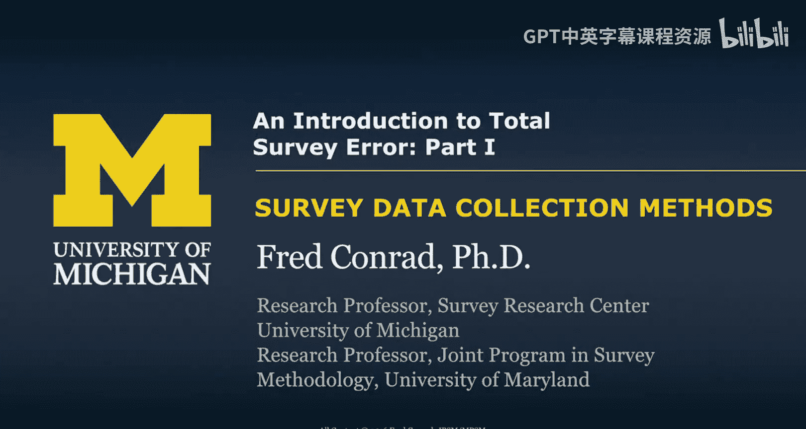
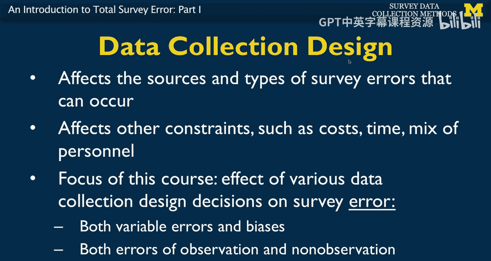
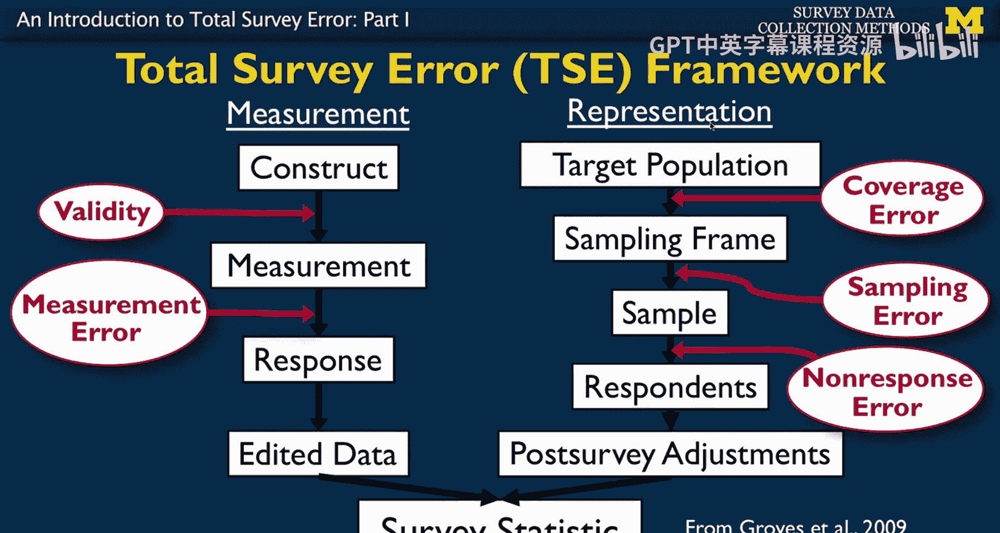
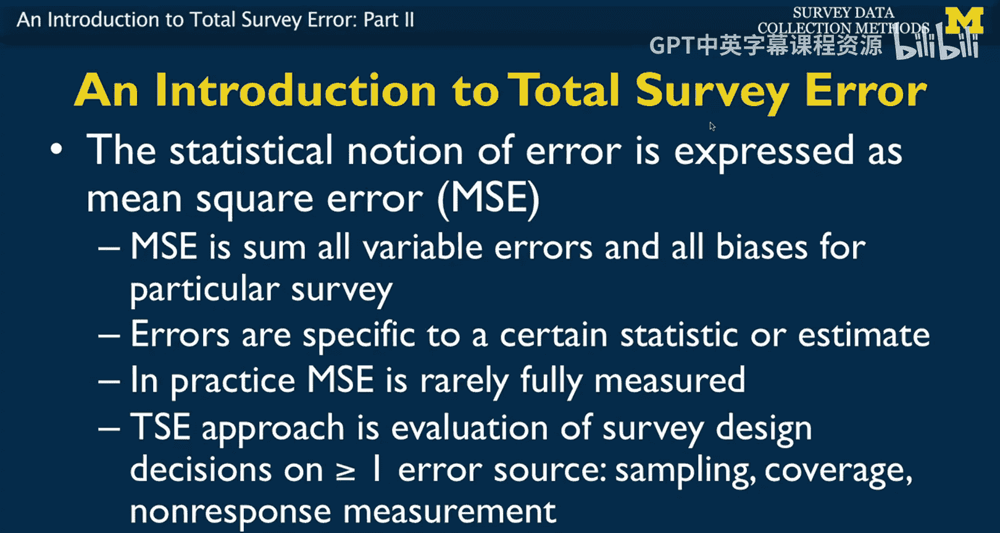

# 密歇根大学《调查数据收集和分析（2-6：方法、社调问卷设计、抽样、缺失数据、分析）｜Survey Data Collection and Analytics》 p02 1_1.2.1 调查误差导论.zh_en -BV1fw4m1e7Zh_p2-

Okay， continuing with our introduction， we'll look now at the concept of survey error and we'll focus on framework that has become quite widely used among survey researchers and methodologists known as the total survey error in which we look at all the different sources of error that can affect the estimates that come out of a survey。

We'll explore the important distinction between variable errors and what survey researchers call bias。

These terms are not used exactly the same way across all different disciplines。

 so it's important to understand how survey researchers and survey methodologists use these terms。

And we'll also distinguish between errors of observation， which have to do with responses。

 answers to survey questions， and errors of non- observationservation which tend to relate to the way in which the results of the sample survey of the respondents in the sample survey represent allowed generalizations to the full population。

So data collection design。The way data collection is designed affects the sources and types of survey errors that can occur。

It also has major consequences for cost， the amount of time that will be involved in data collection and the particular types of professionals that are required to carry out the task。

For example， whether we use interviewers or not。So the focus of this course is the effect of various data collection design decisions on survey error。

Both variable errors and biases and both errors of observation and non observation。

So this is a well known graphic that has appeared in Groroves at all 2009 and elsewhere。

 and in at least one other course in the specialization。

 so those of you doing the entire specialization will recognize it。

And what it really does is it shows the types of survey error kind of in two parallel tracks。

 if you like， one having to do with measurement， which involves answers to questions。

 so responses survey responses and error that can be involved in survey responses。

 and the other has to do with representation， the extent to which the results from the survey can be treated as representing the results from the full population。

 if we could have measured the full population。So if you think about it on the measurement side。

 this is just the questionnaire generally， you start out with a construct or a concept that you want to measure or quantify and you create an item or a battery of items to do this and that's the measurement process So the extent to which the questions successfully measure the construct or successfully operationalize the construct is the extent to which there' are a valid measure of the construct so really the error source there would be invalidities if the question doesn't quite capture the concept。

 then there's some invalidity so you might be interested in in a measure of wealth or let's say poverty and the question concerns income and income is not the only measure of wealth poverty so there wouldn't be a perfect fit between the question or the measurement and and the construct。

 the underlying construct you're interested in so there'd be a certain amount of。

Error due to invalidity there。But let's assume that you've got a question that accurately operationalizes the concept or the construct of interest when that's administered to members of the sample to respondents。

 their answers might not perfectly match the truth or the true value if we could know that this could happen for many reasons having to do with failure to understand the question exactly as it's intended or difficulty recalling relevant information or the fact that the question asks about a sensitive topic and maybe it's asked by an interviewer which makes it embarrassing or is it kind of disincentive to respond honestly if the answer is in fact socially undesirable。

 so there are a number of reasons why the response to a question might depart from the truth or the true value and these together produce what are known as measurement error。

On the representation side， there's a population， let's say it's the national population that we want to describe。

 we want to produce estimates from the data that characterize this population well you can't identify everybody in the population and decide which of them you're going to ask this question to it's just not feasible。

 you need some some way to represent or operationalize the population and this is known as the sampling frame it can be a list for example of address street addresses。

 not everybody in the population has a street address and for example。

 or if it's telephone numbers that are frame consists of not everyone has a telephone number so this can create what's known as undercover and the extent to which those in the sampling frame。

 this list of elements or units or individuals generally of the population。

 the extent to which they differ from those who are included in the frame creates what's called coverage error so if the people who don't have a telephone or the people who don't have Webex。

are fundamentally different on an attribute you intend to measure in the survey than those who do have telephones or web access and can be measured。

 you have what's called coverage error and coverage error is really a combination of the size of the difference between those who are included in the frame and those who are not。

And the number of people who are not included in the frame。

Once we have the frame we draw a sample from it and we only draw one sample in a serve and so it's possible that that one sample will not perfectly represent the full population or all the elements in the sampling frame this sampling error and the extent to which we have sampling error can be intensified by the size of the sample there's a smaller sample is more likely to depart from the frame in terms of its characteristics。

Let's assume that the sample is as representative as we can make it of the full population。

Not every element or every individual in the frame will agree to participate or not every element or individual or organization it will be contactable as we might not be able to even ask them to participate because for example。

 they don't answer the phone or or answer the door or they live in a community that isn't accessible。

 it's gated， let's say。So there are really a couple of sources of nonresse known as noncont and refusal。

 so if we do contact a household， let's say， and the person the interviewer speaks with says no。

 I won't be in your study or more likely just hangs up the phone。We have non response。

Nonresponse is not necessarily the same as nonres error。

 but we have nonrespon error to the extent that the nonresponents differ on an attribute that you intend to measure in the study。

 and like coverage there really are two components to non-res error。

 the size of the difference between the nonresponents and the respondents on the attribute。

 the question you're going to ask。

And the number of non respondents。So these are really the main sources of error there are。

There are error sources that we are not really going to touch on here that involve processes that follow the collection of the data。

 so for example， editing the data or adjusting the data can introduce errors of their own。

 but we're going to focus on measurement error， coverage。

 error and non-response error primarily in this course。

So total survey error is a way of thinking about the various sources of error that may affect survey statistics。

The goal is to make inference to or generalize to represent a broader population。

Survey quality is kind of the flip side of survey error is a measure of the success of that effort。

It's important not to think of error as meaning mistake。

 but rather the uncertainty or lack of confidence of the inference。

 So it's error in the statistical sense。The total survey error perspective allows us to think about something called mean square error。

 which is the sum of all the variable errors and all the biases for a particular survey。

 it's a way of sort of bringing together all the different sources of error into one quantity。

Errors are specific to a certain statistic or estimate in practice we really can only measure means square error in some instances and it's actually pretty rare that we have we're able to quantify all the different sources of error so it's more conceptual but in principle one could combine the different sources of error into a single measure。

The total survey error approach。Is an evaluation of survey design decisions on more than one error source。

 sampling coverage， nonres measurement errors， I said we really focus on coverage。

 nonres and measurement error in this course。

So in the next segment， we will discuss two concepts that are central to the TSE framework。

The notions of true value and the distinction between variable error and biases。

