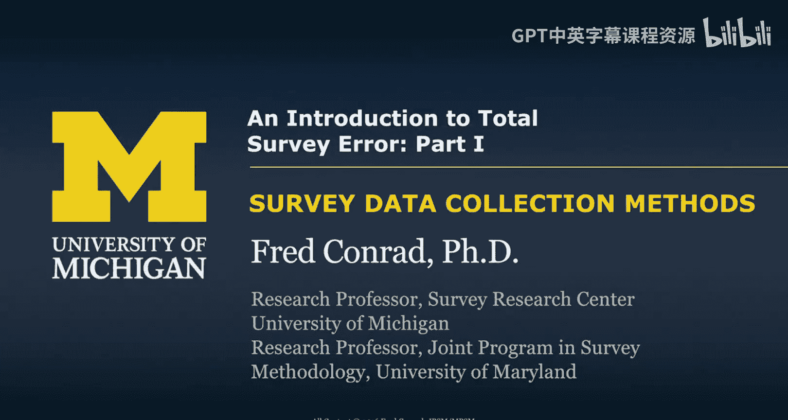
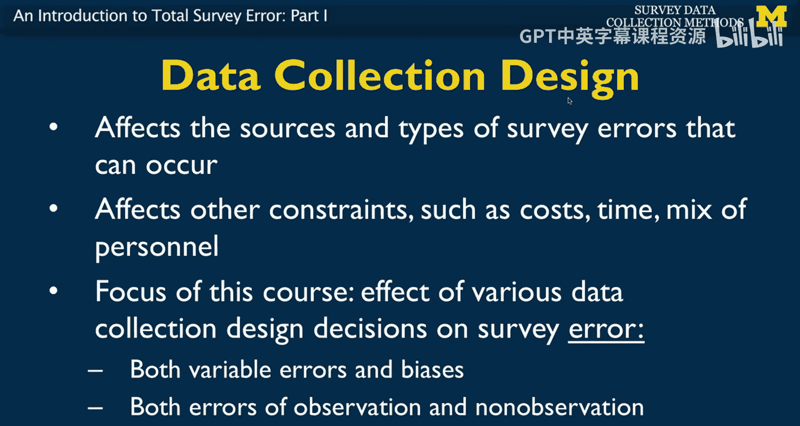
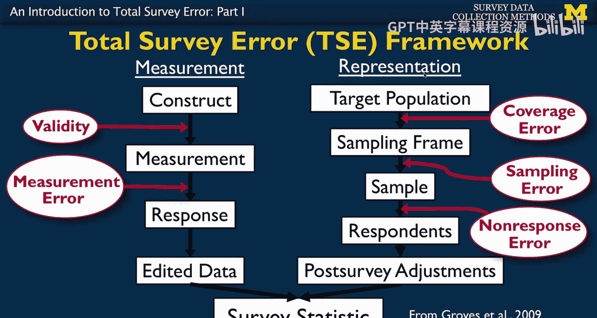
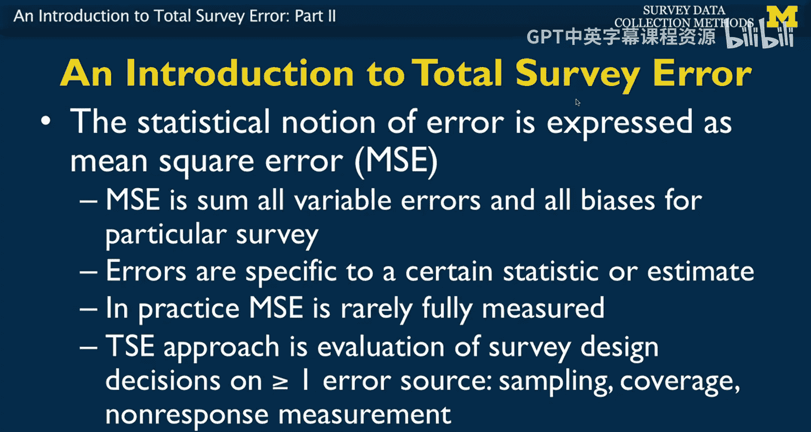

# 调查数据收集与分析：2-6：调查误差导论

在本节课中，我们将学习调查误差的核心概念。我们将介绍一个在调查研究者中广泛使用的框架——**总调查误差**。这个框架帮助我们系统地审视影响调查估计值的各种误差来源。我们将重点区分**可变误差**与**偏差**，以及**观察误差**与**非观察误差**。理解这些概念对于设计高质量的调查至关重要。

## 总调查误差框架

上一节我们介绍了课程的整体目标，本节中我们来看看调查误差的总体框架。总调查误差框架将误差来源分为两条并行的主线：一条与**测量**（即问卷回答）相关，另一条与**代表性**（即样本结果能否代表总体）相关。

下图清晰地展示了这一分类：

### 测量误差

测量过程始于我们希望测量或量化的**构念**或概念。我们通过设计一个或多个调查问题来**操作化**这个构念。

*   **构念效度误差**：如果问题未能准确捕捉目标构念，就会产生效度不足的误差。例如，用“收入”单一问题来测量“财富”或“贫困”构念，就可能存在效度误差，因为财富还包含资产、债务等其他因素。

假设我们设计的问题能准确操作化目标构念，当向受访者提问时，他们的回答也可能与真实情况不符。这被称为**测量误差**。产生原因包括：
*   受访者未能准确理解问题意图。
*   受访者难以回忆相关信息。
*   问题涉及敏感话题，受访者可能因社会期许而不愿诚实回答（尤其在访员面访时）。

### 代表性误差

代表性方面，我们从一个**总体**（如全国人口）开始。由于无法调查总体中的每一个人，我们需要一个能代表总体的操作化列表，即**抽样框**。

*   **覆盖误差**：并非总体中的每个个体都能进入抽样框。例如，以电话号码簿为框，就无法覆盖没有电话的人。如果这些未被覆盖的人在调查关注的属性上与已被覆盖的人存在显著差异，就会产生覆盖误差。覆盖误差的大小取决于两个因素：
    1.  未被覆盖者与已被覆盖者在目标属性上的差异大小。
    2.  未被覆盖者的数量。

从抽样框中，我们抽取一个**样本**。

*   **抽样误差**：由于我们只抽取一个样本，这个样本的特征可能无法完美代表抽样框或总体。样本量越小，抽样误差可能越大。

假设我们抽取的样本能尽可能代表总体，接下来面临的问题是，并非样本中的每个个体都会或都能参与调查。

*   **无回答误差**：这包括无法联系到样本个体（如不接电话、住在封闭社区），以及联系后拒绝参与。无回答本身不一定是误差，但当**无回答者**在调查关注的属性上与**回答者**存在差异时，就产生了无回答误差。其大小同样取决于：
    1.  无回答者与回答者在目标属性上的差异大小。
    2.  无回答者的数量。

## 核心概念与总结

以上是调查中主要的误差来源。本课程将主要关注**测量误差**、**覆盖误差**和**无回答误差**。数据收集后的处理过程（如编辑、调整数据）也可能引入误差，但本课程不做重点讨论。

总调查误差是一种系统思考可能影响调查统计量的各种误差来源的方式。其目标是成功地对更广泛的总体进行**推断**或**概化**。调查质量是调查误差的反面，衡量的是这种推断努力的成功程度。

需要明确的是，这里的“误差”并非指“错误”，而是统计意义上的**不确定性**或推断的**置信度不足**。

总调查误差视角让我们可以思考**均方误差**这个概念。从概念上讲，均方误差是某项调查中所有可变误差与所有偏差的总和，是将不同误差来源汇总为一个量的方式。公式表示为：

`MSE(θ̂) = Var(θ̂) + [Bias(θ̂)]²`

其中，`θ̂` 是总体参数 `θ` 的估计量。

在实践中，误差是针对特定统计量或估计值而言的。我们很少能真正量化所有误差来源，因此总调查误差更多是一个概念性框架。总调查误差方法的核心价值在于，它能让我们在评估调查设计决策时，同时考虑对多种误差来源（如抽样、覆盖、无回答、测量误差）的影响，而不仅仅是单一误差。

本节课中，我们一起学习了总调查误差的基本框架，区分了测量误差与代表性误差下的不同误差类型。下一节，我们将深入探讨总调查误差框架中的两个核心概念：**真值**，以及**可变误差**与**偏差**的关键区别。

