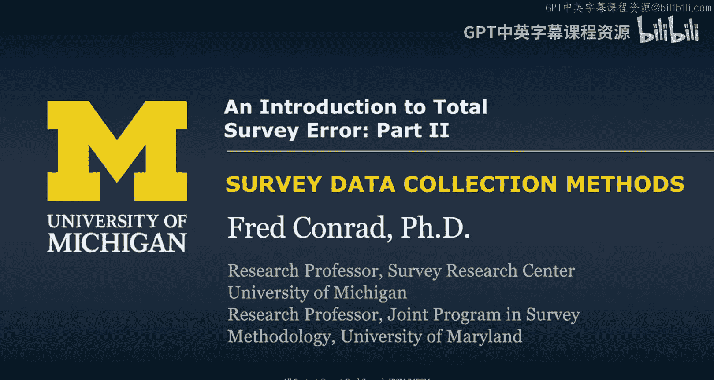
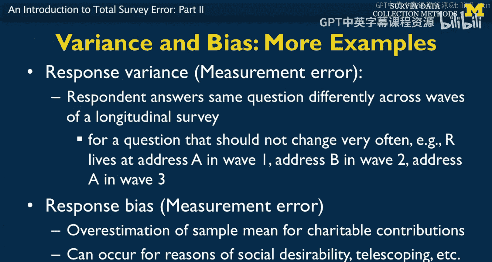

# 密歇根大学《调查数据收集和分析（2-6：方法、社调问卷设计、抽样、缺失数据、分析）｜Survey Data Collection and Analytics》 p03 2_1.2.2 变量误差与偏倚.zh_en -BV1fw4m1e7Zh_p3-

Survey researchers assume that there's an actual or true value for the estimates that come out of a survey。

A related concept， particularly important for getting at biases， is the true value。

 so this is the actual value of what's being measured in the survey。Sometimes it's knowable。

 for example， from administrative records， there's actually some objective indication of the value we're trying to get at by asking a survey question。

 but often it's not knowable， and that makes sense because if it were knowable。

 there wouldn't be a lot of reason to be conducting the survey or asking this particular question on the survey。

In that case， true value becomes more conceptual or at least something we have to get at an indirect way。

Sometimes true value is defined in terms of the measurement process。

 so for example IQ is the score on an IQ test， it's sort of defined in terms of itself。

 and it has predicted validity so IQ tests do predict certain outcomes relatively well even if we don't exactly know what IQ means measurement error is the difference between what is observed the answer to a question。

And the true value。 So again， often it's not knowable。

 and we have to kind of infer what the measurement error is。

So I've made this distinction a few times between variable error and bias。

Variable error arises because answers vary over different units in the design， so interviewers。

 sample persons， respondents and over the questions that we're asking we measure variance of a statistic that is a responses to a question so we talk about say interviewer related variance we're talking about this for a particular question not for all of the questions that the interviewers ask or we're talking about non-resse error we're talking about it really for a particular question or attributes that we're trying to to measure variable error can occur between or within participants and to minimize it。

 we randomize respondents to say to interviewers and we try to hold consistent whole constant what are called essential survey conditions which really means the mode of data collection the。

The timing of data collection and really the operational aspects of the process。Okay。

 this all contrast again survey researchers call bias by which we mean directional error。

 so responses that might be bigger than or estimates that might be bigger than the true value。

But this requires that we know what the true value is and that's really the key to measuring bias。

 so if we have some sense of what we mean by of the true value， then we can quantify bias。

 but often we will measure variance。Almost as a kind of surrogate or proxy for bias because variance is much easier to measure and it kind of comes for free with the data。

嗯。An example of a case where we can get at bias without actually having true value is， for example。

 if we compare responses to a question that's considered sensitive， for example。

 number of lifetime sex partners or lifetime drug use asked in two different modes。

 a mode for example that involves an interview or say a face to face interview and a self-administered mode where there's less。

Perhaps less stigma attached to responding truthfully。 And if we see a difference。

 we assume that the。The self administered mode， say web is closer to the truth。

 closer to the true value， and so we could say that respondents are underestimating in an interviewer administered mode。

 these undesirable behaviors like lifetime drug use， socially undesirable。

By comparing them to the self administered mode， which we assume to be close to the true value。

This graphic makes explicit what we mean by bias versus variance。

 so the figure on the left represents bias among the responses to a question。

 we assume that the red bullsey in the middle of the target is the true value。

And the black dots or circles are the responses， and you can see that they're kind of clustered all in one direction。

 sort of mostly above and the little to the right of the bull'sey。

 just meaning that they're shifted systematically away from the truth。

 so that's what I meant when I gave as an example an overestimate。

The image on the right represents variance again， if the red circle is the true value and the black circles are the。

Individual responses they're kind of distributed around the the true value。

 they're also not perfectly accurate， but the lack of accuracy is communicated is represented through the dispersion of the responses from the from the true value as opposed to a systematic shift in practice。

 we often only have one measurement。 How then can we measure variance and bias。Well。

 we can measure variants from the sample itself by using what are known as replication based methods in which we select a number of subamples and we compute variants across those sub samplesamples。

But as I've indicated， already to estimate bias requires external data or evidence。

 the truth or the truth value or assumptions about direction of the effects。

 as in the example I gave involving sensitive questions asked in different modes。

Turning to some more examples of variance and bias interviewer related error comes in both varieties both are considered a type of measurement error。

 so interviewer related variants might take the form of mean response for a measure like self- rated health being high for some interviewers and low for others and this can happen despite random assignment of respondents to interviewers and other safeguards is often attributed to variation in how the interviewers administer the questions or the question。

 conduct the interview so they may probe differently or they may they may vary their behavior in other ways their delivery for example the questions may differ despite similar training so all this can contribute to interviewer variants and if different interviewers elicit different distributions of answers to the same。

Question and the respondents have been randomly assigned to the interviewers。

 there is some measurement error going on here that's what variants can tell us in a case like this。

When it comes to interviewer bias， again， this refers to consistent under overestimation so for example。

 of discouraged workers， this could be because of a systematic failure to probe in say looking for work question。

 are you looking for work， but the key here is that it has to be systematic that all of the interviewers are going to not probe or over probe in the same way？

Also we spoke about briefly interviewers enduring characteristics affecting answers to questions generally about the same topic。

 so race gender age of interviewers can all systematically affect answers to questions about say racial attitudes or gender gender equality。

 it's possible that there can be low variance， low interviewer variance。

 but high bias for particular questions and it's possible that all interviewers can collect similar data。

 low variance， but that it can be incorrect。We'll discuss this in much more detail in our third lesson when we talk about interviewers。

Other types of variances and bias include response variants。

 simple response variances in which for example， respondents answers to the same question across waves of a longitudinal survey that is where for example。

 respondents are interviewed monthly for some extended period of time this can happen if the respondents give different answers to a question whose answers shouldn't change very often。

 like the address at which the respondent lives， of course respondents move from one address to another。

 but doesn't happen that often， and so if it's happening more often than expected this will take the form of increased response variant and it's an indication that may be that there's error and this may be due for example to in attention by the respondents or something that's ambiguous in the wording the question or that has changed in the wording of the question。

An example of response bias is overestimation again。

 of a sample mean in this case not having to do with interviewers per se。

 for something like say charitable contributions which can occur for a number of reasons including social desirability it's generally considered more desirable to report having contributed or having contributed more than not or have contributed less。

 something called telescoping， which is the tendency to subjectively move events forward in time that actually occurred prior to the reference period。

 the time period asked about in the question， so a respond that might overre because they're including a charitable contribution that was given prior to the period they are being asked about in the next segment we will talk about the implications of the TSE approach in making design decisions about the data collection process。

