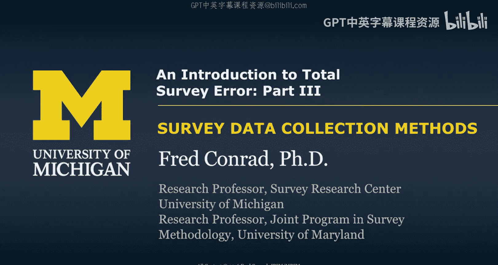
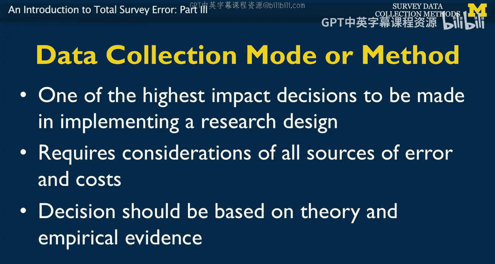

# 密歇根大学《调查数据收集和分析（2-6：方法、社调问卷设计、抽样、缺失数据、分析）｜Survey Data Collection and Analytics》 p04 3_1.2.3 总调查误差.zh_en -BV1fw4m1e7Zh_p4-

Welcome back， the TSE framework keeps designers focused on all the sources of error that can affect the estimates arising from the survey。

Here's just another way of packaging the different sources of error that we've talked about。

 errors of which together comprise total survey error。

Errors of non observation include a coverage sampling and nonresse so these are error errors of non observation in the sense that these are not related to the individual answers that respondents give。

 but errors of observation that category really consists of measurement error。

And measurement error can be due to a number of sources， the questionnaire， the question wording。

 may be difficult or the topic may be sensitive， the mode of data collection matters can contribute to measurement error again to return to the issue of interviewer versus self administration of questions on sensitive topics。

Whether or not an interviewer is involved and to the extent to which the interviewer contributes error。

And the respondent ultimately is the source of the data that is collected and recorded。

 and if the respondent has difficulty or is inattentive or is disingenuous or is looking to minimize their effort。

 all of these can contribute to measurement error。And as I said earlier。

 we won't say much about errors of processing like editing coding imputation。

 but these can all contribute to survey errors， so by editing we generally mean adjusting an answer that seems inconsistent or implausible based on other answers。

By classifying responses that are given in the respondent's own words。

 the coding process can be inaccurate because coders themselves are humans or even if it's done automatically the automated coding rules are created by humans an imputation which is the statistical process of calculating or estimating missing data this too can introduce error because it may not always perfectly reproduce the data that would have been provided if all the data were available so total survey error and design we design each component of a survey to minimize the error in inherent in that component so for example using mail questionnaires or face- to-face interviews rather than the web to reduce coverage error in the survey of the general population so as you'll recall if not everybody has internet access and those who lack internet access differ on the attributes or some of the attributes one is hoping to measure。

In the survey， we have coverage errors， if this is a concern。

 if we think that the questions we are going to ask are likely to be affected by undercover of the population。

 then it might make sense to use a different mode where coverage is less of an issue。

 so face to face interviews or mail make use of addresses and most members of the population have an address。

Or we might design a shorter questionnaire for telephone than mail because in telephone people are under time pressure and we might contact them at a time that they're willing to answer a few questions。

 but not all the questions we want to ask them。Both of these might reduce measurement error。

Or on the telephone respondents need to remember the entire question。

 so designing shorter questions for the phone can help。

These are examples of tradeoffs and so if we have to design a shorter questionnaire。

 we don't get to ask some of the questions we might have wanted to ask。

 but it does mean that we won't lose respondents and therefore increase what are missing data。

So informed and explicit trade offs is really ubiquitous throughout the design of data collection。

The success of the total survey error approach or framework depends on good information on cost and errors and we don't always have that。

 this information can be both theoretical and empirical。

 so for example we talked about interviewer administration versus self-ad where the presence of an interviewer is likely to encourage respondents to provide more socially desirable answers and the answers which present them in a more favorable light。

 that's something that's really theoretical there's relatively little empirical evidence to support that there are some studies which have shown that the differences between self-adist and interviewer administration are in fact related to the true value。

 but we generally don't know that so it's theoretical， but sometimes we have empirical evidence。

We may have evidence from previous surveys that we can be brought to bear in evaluating costs and errors of the approach we're considering and the evidence may be direct or indirect。

Survey errors can arise from many sources， the topic， the available funding。

 because this restricts our ability to reduce error if we can't afford。

 for example interviewers in a case where interviewers might have been able to help explain the intentions behind a question。

 we will have more error as a result， the sampling frame may be incomplete， again。

 not everybody has internet access for a web survey or an email address through which we can contact them。

The data collection mode， of course， this is really one of our main topics can affect error in ways we've discussed interviewer training can affect error if interviewers aren't trained。

 for example， to probe thoroughly， we might have more variable error or bias。

The data collection mode defines at least to some extent the types and levels of error that can occur and the mode that's chosen can significantly affect the quality of the results An example is to reduce sampling error we might increase sample size for a fixed cost so we'll pay more for more cases depending on the mode and that's an informed tradeoff。

Or to reduceunmi spots， we might opt for face to face instead of telephone interviews。

 face to face interviews are more expensive， but if we go into it with our eyes wide open。

 there won't be surprises。So， in sum。The notion of total survey errors guides our decisions about survey design。

 data collection design。The TSE framework is useful for understanding the potential impact。

Of design decisions on survey errors。And together with costs。

Should be an explicit part of the design decision process。

So data collection mode or method is one of the highest impact decisions one can make in implementing a research design。

It requires consideration of all the sources of error and costs that we've been discussing。

And it should be based on both theory and empirical evidence。In our next segment。

 we'll turn to mode and explore just what we mean by mode and how this is related to the impact on survey error and survey costs。

