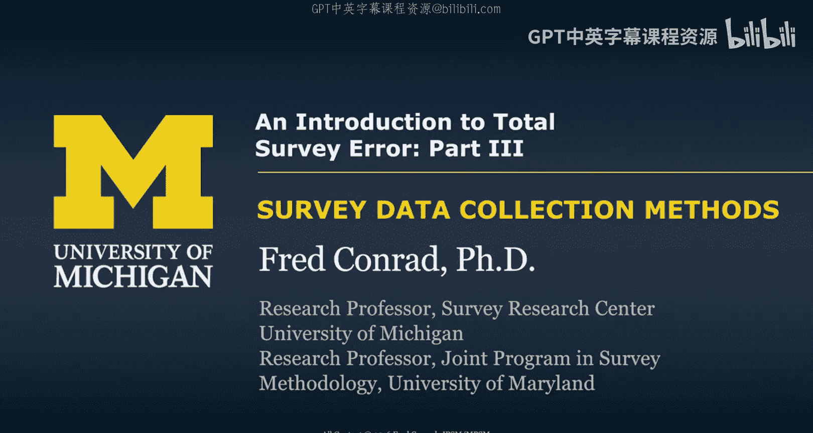
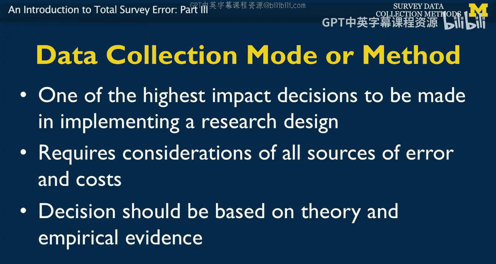

# 调查数据收集与分析：P04：总调查误差框架 🎯

在本节课中，我们将要学习总调查误差框架。这个框架帮助调查设计者全面关注所有可能影响调查估计值的误差来源。我们将了解误差的主要类别、具体来源，以及如何在设计调查时权衡取舍以最小化误差。

## 总调查误差框架概述

总调查误差框架旨在让设计者聚焦于所有可能影响调查估计值的误差来源。它是对我们讨论过的各种误差来源的另一种系统性归纳，这些误差共同构成了总调查误差。

## 误差的主要类别

总调查误差主要分为两大类：非观测误差和观测误差。

### 非观测误差

非观测误差与受访者给出的具体答案无关，主要包括以下三种：
*   **覆盖误差**：抽样框未能完整覆盖目标总体。
*   **抽样误差**：由于仅调查样本而非全体而产生的误差。
*   **无应答误差**：未能从所有被选中的样本单位获得回答。

### 观测误差

观测误差主要就是**测量误差**。测量误差可能由多个来源导致，上一节我们介绍了非观测误差，本节中我们来看看观测误差的具体构成。

以下是测量误差的主要来源：
*   **问卷与问题措辞**：问题可能难以理解，或涉及敏感话题。
*   **数据收集模式**：数据收集的方式很重要。例如，在敏感话题上，采访员面访与受访者自填问卷会产生不同的测量误差。
*   **采访员**：采访员是否参与，以及其在多大程度上引入误差。
*   **受访者**：受访者是数据的最终提供者。如果受访者有理解困难、不专注、不诚实或试图最小化自己的回答努力，所有这些都会导致测量误差。

## 数据处理误差

除了上述误差，数据处理过程也可能引入误差。虽然我们不会深入讨论，但了解它们的存在很重要。
*   **编辑**：指基于其他答案，对看起来不一致或不可信的答案进行调整。
*   **编码**：将受访者用自己的话给出的回答进行分类。编码过程可能不准确，因为编码员是人，或者即使自动编码，其规则也是人制定的。
*   **插补**：这是计算或估计缺失数据的统计过程。插补也可能引入误差，因为它可能无法完美复现如果所有数据都可用时本应提供的数据。

## 调查设计中的权衡

在总调查误差框架下，我们设计调查的每个组成部分，以最小化该部分固有的误差。这通常涉及权衡。

例如：
*   为减少对普通人群调查的覆盖误差，可能使用邮寄问卷或面对面访谈，而非网络调查。因为并非所有人都有互联网接入，而缺乏接入的人群在某些待测属性上可能存在差异。
*   如果担心问题可能受人口覆盖不足的影响，那么使用覆盖问题较小的模式（如利用地址的邮寄或面访）可能更有意义。
*   为电话调查设计比邮寄更短的问卷，因为电话中人们有时间压力。这可能会减少测量误差和无应答。
*   在电话中，受访者需要记住整个问题，因此设计更短的问题会有所帮助。

这些是权衡的例子。如果我们不得不设计更短的问卷，就意味着我们无法询问所有想问的问题，但这样做可以避免失去受访者，从而减少缺失数据。因此，在数据收集设计中，知情且明确的权衡无处不在。

## 成功应用TSE框架的条件

总调查误差方法的成功应用依赖于关于成本和误差的良好信息，但我们并不总是拥有这些信息。这些信息可以是理论性的，也可以是经验性的。

*   **理论证据**：例如，采访员在场可能鼓励受访者提供更符合社会期望的答案，这是一个理论观点。
*   **经验证据**：我们可能从以往的调查中获得证据，用于评估所考虑方法的成本和误差。证据可以是直接的，也可以是间接的。

## 误差的来源与模式选择的影响

调查误差可能来自许多来源：调查主题、可用资金（这限制了我们减少误差的能力）、抽样框的完整性、数据收集模式、采访员培训等。

数据收集模式至少在一定程度上定义了可能发生的误差类型和水平。所选择的模式会显著影响结果的质量。

以下是一些基于TSE框架的设计决策例子：
*   为减少抽样误差，我们可能在固定成本下增加样本量。这是一个知情的权衡。
*   为减少无应答，我们可能选择面对面访谈而非电话访谈。面对面访谈更昂贵，但如果我们事先清楚这一点，就不会有意外。

## 总结与下节预告

本节课中我们一起学习了总调查误差框架。总调查误差的概念指导着我们关于调查设计和数据收集设计的决策。TSE框架有助于理解设计决策对调查误差的潜在影响，并且与成本一起，应成为设计决策过程中明确的一部分。

数据收集模式或方法是实施研究设计时所能做出的影响最大的决策之一。它需要考虑我们讨论过的所有误差来源和成本，并且应基于理论和经验证据。

在下一节中，我们将转向“模式”这一主题，深入探讨模式的具体含义，以及它如何影响调查误差和调查成本。