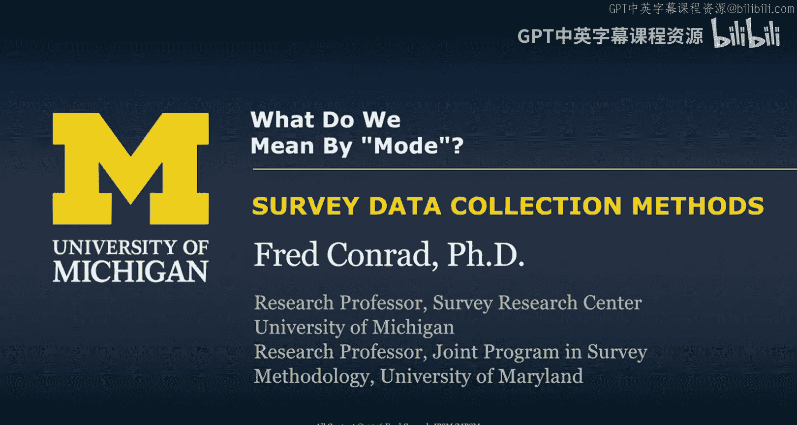
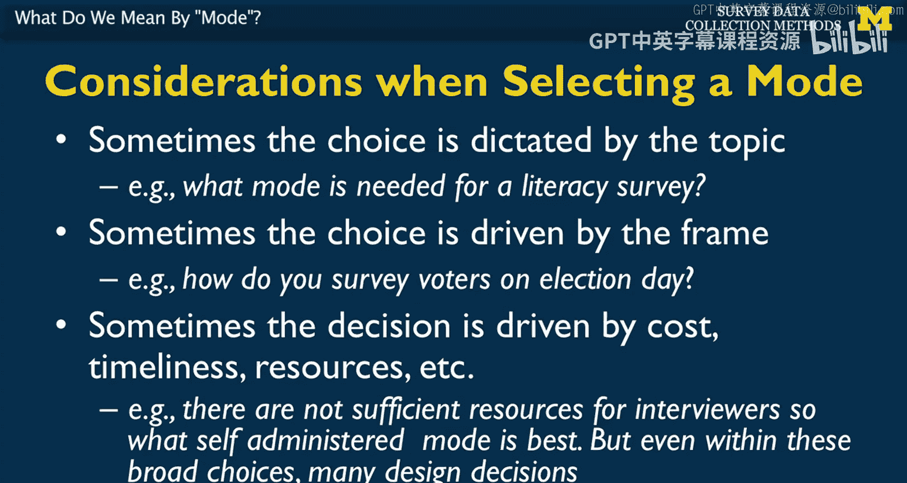

# 密歇根大学《调查数据收集和分析（2-6：方法、社调问卷设计、抽样、缺失数据、分析）｜Survey Data Collection and Analytics》 p05 4_1.3.1 调查模式定义.zh_en -BV1fw4m1e7Zh_p5-

We've used the term mode a number of times so far and we haven't really defined it。

 so the current topic is really what do we mean by mode and how do we select a mode as researchers in addition in a number of designs。

 mixed mode designs which we'll discuss shortly。It sometimes makes sense to give the respondents a choice of how they answer questions。

 and so we'll spend a little time in the second part of this topic discussing respondent mode choice。

 the pros and cons that that approach brings。So a way of thinking about mode that I have found useful is as a combination of a medium and an agent。

 so by medium we mean sort of the channel of communication。

 voice or text on a screen or text on paper or video。

 these are all different media that can comprise part of a mode。

And the agent involved in that mode really in delivering the question， so agent。

 if there's an interviewer， then the interviewer is the agent that pairs with one of those media in what are known as selfaddministered mode。

 the only agent is the respondent， the respondent is self-addministering the questions。

 selfadmin often increasingly involves automated interviewing systems。

 although certainly mailed out paper questionnaires are self-addministered。So taking this approach。

 the kinds of modes that we can derive are， for example。

 an interviewer administering a questionnaire by voice。

 so a telephone interviewer that is voice only or a respondent self aministering a voice interview well what would that mean well a so-called robo call in which and kind of unsolicited phone call comes in and the respondent answers it and interacts with a computer。

 this is sometimes called as we'll see， interactive voice response？

If an interviewer administers a paper questionnaire， then we have。That combination。

 a respondent may self administer a paper questionnaire and so on so the combinations can actually get quite large until recently there were only a few main modes of data collection these three really face to face or personal visit surveys in which an interviewer conducts an interview often in the home of a respondent in the household of a respondent but also in can be in a workplace for an organization or business survey a paper questionnaire is mailed to respondents so a mail or postal survey and telephone surveys traditionally this has meant landline surveys。

 increasingly mobile phones are becoming part of telephone surveys as well in some cases they comprise the majority of the devices respondents use。

In the last few years， there has been an explosion of methods。

 most notably online or web surveys or web data collection。

And there are a number of new modes that are really variance on existing modes。

 so mobile phone surveys are really very similar to landline telephone surveys。

 but they have some different considerations involved for one thing the respondents are mobile or can be mobile what's known as mobile web。

 so these are like web surveys， these are web surveys which the questionnaires displayed on a browser or within an app on a smartphone and again many properties are similar to those of what we can nothing of as traditional web survey。

 but there are some new attributes like small screen for example。

So if we pair agent and medium we can describe a number of the existing methods this way and this also gives us a chance to talk about some of the kind of abbreviations that are used by survey researchers and survey methodologists so if paper is self-addministered。

 the respondent completes a paper questionnaire then this is what we mean by a mail questionnaire but sometimes you'll see the acronym SQ for self-administered questionnaire there are other kinds of self-administered questionnaires that involve computers but they have their own names so SQ generally means a selfadministered paper questionnaire if the questionnaire is displayed on a computer but is self-administered we have web questionnaires as we just discussed TdeE refers to toucht data entry so the kind of robo call I was mentioning before typically involves。

Responses that are entered using the keypad on the telephone， whether it's a landline or mobile。

 IVR or interactive voice response is often the same thing as touch tone data entry。

 but there are speech versions of IVR in which the respondent speaks the answer and the system recognized is programmed to recognize the speech of the respondent。

 speech IVR is less common than touch toneone IVR， but is becoming increasingly increasingly common。

Cassie stands for Comp assististed self interviewterviewing。

 so this mode is used in combination with interviewer administration personal interviewer or faceto-face interviewer administration but it's used for the sensitive questions in the questionnaire so that after asking non-sensitive questions。

 the interviewer will give the device usually a laptop to the respondent to self-administer the sensitive questions and the idea being that respondent will feel more able to answer honestly about questions whose answers are potentially embarrassing if the interviewer is not only not asking the questions but unaware of the answers ACassie refers to essentially the same mode but instead of just displaying the questions on the screen textually they can also be or just be presented in spoken form so that the respondent is listening to recorded presentation audio recording。

presentation of the question， so aCassie or audio cassie refers to this kind of situation just generally for the sensitive questions and the interviewer administers the nonsitive questions in a face to face interview。

If an interviewer is administering the questionnaire。

 this is either done in existing kind of traditional modes via telephone or face to face。

 interviewer administered telephone surveys can actually involve a paper questionnaire。

 the interviewer could read the questions from paper and handwrite the answers onto the paper that the respondent provides。

 but more typical these days that a computer displays the questionnaire to the interviewer who reads the questions out loud to the respondents over the telephone and enters the answers that the interviewer hears from the respondent into the paper into the into the computer so Kaddy is the acronym that's used to describe that。

 but it's kind of if you hear telephone interview it generally means Kaddy at this point in history。

And a face to face or personal interview can again involve a paper questionnaire。

 but more typically some sort of mobile computing device。

 a laptop or a tablet is used for the display of questions which interviewers then read out loud。

 and then the interviewers enter the respondents answers directly into the device。

Those were the kind of existing modes， classic modes there are a number of modes on the horizon。

 I mentioned mobile web can be browser based or app based on a smartphone generally。

 SMS or text messaging interviewing is increasingly common especially in some parts of the world where for example。

 in the developing world where texting is more common than speaking on a mobile phone。

 these can be self- aministered or interview or administered and coverage can be quite high。

 so as I said this mode is growing fast in the developing world faster than in say North America and Western Europe。

Video mediated interviews using desktop video or video that runs on computers is increasingly common。

 so well increasingly viable Skype or Google Hangout or FaceTime or blue jeans or there's a long list of video tools that would lend themselves well to this kind of interviewing。

It's actually not widely used， as I said it's becoming increasingly viable but it's not widely used yet I suspect that it will grow rapidly because it may offer many of the benefits of face- to-face interviewing。

 which have to do with increased response rates and interviewer's ability to explain what the questions mean without the cost of sending an interviewer to a location。

 the travel costs and so the research questions there really are how similar is it to face- to-face interviews。

 does it maintain the benefits without perhaps some of the cost that may lead respondents to shade the truth when answering sensitive questions is that diminished when it's mediated by video when there's some distance between。

Interviewer and the respondent。And virtual interviewers are able to be used。

 these are computer animated interviewing agents that can be either autonomous if there's kind of artificial intelligence behind them or they can be recorded so that they're not actually making decisions on the fly and presenting content differently to different respondents again these are increasingly viable and they're used to some degree but not widely used。

 so there is a proliferation of modes in progress as we speak， which means that as researchers。

 the survey researchers we need to be explicit about the particular modes that we' using their implementations because there are a lot of variance and the particular implementation can affect the results so being precise about the implementation of the mode is key so that if someone wanted to replicate the study they could try to do that using exactly the same mode that you have used。

The mode proliferation underway makes it harder to make broad generalizations about mode in part because there just aren't the studies in the literature that are needed to speak in an informed way about this。

 so we really need more theory to inform our expectations about the effects of modes and increasingly combinations of modes are being used。

 so there are mixed mode surveys which we'll cover in an upcoming topic and there are hybrid designs that also combine different modes。

Again， thinking about what Mod means， there are a number of dimensions， it's just another way of。

Thinking getting one's head around the concept of mode So the degree of interviewer involvement is a dimension is the interviewer involved in the entire data collection process If so this is probably computer assisted personal interviewing is the interviewer present but the respondent is self aministering a part of the questionnaire If so this is probably a cassie or acassie interview if there's no interviewer present。

 this could be a web questionnaire for example， another dimension is the degree of contact that the interviewer has with respondent。

 is it face to face I it indirect or mediated by telephone or mail or is there no contact with the respondent So the interviewer may be directly observing the data that are being collected for example。

 in a price survey an interviewer may be collecting price data in retail outlets without interacting with respondents There's no self-report involved there or records maybe be the source。

Of information as opposed to self reports。And then another dimension is the medium of communication or the channel of questioning。

 which can differ from the channel of responding， so is the medium oral only which is the case。

 for example， in a telephone survey where there's no visual information is it oral and visual so a face to face interview or a video mediated interview。

 the visual information in a face-to-face interview can be not only what the respond see of the interviewer but also materials that the interviewer printed materials that the interviewer provides to the respondent。

 for example， what are known as show cards which could list all of a large set of response options for a question to reduce the respondent's memory burden as the interviewer reads those response options。

A visual only survey would be a mail survey where there's just textual information。

 but no spoken information， no auditory information。

So there really are two approaches to data collection method or the mode。

 so one is selecting the mode if the researcher is lucky enough to be in a position to do that so this becomes a question of what's the most appropriate mode or method for particular research question so often there are constraints such as resources and available time and the frame。

 what kind of information does the frame contain， is it have phone numbers does it have street addresses the topic does it involve sensitive questions is it about literacy。

 for example， or if they're likely to be a in literacy in which case spoken interviews would make more sense。

That's one approach， but oftentimes researchers， members of a research team will find themselves in a situation where the mode has actually been chosen and for one reason or another maybe historical reasons and so the task then is to kind of maximize the benefits of the mode that's already been chosen so one would have to think about okay what are the implications for survey error and survey costs given a particular mode what mode effects are likely and how can we overcome them。

 how can we maximize the benefits of a particular mode。

So the kinds of considerations a researcher would want to take into account when selecting a mode are what is the topic。

 so as I said， a literacy survey is probably not ideally administered in a textual format that requires literacy。

What kind of information is in the frame so how do you survey voters on Ection day when you don't really have a frame that lists all of the voters at a particular location。

 probably an intercept study or what are known as exit polls is appropriate where every inth voter who leaves the voting location is interviewed sometimes the decision really is about resources。

 cost， timeliness and other priorities， so for example there may not be sufficient resources to pay for interviewers。

 interviewers are expensive especially for face to face studies where travel involved。

And so in those cases， self administration is ideal， but what self administered mode is best。

 there are a number of them paper。

And even once these broad choices are made， there are many design decisions that involve the particular questionnaire or the particular study。

 so there's a lot that goes into the selection or choice of a mode by the researcher。

There's another sense of mode choice that involves giving the respondent the choice or requiring the respondent to determine the mode in which they will provide their data。

 their answers， and there pros and cons to respondent mode choice that that are becoming known almost as we speak。

 so the second part of this topic will focus on respondent mode choice and we'll turn to that next。

