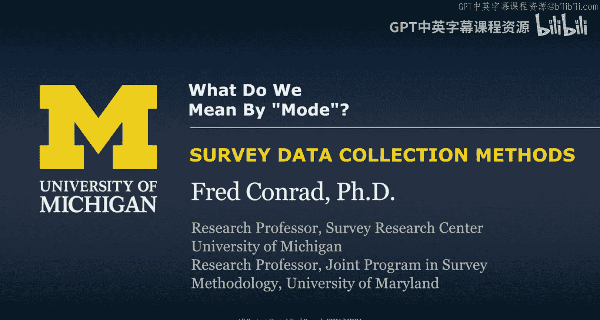
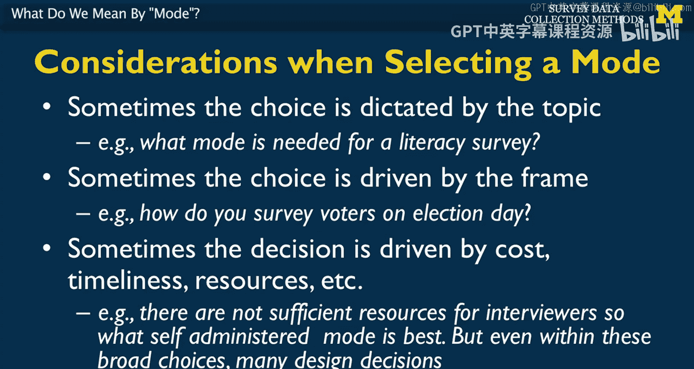

# 调查数据收集与分析：2-6：方法、社调问卷设计、抽样、缺失数据、分析：4_1.3.1 调查模式定义 📚

在本节课程中，我们将学习调查模式的定义、分类以及如何选择。我们还将探讨一种特殊的设计——让受访者选择回答模式，并分析其优缺点。

## 什么是调查模式？🔍

到目前为止，我们已经多次使用“模式”这个词，但尚未给出明确定义。本节的核心就是阐明“模式”的含义，并讨论研究人员如何选择调查模式。此外，在某些设计中，混合模式设计（我们稍后会讨论）很有意义，有时让受访者选择回答方式也是合理的。因此，本主题的第二部分将讨论受访者模式选择及其带来的利弊。

一种有用的思考方式是将模式视为**媒介**和**代理**的组合。

*   **媒介**指的是沟通渠道，例如声音、屏幕上的文字、纸上的文字或视频。这些都是构成模式一部分的不同媒介。
*   **代理**则指在模式中负责传递问题的角色。如果存在访问员，那么访问员就是与某个媒介配对的代理。在所谓的**自填模式**中，唯一的代理就是受访者本人，由受访者自行回答问题。自填模式越来越多地涉及自动化访问系统，当然，邮寄的纸质问卷也属于自填式。

## 模式的组合与分类 📊

采用这种组合思路，我们可以衍生出多种模式。例如：
*   访问员通过语音管理问卷，即电话访问员（仅语音）。
*   受访者自行完成语音访问，例如所谓的“机器人电话”，即由计算机系统拨打电话，受访者与之互动。
*   如果访问员管理纸质问卷，那就是一种组合。
*   受访者自行填写纸质问卷，等等。

直到最近，数据收集的主要模式只有少数几种：
1.  **面对面或入户访问**：访问员进行访问，通常在受访者家中，也可在工作场所进行组织或商业调查。
2.  **邮寄或邮政调查**：将纸质问卷邮寄给受访者。
3.  **电话调查**：传统上指固定电话调查。移动电话也越来越多地用于电话调查，在某些情况下甚至成为受访者使用的主要设备。

近年来，方法数量激增，最显著的是**在线或网络调查**。此外，还有许多新模式，它们本质上是现有模式的变体：
*   **移动电话调查**：与固定电话调查非常相似，但涉及一些不同的考虑因素，例如受访者可能处于移动状态。
*   **移动网络调查**：类似于网络调查，问卷通过智能手机上的浏览器或应用程序显示。其许多属性与传统网络调查相似，但也有一些新特性，例如屏幕较小。

## 常见模式与缩写 📝

如果我们配对代理和媒介，可以这样描述许多现有方法，同时也有机会讨论调查研究人员和方法学家使用的一些缩写：
*   **SQ**：如果纸质问卷是自填的，即受访者完成纸质问卷，这就是我们所说的邮寄问卷。SQ 通常指自填式纸质问卷。
*   **Web问卷**：如果问卷在计算机上显示但由受访者自填，就是我们刚刚讨论的网络问卷。
*   **TDE / IVR**：TDE 指按键式数据输入，即之前提到的“机器人电话”，通常涉及受访者使用电话（无论是固定电话还是移动电话）上的按键输入回答。IVR 或交互式语音响应通常与按键式数据输入相同，但也有语音版本的 IVR，即受访者说出答案，系统被编程为识别受访者的语音。语音 IVR 不如按键式 IVR 常见，但正变得越来越普遍。
*   **CASI**：代表计算机辅助自填访问。这种模式与访问员管理（个人访问或面对面访问）结合使用，但用于问卷中的敏感问题。在询问非敏感问题后，访问员会将设备（通常是笔记本电脑）交给受访者，让其自行回答敏感问题。这样做的理念是，如果访问员不仅不问这些问题，而且不知道答案，受访者会更愿意如实回答可能令人尴尬的问题。
*   **ACASI**：本质上与 CASI 相同，但问题不仅以文本形式显示在屏幕上，也可以或仅以语音形式呈现，即受访者收听预先录制的音频问题。ACASI 或音频 CASI 指的就是这种情况，通常用于敏感问题，而访问员则在面对面访问中询问非敏感问题。
*   **CATI**：如果访问员管理问卷，可以通过电话或面对面等传统模式进行。访问员管理的电话调查实际上可以涉及纸质问卷，访问员可以从纸上读取问题，并将受访者提供的答案手写在纸上。但如今更典型的是，计算机向访问员显示问卷，访问员通过电话向受访者大声读出问题，并将从受访者那里听到的答案输入计算机。CATI 就是用来描述这种模式的缩写，但如果你听到“电话访问”，在当今通常就指 CATI。
*   **CAPI**：面对面或个人访问同样可以涉及纸质问卷，但更典型的是使用某种移动计算设备（笔记本电脑或平板电脑）来显示问题，访问员然后大声读出，并直接将受访者的答案输入设备。

## 新兴模式与未来展望 🚀

以上是现有的经典模式。还有一些即将出现的新模式：
*   **移动网络**：可以基于智能手机的浏览器或应用程序。
*   **SMS或短信访问**：越来越普遍，特别是在世界某些地区（例如发展中国家），发短信比用手机通话更常见。这可以是自填式或访问员管理式，覆盖率可能很高。正如所说，这种模式在发展中国家增长迅速，快于北美和西欧。
*   **视频媒介访问**：使用桌面视频或计算机上运行的视频越来越普遍。Skype、Google Hangout、FaceTime、BlueJeans 等一长串视频工具都很适合这种访问。虽然越来越可行，但尚未广泛使用。预计它会快速增长，因为它可能提供面对面访问的许多好处（如提高回答率、访问员能够解释问题含义），而无需承担派遣访问员到某地的差旅成本。相关研究问题在于它与面对面访问的相似度如何，是否能在保持优点的同时，减少可能导致受访者在回答敏感问题时隐瞒真相的成本（当通过视频媒介、访问员与受访者之间存在一定距离时，这种成本是否会降低）。
*   **虚拟访问员**：可以使用计算机动画访问代理，它们可以是自主的（背后有人工智能），也可以是预先录制的（并非实时决策或向不同受访者呈现不同内容）。这些也越来越可行，并在一定程度上使用，但尚未广泛使用。

## 模式选择与设计考量 ⚖️

正如我们所说，模式正在激增，这意味着作为调查研究人员，我们需要明确我们所使用的特定模式及其实现方式，因为存在很多差异，特定的实现方式会影响结果。因此，精确描述模式的实现方式至关重要，以便如果有人想复制研究，可以尝试使用与你完全相同的模式。

正在进行的模式激增使得对模式进行广泛概括变得更加困难，部分原因是文献中缺乏必要的研究来以知情的方式讨论这一点。因此，我们确实需要更多的理论来指导我们对模式影响的预期。此外，越来越多地使用模式的组合，因此出现了我们将在后续主题中讨论的**混合模式调查**，以及结合不同模式的**混合设计**。

再次思考“模式”的含义，可以从多个维度来理解这个概念：
*   **访问员参与程度**：访问员是否参与整个数据收集过程？如果是，这可能是计算机辅助个人访问。访问员在场，但受访者自行完成部分问卷？如果是，这可能是 CASI 或 ACASI 访问。如果没有访问员在场，例如，这可能是网络问卷。
*   **访问员与受访者的接触程度**：是面对面、间接的（通过电话或邮件媒介），还是与受访者没有接触？例如，在价格调查中，访问员可能在零售店收集价格数据，而不与受访者互动。那里不涉及自我报告，或者信息来源可能是记录而非自我报告。
*   **沟通媒介或提问渠道**：这可能与回答渠道不同。例如，在电话调查中，媒介是纯口头的（没有视觉信息）。在面对面访问或视频媒介访问中，媒介是口头和视觉的。面对面访问中的视觉信息不仅包括受访者看到的访问员，还包括访问员提供给受访者的印刷材料，例如所谓的“展示卡”，它可以列出问题所有的大量回答选项，以减少访问员读出这些选项时受访者的记忆负担。纯视觉调查则是邮寄调查，只有文本信息，没有口头或听觉信息。

## 数据收集方法或模式的两种路径 🛤️

关于数据收集方法或模式，实际上有两种路径：
1.  **选择模式**：如果研究人员有幸能够这样做，那么问题就变成了：对于特定的研究问题，什么是最合适的模式或方法？通常存在一些限制，如资源、可用时间、抽样框（包含什么信息？有电话号码吗？有街道地址吗？）、主题（涉及敏感问题吗？是关于读写能力的吗？例如，如果可能存在读写能力问题，那么口头访问更有意义）。
2.  **优化既定模式**：但很多时候，研究团队的成员会发现模式实际上已经被选定了（可能由于历史原因或其他原因）。那么任务就是最大化已选定模式的好处。因此，必须思考：给定特定模式，对调查误差和调查成本有何影响？可能出现哪些模式效应？我们如何克服它们？如何最大化特定模式的好处？

研究人员在选择模式时需要考虑的因素包括：
*   **主题是什么**：如前所述，读写能力调查可能不适合以需要读写能力的文本格式进行。
*   **抽样框中包含什么信息**：例如，如何在选举日调查选民，当你并没有一个列出特定地点所有选民的抽样框时？可能拦截研究或所谓的“出口民调”是合适的，即采访每第 N 位离开投票地点的选民。
*   **资源、成本、及时性及其他优先级**：有时决定真的关乎资源。例如，可能没有足够的资源支付访问员费用，访问员很昂贵，尤其是涉及差旅的面对面研究。在这种情况下，自填式是理想的，但哪种自填模式最好？有多种选择：纸质、网络等。

即使做出了这些广泛的选择，还有许多涉及特定问卷或特定研究的设计决策。因此，研究人员在选择或决定模式时需要考虑很多因素。

## 受访者模式选择 🤔

模式选择的另一种含义是让受访者选择或要求受访者决定他们提供数据（答案）的模式。受访者模式选择的利弊正逐渐为人所知。因此，本主题的第二部分将聚焦于受访者模式选择，我们接下来将转向这部分内容。

---

**本节课总结**：在本节课中，我们一起学习了调查模式的核心定义，即它是**媒介**与**代理**的组合。我们详细介绍了从传统（如面对面、电话、邮寄）到现代（如网络、移动、视频）的各种调查模式及其常见缩写。我们还探讨了研究人员选择模式时需考虑的关键因素（如主题、资源、抽样框），并简要提及了让受访者选择模式的理念，为下一部分内容做了铺垫。理解模式的多样性及其影响，是设计高质量调查的基础。